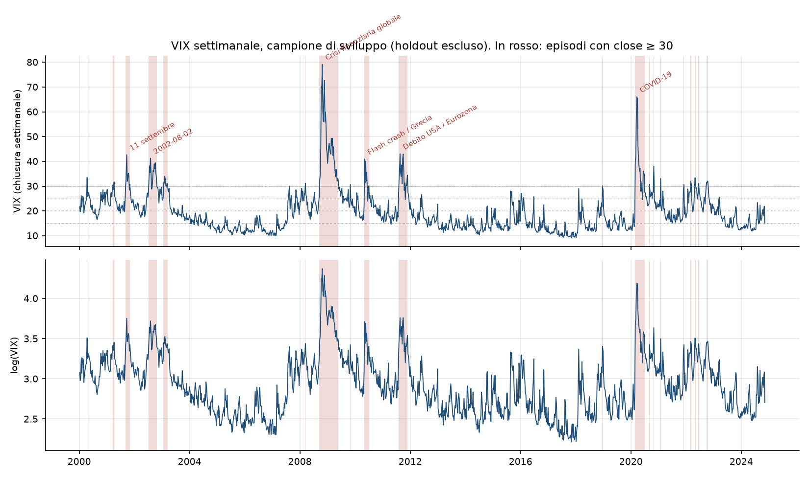
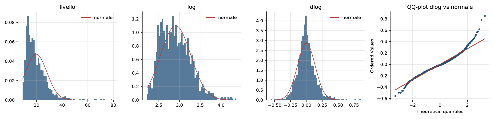
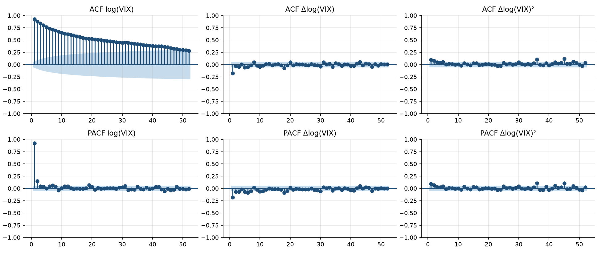
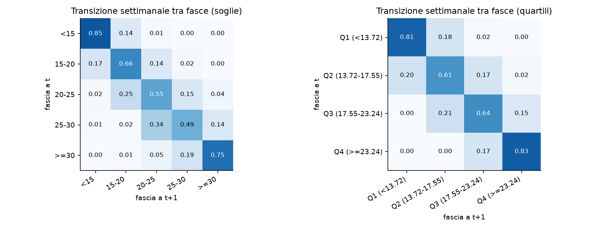
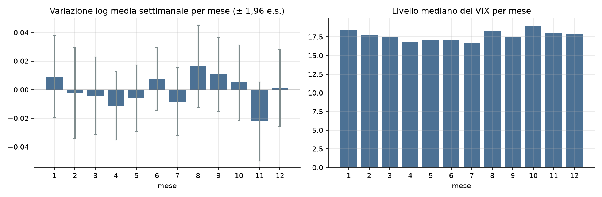
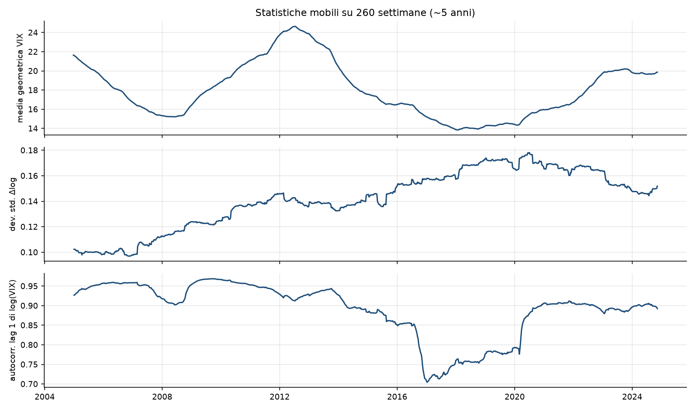
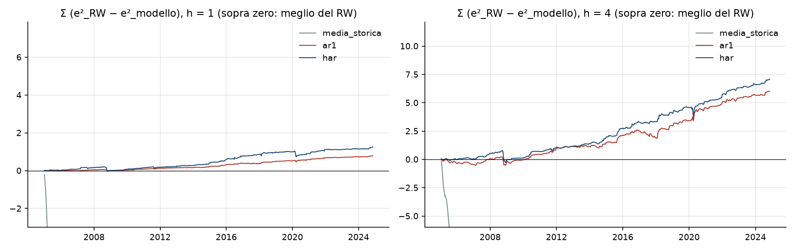
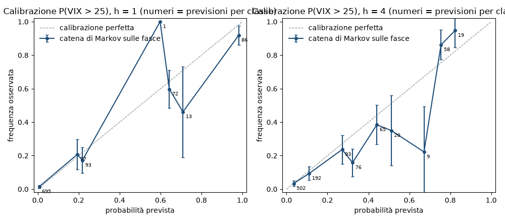

# Fase 0 — Fondamenta, audit dei dati, analisi esplorativa, baseline

*Report generato da `python -m src.run_phase0`. Ogni numero è letto dai file `reports/*.csv` e `reports/*.json`
prodotti dal codice; nessun valore è scritto a mano. Tutte le analisi usano solo il campione di sviluppo
(2000-01-07 → 2024-11-08, 1297 settimane): le ultime 104 settimane sono bloccate.*

## 1. Sintesi

1. **Dati.** Il file contiene barre settimanali OHLC del VIX: 1402 righe dal 2000-01-03 al 2026-11-12, senza settimane mancanti (0) né duplicati (0). Il target è la **chiusura** dell'ultima seduta della settimana.
2. **Anomalie segnalate, non corrette.** 1 settimana incompleta in coda (esclusa), 1 valore di `open` incoerente (2,58 il 2004-11-08), un salto sistematico tra chiusura e apertura successiva (mediana 3,1%).
3. **Campioni.** Sviluppo: 1297 settimane; holdout bloccato: 104 settimane (2024-11-15 → 2026-11-06), salvato a parte e mai letto dal codice di analisi.
4. **Distribuzione.** Il livello è molto asimmetrico (asimmetria 2,23, curtosi in eccesso 8,28); il logaritmo lo è molto meno (0,68; 0,45). Le variazioni log settimanali hanno code pesanti (curtosi in eccesso 3,23) e asimmetria positiva (0,65).
5. **Stazionarietà e persistenza.** ADF rifiuta la radice unitaria su livello, log e variazioni; KPSS non rifiuta la stazionarietà al 5% (per il log è al limite: p = 0,050). Il log-VIX è stazionario ma molto persistente: φ = 0,926, half-life ≈ 9,0 settimane, media di lungo periodo ≈ 18,3 punti.
6. **La persistenza non è stabile.** La half-life stimata per quinquenni va da 3,0 a 20,1 settimane.
7. **Struttura oltre l'AR(1).** Le variazioni log hanno autocorrelazione a lag 1 pari a -0,180, molto più negativa di quella implicata da un AR(1) puro (-0,037): c'è una componente transitoria che rientra in fretta. Il clustering della volatilità delle variazioni è presente ma moderato (ACF lag 1 dei quadrati 0,098).
8. **Asimmetria della dinamica.** I rialzi sono meno frequenti (46,3% delle settimane) ma più ampi: 34 rialzi oltre +0,30 log contro 17 ribassi oltre −0,30. Nessuna stagionalità mensile rilevabile (Kruskal-Wallis p = 0,85).
9. **Baseline puntuali.** Il random walk è difficile da battere a 1 settimana: il modello tipo HAR ottiene R² fuori campione 5,6% (AR(1): 3,5%); a 4 settimane 11,7% e 10,0%. La media storica è nettamente peggiore del random walk.
10. **Baseline probabilistica.** Per P(VIX > 25) la catena di Markov ha Brier 0,062 a h = 1 e 0,092 a h = 4 (climatologia: 0,142 e 0,143), ma è poco informativa quando si parte dalle fasce intermedie 20–30.

## 2. Audit dei dati

### 2.1 Il file

| voce | valore |
|---|---|
| file | `data/raw/VIX_settimanale_2000-2026.csv` |
| sha256 | `bf67b3f19ef38827dd84ba1f2a4008cc439651a93328b9a42b6aab10dcbb76b5` |
| formato | CSV, separatore virgola, intestazione alla prima riga, codifica ASCII |
| colonne | `week_start` (str), `last_trading_day` (str), `open` (float64), `high` (float64), `low` (float64), `close` (float64), `trading_days` (int64), `note` (str) |
| tipo di valore | OHLC settimanale (open, high, low, close) + numero di sedute della settimana |
| righe | 1402 |
| intervallo `week_start` | 2000-01-03 → 2026-11-09 |
| intervallo `last_trading_day` | 2000-01-07 → 2026-11-12 |
| giorno di `week_start` | lun: 1402 |
| giorno di `last_trading_day` | lun: 1, gio: 43, ven: 1358 |
| sedute per settimana (`trading_days`) | 1 sedute: 1, 3 sedute: 2, 4 sedute: 211, 5 sedute: 1188 |
| ordinato per data | sì |
| settimane mancanti | 0 |
| duplicati (`week_start` / righe intere) | 0 / 0 |
| valori mancanti nelle colonne numeriche | 0 |
| valori non positivi | 0 |
| decimali (massimo) | 2 |

Ogni riga è una settimana di calendario che inizia di lunedì (`week_start`). `last_trading_day` è l'ultima seduta
della settimana: quasi sempre venerdì, giovedì quando il venerdì è festivo. **Giorno di riferimento adottato:**
la chiusura settimanale è datata a `last_trading_day` (colonna `date` dei file puliti).

### 2.2 Anomalie e casi particolari

- **Settimana incompleta.** 1 riga ha la colonna `note` valorizzata: settimana del 2026-11-09, nota «Settimana in corso (dati fino a gio 12/11/2026)», 4 sedute. Non è una chiusura settimanale definitiva: è **esclusa** dai file puliti (trasformazione T2).
- **OHLC incoerente.** 1 riga viola high ≥ max(open, close) e low ≤ min(open, close): settimana del 2004-11-08, open = 2,58 con low = 12,64, high = 14,48, close = 13,33. Ha l'aspetto di un errore di battitura nell'`open`. **Non è stato corretto**: la riga è marcata con `flag_ohlc_incoerente = 1`. La chiusura, unica colonna usata in questa fase, è coerente con le settimane vicine.
- **Salto chiusura → apertura.** ln(open_t / close_t−1) ha mediana 3,1% ed è positivo nel 80,2% delle settimane (escluso holdout). Un salto così sistematico suggerisce che `open` non sia confrontabile con la chiusura precedente (o che sia calcolato in modo diverso). In questa fase `open`, `high` e `low` non sono usati; prima di usarli serve un chiarimento sulla fonte.
- **Settimane corte.** 3 settimane hanno 3 sedute o meno: 2001-09-10 (1 sedute, ultima il 2001-09-10); 2007-01-01 (3 sedute, ultima il 2007-01-05); 2012-10-29 (3 sedute, ultima il 2012-11-02). Sono conservate e marcate con `flag_settimana_corta = 1`. La settimana del 2001-09-10 ha una sola seduta (lunedì) per la chiusura dei mercati dopo l'11 settembre.
- **Variazioni estreme.** 5 variazioni log settimanali della chiusura superano la soglia robusta (escluso holdout: |z robusto| > 5 su dlog(close), z = (x - mediana) / (1.4826 * MAD)). Coincidono tutte con episodi di mercato noti e sono **conservate**:

| week_start   | last_trading_day   |   close |   dlog_close |   z_robusto |
|:-------------|:-------------------|--------:|-------------:|------------:|
| 2007-02-26   | 2007-03-02         |  18.610 |        0.565 |       5.179 |
| 2010-05-03   | 2010-05-07         |  40.950 |        0.619 |       5.669 |
| 2014-12-08   | 2014-12-12         |  21.080 |        0.579 |       5.304 |
| 2015-08-17   | 2015-08-21         |  28.030 |        0.781 |       7.135 |
| 2020-02-24   | 2020-02-28         |  40.110 |        0.854 |       7.787 |

- **Intervalli dei valori (escluso holdout).** `open`: 2,58–79,13; `high`: 10,18–89,53; `low`: 8,56–65,10; `close`: 9,14–79,13.

### 2.3 Dataset puliti e trasformazioni

- T1. Lettura del CSV grezzo senza modifiche; `week_start` e `last_trading_day` convertite in date.
- T2. Rimozione delle righe con `note` valorizzata che indicano una settimana incompleta (settimana in corso): la chiusura non e' una chiusura settimanale definitiva.
- T3. Colonna `date` = `last_trading_day` (data in cui la chiusura settimanale e' osservabile); e' la data di riferimento di ogni osservazione.
- T4. Colonne derivate: `log_close` = ln(close); `dlog_close` = differenza prima di `log_close`.
- T5. Colonne di segnalazione (nessun valore viene corretto): `flag_ohlc_incoerente` (high < max(open, close) oppure low > min(open, close)); `flag_settimana_corta` (trading_days <= 3).
- T6. Divisione temporale: le ultime 104 settimane complete -> holdout (file separato, bloccato); tutte le precedenti -> dev. Il file clean e' l'unione dei due.

| file | righe | da | a | uso |
|---|---|---|---|---|
| `data/processed/vix_weekly_clean.csv` | 1401 | 2000-01-07 | 2026-11-06 | unione dei due seguenti |
| `data/processed/vix_weekly_dev.csv` | 1297 | 2000-01-07 | 2024-11-08 | unico file letto da analisi e baseline |
| `data/processed/vix_weekly_holdout.csv` | 104 | 2024-11-15 | 2026-11-06 | **bloccato** |

## 3. Analisi esplorativa (campione di sviluppo)

### 3.1 Serie storica ed episodi di stress



Un episodio di stress è definito come un periodo con chiusura ≥ 30 (periodi separati da al più 4 settimane sono uniti).
Ne risultano 20; i dieci con il picco più alto (le etichette sono descrittive, assegnate a mano in base alla data del picco):

| inizio     | fine       |   settimane_sopra_soglia | data_picco   |   picco_close | etichetta                 |
|:-----------|:-----------|-------------------------:|:-------------|--------------:|:--------------------------|
| 2008-09-19 | 2009-05-22 |                       36 | 2008-10-24   |         79.13 | Crisi finanziaria globale |
| 2020-02-28 | 2020-06-26 |                       14 | 2020-03-20   |         66.04 | COVID-19                  |
| 2011-08-05 | 2011-11-25 |                       15 | 2011-08-19   |         43.05 | Debito USA / Eurozona     |
| 2001-09-07 | 2001-11-02 |                        8 | 2001-09-21   |         42.66 | 11 settembre              |
| 2002-07-12 | 2002-10-25 |                       14 | 2002-08-02   |         41.29 |                           |
| 2010-05-07 | 2010-07-02 |                        6 | 2010-05-07   |         40.95 | Flash crash / Grecia      |
| 2020-10-30 | 2020-10-30 |                        1 | 2020-10-30   |         38.02 |                           |
| 2003-01-24 | 2003-03-14 |                        7 | 2003-02-07   |         34.01 |                           |
| 2000-04-14 | 2000-04-14 |                        1 | 2000-04-14   |         33.49 |                           |
| 2022-04-29 | 2022-05-06 |                        2 | 2022-04-29   |         33.40 |                           |

### 3.2 Distribuzioni



| serie   |    n |   media |   dev_std |   asimmetria |   curtosi_eccesso |    min |    q01 |    q05 |   mediana |    q95 |    q99 |    max |
|:--------|-----:|--------:|----------:|-------------:|------------------:|-------:|-------:|-------:|----------:|-------:|-------:|-------:|
| livello | 1297 |  19.684 |     8.442 |        2.229 |             8.284 |  9.140 |  9.810 | 11.228 |    17.550 | 34.816 | 49.528 | 79.130 |
| log     | 1297 |   2.908 |     0.363 |        0.678 |             0.450 |  2.213 |  2.283 |  2.418 |     2.865 |  3.550 |  3.902 |  4.371 |
| dlog    | 1296 |  -0.000 |     0.140 |        0.655 |             3.227 | -0.556 | -0.312 | -0.206 |    -0.009 |  0.231 |  0.413 |  0.854 |

- Il passaggio al logaritmo riduce l'asimmetria da 2,23 a 0,68 e la curtosi in eccesso da 8,28 a 0,45: giustifica il log come scala di lavoro. La normalità resta comunque rifiutata (Jarque-Bera) per tutte e tre le serie.
- Code delle variazioni log: il 1,00% delle osservazioni è oltre +3 deviazioni standard e il 0,46% oltre −3, contro lo 0,13% atteso per coda sotto normalità. La coda destra (rialzi) è più pesante della sinistra.
- Una variazione settimanale tipica è ampia: deviazione standard 0,140 in log, cioè circa il 14% del livello.

### 3.3 Stazionarietà

| serie   |   adf_stat |   adf_p |   adf_ritardi |   kpss_stat |   kpss_p |   kpss_ritardi |
|:--------|-----------:|--------:|--------------:|------------:|---------:|---------------:|
| livello |    -4.3360 |  0.0004 |            13 |      0.3872 |   0.0827 |             20 |
| log     |    -4.6275 |  0.0001 |             6 |      0.4621 |   0.0504 |             20 |
| dlog    |   -13.8958 |  0.0000 |            10 |      0.0139 |   0.1000 |             15 |

ADF (costante, ritardi scelti con AIC) rifiuta la radice unitaria per tutte le serie. KPSS (ipotesi nulla: stazionarietà attorno a una costante;
il p-value è tabulato solo tra 0,01 e 0,10) non rifiuta al 5%, ma per il log è al limite (p = 0,050).
Lettura: livello e log sono stazionari con ritorno alla media lento; non serve differenziare, ma la media di lungo periodo è stimata con molta incertezza.

### 3.4 Autocorrelazione e clustering



|    lag |   log |   dlog |   dlog_quadrato |   dlog_assoluto |
|-------:|------:|-------:|----------------:|----------------:|
|  1.000 | 0.926 | -0.180 |           0.098 |           0.129 |
|  2.000 | 0.879 | -0.034 |           0.080 |           0.117 |
|  3.000 | 0.837 | -0.044 |           0.048 |           0.096 |
|  4.000 | 0.801 |  0.006 |           0.041 |           0.076 |
|  8.000 | 0.697 |  0.049 |           0.013 |           0.029 |
| 12.000 | 0.623 |  0.012 |           0.033 |           0.050 |
| 26.000 | 0.473 | -0.013 |           0.004 |           0.020 |
| 52.000 | 0.283 |  0.003 |           0.035 |           0.020 |

(Banda al 95% sotto l'ipotesi di rumore bianco: ±0,054.)

- **log-VIX**: l'ACF decade lentamente (0,93 a lag 1, 0,62 a lag 12, 0,28 a un anno). Il decadimento è più lento di quello geometrico di un AR(1) con φ = 0,926 (che a lag 12 darebbe 0,40, a lag 52 0,02): la memoria è più lunga di quella di un AR(1).
- **Variazioni**: autocorrelazione a lag 1 negativa e significativa (-0,180); Ljung-Box a 4 ritardi Q = 46,2 (p < 0,001). Un AR(1) puro sul log implicherebbe solo -0,037. Insieme al punto precedente è la firma di due componenti: una persistente e una transitoria che rientra in 1–2 settimane.
- **Clustering**: i quadrati delle variazioni sono autocorrelati (lag 1: 0,098; Ljung-Box a 12 ritardi p = 0,001) e i valori assoluti di più (lag 1: 0,129). L'effetto esiste ma è contenuto: la «volatilità della volatilità» varia nel tempo, senza la persistenza tipica dei rendimenti azionari.

### 3.5 Mean reversion

Regressione AR(1) su log-VIX, x_t = a + φ·x_t−1 + ε (OLS, 1296 osservazioni):

| parametro | stima |
|---|---|
| φ | 0,9261 (e.s. 0,0105) |
| velocità di ritorno κ = −ln φ | 0,0768 per settimana |
| half-life = ln 0,5 / ln φ | 9,0 settimane (IC 95%: 7,0–12,6) |
| media di lungo periodo | 2,904 in log, cioè 18,3 punti VIX |
| dev. std. dei residui | 0,1372 |

Ogni settimana si chiude circa il 7,4% della distanza dalla media. La stima OLS di φ è distorta verso il basso
in campioni finiti, quindi la half-life vera è, semmai, un po' più lunga.

**Ritorno diverso sopra e sotto la media?** Stimando Δx_t = a + b⁺·(x_t−1 − μ)⁺ + b⁻·(x_t−1 − μ)⁻ si ottiene
b⁺ = -0,061 (half-life 11,0 settimane sopra la media) e
b⁻ = -0,093 (half-life 7,1 settimane sotto la media).
La differenza **non è statisticamente significativa** (t = 0,85, p = 0,39): con questi dati non si può affermare che la velocità di rientro dipenda dal lato.

### 3.6 Asimmetria della dinamica: i rialzi sono più rapidi dei ribassi?

| misura | rialzi | ribassi |
|---|---|---|
| quota di settimane | 46,3% | 53,5% |
| variazione log media | 0,109 | -0,095 |
| variazione log mediana | 0,077 | -0,075 |
| quantile estremo (95° / 5°) | 0,231 | -0,206 |
| quantile estremo (99° / 1°) | 0,413 | -0,312 |
| variazione massima | 0,854 | -0,556 |
| settimane oltre ±0,30 log | 34 | 17 |
| durata media di una serie consecutiva (settimane) | 1,64 | 1,89 |
| ampiezza media di una serie consecutiva (log) | 0,179 | -0,179 |

Sì, con una precisazione. Le settimane di ribasso sono più numerose e le serie di ribassi durano di più; i rialzi sono più
rari, più concentrati e con una coda molto più pesante. Le serie consecutive di rialzi e di ribassi hanno la stessa ampiezza
media: il VIX sale in meno tempo di quanto impieghi a scendere della stessa quantità. La differenza sta soprattutto nelle code;
le variazioni mediane sono quasi uguali.

Sugli 20 episodi di stress, definendo la «metà» come punto medio (in log) tra il minimo delle 26 settimane
precedenti e il picco: dall'ultima chiusura sotto la metà al picco passano in mediana 3,0 settimane
(media 3,6); dal picco al ritorno sotto la metà 4,0
(media 5,8). La salita è più rapida nel 50% degli episodi,
la discesa nel 30%. Sono pochi episodi: è un'indicazione, non una stima precisa.

### 3.7 Regimi

Fasce a soglie fisse (15 / 20 / 25 / 30):

| fascia   |   settimane |   frequenza |   n_periodi |   durata_media |   durata_mediana |   durata_massima |
|:---------|------------:|------------:|------------:|---------------:|-----------------:|-----------------:|
| <15      |         438 |        0.34 |          67 |           6.54 |                3 |               31 |
| 15-20    |         367 |        0.28 |         123 |           2.98 |                2 |               16 |
| 20-25    |         242 |        0.19 |         110 |           2.20 |                1 |               14 |
| 25-30    |         132 |        0.10 |          67 |           1.97 |                2 |                7 |
| >=30     |         118 |        0.09 |          29 |           4.07 |                1 |               36 |

Matrice di transizione settimanale (righe: fascia a t; colonne: fascia a t+1):

| da \ a   |   <15 |   15-20 |   20-25 |   25-30 |   >=30 |
|:---------|------:|--------:|--------:|--------:|-------:|
| <15      | 0.849 |   0.137 |   0.011 |   0.002 |  0.000 |
| 15-20    | 0.166 |   0.665 |   0.144 |   0.022 |  0.003 |
| 20-25    | 0.021 |   0.248 |   0.545 |   0.149 |  0.037 |
| 25-30    | 0.008 |   0.015 |   0.341 |   0.492 |  0.144 |
| >=30     | 0.000 |   0.008 |   0.051 |   0.186 |  0.754 |



- Le fasce estreme sono le più persistenti: probabilità di restare 0,85 per «<15» e 0,75 per «>=30». Le fasce intermedie sono di passaggio (0,55 per «20-25», 0,49 per «25-30»).
- La matrice è quasi tridiagonale: i salti di più di una fascia in una settimana sono rari.
- Le durate sono molto asimmetriche: la mediana è di 1–3 settimane in ogni fascia, ma il periodo più lungo sopra 30 è durato 36 settimane e quello sotto 15 31.

Fasce per quartili (quartili calcolati sull'intero campione di sviluppo: uso solo descrittivo, non previsivo):

| fascia           |   settimane |   frequenza |   n_periodi |   durata_media |   durata_mediana |   durata_massima |
|:-----------------|------------:|------------:|------------:|---------------:|-----------------:|-----------------:|
| Q1 (<13.72)      |         324 |        0.25 |          63 |           5.14 |                3 |               28 |
| Q2 (13.72-17.55) |         324 |        0.25 |         127 |           2.55 |                2 |               10 |
| Q3 (17.55-23.24) |         324 |        0.25 |         117 |           2.77 |                2 |               22 |
| Q4 (>=23.24)     |         325 |        0.25 |          56 |           5.80 |                2 |               45 |

| da \ a           |   Q1 (<13.72) |   Q2 (13.72-17.55) |   Q3 (17.55-23.24) |   Q4 (>=23.24) |
|:-----------------|--------------:|-------------------:|-------------------:|---------------:|
| Q1 (<13.72)      |         0.806 |              0.176 |              0.015 |          0.003 |
| Q2 (13.72-17.55) |         0.195 |              0.610 |              0.173 |          0.022 |
| Q3 (17.55-23.24) |         0.000 |              0.213 |              0.639 |          0.148 |
| Q4 (>=23.24)     |         0.000 |              0.003 |              0.169 |          0.828 |

### 3.8 Stagionalità



|    mese |        n |   dlog_media |   dlog_se |   dlog_t |   quota_rialzi |   livello_mediano |
|--------:|---------:|-------------:|----------:|---------:|---------------:|------------------:|
|  1.0000 | 105.0000 |       0.0091 |    0.0146 |   0.6241 |         0.4762 |           18.3800 |
|  2.0000 | 101.0000 |      -0.0023 |    0.0161 |  -0.1447 |         0.4158 |           17.7800 |
|  3.0000 | 112.0000 |      -0.0042 |    0.0139 |  -0.3027 |         0.4821 |           17.5000 |
|  4.0000 | 107.0000 |      -0.0112 |    0.0122 |  -0.9152 |         0.4112 |           16.7700 |
|  5.0000 | 110.0000 |      -0.0059 |    0.0119 |  -0.4999 |         0.4364 |           17.1250 |
|  6.0000 | 108.0000 |       0.0076 |    0.0112 |   0.6767 |         0.4722 |           17.0550 |
|  7.0000 | 110.0000 |      -0.0084 |    0.0121 |  -0.6902 |         0.4636 |           16.6100 |
|  8.0000 | 111.0000 |       0.0165 |    0.0146 |   1.1233 |         0.4775 |           18.2700 |
|  9.0000 | 108.0000 |       0.0107 |    0.0131 |   0.8176 |         0.5093 |           17.5350 |
| 10.0000 | 109.0000 |       0.0050 |    0.0135 |   0.3676 |         0.4954 |           19.0300 |
| 11.0000 | 105.0000 |      -0.0221 |    0.0141 |  -1.5717 |         0.4190 |           18.0400 |
| 12.0000 | 110.0000 |       0.0011 |    0.0137 |   0.0817 |         0.4909 |           17.9000 |

Nessuna evidenza di stagionalità mensile nelle variazioni: Kruskal-Wallis p = 0,85, ANOVA p = 0,79;
nemmeno la varianza cambia tra mesi (Levene p = 0,65). I mesi con statistica t più estrema sono
il mese 8 (t = 1,12) e il mese 11 (t = -1,57):
0 mesi su 12 superano |t| = 1,96. Le differenze di livello mediano tra mesi riflettono in buona parte
il mese in cui sono caduti i pochi grandi episodi di crisi, non un effetto stagionale.

### 3.9 Stabilità nel tempo

| periodo   |   n |   vix_medio |   vix_mediano |   vix_min |   vix_max |   dev_std_log |   dev_std_dlog |
|:----------|----:|------------:|--------------:|----------:|----------:|--------------:|---------------:|
| 2000-2004 | 261 |       22.40 |         21.25 |     11.23 |     42.66 |          0.27 |           0.10 |
| 2005-2009 | 261 |       21.43 |         17.40 |     10.02 |     79.13 |          0.48 |           0.12 |
| 2010-2014 | 260 |       18.44 |         16.98 |     10.32 |     43.05 |          0.30 |           0.15 |
| 2015-2019 | 261 |       14.95 |         13.78 |      9.14 |     30.11 |          0.26 |           0.17 |
| 2020-2024 | 254 |       21.23 |         19.74 |     11.93 |     66.04 |          0.32 |           0.15 |

| periodo   |   asimmetria_dlog |   curtosi_eccesso_dlog |   phi_ar1 |   half_life_sett |   mu_vix_ar1 |   quota_sopra_25 |   acf1_dlog |   acf1_dlog_quadrato |
|:----------|------------------:|-----------------------:|----------:|-----------------:|-------------:|-----------------:|------------:|---------------------:|
| 2000-2004 |             0.244 |                  0.397 |     0.933 |            9.929 |       21.050 |            0.299 |      -0.238 |                0.190 |
| 2005-2009 |             0.515 |                  1.893 |     0.966 |           20.050 |       19.855 |            0.257 |      -0.194 |                0.111 |
| 2010-2014 |             0.631 |                  1.975 |     0.885 |            5.651 |       17.441 |            0.131 |      -0.219 |                0.126 |
| 2015-2019 |             0.690 |                  2.487 |     0.792 |            2.977 |       14.369 |            0.038 |      -0.188 |                0.089 |
| 2020-2024 |             0.736 |                  4.389 |     0.887 |            5.754 |       20.140 |            0.236 |      -0.097 |                0.035 |



- **Il livello medio cambia regime per anni**: VIX mediano da 13,8 a 21,2 tra quinquenni; la quota di settimane sopra 25 va dal 3,8% al 29,9%.
- **La persistenza non è costante**: φ tra 0,792 e 0,966, half-life tra 3,0 e 20,1 settimane. Parte dell'elevata persistenza stimata sull'intero campione riflette spostamenti lenti del livello medio.
- **Le variazioni sono diventate più ampie e più asimmetriche**: la deviazione standard di Δlog passa da 0,102 (2000-2004) a 0,153 (2020-2024), l'asimmetria da 0,24 a 0,74.
- **L'autocorrelazione negativa delle variazioni è stabile nel segno** in tutti i sottoperiodi (tra -0,24 e -0,10): è la regolarità più robusta emersa.

## 4. Baseline con valutazione walk-forward

**Protocollo.** Target: log(VIX) a h = 1 e h = 4 settimane. Finestra espandibile, ristima a ogni passo; prima stima su 260 settimane (5 anni).
La previsione fatta all'origine t usa solo le chiusure fino a t e riguarda t + h. Previsioni valutate:
1037 per h = 1 (obiettivi dal 2004-12-31 al 2024-11-08) e
1034 per h = 4 (dal 2005-01-21 al 2024-11-08).
L'holdout non è toccato.

**Modelli.** (a) random walk; (b) media storica espandibile; (c) AR(1) su log-VIX, previsione iterata; (d) tipo HAR, regressione
diretta di x_t+h su ultimo valore, media a 4 e media a 12 settimane.

**Metriche.** RMSE e MAE in log e in punti VIX (previsione in punti = exp della previsione in log); accuratezza direzionale
(segno della variazione prevista contro segno di quella realizzata, rispetto al valore all'origine: non definita per il random walk, che prevede
variazione nulla); R² fuori campione = 1 − SSE_modello / SSE_RW; Diebold-Mariano su perdita quadratica contro il random walk
(positivo = il modello è migliore; varianza HAC con h − 1 ritardi, correzione di Harvey-Leybourne-Newbold).

### 4.1 Tabella comparativa

|   h | modello       |    n |   RMSE log |   MAE log |   RMSE VIX |   MAE VIX |   acc. dir. |   R² OOS vs RW |      DM |    p DM |
|----:|:--------------|-----:|-----------:|----------:|-----------:|----------:|------------:|---------------:|--------:|--------:|
|   1 | Random walk   | 1037 |      0.148 |     0.107 |      3.397 |     2.165 |       –     |          0.000 |   –     |   –     |
|   1 | Media storica | 1037 |      0.384 |     0.318 |      8.852 |     6.230 |       0.551 |         -5.763 | -18.752 |   0.000 |
|   1 | AR(1)         | 1037 |      0.145 |     0.106 |      3.339 |     2.139 |       0.549 |          0.035 |   4.097 |   0.000 |
|   1 | Tipo HAR      | 1037 |      0.143 |     0.106 |      3.380 |     2.146 |       0.562 |          0.056 |   3.241 |   0.001 |
|   4 | Random walk   | 1034 |      0.242 |     0.175 |      6.016 |     3.631 |       –     |          0.000 |   –     |   –     |
|   4 | Media storica | 1034 |      0.385 |     0.319 |      8.886 |     6.252 |       0.593 |         -1.536 |  -6.167 |   0.000 |
|   4 | AR(1)         | 1034 |      0.230 |     0.169 |      5.637 |     3.385 |       0.593 |          0.100 |   3.425 |   0.001 |
|   4 | Tipo HAR      | 1034 |      0.227 |     0.166 |      5.702 |     3.353 |       0.625 |          0.117 |   4.203 |   0.000 |

- **h = 1.** Il random walk ha RMSE 0,1476 in log (3,40 punti VIX). AR(1) e HAR lo migliorano di poco ma in modo statisticamente significativo: R² OOS 3,5% e 5,6%. In punti VIX il vantaggio dell'HAR quasi scompare (RMSE 3,38 contro 3,40): gli errori in punti sono dominati dalle poche settimane di crisi.
- **h = 4.** Il ritorno alla media diventa sfruttabile: R² OOS 10,0% per l'AR(1) e 11,7% per l'HAR, accuratezza direzionale 59,3% e 62,5%.
- **La media storica** è molto peggiore del random walk a entrambi gli orizzonti (R² OOS -576% a h = 1), ma ha un'accuratezza direzionale simile agli altri modelli: «il VIX tornerà verso la media» indovina il segno, non l'ampiezza.
- **Modello migliore per RMSE in log:** Tipo HAR a h = 1, Tipo HAR a h = 4. Il riferimento da battere in Fase 1 è questo, non il random walk.



### 4.2 Per sottoperiodo (data dell'obiettivo)

|   h | sottoperiodo   | modello       |   n |   RMSE log |   MAE log |   RMSE VIX |   MAE VIX |   acc. dir. |   R² OOS vs RW |      DM |    p DM |
|----:|:---------------|:--------------|----:|-----------:|----------:|-----------:|----------:|------------:|---------------:|--------:|--------:|
|   1 | 2005-2009      | Random walk   | 261 |      0.124 |     0.093 |      3.522 |     2.152 |       –     |          0.000 |   –     |   –     |
|   1 | 2005-2009      | Media storica | 261 |      0.492 |     0.417 |     12.943 |     9.011 |       0.548 |        -14.707 | -11.707 |   0.000 |
|   1 | 2005-2009      | AR(1)         | 261 |      0.124 |     0.093 |      3.521 |     2.135 |       0.548 |          0.005 |   0.236 |   0.813 |
|   1 | 2005-2009      | Tipo HAR      | 261 |      0.123 |     0.093 |      3.625 |     2.163 |       0.564 |          0.016 |   0.403 |   0.687 |
|   1 | 2010-2014      | Random walk   | 260 |      0.145 |     0.109 |      3.205 |     2.173 |       –     |          0.000 |   –     |   –     |
|   1 | 2010-2014      | Media storica | 260 |      0.321 |     0.275 |      6.470 |     5.235 |       0.546 |         -3.902 | -11.659 |   0.000 |
|   1 | 2010-2014      | AR(1)         | 260 |      0.142 |     0.109 |      3.138 |     2.154 |       0.546 |          0.034 |   2.597 |   0.010 |
|   1 | 2010-2014      | Tipo HAR      | 260 |      0.140 |     0.107 |      3.104 |     2.126 |       0.573 |          0.061 |   2.401 |   0.017 |
|   1 | 2015-2019      | Random walk   | 261 |      0.165 |     0.120 |      2.928 |     1.938 |       –     |          0.000 |   –     |   –     |
|   1 | 2015-2019      | Media storica | 261 |      0.358 |     0.313 |      5.526 |     4.945 |       0.525 |         -3.693 | -11.736 |   0.000 |
|   1 | 2015-2019      | AR(1)         | 261 |      0.162 |     0.119 |      2.854 |     1.925 |       0.517 |          0.043 |   3.005 |   0.003 |
|   1 | 2015-2019      | Tipo HAR      | 261 |      0.158 |     0.117 |      2.773 |     1.879 |       0.571 |          0.083 |   2.639 |   0.009 |
|   1 | 2020-2024      | Random walk   | 254 |      0.153 |     0.107 |      3.876 |     2.404 |       –     |          0.000 |   –     |   –     |
|   1 | 2020-2024      | Media storica | 254 |      0.339 |     0.265 |      8.562 |     5.703 |       0.583 |         -3.894 |  -7.064 |   0.000 |
|   1 | 2020-2024      | AR(1)         | 254 |      0.150 |     0.105 |      3.783 |     2.349 |       0.583 |          0.045 |   2.278 |   0.024 |
|   1 | 2020-2024      | Tipo HAR      | 254 |      0.150 |     0.107 |      3.920 |     2.425 |       0.539 |          0.043 |   1.085 |   0.279 |
|   4 | 2005-2009      | Random walk   | 259 |      0.214 |     0.153 |      6.687 |     3.645 |       –     |          0.000 |   –     |   –     |
|   4 | 2005-2009      | Media storica | 259 |      0.496 |     0.419 |     13.032 |     9.078 |       0.585 |         -4.352 |  -4.466 |   0.000 |
|   4 | 2005-2009      | AR(1)         | 259 |      0.214 |     0.153 |      6.581 |     3.479 |       0.585 |         -0.002 |  -0.027 |   0.979 |
|   4 | 2005-2009      | Tipo HAR      | 259 |      0.213 |     0.150 |      6.803 |     3.536 |       0.605 |          0.012 |   0.137 |   0.891 |
|   4 | 2010-2014      | Random walk   | 260 |      0.231 |     0.171 |      5.159 |     3.401 |       –     |          0.000 |   –     |   –     |
|   4 | 2010-2014      | Media storica | 260 |      0.322 |     0.276 |      6.493 |     5.257 |       0.571 |         -0.937 |  -3.522 |   0.001 |
|   4 | 2010-2014      | AR(1)         | 260 |      0.219 |     0.165 |      4.814 |     3.223 |       0.571 |          0.104 |   2.873 |   0.004 |
|   4 | 2010-2014      | Tipo HAR      | 260 |      0.216 |     0.163 |      4.802 |     3.193 |       0.591 |          0.126 |   3.714 |   0.000 |
|   4 | 2015-2019      | Random walk   | 261 |      0.255 |     0.189 |      4.405 |     3.061 |       –     |          0.000 |   –     |   –     |
|   4 | 2015-2019      | Media storica | 261 |      0.359 |     0.314 |      5.543 |     4.961 |       0.582 |         -0.987 |  -2.781 |   0.006 |
|   4 | 2015-2019      | AR(1)         | 261 |      0.239 |     0.189 |      4.065 |     2.999 |       0.582 |          0.118 |   1.910 |   0.057 |
|   4 | 2015-2019      | Tipo HAR      | 261 |      0.233 |     0.180 |      3.963 |     2.849 |       0.609 |          0.159 |   3.535 |   0.000 |
|   4 | 2020-2024      | Random walk   | 254 |      0.265 |     0.188 |      7.388 |     4.439 |       –     |          0.000 |   –     |   –     |
|   4 | 2020-2024      | Media storica | 254 |      0.340 |     0.266 |      8.575 |     5.714 |       0.632 |         -0.645 |  -2.765 |   0.006 |
|   4 | 2020-2024      | AR(1)         | 254 |      0.245 |     0.170 |      6.670 |     3.852 |       0.632 |          0.146 |   2.976 |   0.003 |
|   4 | 2020-2024      | Tipo HAR      | 254 |      0.246 |     0.169 |      6.739 |     3.849 |       0.696 |          0.139 |   2.610 |   0.010 |

(Omessi i gruppi con meno di 30 previsioni; il file CSV li contiene tutti.)

Il vantaggio sul random walk non è uniforme. Per l'HAR l'R² OOS a h = 1 è 1,6% nel 2005-2009,
6,1% nel 2010-2014, 8,3% nel 2015-2019 e 4,3% nel 2020-2024;
a h = 4 rispettivamente 1,2%, 12,6%, 15,9% e 13,9%.
Nel quinquennio della crisi finanziaria nessun modello batte il random walk in modo statisticamente significativo: un lungo spostamento di livello premia chi non scommette sul rientro.

### 4.3 Per regime di partenza (fascia del VIX all'origine)

|   h | fascia_origine   | modello       |   n |   RMSE log |   MAE log |   RMSE VIX |   MAE VIX |   acc. dir. |   R² OOS vs RW |      DM |    p DM |
|----:|:-----------------|:--------------|----:|-----------:|----------:|-----------:|----------:|------------:|---------------:|--------:|--------:|
|   1 | <15              | Random walk   | 417 |      0.130 |     0.090 |      1.932 |     1.224 |       –     |          0.000 |   –     |   –     |
|   1 | <15              | Media storica | 417 |      0.422 |     0.396 |      6.461 |     6.133 |       0.552 |         -9.485 | -25.076 |   0.000 |
|   1 | <15              | AR(1)         | 417 |      0.127 |     0.090 |      1.883 |     1.230 |       0.552 |          0.055 |   3.275 |   0.001 |
|   1 | <15              | Tipo HAR      | 417 |      0.126 |     0.090 |      1.883 |     1.230 |       0.571 |          0.062 |   3.444 |   0.001 |
|   1 | 15-20            | Random walk   | 278 |      0.153 |     0.113 |      3.055 |     2.043 |       –     |          0.000 |   –     |   –     |
|   1 | 15-20            | Media storica | 278 |      0.209 |     0.174 |      3.892 |     3.151 |       0.457 |         -0.863 |  -7.744 |   0.000 |
|   1 | 15-20            | AR(1)         | 278 |      0.153 |     0.114 |      3.052 |     2.064 |       0.450 |         -0.003 |  -0.494 |   0.622 |
|   1 | 15-20            | Tipo HAR      | 278 |      0.152 |     0.113 |      3.055 |     2.047 |       0.529 |          0.011 |   0.506 |   0.613 |
|   1 | 20-25            | Random walk   | 170 |      0.164 |     0.126 |      3.712 |     2.762 |       –     |          0.000 |   –     |   –     |
|   1 | 20-25            | Media storica | 170 |      0.222 |     0.178 |      5.001 |     3.804 |       0.606 |         -0.819 |  -4.828 |   0.000 |
|   1 | 20-25            | AR(1)         | 170 |      0.163 |     0.124 |      3.695 |     2.718 |       0.606 |          0.019 |   1.898 |   0.059 |
|   1 | 20-25            | Tipo HAR      | 170 |      0.156 |     0.120 |      3.566 |     2.638 |       0.553 |          0.102 |   3.441 |   0.001 |
|   1 | 25-30            | Random walk   |  86 |      0.142 |     0.106 |      3.616 |     2.760 |       –     |          0.000 |   –     |   –     |
|   1 | 25-30            | Media storica |  86 |      0.350 |     0.323 |      8.158 |     7.370 |       0.640 |         -5.043 |  -8.853 |   0.000 |
|   1 | 25-30            | AR(1)         |  86 |      0.138 |     0.102 |      3.517 |     2.666 |       0.640 |          0.064 |   1.934 |   0.056 |
|   1 | 25-30            | Tipo HAR      |  86 |      0.132 |     0.102 |      3.412 |     2.660 |       0.570 |          0.137 |   1.452 |   0.150 |
|   1 | >=30             | Random walk   |  86 |      0.175 |     0.136 |      7.111 |     5.349 |       –     |          0.000 |   –     |   –     |
|   1 | >=30             | Media storica |  86 |      0.742 |     0.675 |     24.032 |    20.312 |       0.651 |        -16.973 |  -9.941 |   0.000 |
|   1 | >=30             | AR(1)         |  86 |      0.168 |     0.129 |      6.910 |     5.116 |       0.651 |          0.083 |   1.730 |   0.087 |
|   1 | >=30             | Tipo HAR      |  86 |      0.174 |     0.136 |      7.321 |     5.418 |       0.640 |          0.015 |   0.151 |   0.880 |
|   4 | <15              | Random walk   | 417 |      0.213 |     0.142 |      3.814 |     2.074 |       –     |          0.000 |   –     |   –     |
|   4 | <15              | Media storica | 417 |      0.410 |     0.373 |      6.549 |     5.890 |       0.590 |         -2.681 |  -7.122 |   0.000 |
|   4 | <15              | AR(1)         | 417 |      0.199 |     0.145 |      3.613 |     2.121 |       0.590 |          0.130 |   2.108 |   0.036 |
|   4 | <15              | Tipo HAR      | 417 |      0.201 |     0.141 |      3.661 |     2.070 |       0.600 |          0.116 |   3.153 |   0.002 |
|   4 | 15-20            | Random walk   | 277 |      0.267 |     0.198 |      6.168 |     3.790 |       –     |          0.000 |   –     |   –     |
|   4 | 15-20            | Media storica | 277 |      0.297 |     0.242 |      6.408 |     4.595 |       0.464 |         -0.232 |  -2.131 |   0.034 |
|   4 | 15-20            | AR(1)         | 277 |      0.268 |     0.202 |      6.144 |     3.860 |       0.464 |         -0.005 |  -0.268 |   0.789 |
|   4 | 15-20            | Tipo HAR      | 277 |      0.262 |     0.195 |      6.103 |     3.733 |       0.569 |          0.038 |   1.431 |   0.153 |
|   4 | 20-25            | Random walk   | 168 |      0.226 |     0.180 |      4.934 |     3.862 |       –     |          0.000 |   –     |   –     |
|   4 | 20-25            | Media storica | 168 |      0.249 |     0.198 |      5.599 |     4.173 |       0.619 |         -0.205 |  -1.060 |   0.291 |
|   4 | 20-25            | AR(1)         | 168 |      0.220 |     0.174 |      4.853 |     3.712 |       0.619 |          0.060 |   1.493 |   0.137 |
|   4 | 20-25            | Tipo HAR      | 168 |      0.208 |     0.166 |      4.620 |     3.544 |       0.631 |          0.156 |   2.357 |   0.020 |
|   4 | 25-30            | Random walk   |  86 |      0.259 |     0.196 |      7.276 |     5.007 |       –     |          0.000 |   –     |   –     |
|   4 | 25-30            | Media storica |  86 |      0.344 |     0.280 |      9.171 |     6.544 |       0.779 |         -0.762 |  -2.165 |   0.033 |
|   4 | 25-30            | AR(1)         |  86 |      0.236 |     0.169 |      6.928 |     4.294 |       0.779 |          0.166 |   2.163 |   0.033 |
|   4 | 25-30            | Tipo HAR      |  86 |      0.226 |     0.168 |      6.745 |     4.281 |       0.756 |          0.236 |   1.860 |   0.066 |
|   4 | >=30             | Random walk   |  86 |      0.293 |     0.233 |     11.900 |     8.845 |       –     |          0.000 |   –     |   –     |
|   4 | >=30             | Media storica |  86 |      0.670 |     0.581 |     21.536 |    17.107 |       0.779 |         -4.231 |  -3.216 |   0.002 |
|   4 | >=30             | AR(1)         |  86 |      0.246 |     0.174 |     10.156 |     6.437 |       0.779 |          0.297 |   2.158 |   0.034 |
|   4 | >=30             | Tipo HAR      |  86 |      0.263 |     0.190 |     10.899 |     7.053 |       0.779 |          0.192 |   1.168 |   0.246 |

- L'errore cresce con il livello di partenza: per il random walk a h = 1 l'RMSE in log va da 0,130 a 0,175 tra le fasce. Gli errori sono eteroschedastici rispetto al livello.
- Il guadagno dei modelli con ritorno alla media si concentra ai margini. A h = 4 l'AR(1) ha R² OOS 29,7% partendo da «>=30» e 13,0% da «<15», ma -0,5% da «15-20», dove il VIX è già vicino alla sua media.
- Il random walk ha una distorsione sistematica condizionata al regime: sottostima partendo da livelli bassi e sovrastima partendo da livelli alti (colonna `bias_log` in `reports/baseline_metriche_regime.csv`).
- I gruppi «25-30» e «>=30» hanno 86 previsioni ciascuno: i test lì hanno poca potenza.

### 4.4 Baseline probabilistica: P(VIX > 25)

A ogni origine t si stima la matrice di transizione empirica a un passo tra le cinque fasce usando la storia fino a t; la probabilità a h
passi è la riga della fascia corrente della matrice elevata a h, sommata sulle fasce sopra 25. Riferimenti:
climatologia (frequenza storica espandibile dell'evento) e persistenza (1 se oggi VIX > 25, altrimenti 0).

|   h | modello                          |    n |   freq. evento |   prob. media |   Brier |   Brier skill vs clim. |
|----:|:---------------------------------|-----:|---------------:|--------------:|--------:|-----------------------:|
|   1 | Catena di Markov sulle fasce     | 1037 |          0.165 |         0.174 |   0.062 |                  0.562 |
|   1 | Climatologia (frequenza storica) | 1037 |          0.165 |         0.226 |   0.142 |                  0.000 |
|   1 | Persistenza (0/1)                | 1037 |          0.165 |         0.165 |   0.083 |                  0.414 |
|   4 | Catena di Markov sulle fasce     | 1034 |          0.165 |         0.187 |   0.092 |                  0.357 |
|   4 | Climatologia (frequenza storica) | 1034 |          0.165 |         0.226 |   0.143 |                  0.000 |
|   4 | Persistenza (0/1)                | 1034 |          0.165 |         0.165 |   0.133 |                  0.064 |



|   h | classe   |   n |   prob_media |   freq_osservata |   se_binomiale |
|----:|:---------|----:|-------------:|-----------------:|---------------:|
|   1 | 0.0-0.1  | 695 |        0.007 |            0.014 |          0.005 |
|   1 | 0.1-0.2  |  77 |        0.194 |            0.208 |          0.046 |
|   1 | 0.2-0.3  |  93 |        0.218 |            0.172 |          0.039 |
|   1 | 0.5-0.6  |   1 |        0.598 |            1.000 |          0.000 |
|   1 | 0.6-0.7  |  72 |        0.643 |            0.597 |          0.058 |
|   1 | 0.7-0.8  |  13 |        0.709 |            0.462 |          0.138 |
|   1 | 0.9-1.0  |  86 |        0.982 |            0.919 |          0.029 |
|   4 | 0.0-0.1  | 502 |        0.035 |            0.034 |          0.008 |
|   4 | 0.1-0.2  | 192 |        0.111 |            0.094 |          0.021 |
|   4 | 0.2-0.3  |  93 |        0.272 |            0.237 |          0.044 |
|   4 | 0.3-0.4  |  76 |        0.322 |            0.158 |          0.042 |
|   4 | 0.4-0.5  |  65 |        0.441 |            0.385 |          0.060 |
|   4 | 0.5-0.6  |  20 |        0.512 |            0.350 |          0.107 |
|   4 | 0.6-0.7  |   9 |        0.672 |            0.222 |          0.139 |
|   4 | 0.7-0.8  |  58 |        0.755 |            0.862 |          0.045 |
|   4 | 0.8-0.9  |  19 |        0.824 |            0.947 |          0.051 |

- La catena di Markov riduce il Brier score del 56% rispetto alla climatologia a h = 1 e del 36% a h = 4, e batte la persistenza a entrambi gli orizzonti.
- La climatologia è distorta: prevede in media 22,6% contro una frequenza realizzata del 16,5%, perché i primi cinque anni del campione avevano un VIX più alto.
- **Calibrazione.** Buona agli estremi, dove sta la maggior parte delle previsioni. Nelle classi intermedie la catena tende a sovrastimare, soprattutto a h = 4 (per esempio nella classe 0,3–0,4 la frequenza osservata è 0,16). Il modello emette solo cinque valori distinti per data (uno per fascia): ignora dove si trova il VIX all'interno della fascia.

Per sottoperiodo:

|   h | sottoperiodo   | modello                          |   n |   freq. evento |   prob. media |   Brier |   Brier skill vs clim. |
|----:|:---------------|:---------------------------------|----:|---------------:|--------------:|--------:|-----------------------:|
|   1 | 2005-2009      | Catena di Markov sulle fasce     | 261 |          0.257 |         0.260 |   0.070 |                  0.638 |
|   1 | 2005-2009      | Climatologia (frequenza storica) | 261 |          0.257 |         0.239 |   0.192 |                  0.000 |
|   1 | 2005-2009      | Persistenza (0/1)                | 261 |          0.257 |         0.257 |   0.100 |                  0.482 |
|   1 | 2010-2014      | Catena di Markov sulle fasce     | 260 |          0.131 |         0.149 |   0.057 |                  0.557 |
|   1 | 2010-2014      | Climatologia (frequenza storica) | 260 |          0.131 |         0.263 |   0.128 |                  0.000 |
|   1 | 2010-2014      | Persistenza (0/1)                | 260 |          0.131 |         0.131 |   0.077 |                  0.400 |
|   1 | 2015-2019      | Catena di Markov sulle fasce     | 261 |          0.038 |         0.049 |   0.034 |                  0.476 |
|   1 | 2015-2019      | Climatologia (frequenza storica) | 261 |          0.038 |         0.204 |   0.064 |                  0.000 |
|   1 | 2015-2019      | Persistenza (0/1)                | 261 |          0.038 |         0.038 |   0.046 |                  0.283 |
|   1 | 2020-2024      | Catena di Markov sulle fasce     | 254 |          0.236 |         0.241 |   0.089 |                  0.512 |
|   1 | 2020-2024      | Climatologia (frequenza storica) | 254 |          0.236 |         0.197 |   0.183 |                  0.000 |
|   1 | 2020-2024      | Persistenza (0/1)                | 254 |          0.236 |         0.236 |   0.110 |                  0.398 |
|   4 | 2005-2009      | Catena di Markov sulle fasce     | 259 |          0.259 |         0.240 |   0.100 |                  0.489 |
|   4 | 2005-2009      | Climatologia (frequenza storica) | 259 |          0.259 |         0.238 |   0.195 |                  0.000 |
|   4 | 2005-2009      | Persistenza (0/1)                | 259 |          0.259 |         0.259 |   0.147 |                  0.247 |
|   4 | 2010-2014      | Catena di Markov sulle fasce     | 260 |          0.131 |         0.186 |   0.086 |                  0.333 |
|   4 | 2010-2014      | Climatologia (frequenza storica) | 260 |          0.131 |         0.264 |   0.129 |                  0.000 |
|   4 | 2010-2014      | Persistenza (0/1)                | 260 |          0.131 |         0.131 |   0.115 |                  0.106 |
|   4 | 2015-2019      | Catena di Markov sulle fasce     | 261 |          0.038 |         0.088 |   0.045 |                  0.298 |
|   4 | 2015-2019      | Climatologia (frequenza storica) | 261 |          0.038 |         0.205 |   0.064 |                  0.000 |
|   4 | 2015-2019      | Persistenza (0/1)                | 261 |          0.038 |         0.038 |   0.069 |                 -0.071 |
|   4 | 2020-2024      | Catena di Markov sulle fasce     | 254 |          0.236 |         0.235 |   0.137 |                  0.252 |
|   4 | 2020-2024      | Climatologia (frequenza storica) | 254 |          0.236 |         0.197 |   0.184 |                  0.000 |
|   4 | 2020-2024      | Persistenza (0/1)                | 254 |          0.236 |         0.236 |   0.205 |                 -0.115 |

Per fascia di partenza:

|   h | fascia_origine   | modello                          |   n |   freq. evento |   prob. media |   Brier |   Brier skill vs clim. |
|----:|:-----------------|:---------------------------------|----:|---------------:|--------------:|--------:|-----------------------:|
|   1 | <15              | Catena di Markov sulle fasce     | 417 |          0.002 |         0.001 |   0.002 |                  0.954 |
|   1 | <15              | Climatologia (frequenza storica) | 417 |          0.002 |         0.224 |   0.052 |                  0.000 |
|   1 | <15              | Persistenza (0/1)                | 417 |          0.002 |         0.000 |   0.002 |                  0.954 |
|   1 | 15-20            | Catena di Markov sulle fasce     | 278 |          0.032 |         0.016 |   0.032 |                  0.549 |
|   1 | 15-20            | Climatologia (frequenza storica) | 278 |          0.032 |         0.226 |   0.070 |                  0.000 |
|   1 | 15-20            | Persistenza (0/1)                | 278 |          0.032 |         0.000 |   0.032 |                  0.540 |
|   1 | 20-25            | Catena di Markov sulle fasce     | 170 |          0.188 |         0.207 |   0.154 |                  0.003 |
|   1 | 20-25            | Climatologia (frequenza storica) | 170 |          0.188 |         0.228 |   0.155 |                  0.000 |
|   1 | 20-25            | Persistenza (0/1)                | 170 |          0.188 |         0.000 |   0.188 |                 -0.218 |
|   1 | 25-30            | Catena di Markov sulle fasce     |  86 |          0.581 |         0.653 |   0.253 |                  0.331 |
|   1 | 25-30            | Climatologia (frequenza storica) |  86 |          0.581 |         0.225 |   0.378 |                  0.000 |
|   1 | 25-30            | Persistenza (0/1)                |  86 |          0.581 |         0.988 |   0.430 |                 -0.139 |
|   1 | >=30             | Catena di Markov sulle fasce     |  86 |          0.919 |         0.982 |   0.077 |                  0.858 |
|   1 | >=30             | Climatologia (frequenza storica) |  86 |          0.919 |         0.235 |   0.544 |                  0.000 |
|   1 | >=30             | Persistenza (0/1)                |  86 |          0.919 |         1.000 |   0.081 |                  0.850 |
|   4 | <15              | Catena di Markov sulle fasce     | 417 |          0.017 |         0.023 |   0.017 |                  0.726 |
|   4 | <15              | Climatologia (frequenza storica) | 417 |          0.017 |         0.224 |   0.061 |                  0.000 |
|   4 | <15              | Persistenza (0/1)                | 417 |          0.017 |         0.000 |   0.017 |                  0.723 |
|   4 | 15-20            | Catena di Markov sulle fasce     | 277 |          0.101 |         0.105 |   0.092 |                  0.149 |
|   4 | 15-20            | Climatologia (frequenza storica) | 277 |          0.101 |         0.226 |   0.108 |                  0.000 |
|   4 | 15-20            | Persistenza (0/1)                | 277 |          0.101 |         0.000 |   0.101 |                  0.065 |
|   4 | 20-25            | Catena di Markov sulle fasce     | 168 |          0.202 |         0.294 |   0.173 |                 -0.035 |
|   4 | 20-25            | Climatologia (frequenza storica) | 168 |          0.202 |         0.228 |   0.167 |                  0.000 |
|   4 | 20-25            | Persistenza (0/1)                | 168 |          0.202 |         0.000 |   0.202 |                 -0.208 |
|   4 | 25-30            | Catena di Markov sulle fasce     |  86 |          0.372 |         0.457 |   0.244 |                  0.055 |
|   4 | 25-30            | Climatologia (frequenza storica) |  86 |          0.372 |         0.225 |   0.258 |                  0.000 |
|   4 | 25-30            | Persistenza (0/1)                |  86 |          0.372 |         0.988 |   0.616 |                 -1.384 |
|   4 | >=30             | Catena di Markov sulle fasce     |  86 |          0.814 |         0.761 |   0.143 |                  0.706 |
|   4 | >=30             | Climatologia (frequenza storica) |  86 |          0.814 |         0.235 |   0.487 |                  0.000 |
|   4 | >=30             | Persistenza (0/1)                |  86 |          0.814 |         1.000 |   0.186 |                  0.618 |

Partendo da «20-25» la catena non fa meglio della climatologia (Brier skill 0,003 a h = 1 e -0,035 a h = 4),
e da «25-30» a h = 4 il guadagno è minimo (0,055). È proprio vicino alla soglia che una previsione probabilistica
serve di più: qui sta il margine di miglioramento più chiaro.

## 5. Problemi e ambiguità riscontrati

1. **Fonte dei dati non documentata.** Il file non indica la provenienza né il metodo di aggregazione settimanale. I valori non sono stati confrontati con una fonte esterna.
2. **Settimana incompleta in coda** (2026-11-09): esclusa. Di conseguenza l'holdout è formato dalle ultime 104 settimane *complete* (2024-11-15 → 2026-11-06). Se si preferisce contare la settimana parziale, il confine si sposta di una settimana.
3. **`open` anomalo** del 2004-11-08 (2,58): lasciato com'è e marcato. Da decidere come trattarlo se in Fase 1 si usano le colonne OHLC.
4. **Salto sistematico tra chiusura e apertura successiva** (mediana 3,1%, positivo nel 80,2% dei casi): la colonna `open` va chiarita prima dell'uso.
5. **Giorno di riferimento non uniforme.** La chiusura è di venerdì in 1358 casi, di giovedì in 43, di lunedì in 1 (settimana dell'11 settembre 2001). Gli orizzonti sono espressi in settimane, non in un numero fisso di giorni di calendario.
6. **Settimane corte** (3 con 3 sedute o meno): conservate, perché toglierle creerebbe buchi nella serie.
7. **Contatto con l'holdout durante l'ispezione iniziale.** Prima di separare i dati ho ispezionato l'intero file grezzo (prime e ultime righe, conteggi, statistiche descrittive e le maggiori variazioni sull'intero file): ho quindi visto alcune righe e alcuni valori estremi che ricadono nell'holdout. Nessuna scelta di modello, soglia o parametro è stata fatta su quei valori; da quel momento ogni controllo sui valori è limitato al campione di sviluppo e i file di analisi leggono solo `vix_weekly_dev.csv`. Lo segnalo per trasparenza.
8. **Test di Diebold-Mariano con modelli annidati.** Il random walk è un caso particolare dell'AR(1) e dell'HAR; in questo caso la distribuzione del DM non è quella standard e il test tende a essere conservativo. I p-value sono indicativi. Inoltre i test sono molti (modelli × orizzonti × sottogruppi) e non sono corretti per confronti multipli.
9. **Metriche in punti VIX.** exp(previsione in log) è una previsione della mediana, non della media: le metriche in punti sono coerenti tra i modelli ma non ottimali per l'RMSE in punti.
10. **Accuratezza direzionale** non definita per il random walk. Il confronto naturale è il 50%, ma dato che i ribassi sono più frequenti (53,5% delle settimane), anche «prevedi sempre ribasso» supera il 50%.
11. **Sottoperiodo 2000-2004.** Serve da finestra iniziale: contiene 1 sola previsione a h = 1 ed è omesso dalle tabelle del report.
12. **Catena di Markov.** Nessun lisciamento delle frequenze; l'orizzonte 4 usa la matrice a un passo elevata alla quarta (ipotesi markoviana), non una matrice a 4 passi stimata direttamente.
13. **KPSS.** p-value disponibile solo nell'intervallo 0,01–0,10; per il log-VIX il risultato è al limite e dipende dalla scelta dei ritardi.
14. **Etichette degli episodi di stress**: assegnate a mano in base alla data del picco, solo a scopo descrittivo.

## 6. Proposte per la Fase 1

Ordinate per rapporto atteso tra beneficio e rischio; ognuna nasce da un risultato di questa fase.

1. **Modelli a due componenti (ARMA(1,1) o forma a spazio degli stati: livello persistente + disturbo transitorio).** Motivo: l'autocorrelazione a lag 1 delle variazioni (-0,180) è molto più negativa di quanto consenta un AR(1) (-0,037), e l'ACF del log decade più lentamente di φ^k. L'HAR, che media su 4 e 12 settimane, già ne cattura una parte (R² OOS 5,6% contro 3,5% a h = 1). È l'estensione più economica e meglio motivata.
2. **Previsioni di densità con varianza dipendente dallo stato.** Motivo: gli errori crescono con il livello di partenza, le variazioni hanno code pesanti e asimmetria positiva, e c'è clustering (moderato). Proposta: modellare la varianza condizionata dei residui (in funzione del livello e/o di tipo GARCH) con una distribuzione asimmetrica, e valutare con CRPS e log score oltre a RMSE.
3. **P(VIX > 25) da un modello continuo anziché dalle fasce.** Motivo: la catena di Markov non aggiunge nulla proprio partendo da 20–30, perché ignora la posizione dentro la fascia. Proposta: regressione logistica su log-VIX e medie mobili, oppure probabilità ricavata dalla densità del punto 2; confronto con Brier, scomposizione affidabilità/risoluzione e curva di calibrazione, con la catena di Markov come riferimento.
4. **Gestione dell'instabilità dei parametri.** Motivo: half-life tra 3,0 e 20,1 settimane e livello medio che si sposta per anni; nel 2005-2009 nessun modello batte il random walk in modo significativo. Proposta: confrontare finestra espandibile, finestra mobile e pesi esponenziali; valutare la combinazione di previsioni (per esempio media tra random walk e HAR).
5. **Non linearità mirate.** Motivo: i guadagni si concentrano agli estremi (sotto 15 e sopra 30). Proposta: modelli a soglia o con ritorno alla media dipendente dal livello. Avvertenza: l'asimmetria del ritorno sopra/sotto la media non è risultata significativa (p = 0,39), quindi il rischio di sovradattamento è concreto; da tenere solo se il guadagno regge in ogni sottoperiodo.
6. **Informazione infrasettimanale già presente nel file** (massimo, minimo, escursione della settimana). Motivo: è disponibile senza nuove fonti ed è plausibile che un'escursione ampia segnali una componente transitoria. Subordinata al chiarimento sulle colonne OHLC (punti 3 e 4 della sezione 5).
7. **Variabili esterne** (rendimenti dell'S&P 500, struttura a termine dei future sul VIX, volatilità realizzata). Potenzialmente la fonte di guadagno maggiore, ma richiede nuovi dati con le relative date di disponibilità: serve una decisione esplicita.
8. **Protocollo di valutazione.** Mantenere lo stesso walk-forward e le stesse tabelle; aggiungere il test di Clark-West per i modelli annidati e una correzione per confronti multipli; fissare in anticipo l'elenco dei modelli; aprire l'holdout una sola volta, alla fine.

**Decisioni richieste prima della Fase 1:** (i) qual è la fonte del file e come è definito `open`; (ii) conferma dell'esclusione della settimana parziale e della chiusura dell'ultima seduta come valore di riferimento; (iii) se sono ammessi dati esterni; (iv) se l'obiettivo principale è la previsione puntuale, quella probabilistica o entrambe.

## 7. Riproducibilità

```
python -m venv .venv && source .venv/bin/activate && pip install -r requirements.txt
python -m src.run_phase0     # rigenera dataset, tabelle, figure e questo report
python -m pytest             # test, incluso il controllo anti look-ahead
```

Versioni e seed sono registrati in `reports/run_manifest.json`. Le previsioni walk-forward complete sono in `reports/baseline_previsioni.csv`.
