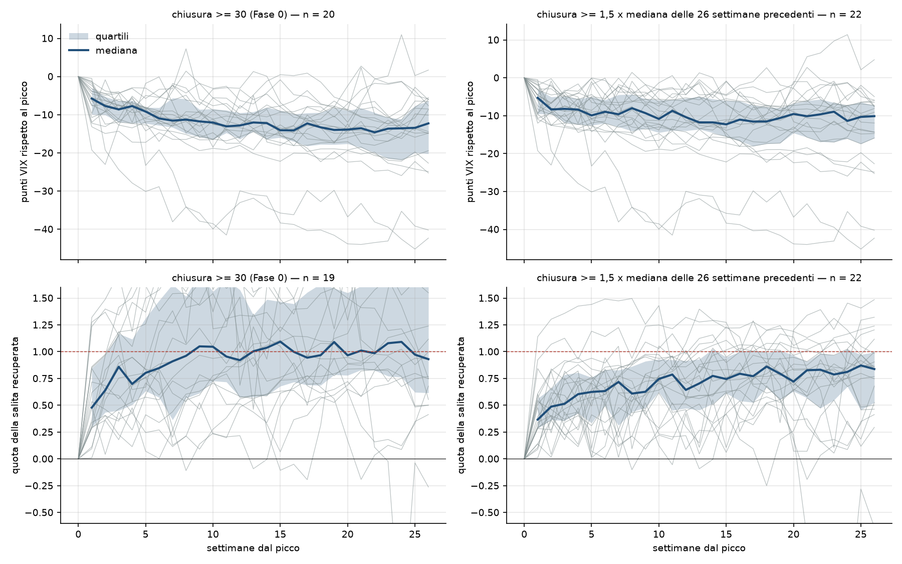
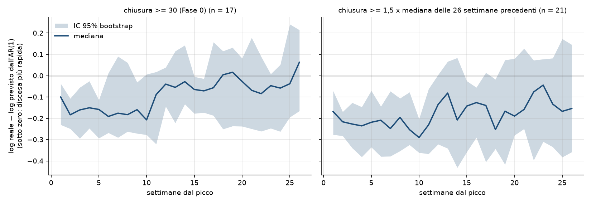
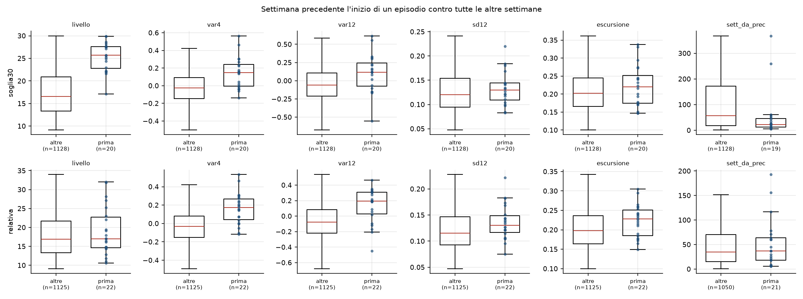
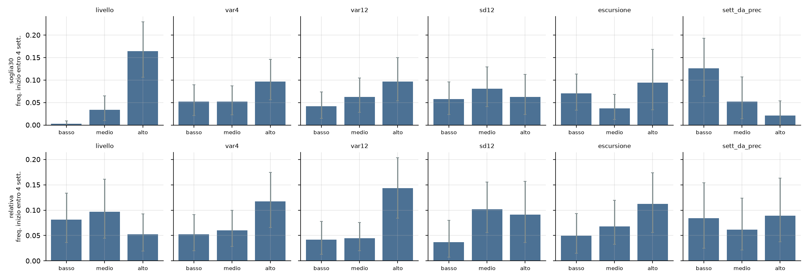
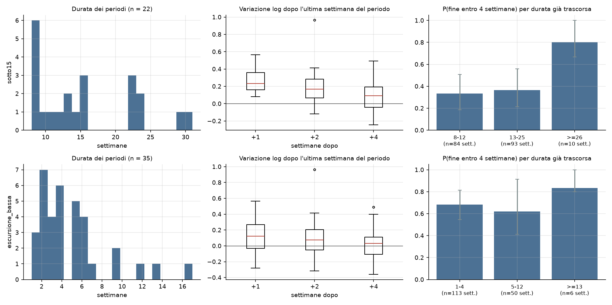
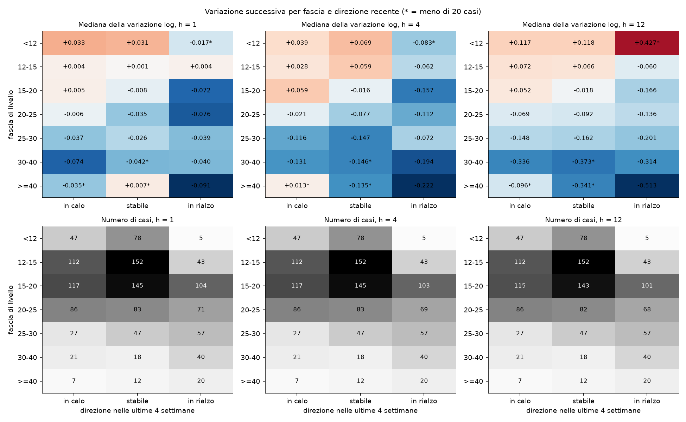
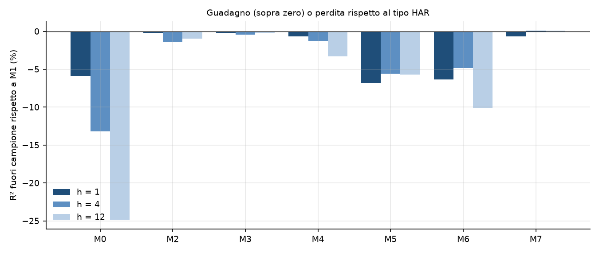
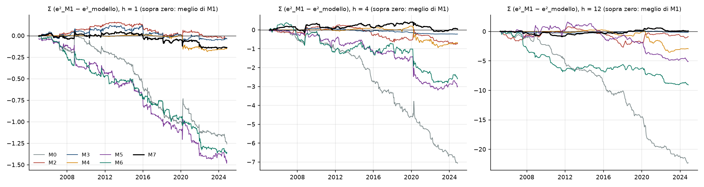

# Fase 1 — Pattern storici e modelli che usano solo il VIX

*Report generato da `python -m src.run_phase1`. Ogni numero è letto dai file `reports/fase1/*.csv` e `*.json` prodotti dal codice.
Dati: solo `data/processed/vix_weekly_dev.csv` (2000-01-07 → 2024-11-08, 1297 settimane); l'holdout resta bloccato
e l'esecuzione avviene sotto una guardia che ne impedisce l'apertura. Intervalli di confidenza: bootstrap percentile al 95%,
2000 repliche (per episodi e periodi: ricampionamento delle unità; per le settimane: blocchi di 26 settimane).*

## 1. Sintesi

1. **Nessun modello dell'elenco batte il tipo HAR (M1).** Il migliore è M2 a h = 1 (R² fuori campione rispetto a M1: -0,17%), M7 a h = 4 (0,08%) e M7 a h = 12 (0,09%). Dopo la correzione di Holm i modelli significativamente migliori di M1 sono 0 su 18.
2. **M1 batte il random walk a tutti gli orizzonti** anche con il test corretto per modelli annidati (Clark-West, p Holm < 0,001): R² rispetto al random walk 5,6% a h = 1, 11,7% a h = 4, 19,9% a h = 12.
3. **Tabella condizionata (M5) e analogia (M6) fanno peggio di M1**: significativamente peggio dopo Holm per M5 a h = 1, M6 a h = 1. I pattern su cui si basano sono reali, ma una regressione lineare li sfrutta già meglio.
4. **Dopo i picchi la discesa iniziale è rapida.** Con la definizione di Fase 0 (20 episodi) metà della salita è recuperata in 2 settimane (mediana) e il 100% in 9; con la definizione relativa (22 episodi) in 2 e 23,5 settimane.
5. **Nelle prime 4 settimane la discesa è più rapida di quella prevista dall'AR(1)**: scarto mediano in log a 4 settimane -0,151 (IC 95%: -0,247; -0,025); da 8 settimane in poi l'intervallo comprende lo zero (definizione principale). Attenzione: il picco si riconosce solo a posteriori.
6. **I picchi alti rientrano molto più lentamente**, ma i casi sono pochissimi: 4 episodi con picco 40-50 e 2 con picco ≥ 50.
7. **Prima dei picchi il segnale è debole.** Con la definizione relativa, quando il VIX è già salito nelle ultime 12 settimane (terzile alto) un episodio inizia entro 4 settimane nel 14,4% dei casi, contro il 4,2% del terzile basso. Volatilità ed escursione recenti non danno un segnale affidabile. I picchi arrivano in gran parte senza preavviso.
8. **I periodi calmi finiscono di colpo e senza calendario.** 22 periodi sotto 15 (durata mediana 13,5 settimane); il 68% termina con un rialzo settimanale oltre +20%. La probabilità di fine non cresce in modo dimostrabile con la durata.
9. **Tabelle condizionate.** Il ritorno alla media per fascia è netto e regge in entrambe le metà del campione partendo da VIX ≥ 25; la direzione recente aggiunge informazione a 4 e 12 settimane (dopo un rialzo il calo successivo è più forte).
10. **Verifica sulle due metà.** Su 33 pattern: 7 reggono (in parte meccanici tra questi: 1), 10 non reggono, 16 hanno dati insufficienti. Quasi tutto ciò che riguarda episodi e periodi calmi ha troppo pochi casi per metà oppure non regge.

## 2. Parte A — Pattern storici

### A1. Dopo i picchi

**Definizioni.** Principale (`soglia30`): chiusura >= 30 (Fase 0), periodi separati da al più 4 settimane uniti → **20 episodi**.
Alternativa (`relativa`): chiusura >= 1,5 x mediana delle 26 settimane precedenti, stessa regola di unione → **22 episodi**.
Picco = chiusura massima dell'episodio. Livello di partenza = mediana delle 26 settimane prima dell'inizio. Quota recuperata dopo k settimane =
(picco − chiusura) / (picco − partenza): 0 al picco, 1 al ritorno al livello di partenza.

Episodi per classe di altezza del picco:

| definizione   | classe   |   episodi |   con quota recuperata definita |
|:--------------|:---------|----------:|--------------------------------:|
| relativa      | 30-40    |         4 |                               4 |
| relativa      | 40-50    |         4 |                               4 |
| relativa      | <30      |        12 |                              12 |
| relativa      | >=50     |         2 |                               2 |
| soglia30      | 30-40    |        14 |                              13 |
| soglia30      | 40-50    |         4 |                               4 |
| soglia30      | >=50     |         2 |                               2 |

Con la definizione relativa 12 episodi hanno picco sotto 30: sono i picchi nati in periodi calmi, che la soglia fissa non vede.
**Le classi 40-50 e ≥ 50 contengono 4 e 2 episodi: per loro ogni numero è un aneddoto, non una stima.**

Elenco degli episodi (definizione principale):

| inizio     | data_picco   |   picco | classe   |   base |   salita |   sett. 50% |   sett. 100% |   sett. <25 |   sett. <20 |   rimbalzi |
|:-----------|:-------------|--------:|:---------|-------:|---------:|------------:|-------------:|------------:|------------:|-----------:|
| 2000-04-14 | 2000-04-14   |    33.5 | 30-40    |   22.8 |     10.7 |         1.0 |          7.0 |           6 |          11 |          0 |
| 2001-03-23 | 2001-04-06   |    31.7 | 30-40    |   25.2 |      6.5 |         1.0 |          3.0 |           3 |           9 |          0 |
| 2001-09-07 | 2001-09-21   |    42.7 | 40-50    |   22.6 |     20.1 |         1.0 |         13.0 |           9 |          23 |          0 |
| 2002-07-12 | 2002-08-02   |    41.3 | 40-50    |   21.1 |     20.2 |         2.0 |         38.0 |          16 |          40 |          1 |
| 2003-01-24 | 2003-02-07   |    34.0 | 30-40    |   29.5 |      4.5 |         2.0 |          6.0 |           9 |          13 |          0 |
| 2008-03-14 | 2008-03-14   |    31.2 | 30-40    |   23.8 |      7.3 |         1.0 |          3.0 |           3 |           6 |          0 |
| 2008-09-19 | 2008-10-24   |    79.1 | >=50     |   22.5 |     56.6 |         8.0 |         51.0 |          38 |          61 |          0 |
| 2009-10-30 | 2009-10-30   |    30.7 | 30-40    |   25.8 |      4.9 |         1.0 |          1.0 |           1 |           8 |          0 |
| 2010-05-07 | 2010-05-07   |    41.0 | 40-50    |   20.6 |     20.3 |         5.0 |         23.0 |           6 |          23 |          2 |
| 2011-08-05 | 2011-08-19   |    43.0 | 40-50    |   17.7 |     25.4 |         8.0 |         24.0 |          10 |          22 |          2 |
| 2018-12-21 | 2018-12-21   |    30.1 | 30-40    |   14.3 |     15.8 |         2.0 |          9.0 |           2 |           3 |          0 |
| 2020-02-28 | 2020-03-20   |    66.0 | >=50     |   13.7 |     52.3 |         4.0 |        169.0 |          11 |          47 |          2 |
| 2020-09-04 | 2020-09-04   |    30.8 | 30-40    |   30.0 |      0.7 |         –   |          –   |           9 |          23 |          3 |
| 2020-10-30 | 2020-10-30   |    38.0 | 30-40    |   27.4 |     10.7 |         1.0 |          1.0 |           1 |          15 |          0 |
| 2021-01-29 | 2021-01-29   |    33.1 | 30-40    |   23.5 |      9.6 |         1.0 |          1.0 |           1 |           2 |          0 |
| 2021-12-03 | 2021-12-03   |    30.7 | 30-40    |   16.4 |     14.2 |         1.0 |         73.0 |           1 |           1 |          2 |
| 2022-03-04 | 2022-03-04   |    32.0 | 30-40    |   19.0 |     13.0 |         2.0 |         45.0 |           2 |           4 |          2 |
| 2022-04-29 | 2022-04-29   |    33.4 | 30-40    |   22.1 |     11.3 |         4.0 |         13.0 |           5 |          15 |          0 |
| 2022-06-17 | 2022-06-17   |    31.1 | 30-40    |   26.5 |      4.6 |         1.0 |          3.0 |           3 |           8 |          0 |
| 2022-09-30 | 2022-10-14   |    32.0 | 30-40    |   25.5 |      6.5 |         2.0 |          3.0 |           3 |           7 |          0 |



Quota della salita recuperata:

| misura                                   | soglia30: stima [IC 95%]   | soglia30: n   | relativa: stima [IC 95%]   | relativa: n   |
|:-----------------------------------------|:---------------------------|:--------------|:---------------------------|:--------------|
| quota recuperata dopo 1 sett. (mediana)  | 0.48 [0.29; 0.84]          | 19 (+1 n.d.)  | 0.37 [0.28; 0.55]          | 22            |
| quota recuperata dopo 2 sett. (mediana)  | 0.64 [0.46; 0.96]          | 19 (+1 n.d.)  | 0.49 [0.38; 0.63]          | 22            |
| quota recuperata dopo 4 sett. (mediana)  | 0.70 [0.53; 1.05]          | 19 (+1 n.d.)  | 0.60 [0.43; 0.76]          | 22            |
| quota recuperata dopo 8 sett. (mediana)  | 0.96 [0.58; 1.48]          | 19 (+1 n.d.)  | 0.61 [0.49; 0.80]          | 22            |
| quota recuperata dopo 13 sett. (mediana) | 1.00 [0.59; 1.33]          | 19 (+1 n.d.)  | 0.70 [0.51; 0.88]          | 22            |
| quota recuperata dopo 26 sett. (mediana) | 0.93 [0.68; 1.55]          | 19 (+1 n.d.)  | 0.84 [0.68; 0.98]          | 21 (+1 n.d.)  |

In punti VIX:

| misura                                              | soglia30: stima [IC 95%]   |   soglia30: n | relativa: stima [IC 95%]   | relativa: n   |
|:----------------------------------------------------|:---------------------------|--------------:|:---------------------------|:--------------|
| punti VIX rispetto al picco dopo 1 sett. (mediana)  | -5.8 [-8.7; -3.5]          |            20 | -5.3 [-8.8; -3.0]          | 22            |
| punti VIX rispetto al picco dopo 2 sett. (mediana)  | -7.7 [-9.3; -5.6]          |            20 | -8.3 [-9.3; -6.6]          | 22            |
| punti VIX rispetto al picco dopo 4 sett. (mediana)  | -7.7 [-10.9; -6.7]         |            20 | -8.4 [-12.1; -6.0]         | 22            |
| punti VIX rispetto al picco dopo 8 sett. (mediana)  | -11.3 [-14.5; -7.7]        |            20 | -8.0 [-12.6; -5.2]         | 22            |
| punti VIX rispetto al picco dopo 13 sett. (mediana) | -12.0 [-14.2; -9.9]        |            20 | -11.8 [-13.4; -5.1]        | 22            |
| punti VIX rispetto al picco dopo 26 sett. (mediana) | -12.3 [-18.8; -7.1]        |            20 | -10.1 [-14.7; -7.5]        | 21 (+1 n.d.)  |

Tempi di recupero e rimbalzi:

| misura                                                                | soglia30: stima [IC 95%]   | soglia30: n   | relativa: stima [IC 95%]   | relativa: n   |
|:----------------------------------------------------------------------|:---------------------------|:--------------|:---------------------------|:--------------|
| settimane per recuperare il 50% (mediana)                             | 2.0 [1.0; 2.0]             | 19 (+1 n.d.)  | 2.0 [1.0; 3.0]             | 22            |
| settimane per recuperare il 100% (mediana)                            | 9.0 [3.0; 24.0]            | 19 (+1 n.d.)  | 23.5 [12.5; 44.5]          | 20 (+2 n.d.)  |
| settimane per tornare sotto 25 (mediana)                              | 4.0 [2.5; 9.0]             | 20            | 1.5 [1.0; 4.0]             | 22            |
| settimane per tornare sotto 20 (mediana)                              | 12.0 [7.5; 22.5]           | 20            | 4.5 [1.0; 14.0]            | 22            |
| rialzi settimanali oltre +20% durante la discesa (media per episodio) | 0.7 [0.3; 1.1]             | 20            | 1.0 [0.6; 1.4]             | 22            |
| quota di episodi con almeno un rimbalzo                               | 0.3 [0.1; 0.6]             | 20            | 0.6 [0.4; 0.8]             | 22            |

Per classe di altezza del picco (stima [IC 95%]):

| definizione   | classe del picco   |   episodi | quota a 4 sett.   | quota a 13 sett.   | sett. per il 50%   | sett. per il 100%   | sett. sotto 25    | sett. sotto 20    |
|:--------------|:-------------------|----------:|:------------------|:-------------------|:-------------------|:--------------------|:------------------|:------------------|
| soglia30      | 30-40              |        14 | 0.95 [0.70; 1.20] | 1.23 [0.86; 1.51]  | 1.0 [1.0; 2.0]     | 3.0 [3.0; 9.0]      | 3.0 [1.5; 4.5]    | 8.0 [4.0; 12.0]   |
| soglia30      | 40-50              |         4 | 0.43 [0.27; 0.48] | 0.77 [0.44; 1.00]  | 3.5 [1.0; 8.0]     | 23.5 [13.0; 38.0]   | 9.5 [6.0; 16.0]   | 23.0 [22.0; 40.0] |
| soglia30      | >=50               |         2 | 0.32 [0.11; 0.53] | 0.58 [0.56; 0.59]  | 6.0 [4.0; 8.0]     | 110.0 [51.0; 169.0] | 24.5 [11.0; 38.0] | 54.0 [47.0; 61.0] |
| relativa      | <30                |        12 | 0.70 [0.42; 0.86] | 0.79 [0.21; 1.00]  | 1.0 [1.0; 2.5]     | 13.5 [6.0; 155.0]   | 1.0 [1.0; 1.0]    | 1.0 [1.0; 5.5]    |
| relativa      | 30-40              |         4 | 0.80 [0.68; 0.95] | 0.66 [-0.09; 1.07] | 2.0 [1.0; 4.0]     | 35.5 [12.0; 73.0]   | 2.0 [1.0; 5.0]    | 3.5 [1.0; 15.0]   |
| relativa      | 40-50              |         4 | 0.43 [0.27; 0.48] | 0.77 [0.44; 1.00]  | 3.5 [1.0; 8.0]     | 23.5 [13.0; 38.0]   | 9.5 [6.0; 16.0]   | 23.0 [22.0; 40.0] |
| relativa      | >=50               |         2 | 0.32 [0.11; 0.53] | 0.58 [0.56; 0.59]  | 6.0 [4.0; 8.0]     | 110.0 [51.0; 169.0] | 24.5 [11.0; 38.0] | 54.0 [47.0; 61.0] |

- **La prima settimana fa gran parte del lavoro.** Una settimana dopo il picco è già recuperato il 48% della salita (definizione principale) o il 37% (relativa); il 50% è raggiunto in 2 settimane in mediana con entrambe le definizioni.
- **Il ritorno completo è lento e molto variabile.** Mediana 9,0 (IC 95%: 3,0; 24,0) settimane con la definizione principale, 23,5 (IC 95%: 12,5; 44,5) con quella relativa; in quest'ultima 2 episodi non tornano al livello di partenza entro la fine del campione. Dopo i picchi nati in periodi molto calmi il livello di partenza può non essere più rivisto per anni: la «quota recuperata» si ferma sotto 1.
- **Ritorno sotto le soglie.** Sotto 25 in 4 settimane e sotto 20 in 12 (mediane, definizione principale).
- **L'altezza del picco conta.** Per i picchi 30-40 il 100% è recuperato in 3 settimane (mediana, 13 episodi); per i picchi 40-50 ne servono 23,5 e per i due ≥ 50 110. Pochi casi, ma la direzione è coerente: più alto il picco, più lenta la normalizzazione.
- **Rimbalzi.** Durante la discesa si osservano in media 0,70 rialzi settimanali oltre +20% per episodio (definizione principale; 1,00 con la relativa); il 35% degli episodi ne ha almeno uno (59% con la relativa). La discesa non è liscia.

**Confronto con l'AR(1).** Scarto tra il log-VIX realizzato k settimane dopo il picco e quello previsto dall'AR(1) partendo dal picco
(negativo = discesa reale più rapida). L'AR(1) «fino al picco» usa solo la storia disponibile al picco (richiede almeno 104 settimane).

| misura                                       | soglia30: stima [IC 95%]   | soglia30: n   | relativa: stima [IC 95%]   | relativa: n   |
|:---------------------------------------------|:---------------------------|:--------------|:---------------------------|:--------------|
| AR(1) stimato fino al picco, 1 sett.         | -0.100 [-0.230; -0.037]    | 17 (+3 n.d.)  | -0.169 [-0.277; -0.071]    | 21 (+1 n.d.)  |
| AR(1) stimato fino al picco, 2 sett.         | -0.183 [-0.249; -0.107]    | 17 (+3 n.d.)  | -0.216 [-0.282; -0.170]    | 21 (+1 n.d.)  |
| AR(1) stimato fino al picco, 4 sett.         | -0.151 [-0.247; -0.025]    | 17 (+3 n.d.)  | -0.235 [-0.381; -0.147]    | 21 (+1 n.d.)  |
| AR(1) stimato fino al picco, 8 sett.         | -0.183 [-0.262; 0.061]     | 17 (+3 n.d.)  | -0.195 [-0.354; -0.106]    | 21 (+1 n.d.)  |
| AR(1) stimato fino al picco, 13 sett.        | -0.055 [-0.222; 0.115]     | 17 (+3 n.d.)  | -0.081 [-0.341; 0.067]     | 21 (+1 n.d.)  |
| AR(1) stimato fino al picco, 26 sett.        | 0.063 [-0.166; 0.215]      | 17 (+3 n.d.)  | -0.154 [-0.358; 0.145]     | 20 (+2 n.d.)  |
| AR(1) stimato su tutto il campione, 1 sett.  | -0.122 [-0.205; -0.075]    | 20            | -0.166 [-0.256; -0.079]    | 22            |
| AR(1) stimato su tutto il campione, 4 sett.  | -0.102 [-0.173; -0.015]    | 20            | -0.202 [-0.359; -0.101]    | 22            |
| AR(1) stimato su tutto il campione, 13 sett. | -0.040 [-0.113; 0.171]     | 20            | -0.085 [-0.305; 0.136]     | 22            |



La discesa reale è **più rapida di quella dell'AR(1) nelle prime settimane** (a 2 settimane: -0,183 (IC 95%: -0,249; -0,107); a 4: -0,151 (IC 95%: -0,247; -0,025)),
poi lo scarto si chiude: a 13 settimane è -0,055 (IC 95%: -0,222; 0,115) e a 26 0,063 (IC 95%: -0,166; 0,215). Due avvertenze: il picco è scelto
a posteriori come massimo dell'episodio, quindi una parte del calo successivo è garantita per costruzione; e gli episodi non sono indipendenti
(4 hanno il picco nel 2022).

**Cosa implica per il modello di previsione.** (i) Serve una componente che rientra in 1–4 settimane oltre a quella lenta: un AR(1) da solo
sbaglia la forma della discesa; l'HAR e l'ARMA(1,1) ce l'hanno. (ii) Il picco non è riconoscibile in tempo reale, quindi questi numeri non si
traducono in una regola di previsione: servono come controllo di plausibilità delle traiettorie previste. (iii) La dispersione tra episodi
(quartili molto larghi, rimbalzi oltre +20%) dice che dopo un picco conta la distribuzione più del valore centrale: è materia per la Fase 2.

### A2. Prima dei picchi

Per ogni episodio le grandezze sono misurate nell'ultima settimana prima dell'inizio, su finestre che guardano indietro fino a 12 settimane.
Il confronto è con tutte le altre settimane fuori dagli episodi. `escursione` usa `high` e `low` ed è **esplorativa**.



| definizione   | grandezza                             |   episodi |   altre sett. |   mediana prima |   mediana altre | differenza [IC 95%]       | percentile medio [IC 95%]   |   p Mann-Whitney |
|:--------------|:--------------------------------------|----------:|--------------:|----------------:|----------------:|:--------------------------|:----------------------------|-----------------:|
| soglia30      | livello                               |        20 |          1128 |          25.680 |          16.545 | 9.135 [6.790; 11.810]     | 90 [84; 94]                 |            0.000 |
| soglia30      | variazione log 4 sett.                |        20 |          1128 |           0.150 |          -0.026 | 0.176 [0.032; 0.261]      | 74 [64; 83]                 |            0.000 |
| soglia30      | variazione log 12 sett.               |        20 |          1128 |           0.117 |          -0.061 | 0.178 [0.037; 0.290]      | 68 [56; 78]                 |            0.006 |
| soglia30      | dev. std. variazioni (12 sett.)       |        20 |          1128 |           0.130 |           0.120 | 0.010 [-0.010; 0.028]     | 56 [45; 65]                 |            0.386 |
| soglia30      | escursione ln(high/low) [esplorativo] |        20 |          1128 |           0.220 |           0.202 | 0.018 [-0.028; 0.049]     | 57 [45; 68]                 |            0.307 |
| soglia30      | settimane dall'episodio precedente    |        19 |          1128 |          22.000 |          57.000 | -35.000 [-88.000; -3.975] | 35 [25; 47]                 |            0.022 |
| relativa      | livello                               |        22 |          1125 |          17.015 |          16.860 | 0.155 [-2.710; 4.560]     | 54 [41; 66]                 |            0.568 |
| relativa      | variazione log 4 sett.                |        22 |          1125 |           0.172 |          -0.033 | 0.205 [0.100; 0.279]      | 79 [70; 87]                 |            0.000 |
| relativa      | variazione log 12 sett.               |        22 |          1125 |           0.194 |          -0.077 | 0.271 [0.138; 0.374]      | 75 [63; 85]                 |            0.000 |
| relativa      | dev. std. variazioni (12 sett.)       |        22 |          1125 |           0.130 |           0.116 | 0.015 [-0.002; 0.031]     | 61 [53; 70]                 |            0.069 |
| relativa      | escursione ln(high/low) [esplorativo] |        22 |          1125 |           0.228 |           0.198 | 0.030 [-0.005; 0.051]     | 63 [53; 72]                 |            0.036 |
| relativa      | settimane dall'episodio precedente    |        21 |          1050 |          37.000 |          35.000 | 2.000 [-24.000; 30.000]   | 51 [40; 63]                 |            0.960 |

(«Percentile medio»: posizione media dei valori pre-episodio nella distribuzione delle altre settimane; 50 = nessuna differenza.)

Frequenza con cui un episodio inizia nelle 4 settimane successive, per terzile (settimane fuori dagli episodi; le settimane con evento
sono fino a 4 per ogni episodio, quindi gli eventi indipendenti sono 20 e 22):

| definizione   | grandezza                             | basso                                | medio                                | alto                                  | alto − basso [IC 95%]     |
|:--------------|:--------------------------------------|:-------------------------------------|:-------------------------------------|:--------------------------------------|:--------------------------|
| soglia30      | livello                               | 0.3% [0.0; 0.9] (n=382, eventi=1)    | 3.4% [1.0; 6.5] (n=382, eventi=13)   | 16.4% [10.6; 23.0] (n=384, eventi=63) | +16.1 [+10.1; +21.9] p.p. |
| soglia30      | variazione log 4 sett.                | 5.2% [2.1; 9.0] (n=383, eventi=20)   | 5.2% [2.3; 8.7] (n=382, eventi=20)   | 9.7% [5.6; 14.6] (n=383, eventi=37)   | +4.4 [-0.1; +9.4] p.p.    |
| soglia30      | variazione log 12 sett.               | 4.2% [1.5; 7.4] (n=383, eventi=16)   | 6.3% [2.8; 10.5] (n=382, eventi=24)  | 9.7% [5.4; 15.0] (n=383, eventi=37)   | +5.5 [+0.8; +10.8] p.p.   |
| soglia30      | dev. std. variazioni (12 sett.)       | 5.7% [2.3; 9.6] (n=383, eventi=22)   | 8.1% [4.1; 12.9] (n=382, eventi=31)  | 6.3% [2.3; 11.2] (n=383, eventi=24)   | +0.5 [-4.9; +6.3] p.p.    |
| soglia30      | escursione ln(high/low) [esplorativo] | 7.0% [3.3; 11.3] (n=383, eventi=27)  | 3.7% [1.3; 6.8] (n=382, eventi=14)   | 9.4% [3.4; 16.9] (n=383, eventi=36)   | +2.3 [-4.7; +10.4] p.p.   |
| soglia30      | settimane dall'episodio precedente    | 12.6% [6.4; 19.3] (n=380, eventi=48) | 5.2% [1.4; 10.7] (n=383, eventi=20)  | 2.1% [0.0; 5.4] (n=384, eventi=8)     | -10.5 [-18.3; -3.3] p.p.  |
| relativa      | livello                               | 8.1% [3.6; 13.4] (n=381, eventi=31)  | 9.7% [4.5; 16.1] (n=383, eventi=37)  | 5.2% [2.0; 9.3] (n=383, eventi=20)    | -2.9 [-8.9; +2.9] p.p.    |
| relativa      | variazione log 4 sett.                | 5.2% [2.0; 9.1] (n=382, eventi=20)   | 6.0% [2.9; 10.0] (n=382, eventi=23)  | 11.7% [6.6; 17.4] (n=383, eventi=45)  | +6.5 [+1.5; +12.0] p.p.   |
| relativa      | variazione log 12 sett.               | 4.2% [1.3; 7.8] (n=382, eventi=16)   | 4.5% [2.0; 7.6] (n=382, eventi=17)   | 14.4% [8.4; 20.4] (n=383, eventi=55)  | +10.2 [+4.3; +16.2] p.p.  |
| relativa      | dev. std. variazioni (12 sett.)       | 3.7% [0.7; 8.0] (n=382, eventi=14)   | 10.2% [5.6; 15.6] (n=382, eventi=39) | 9.1% [3.6; 15.7] (n=383, eventi=35)   | +5.5 [-0.6; +12.4] p.p.   |
| relativa      | escursione ln(high/low) [esplorativo] | 5.0% [1.5; 9.3] (n=382, eventi=19)   | 6.8% [3.3; 11.9] (n=382, eventi=26)  | 11.2% [5.6; 17.3] (n=383, eventi=43)  | +6.3 [-0.6; +13.4] p.p.   |
| relativa      | settimane dall'episodio precedente    | 8.4% [2.5; 15.4] (n=356, eventi=30)  | 6.2% [2.2; 12.4] (n=356, eventi=22)  | 8.9% [3.8; 16.3] (n=359, eventi=32)   | +0.5 [-7.7; +9.6] p.p.    |



- **Definizione principale.** Prima dell'inizio il VIX è già alto (mediana 25,7 contro 16,5): è quasi una tautologia, perché per chiudere sopra 30 bisogna partire vicino a 30. Gli episodi inoltre si raggruppano: la distanza mediana dal precedente è 22 settimane contro 57.
- **Definizione relativa** (più pulita, perché non dipende dal livello): il livello non distingue (17,0 contro 16,9). Distingue la **salita già in corso**: variazione a 4 settimane 0,172 contro -0,033, a 12 settimane 0,194 contro -0,077.
- **Terzili.** Con la definizione relativa l'intervallo della differenza alto − basso esclude lo zero per: variazione log 4 sett., variazione log 12 sett.. Con la principale per: livello, variazione log 12 sett., settimane dall'episodio precedente.
- **Deviazione standard ed escursione recenti**: differenze piccole, con intervalli che comprendono lo zero in quasi tutti i confronti.

**Conclusione.** Esiste un segnale, ma è debole e poco utile: un episodio è più probabile quando il VIX sta già salendo (e, con la soglia fissa,
quando è già alto o un altro episodio è finito da poco). Anche nel terzile più a rischio la frequenza resta bassa
(14,4% con la definizione relativa, contro una frequenza di base del 7,7%):
nel 86% delle settimane «a rischio» non inizia alcun episodio. La «calma prima della tempesta» misurata con la volatilità del VIX non è un segnale.
**In pratica i picchi arrivano senza preavviso utilizzabile**; ciò che si vede prima è l'inizio della salita stessa.

**Cosa implica per il modello di previsione.** Con il solo VIX non si può anticipare un picco nella previsione puntuale: nessuna variabile di
stato sposta la mediana in modo utile. Il rischio di picco va trattato come coda destra della distribuzione prevista (Fase 2), che può
allargarsi quando il VIX è in salita. Un vero segnale anticipatore, se esiste, va cercato nei dati esterni (Fase 3).

### A3. Periodi calmi

**Definizioni.** Principale (`sotto15`): chiusura < 15 per almeno 8 settimane consecutive. Alternativa (`escursione_bassa`): escursione del log-VIX su 12 settimane nel 20% più basso della storia
(soglia = quantile 20% calcolato sulla storia fino a quella settimana, a partire dalla settimana 104; un periodo è una sequenza consecutiva di settimane sotto soglia, di qualunque lunghezza).



| misura                                                       | sotto15: stima [IC 95%]   | sotto15: min–max   |   sotto15: n | escursione_bassa: stima [IC 95%]   | escursione_bassa: min–max   |   escursione_bassa: n |
|:-------------------------------------------------------------|:--------------------------|:-------------------|-------------:|:-----------------------------------|:----------------------------|----------------------:|
| durata in settimane (mediana)                                | 13.5 [10.0; 22.0]         | 8.0–31.0           |           22 | 4.0 [3.0; 5.0]                     | 1.0–17.0                    |                    35 |
| banda di oscillazione, punti VIX (mediana)                   | 3.21 [2.65; 3.67]         | 1.50–5.27          |           22 | 2.12 [0.90; 3.10]                  | 0.00–9.63                   |                    35 |
| banda di oscillazione, log (mediana)                         | 0.248 [0.200; 0.292]      | 0.107–0.447        |           22 | 0.167 [0.055; 0.202]               | 0.000–0.280                 |                    35 |
| variazione log 1 sett. dopo la fine (mediana)                | 0.232 [0.180; 0.341]      | 0.081–0.565        |           22 | 0.122 [-0.011; 0.215]              | -0.282–0.565                |                    35 |
| variazione log 2 sett. dopo la fine (mediana)                | 0.167 [0.084; 0.262]      | -0.118–0.964       |           22 | 0.074 [-0.006; 0.152]              | -0.317–0.964                |                    35 |
| variazione log 4 sett. dopo la fine (mediana)                | 0.094 [-0.032; 0.162]     | -0.246–0.492       |           22 | 0.031 [-0.027; 0.083]              | -0.359–0.492                |                    35 |
| variazione log dalla 1ª alla 4ª sett. dopo la fine (mediana) | -0.168 [-0.275; -0.087]   | -0.426–0.209       |           22 | -0.049 [-0.200; 0.049]             | -0.601–0.214                |                    35 |
| quota di uscite con rialzo settimanale oltre +20%            | 0.68 [0.50; 0.86]         | 0.00–1.00          |           22 | 0.40 [0.26; 0.57]                  | 0.00–1.00                   |                    35 |
| quota di uscite al rialzo                                    | 1.00 [1.00; 1.00]         | 1.00–1.00          |           22 | 0.66 [0.51; 0.80]                  | 0.00–1.00                   |                    35 |

Probabilità che il periodo finisca nelle 4 settimane successive, per durata già trascorsa:

| definizione      | settimane già trascorse   |   settimane osservate |   periodi | P(fine entro 4 sett.) [IC 95%]   |
|:-----------------|:--------------------------|----------------------:|----------:|:---------------------------------|
| sotto15          | 8-12                      |                    84 |        22 | 0.33 [0.18; 0.51]                |
| sotto15          | 13-25                     |                    93 |        13 | 0.37 [0.22; 0.56]                |
| sotto15          | >=26                      |                    10 |         2 | 0.80 [0.67; 1.00]                |
| escursione_bassa | 1-4                       |                   113 |        35 | 0.68 [0.55; 0.81]                |
| escursione_bassa | 5-12                      |                    50 |        15 | 0.62 [0.41; 0.91]                |
| escursione_bassa | >=13                      |                     6 |         2 | 0.83 [0.80; 1.00]                |

- **Quanti e quando.** 22 periodi sotto 15, concentrati in pochi anni: 5 tra 2004 e 2007, 14 tra 2013 e 2019, 3 dal 2023. Durata da 8 a 31 settimane (mediana 13,5).
- **Banda di oscillazione.** Dentro un periodo il VIX si muove in una banda mediana di 3,21 punti (0,248 in log).
- **Come finiscono.** Per definizione un periodo sotto 15 finisce con un rialzo. Quel rialzo è brusco: variazione log mediana nella settimana di uscita 0,232 (IC 95%: 0,180; 0,341); nel 68% dei casi (IC 95%: 50%–86%) supera +20% in una settimana.
- **Poi rientra in parte.** Dalla prima alla quarta settimana dopo l'uscita la variazione mediana è -0,168 (IC 95%: -0,275; -0,087): a 4 settimane dall'ultima settimana calma il guadagno mediano si riduce a 0,094 (IC 95%: -0,032; 0,162).
- **La durata non aiuta.** P(fine entro 4 settimane) è 0,33 dopo 8-12 settimane e 0,37 dopo 13-25. Il valore 0,80 oltre le 26 settimane viene da 2 soli periodi (10 settimane): non è una stima affidabile. Confrontando tutte le durate oltre 12 settimane con 8-12, la differenza è 0,07 (IC 95%: -0,11; 0,26): compatibile con zero.
- **Definizione alternativa.** 35 periodi, molto più brevi (mediana 4 settimane): più che periodi sono finestre. Escono al rialzo nel 66% dei casi e con un rialzo oltre +20% nel 40%; nemmeno qui la durata trascorsa conta.

**Cosa implica per il modello di previsione.** Dentro un periodo calmo la previsione puntuale migliore resta «poco sopra il valore attuale»;
il momento dell'uscita non è prevedibile dalla durata. L'informazione utile è sulla forma: variazioni piccole quasi sempre, con una coda destra
pesante (un'uscita su tre non supera +20%, due su tre sì). Per la Fase 2 questo chiede una distribuzione asimmetrica quando il VIX è basso,
e una verifica di calibrazione dedicata ai periodi calmi.

### A4. Tabelle condizionate

Fasce: <12, 12-15, 15-20, 20-25, 25-30, 30-40, >=40. Direzione = variazione log nelle ultime 4 settimane: «in calo» sotto −0,10, «in rialzo» sopra +0,10, altrimenti «stabile».
Celle: mediana della variazione log successiva [IC 95% a blocchi] e numero di settimane.



**h = 1**

| fascia   | in calo                       | stabile                       | in rialzo                     | tutte                         |
|:---------|:------------------------------|:------------------------------|:------------------------------|:------------------------------|
| <12      | +0.033 [+0.009; +0.058] n=47  | +0.031 [+0.009; +0.054] n=78  | -0.017 [-0.083; -0.017] n=5   | +0.026 [+0.012; +0.044] n=130 |
| 12-15    | +0.004 [-0.011; +0.014] n=112 | +0.001 [-0.016; +0.009] n=152 | +0.004 [-0.053; +0.021] n=43  | +0.003 [-0.004; +0.010] n=307 |
| 15-20    | +0.005 [-0.018; +0.046] n=117 | -0.008 [-0.021; +0.006] n=145 | -0.072 [-0.098; -0.012] n=104 | -0.010 [-0.022; +0.001] n=366 |
| 20-25    | -0.006 [-0.017; +0.023] n=86  | -0.035 [-0.073; -0.004] n=83  | -0.076 [-0.129; -0.011] n=71  | -0.022 [-0.044; -0.007] n=240 |
| 25-30    | -0.037 [-0.058; -0.006] n=27  | -0.026 [-0.042; +0.005] n=47  | -0.039 [-0.112; +0.005] n=57  | -0.033 [-0.046; -0.023] n=131 |
| 30-40    | -0.074 [-0.182; -0.024] n=21  | -0.042 [-0.134; -0.011] n=18  | -0.040 [-0.068; +0.045] n=40  | -0.045 [-0.075; -0.024] n=79  |
| >=40     | -0.035 [-0.088; -0.033] n=7   | +0.007 [-0.014; +0.007] n=12  | -0.091 [-0.223; -0.008] n=20  | -0.035 [-0.171; -0.022] n=39  |

**h = 4**

| fascia   | in calo                       | stabile                       | in rialzo                     | tutte                         |
|:---------|:------------------------------|:------------------------------|:------------------------------|:------------------------------|
| <12      | +0.039 [-0.007; +0.081] n=47  | +0.069 [+0.030; +0.121] n=78  | -0.083 [-0.124; +0.546] n=5   | +0.047 [+0.010; +0.101] n=130 |
| 12-15    | +0.028 [+0.000; +0.068] n=112 | +0.059 [+0.012; +0.088] n=152 | -0.062 [-0.081; -0.001] n=43  | +0.026 [-0.003; +0.065] n=307 |
| 15-20    | +0.059 [+0.011; +0.112] n=117 | -0.016 [-0.071; +0.018] n=145 | -0.157 [-0.210; -0.091] n=103 | -0.015 [-0.064; +0.016] n=365 |
| 20-25    | -0.021 [-0.082; +0.020] n=86  | -0.077 [-0.101; -0.028] n=83  | -0.112 [-0.184; -0.001] n=69  | -0.060 [-0.096; -0.022] n=238 |
| 25-30    | -0.116 [-0.163; -0.018] n=27  | -0.147 [-0.169; -0.098] n=47  | -0.072 [-0.150; -0.008] n=57  | -0.109 [-0.147; -0.062] n=131 |
| 30-40    | -0.131 [-0.246; -0.093] n=21  | -0.146 [-0.211; -0.065] n=18  | -0.194 [-0.279; -0.090] n=40  | -0.164 [-0.244; -0.093] n=79  |
| >=40     | +0.013 [-0.398; +0.026] n=7   | -0.135 [-0.339; -0.072] n=12  | -0.222 [-0.302; -0.085] n=20  | -0.148 [-0.328; -0.072] n=39  |

**h = 12**

| fascia   | in calo                       | stabile                       | in rialzo                     | tutte                         |
|:---------|:------------------------------|:------------------------------|:------------------------------|:------------------------------|
| <12      | +0.117 [+0.024; +0.152] n=47  | +0.118 [+0.026; +0.223] n=78  | +0.427 [+0.397; +0.435] n=5   | +0.121 [+0.041; +0.208] n=130 |
| 12-15    | +0.072 [-0.007; +0.159] n=112 | +0.066 [+0.010; +0.187] n=152 | -0.060 [-0.137; +0.192] n=43  | +0.055 [-0.003; +0.118] n=307 |
| 15-20    | +0.052 [-0.055; +0.151] n=115 | -0.018 [-0.080; +0.072] n=143 | -0.166 [-0.215; -0.120] n=101 | -0.051 [-0.110; +0.045] n=359 |
| 20-25    | -0.069 [-0.152; +0.043] n=86  | -0.092 [-0.138; +0.051] n=82  | -0.136 [-0.266; +0.013] n=68  | -0.085 [-0.145; +0.013] n=236 |
| 25-30    | -0.148 [-0.246; -0.061] n=27  | -0.162 [-0.310; -0.068] n=47  | -0.201 [-0.291; -0.103] n=57  | -0.171 [-0.251; -0.095] n=131 |
| 30-40    | -0.336 [-0.384; -0.296] n=21  | -0.373 [-0.407; -0.289] n=18  | -0.314 [-0.389; -0.249] n=40  | -0.336 [-0.381; -0.291] n=79  |
| >=40     | -0.096 [-0.409; -0.076] n=7   | -0.341 [-0.341; -0.341] n=12  | -0.513 [-0.542; -0.422] n=20  | -0.360 [-0.530; -0.319] n=39  |

Distribuzione completa a h = 4 (quantili della variazione log e quota di rialzi):

| fascia   | direzione   |   n |   mediana |    q10 |    q25 |    q75 |   q90 |   quota_rialzi |
|:---------|:------------|----:|----------:|-------:|-------:|-------:|------:|---------------:|
| <12      | in calo     |  47 |     0.039 | -0.057 | -0.039 |  0.120 | 0.244 |          0.638 |
| <12      | stabile     |  78 |     0.069 | -0.054 | -0.008 |  0.169 | 0.403 |          0.705 |
| <12      | in rialzo   |   5 |    -0.083 | -0.182 | -0.164 | -0.035 | 0.314 |          0.200 |
| 12-15    | in calo     | 112 |     0.028 | -0.129 | -0.067 |  0.121 | 0.291 |          0.589 |
| 12-15    | stabile     | 152 |     0.059 | -0.138 | -0.044 |  0.169 | 0.288 |          0.599 |
| 12-15    | in rialzo   |  43 |    -0.062 | -0.194 | -0.104 |  0.083 | 0.199 |          0.349 |
| 15-20    | in calo     | 117 |     0.059 | -0.134 | -0.032 |  0.194 | 0.424 |          0.632 |
| 15-20    | stabile     | 145 |    -0.016 | -0.220 | -0.129 |  0.121 | 0.251 |          0.448 |
| 15-20    | in rialzo   | 103 |    -0.157 | -0.321 | -0.255 |  0.026 | 0.208 |          0.301 |
| 20-25    | in calo     |  86 |    -0.021 | -0.216 | -0.144 |  0.108 | 0.239 |          0.442 |
| 20-25    | stabile     |  83 |    -0.077 | -0.229 | -0.161 |  0.051 | 0.168 |          0.349 |
| 20-25    | in rialzo   |  69 |    -0.112 | -0.452 | -0.257 |  0.051 | 0.249 |          0.362 |
| 25-30    | in calo     |  27 |    -0.116 | -0.215 | -0.171 |  0.043 | 0.226 |          0.296 |
| 25-30    | stabile     |  47 |    -0.147 | -0.284 | -0.190 | -0.045 | 0.063 |          0.170 |
| 25-30    | in rialzo   |  57 |    -0.072 | -0.403 | -0.248 |  0.043 | 0.225 |          0.316 |
| 30-40    | in calo     |  21 |    -0.131 | -0.259 | -0.230 | -0.079 | 0.124 |          0.190 |
| 30-40    | stabile     |  18 |    -0.146 | -0.260 | -0.231 | -0.056 | 0.044 |          0.167 |
| 30-40    | in rialzo   |  40 |    -0.194 | -0.490 | -0.282 | -0.051 | 0.077 |          0.200 |
| >=40     | in calo     |   7 |     0.013 | -0.302 | -0.173 |  0.046 | 0.074 |          0.571 |
| >=40     | stabile     |  12 |    -0.135 | -0.412 | -0.265 | -0.057 | 0.037 |          0.167 |
| >=40     | in rialzo   |  20 |    -0.222 | -0.550 | -0.328 | -0.067 | 0.127 |          0.200 |

(Le tabelle complete per h = 1 e h = 12 sono in `reports/fase1/a4_celle.csv`.)

- **Livello.** La mediana della variazione successiva scende in modo regolare con la fascia: a 4 settimane da 0,047 partendo sotto 12 a -0,164 partendo da 30-40; a 12 settimane da 0,121 a -0,336. Partendo da 30-40 il VIX è più alto dopo 12 settimane solo nel 6% dei casi.
- **Direzione.** A parità di fascia, dopo un rialzo recente il calo successivo è più forte. Esempio nella fascia 15-20 a 4 settimane: -0,157 dopo un rialzo contro 0,059 dopo un calo. Un rialzo recente è in parte transitorio.
- **Asimmetria.** Nelle fasce basse la distribuzione è sbilanciata verso l'alto: nella cella 12-15 / stabile a 4 settimane il 10° percentile è -0,138 e il 90° è 0,288.
- **Celle poco popolate.** 4 celle su 21 hanno meno di 20 casi (<12 / in rialzo: 5, 30-40 / stabile: 18, >=40 / in calo: 7, >=40 / stabile: 12). Le settimane sono inoltre sovrapposte e dipendenti: i casi indipendenti sono molti meno di n.

**Cosa implica per il modello di previsione.** Livello e direzione recente sono le due variabili di stato che contano, e sono esattamente quelle
dell'HAR (ultimo valore, media a 4 e a 12 settimane). La tabella dà la stessa informazione in forma non parametrica e più rumorosa: infatti M5 non
batte M1 (Parte B). Il valore aggiunto della tabella è nei quantili: larghezza e asimmetria cambiano con la cella, ed è ciò che serve per le
previsioni probabilistiche.

### A5. Verifica dei pattern sulle due metà

Ogni pattern è stimato separatamente su 2000-2012 e 2013-2024. Verdetto: **regge** = stesso segno e intervallo che esclude lo zero in entrambe le metà;
**dati insufficienti** = meno di 10 casi in una metà; altrimenti **non regge**. Per le righe A4 i «casi» sono settimane sovrapposte.

| blocco   | pattern                                                                                                         |   casi 2000-12 |   casi 2013-24 | stima 1ª metà [IC 95%]   | stima 2ª metà [IC 95%]   | verdetto           | nota                                                                                                     |
|:---------|:----------------------------------------------------------------------------------------------------------------|---------------:|---------------:|:-------------------------|:-------------------------|:-------------------|:---------------------------------------------------------------------------------------------------------|
| A1       | [soglia30] quota della salita recuperata 4 settimane dopo il picco (mediana) > 0                                |             10 |              9 | 0.561 [0.348; 1.048]     | 0.946 [0.536; 1.503]     | dati insufficienti | in parte meccanico: il picco è il massimo dell'episodio                                                  |
| A1       | [soglia30] quota della salita recuperata 13 settimane dopo il picco (mediana) > 0                               |             10 |              9 | 1.118 [0.593; 1.442]     | 0.862 [0.462; 1.511]     | dati insufficienti | in parte meccanico: il picco è il massimo dell'episodio                                                  |
| A1       | [soglia30] discesa più rapida dell'AR(1): log reale − log previsto a 4 settimane (mediana) < 0                  |              7 |             10 | -0.034 [-0.186; 0.050]   | -0.230 [-0.404; -0.071]  | dati insufficienti | AR(1) stimato sulla storia fino al picco; picco noto solo a posteriori                                   |
| A1       | [relativa] quota della salita recuperata 4 settimane dopo il picco (mediana) > 0                                |              9 |             13 | 0.428 [0.269; 0.674]     | 0.760 [0.533; 0.897]     | dati insufficienti | in parte meccanico: il picco è il massimo dell'episodio                                                  |
| A1       | [relativa] quota della salita recuperata 13 settimane dopo il picco (mediana) > 0                               |              9 |             13 | 0.593 [0.436; 0.806]     | 0.801 [0.512; 1.071]     | dati insufficienti | in parte meccanico: il picco è il massimo dell'episodio                                                  |
| A1       | [relativa] discesa più rapida dell'AR(1): log reale − log previsto a 4 settimane (mediana) < 0                  |              8 |             13 | -0.148 [-0.235; 0.031]   | -0.381 [-0.447; -0.165]  | dati insufficienti | AR(1) stimato sulla storia fino al picco; picco noto solo a posteriori                                   |
| A2       | [soglia30] frequenza di inizio episodio entro 4 settimane: terzile alto − terzile basso di «livello»            |             10 |             10 | 0.133 [0.074; 0.184]     | 0.179 [0.072; 0.268]     | regge              | terzili ricalcolati dentro ciascuna metà; in parte meccanico: per superare 30 bisogna essere vicini a 30 |
| A2       | [soglia30] frequenza di inizio episodio entro 4 settimane: terzile alto − terzile basso di «var4»               |             10 |             10 | 0.048 [-0.018; 0.122]    | 0.036 [-0.039; 0.118]    | non regge          | terzili ricalcolati dentro ciascuna metà                                                                 |
| A2       | [soglia30] frequenza di inizio episodio entro 4 settimane: terzile alto − terzile basso di «var12»              |             10 |             10 | 0.069 [-0.006; 0.155]    | 0.036 [-0.018; 0.103]    | non regge          | terzili ricalcolati dentro ciascuna metà                                                                 |
| A2       | [soglia30] frequenza di inizio episodio entro 4 settimane: terzile alto − terzile basso di «sd12»               |             10 |             10 | 0.000 [-0.081; 0.081]    | 0.021 [-0.073; 0.120]    | non regge          | terzili ricalcolati dentro ciascuna metà                                                                 |
| A2       | [soglia30] frequenza di inizio episodio entro 4 settimane: terzile alto − terzile basso di «escursione»         |             10 |             10 | 0.011 [-0.067; 0.095]    | 0.087 [-0.011; 0.202]    | non regge          | terzili ricalcolati dentro ciascuna metà                                                                 |
| A2       | [soglia30] frequenza di inizio episodio entro 4 settimane: terzile alto − terzile basso di «sett_da_prec»       |             10 |             10 | -0.017 [-0.067; 0.054]   | -0.144 [-0.266; -0.029]  | non regge          | terzili ricalcolati dentro ciascuna metà                                                                 |
| A2       | [relativa] frequenza di inizio episodio entro 4 settimane: terzile alto − terzile basso di «livello»            |              9 |             13 | 0.000 [-0.086; 0.075]    | -0.006 [-0.110; 0.116]   | dati insufficienti | terzili ricalcolati dentro ciascuna metà                                                                 |
| A2       | [relativa] frequenza di inizio episodio entro 4 settimane: terzile alto − terzile basso di «var4»               |              9 |             13 | 0.089 [0.018; 0.167]     | 0.044 [-0.023; 0.116]    | dati insufficienti | terzili ricalcolati dentro ciascuna metà                                                                 |
| A2       | [relativa] frequenza di inizio episodio entro 4 settimane: terzile alto − terzile basso di «var12»              |              9 |             13 | 0.094 [0.022; 0.168]     | 0.111 [0.021; 0.223]     | dati insufficienti | terzili ricalcolati dentro ciascuna metà                                                                 |
| A2       | [relativa] frequenza di inizio episodio entro 4 settimane: terzile alto − terzile basso di «sd12»               |              9 |             13 | 0.005 [-0.067; 0.062]    | 0.044 [-0.060; 0.149]    | dati insufficienti | terzili ricalcolati dentro ciascuna metà                                                                 |
| A2       | [relativa] frequenza di inizio episodio entro 4 settimane: terzile alto − terzile basso di «escursione»         |              9 |             13 | 0.025 [-0.051; 0.101]    | 0.072 [-0.031; 0.181]    | dati insufficienti | terzili ricalcolati dentro ciascuna metà                                                                 |
| A2       | [relativa] frequenza di inizio episodio entro 4 settimane: terzile alto − terzile basso di «sett_da_prec»       |              9 |             13 | 0.020 [-0.098; 0.137]    | -0.009 [-0.144; 0.154]   | dati insufficienti | terzili ricalcolati dentro ciascuna metà                                                                 |
| A3       | [sotto15] variazione log nelle 4 settimane dopo la fine del periodo (mediana)                                   |              5 |             17 | 0.107 [-0.246; 0.244]    | 0.010 [-0.043; 0.162]    | dati insufficienti | in parte meccanico per «sotto15»: il periodo finisce con una chiusura ≥ 15                               |
| A3       | [sotto15] prosecuzione dopo l'uscita: variazione log dalla 1ª alla 4ª settimana dopo la fine (mediana)          |              5 |             17 | -0.233 [-0.363; 0.053]   | -0.136 [-0.275; -0.087]  | dati insufficienti |                                                                                                          |
| A3       | [sotto15] P(fine entro 4 settimane): durata oltre 8-12 settimane meno durata 8-12                               |              5 |              8 | 0.173 [-0.016; 0.333]    | 0.132 [-0.119; 0.452]    | dati insufficienti |                                                                                                          |
| A3       | [escursione_bassa] variazione log nelle 4 settimane dopo la fine del periodo (mediana)                          |             18 |             17 | 0.042 [-0.078; 0.076]    | 0.011 [-0.101; 0.160]    | non regge          |                                                                                                          |
| A3       | [escursione_bassa] prosecuzione dopo l'uscita: variazione log dalla 1ª alla 4ª settimana dopo la fine (mediana) |             18 |             17 | 0.000 [-0.082; 0.075]    | -0.200 [-0.386; 0.060]   | non regge          |                                                                                                          |
| A3       | [escursione_bassa] P(fine entro 4 settimane): durata oltre 1-4 settimane meno durata 1-4                        |             10 |              5 | 0.002 [-0.211; 0.296]    | -0.041 [-0.275; 0.211]   | dati insufficienti |                                                                                                          |
| A4       | partendo da VIX < 15: variazione log a 1 settimane (mediana) > 0                                                |            148 |            289 | 0.014 [0.010; 0.021]     | 0.006 [-0.003; 0.014]    | non regge          | settimane sovrapposte: casi indipendenti molto meno numerosi                                             |
| A4       | partendo da VIX ≥ 25: variazione log a 1 settimane (mediana) < 0                                                |            178 |             71 | -0.033 [-0.045; -0.025]  | -0.045 [-0.116; -0.032]  | regge              | settimane sovrapposte: casi indipendenti molto meno numerosi                                             |
| A4       | effetto della direzione recente: mediana a 1 settimane dopo «in rialzo» meno dopo «in calo»                     |            161 |            179 | -0.019 [-0.064; 0.002]   | -0.063 [-0.093; -0.028]  | non regge          | tutte le fasce insieme                                                                                   |
| A4       | partendo da VIX < 15: variazione log a 4 settimane (mediana) > 0                                                |            148 |            289 | 0.019 [0.002; 0.077]     | 0.039 [0.012; 0.081]     | regge              | settimane sovrapposte: casi indipendenti molto meno numerosi                                             |
| A4       | partendo da VIX ≥ 25: variazione log a 4 settimane (mediana) < 0                                                |            178 |             71 | -0.113 [-0.147; -0.079]  | -0.179 [-0.301; -0.151]  | regge              | settimane sovrapposte: casi indipendenti molto meno numerosi                                             |
| A4       | effetto della direzione recente: mediana a 4 settimane dopo «in rialzo» meno dopo «in calo»                     |            161 |            176 | -0.086 [-0.137; -0.046]  | -0.176 [-0.216; -0.124]  | regge              | tutte le fasce insieme                                                                                   |
| A4       | partendo da VIX < 15: variazione log a 12 settimane (mediana) > 0                                               |            148 |            289 | 0.060 [-0.038; 0.169]    | 0.082 [0.030; 0.167]     | non regge          | settimane sovrapposte: casi indipendenti molto meno numerosi                                             |
| A4       | partendo da VIX ≥ 25: variazione log a 12 settimane (mediana) < 0                                               |            178 |             71 | -0.261 [-0.325; -0.171]  | -0.296 [-0.422; -0.222]  | regge              | settimane sovrapposte: casi indipendenti molto meno numerosi                                             |
| A4       | effetto della direzione recente: mediana a 12 settimane dopo «in rialzo» meno dopo «in calo»                    |            161 |            173 | -0.123 [-0.207; -0.071]  | -0.247 [-0.307; -0.167]  | regge              | tutte le fasce insieme                                                                                   |

- **Reggono** (7): A2-soglia30-livello; A4-alto-h1; A4-basso-h4; A4-alto-h4; A4-direzione-h4; A4-alto-h12; A4-direzione-h12. Sono quasi tutti pattern di ritorno alla media per livello e direzione (A4); l'unico di A2 è il livello con la soglia fissa, in parte meccanico.
- **Dati insufficienti** (16): tutti i pattern di A1, quelli di A2 con la definizione relativa, quelli dei periodi sotto 15 e la durata con la definizione alternativa. Con circa dieci episodi per metà non si può confermare né smentire nulla; in particolare i periodi sotto 15 sono solo 5 nella prima metà.
- **Non reggono** (10): i segnali anticipatori di A2 diversi dal livello, i pattern dei periodi calmi con la definizione alternativa, il ritorno verso l'alto a 1 e 12 settimane partendo da VIX basso, l'effetto della direzione a 1 settimana.
- Lo scarto dall'AR(1) dopo i picchi ha lo stesso segno nelle due metà ma è più marcato nella seconda; con 7–13 episodi per metà resta non verificabile.

**Cosa implica per il modello di previsione.** I soli pattern abbastanza solidi da entrare in un modello sono quelli di livello e direzione,
che l'HAR già contiene. I pattern «a eventi» (dopo i picchi, prima dei picchi, fine dei periodi calmi) non hanno abbastanza casi per essere
stimati in modo affidabile: non vanno codificati come regole.

## 3. Parte B — Modelli

**Protocollo** (identico alla Fase 0): target log(VIX); finestra espandibile, ristima a ogni passo (M4: ultime 520 settimane); prima stima su 260 settimane.
Previsioni valutate: 1037 a h = 1, 1034 a h = 4, 1026 a h = 12
(obiettivi dal 2004-12-31 al 2024-11-08). h = 12 è secondario.

**Elenco chiuso dei modelli** (parametri fissati prima di eseguire la valutazione):

| sigla | modello | note di implementazione |
|---|---|---|
| M0 | Random walk | |
| M1 | Tipo HAR della Fase 0 | stessa funzione della Fase 0; regressione diretta per ogni h. **Riferimento.** |
| M2 | ARMA(1,1) su log-VIX | massima verosimiglianza esatta (spazio degli stati, statsmodels ARIMA); ristima a ogni origine (1037 stime, 13 con ottimizzazione non convergente, 0 fallite); previsione iterata |
| M3 | HAR esteso | variabili di M1 + ultima variazione settimanale divisa in parte positiva e parte negativa |
| M4 | M1 su finestra mobile | ultime 520 settimane; identico a M1 per le prime 261 origini, quando la storia è più corta |
| M5 | Tabella condizionata | valore attuale + mediana storica della variazione a h nella cella fascia × direzione; sotto 20 casi usa la sola fascia; fascia mai vista: variazione nulla |
| M6 | Analogia | 30 situazioni passate più simili (distanza euclidea sullo stato standardizzato con la storia disponibile); solo casi con esito già noto |
| M7 | Combinazione | media semplice di M2, M3, M6 |

**Test contro M1.** Clark-West (una coda) per le coppie annidate: M0 dentro M1 e M1 dentro M3. Diebold-Mariano (due code) per gli altri.
La colonna «statistica» è positiva quando il modello della riga è migliore di M1. Holm sui 21 confronti (7 modelli × 3 orizzonti).
R² vs M1 = 1 − SSE_modello / SSE_M1.

### 3.1 Tabella comparativa

|   h | modello                   |    n |   RMSE log |   MAE log |   RMSE VIX |   MAE VIX |   acc. dir. |   R² vs RW |   R² vs M1 | test   |   statistica |        p |   p Holm |
|----:|:--------------------------|-----:|-----------:|----------:|-----------:|----------:|------------:|-----------:|-----------:|:-------|-------------:|---------:|---------:|
|   1 | M0 Random walk            | 1037 |     0.1476 |    0.1072 |     3.3972 |    2.1652 |      –      |     0.0000 |    -0.0590 | CW     |      -6.0443 |   0.0000 |   0.0000 |
|   1 | M1 Tipo HAR (riferimento) | 1037 |     0.1434 |    0.1061 |     3.3799 |    2.1458 |      0.5623 |     0.0557 |     0.0000 |        |       –      |   –      |   –      |
|   1 | M2 ARMA(1,1)              | 1037 |     0.1436 |    0.1060 |     3.3518 |    2.1419 |      0.5768 |     0.0541 |    -0.0017 | DM     |      -0.2200 |   0.8259 |   1.0000 |
|   1 | M3 HAR esteso             | 1037 |     0.1436 |    0.1059 |     3.3715 |    2.1398 |      0.5758 |     0.0541 |    -0.0017 | CW     |       1.4513 |   0.0733 |   1.0000 |
|   1 | M4 HAR finestra 520       | 1037 |     0.1439 |    0.1061 |     3.4112 |    2.1459 |      0.5662 |     0.0492 |    -0.0069 | DM     |      -1.2406 |   0.2150 |   1.0000 |
|   1 | M5 Tabella condizionata   | 1037 |     0.1482 |    0.1070 |     3.5090 |    2.1703 |      0.5409 |    -0.0087 |    -0.0681 | DM     |      -3.5649 |   0.0004 |   0.0065 |
|   1 | M6 Analogia (k = 30)      | 1037 |     0.1479 |    0.1066 |     3.4589 |    2.1564 |      0.5440 |    -0.0043 |    -0.0635 | DM     |      -3.9767 |   0.0001 |   0.0013 |
|   1 | M7 Combinazione           | 1037 |     0.1439 |    0.1054 |     3.3677 |    2.1331 |      0.5594 |     0.0496 |    -0.0065 | DM     |      -0.8370 |   0.4028 |   1.0000 |
|   4 | M0 Random walk            | 1034 |     0.2420 |    0.1753 |     6.0164 |    3.6314 |      –      |     0.0000 |    -0.1322 | CW     |      -7.1174 |   0.0000 |   0.0000 |
|   4 | M1 Tipo HAR (riferimento) | 1034 |     0.2274 |    0.1657 |     5.7019 |    3.3534 |      0.6246 |     0.1167 |     0.0000 |        |       –      |   –      |   –      |
|   4 | M2 ARMA(1,1)              | 1034 |     0.2289 |    0.1677 |     5.6691 |    3.3796 |      0.6043 |     0.1046 |    -0.0137 | DM     |      -0.8801 |   0.3790 |   1.0000 |
|   4 | M3 HAR esteso             | 1034 |     0.2279 |    0.1664 |     5.7008 |    3.3655 |      0.6285 |     0.1131 |    -0.0041 | CW     |       0.0005 |   0.4998 |   1.0000 |
|   4 | M4 HAR finestra 520       | 1034 |     0.2288 |    0.1653 |     5.7565 |    3.3324 |      0.6169 |     0.1055 |    -0.0128 | DM     |      -0.9296 |   0.3528 |   1.0000 |
|   4 | M5 Tabella condizionata   | 1034 |     0.2336 |    0.1674 |     5.8379 |    3.4016 |      0.6301 |     0.0675 |    -0.0558 | DM     |      -2.3025 |   0.0215 |   0.3226 |
|   4 | M6 Analogia (k = 30)      | 1034 |     0.2328 |    0.1644 |     5.7319 |    3.3127 |      0.6140 |     0.0740 |    -0.0483 | DM     |      -1.6435 |   0.1006 |   1.0000 |
|   4 | M7 Combinazione           | 1034 |     0.2273 |    0.1636 |     5.6552 |    3.3032 |      0.6208 |     0.1174 |     0.0008 | DM     |       0.0751 |   0.9402 |   1.0000 |
|  12 | M0 Random walk            | 1026 |     0.3303 |    0.2463 |     8.5055 |    5.2286 |      –      |     0.0000 |    -0.2485 | CW     |      -6.8590 |   0.0000 |   0.0000 |
|  12 | M1 Tipo HAR (riferimento) | 1026 |     0.2956 |    0.2185 |     7.4781 |    4.4131 |      0.6673 |     0.1990 |     0.0000 |        |       –      |   –      |   –      |
|  12 | M2 ARMA(1,1)              | 1026 |     0.2971 |    0.2232 |     7.4406 |    4.4719 |      0.6429 |     0.1912 |    -0.0098 | DM     |      -0.3156 |   0.7523 |   1.0000 |
|  12 | M3 HAR esteso             | 1026 |     0.2959 |    0.2190 |     7.4844 |    4.4173 |      0.6673 |     0.1977 |    -0.0017 | CW     |       0.5730 |   0.2833 |   1.0000 |
|  12 | M4 HAR finestra 520       | 1026 |     0.3004 |    0.2226 |     7.5877 |    4.4941 |      0.6537 |     0.1728 |    -0.0327 | DM     |      -1.4387 |   0.1505 |   1.0000 |
|  12 | M5 Tabella condizionata   | 1026 |     0.3039 |    0.2194 |     7.5361 |    4.4115 |      0.6536 |     0.1534 |    -0.0570 | DM     |      -1.3240 |   0.1858 |   1.0000 |
|  12 | M6 Analogia (k = 30)      | 1026 |     0.3102 |    0.2249 |     7.7107 |    4.5312 |      0.6146 |     0.1180 |    -0.1011 | DM     |      -2.4047 |   0.0164 |   0.2618 |
|  12 | M7 Combinazione           | 1026 |     0.2955 |    0.2168 |     7.4665 |    4.3751 |      0.6673 |     0.1998 |     0.0009 | DM     |       0.0716 |   0.9430 |   1.0000 |





- **M1 resta il riferimento.** Nessun modello ha un R² rispetto a M1 superiore a 0,09%; nessuna differenza positiva è significativa, nemmeno prima della correzione di Holm.
- **M2 (ARMA) e M3 (HAR esteso) sono equivalenti a M1**: R² vs M1 -0,17% e -0,17% a h = 1, -1,37% e -0,41% a h = 4. La componente transitoria individuata in Fase 0 è già catturata dall'HAR; separare rialzi e ribassi dell'ultima settimana non aggiunge nulla (Clark-West p = 0,073 a h = 1, 0,500 a h = 4).
- **M4 (finestra mobile) è un po' peggiore** a tutti gli orizzonti (-0,69%, -1,28%, -3,27%): l'instabilità dei parametri vista in Fase 0 non si risolve accorciando la finestra.
- **M5 e M6 sono peggiori**, in modo significativo a h = 1 (-6,81% e -6,35%; p Holm 0,006 e 0,001). A h = 1 non battono nemmeno il random walk.
- **M7 (combinazione) eguaglia M1** (-0,65%, 0,08%, 0,09%) e ha il MAE in log più basso a tutti gli orizzonti (0,1054 contro 0,1061 a h = 1): differenze minime, non significative.
- **Accuratezza direzionale** tra 54,1% e 57,7% a h = 1 e fino al 66,7% a h = 12: nessun modello si stacca.

**Sensibilità di M6 al numero di vicini** (solo informativa, non usata per scegliere):

|   h | modello              |    n |   rmse_log |   mae_log |   acc_direzionale |   r2_oos_vs_rw |   r2_oos_vs_m1 |
|----:|:---------------------|-----:|-----------:|----------:|------------------:|---------------:|---------------:|
|   1 | M6 con k = 15        | 1037 |     0.1522 |    0.1098 |            0.5172 |        -0.0635 |        -0.1262 |
|   1 | M6 Analogia (k = 30) | 1037 |     0.1479 |    0.1066 |            0.5440 |        -0.0043 |        -0.0635 |
|   1 | M6 con k = 60        | 1037 |     0.1460 |    0.1052 |            0.5536 |         0.0216 |        -0.0361 |
|   4 | M6 con k = 15        | 1034 |     0.2342 |    0.1671 |            0.6154 |         0.0635 |        -0.0603 |
|   4 | M6 Analogia (k = 30) | 1034 |     0.2328 |    0.1644 |            0.6140 |         0.0740 |        -0.0483 |
|   4 | M6 con k = 60        | 1034 |     0.2301 |    0.1630 |            0.6208 |         0.0955 |        -0.0240 |
|  12 | M6 con k = 15        | 1026 |     0.3232 |    0.2370 |            0.6010 |         0.0425 |        -0.1954 |
|  12 | M6 Analogia (k = 30) | 1026 |     0.3102 |    0.2249 |            0.6146 |         0.1180 |        -0.1011 |
|  12 | M6 con k = 60        | 1026 |     0.3096 |    0.2222 |            0.6263 |         0.1215 |        -0.0968 |

Più vicini si usano, più M6 migliora: mediando su più casi l'analogia si avvicina a una regressione. È coerente con il resto: non c'è struttura locale da sfruttare.

### 3.2 Per sottoperiodo (data dell'obiettivo)

R² fuori campione rispetto a M1, in percentuale (positivo = meglio di M1). Tabella completa in `reports/fase1/b_metriche_sottoperiodi.csv`.

|   h | sottoperiodo   |   n |   RMSE log M1 |   R² M1 vs RW (%) |    M0 |   M2 |   M3 |    M4 |    M5 |    M6 |   M7 |
|----:|:---------------|----:|--------------:|------------------:|------:|-----:|-----:|------:|------:|------:|-----:|
|   1 | 2005-2009      | 261 |           0.1 |               1.6 |  -1.6 |  1.8 |  0.7 |  -0.0 |  -8.8 |  -8.0 | -0.0 |
|   1 | 2010-2014      | 260 |           0.1 |               6.1 |  -6.5 |  0.7 |  0.7 |   0.1 |  -3.3 |  -4.7 |  0.4 |
|   1 | 2015-2019      | 261 |           0.2 |               8.3 |  -9.0 | -1.5 | -0.8 |  -0.1 |  -8.3 |  -5.8 | -1.0 |
|   1 | 2020-2024      | 254 |           0.1 |               4.3 |  -4.5 | -0.9 | -0.8 |  -2.5 |  -6.3 |  -7.2 | -1.6 |
|   4 | 2005-2009      | 259 |           0.2 |               1.2 |  -1.2 |  1.4 |  0.5 |   0.0 |  -2.6 |  -1.0 |  2.8 |
|   4 | 2010-2014      | 260 |           0.2 |              12.6 | -14.4 | -1.7 | -1.2 |   0.7 |  -4.0 |  -6.4 | -0.6 |
|   4 | 2015-2019      | 261 |           0.2 |              15.9 | -18.9 | -3.5 | -0.4 |   0.8 |  -4.5 |  -0.8 |  1.1 |
|   4 | 2020-2024      | 254 |           0.2 |              13.9 | -16.1 | -1.3 | -0.5 |  -5.7 | -10.1 | -10.2 | -2.4 |
|  12 | 2005-2009      | 251 |           0.3 |               8.6 |  -9.4 | -0.4 | -0.8 |   0.0 |   2.8 | -16.9 | -0.8 |
|  12 | 2010-2014      | 260 |           0.3 |              19.8 | -24.6 | -0.2 | -0.2 |   1.2 |   0.2 |  -9.8 |  0.1 |
|  12 | 2015-2019      | 261 |           0.3 |              26.7 | -36.5 | -8.8 |  1.2 |  -1.5 | -12.8 |  -0.9 |  1.7 |
|  12 | 2020-2024      | 254 |           0.3 |              23.6 | -30.8 |  4.2 | -0.7 | -11.4 | -12.9 | -11.2 | -0.3 |

Nessun modello è migliore di M1 in tutti i sottoperiodi. M4 perde soprattutto nel 2020-2024 (-5,7% a h = 4, -11,4% a h = 12):
una spiegazione plausibile è che la finestra di dieci anni, dominata dalla calma 2013-2019, fosse impreparata al 2020.

### 3.3 Per fascia di partenza

|   h | fascia_origine   |   n |   RMSE log M1 |   R² M1 vs RW (%) |     M0 |    M2 |   M3 |    M4 |    M5 |    M6 |   M7 |
|----:|:-----------------|----:|--------------:|------------------:|-------:|------:|-----:|------:|------:|------:|-----:|
|   1 | <15              | 417 |           0.1 |               6.2 |   -6.6 |   0.6 |  1.6 |   0.0 |  -5.1 |  -4.6 |  0.6 |
|   1 | 15-20            | 278 |           0.2 |               1.1 |   -1.2 |  -1.5 | -2.7 |  -1.0 |  -8.0 | -10.1 | -3.2 |
|   1 | 20-25            | 170 |           0.2 |              10.2 |  -11.3 |  -1.9 | -0.7 |  -0.2 |  -7.4 |  -3.8 | -0.6 |
|   1 | 25-30            |  86 |           0.1 |              13.7 |  -15.9 |  -5.1 | -4.2 |  -3.6 |  -4.6 | -11.1 | -4.5 |
|   1 | >=30             |  86 |           0.2 |               1.5 |   -1.5 |   6.8 |  4.8 |  -0.8 |  -8.6 |  -2.7 |  4.6 |
|   4 | <15              | 417 |           0.2 |              11.6 |  -13.1 |   1.0 | -1.0 |   0.2 |  -5.8 |  -7.5 |  0.1 |
|   4 | 15-20            | 277 |           0.3 |               3.8 |   -3.9 |  -1.0 | -0.6 |  -1.3 |  -3.2 |  -7.9 | -0.9 |
|   4 | 20-25            | 168 |           0.2 |              15.6 |  -18.5 | -10.6 | -0.2 |  -2.8 | -11.7 |  -0.6 | -1.7 |
|   4 | 25-30            |  86 |           0.2 |              23.6 |  -30.8 |  -7.5 |  0.5 |  -6.0 | -10.8 |  -6.9 | -3.2 |
|   4 | >=30             |  86 |           0.3 |              19.2 |  -23.8 |   6.6 |  0.8 |   0.2 |  -1.3 |   8.7 |  7.6 |
|  12 | <15              | 417 |           0.3 |              16.7 |  -20.0 |   3.2 |  0.4 |  -1.3 | -11.9 | -16.4 |  0.3 |
|  12 | 15-20            | 271 |           0.3 |               9.2 |  -10.1 |  -9.2 | -0.8 |  -0.6 |  -2.6 |  -8.9 | -2.5 |
|  12 | 20-25            | 166 |           0.3 |               4.6 |   -4.8 |  -2.0 | -0.6 |  -5.0 |  -2.4 |  -4.1 | -0.3 |
|  12 | 25-30            |  86 |           0.2 |              39.5 |  -65.3 |  -3.0 | -0.9 | -10.8 |  -2.3 |  -6.8 |  0.6 |
|  12 | >=30             |  86 |           0.2 |              62.9 | -169.8 |  16.0 |  1.0 | -16.8 |   7.8 |   3.2 | 12.7 |

Partendo da VIX ≥ 30 (86 previsioni) M2 e M7 fanno meglio di M1 (6,6% e 7,6% a h = 4;
16,0% e 12,7% a h = 12), ma perdono nelle fasce intermedie. Sono pochi casi concentrati in poche crisi:
un'indicazione, non un risultato.

### 3.4 Sottoinsiemi «dopo un picco» e «periodo calmo»

**Queste due etichette sono assegnate a posteriori** e servono solo a suddividere la valutazione: «entro 12 settimane dopo un picco» = origine tra 0 e 12 settimane dopo il picco di un episodio (chiusura >= 30);
«dentro un periodo calmo» = origine dentro un periodo con chiusura < 15 per almeno 8 settimane. Né il picco né l'appartenenza a un periodo calmo sono noti all'origine della previsione.
I test in questa tabella non sono corretti per confronti multipli.

|   h | sottoinsieme                         |   n |   RMSE log M1 |   R² M1 vs RW (%) |    M0 |   M2 |   M3 |    M4 |    M5 |    M6 |   M7 |
|----:|:-------------------------------------|----:|--------------:|------------------:|------:|-----:|-----:|------:|------:|------:|-----:|
|   1 | altre origini (non dopo un picco)    | 858 |           0.1 |               3.5 |  -3.6 | -0.4 | -0.6 |  -0.9 |  -5.5 |  -4.8 | -0.5 |
|   1 | altre origini (non in periodo calmo) | 703 |           0.2 |               6.3 |  -6.8 | -0.1 | -0.6 |  -0.8 |  -8.3 |  -8.1 | -1.4 |
|   1 | dentro un periodo calmo              | 334 |           0.1 |               2.3 |  -2.3 | -0.6 |  1.5 |  -0.4 |  -0.9 |   0.9 |  2.2 |
|   1 | entro 12 settimane dopo un picco     | 179 |           0.1 |              14.5 | -16.9 |  0.8 |  1.9 |   0.4 | -13.1 | -14.2 | -1.6 |
|   4 | altre origini (non dopo un picco)    | 855 |           0.2 |               8.3 |  -9.1 | -0.6 | -0.5 |  -1.0 |  -4.6 |  -3.9 |  0.5 |
|   4 | altre origini (non in periodo calmo) | 700 |           0.2 |              12.4 | -14.2 | -1.6 | -0.3 |  -1.4 |  -6.4 |  -5.5 | -0.4 |
|   4 | dentro un periodo calmo              | 334 |           0.2 |               8.3 |  -9.0 | -0.6 | -1.0 |  -1.0 |  -2.0 |  -2.0 |  2.1 |
|   4 | entro 12 settimane dopo un picco     | 179 |           0.2 |              29.1 | -41.1 | -6.6 |  0.1 |  -3.3 | -12.3 | -11.5 | -3.0 |
|  12 | altre origini (non dopo un picco)    | 847 |           0.3 |              15.9 | -18.9 | -1.0 | -0.2 |  -1.8 |  -5.0 |  -9.3 |  0.2 |
|  12 | altre origini (non in periodo calmo) | 692 |           0.3 |              22.3 | -28.7 | -4.6 | -0.6 |  -4.7 |  -3.1 |  -6.8 | -0.4 |
|  12 | dentro un periodo calmo              | 334 |           0.3 |              15.4 | -18.2 |  5.2 |  0.6 |  -0.9 | -10.2 | -15.9 |  0.9 |
|  12 | entro 12 settimane dopo un picco     | 179 |           0.2 |              47.8 | -91.6 | -0.3 |  0.1 | -20.2 | -13.0 | -18.9 | -0.8 |

- **Dopo un picco** (179 origini) il ritorno alla media rende molto: M1 ha R² rispetto al random walk 14,5% a h = 1, 29,1% a h = 4 e 47,8% a h = 12. Gli altri modelli non fanno meglio: M3 guadagna 1,9% a h = 1 (Clark-West p = 0,076, non corretto); M5 e M6 perdono oltre il 10%.
- **Dentro un periodo calmo** (334 origini) gli errori sono più piccoli (RMSE log di M1 0,1125 a h = 1) e il vantaggio sul random walk è modesto (2,3%). M7 e M3 fanno leggermente meglio di M1 a h = 1 (2,2% e 1,5%; p non corretti 0,049 e 0,021), ma a h = 4 M3 torna sotto M1.

### 3.5 Cosa implica per il modello di previsione

1. **Per la previsione puntuale il tipo HAR resta il modello di riferimento.** Sette alternative costruite sul solo VIX (dinamica ARMA, asimmetria, finestra mobile, tabelle, analogie, combinazione) non lo migliorano. Con il solo VIX la media condizionata sembra sfruttata quasi per intero.
2. **I pattern della Parte A non sono informazione nuova per la media**: livello e direzione sono già nell'HAR; picchi e uscite dai periodi calmi non sono prevedibili nella tempistica.
3. **Il margine residuo sta nella distribuzione, non nel centro.** La Parte A mostra code e asimmetrie che dipendono dallo stato (bassa volatilità con coda destra pesante; dopo i picchi grande dispersione). È l'oggetto della Fase 2.
4. **La combinazione M7 non fa danni** e ha il MAE più basso: può restare come alternativa di controllo, senza aspettarsi guadagni.

## 4. Problemi e ambiguità

1. **Il picco è definito a posteriori.** Tutta l'analisi A1 condiziona su un'informazione non disponibile in tempo reale; parte del calo dopo il picco è garantita per costruzione. Lo stesso vale per «ultima settimana di un periodo calmo» in A3.
2. **Quota recuperata non definita** quando la salita è inferiore a 3 punti: accade per 1 episodio della definizione principale (2020-09-04, partenza 30,0), escluso dalle statistiche sulla quota. La soglia di 3 punti è una mia scelta.
3. **Livello di partenza calcolato su meno di 26 settimane** per gli episodi a inizio campione (numero di casi: 1); sono usate le settimane disponibili.
4. **Classe «<30»** aggiunta per la definizione relativa: le classi richieste (30-40, 40-50, ≥ 50) non coprono i picchi nati in periodi calmi.
5. **Tempi di recupero censurati**: episodi che non recuperano entro la fine del campione sono esclusi dalla mediana e contati a parte (per il recupero del 100%: 0 con la definizione principale, 2 con la relativa). I tempi non hanno limite a 26 settimane.
6. **«Oltre +20%»** = variazione percentuale semplice settimanale superiore a 20%. **«Oltre 10%»** per la direzione = variazione log a 4 settimane oltre ±0,10. Interpretazioni mie.
7. **A2, «nelle 12 settimane prima»**: ho misurato le grandezze nell'ultima settimana prima dell'inizio, con finestre all'indietro fino a 12 settimane. I terzili sono calcolati sull'intero campione di sviluppo (uso descrittivo); in A5 sono ricalcolati dentro ciascuna metà.
8. **Bootstrap.** Gli episodi sono ricampionati come indipendenti, ma si raggruppano nel tempo; le settimane sono ricampionate a blocchi di 26. Gli intervalli sono approssimati e, sotto i 10 casi, poco affidabili. Nella Parte A non c'è correzione per confronti multipli: su decine di intervalli, qualcuno esclude lo zero per caso.
9. **A3, definizione alternativa**: la soglia è un quantile calcolato sulla storia fino a quel momento (dalla settimana 104); produce sequenze brevi (mediana 4 settimane) che è generoso chiamare periodi. Nessuna durata minima imposta.
10. **A3, durata**: la classe più lunga contiene 2 periodi. Dopo aver visto che in A5 una metà restava senza casi in quella classe, ho aggiunto il confronto a due classi (oltre la prima classe contro la prima). È l'unica modifica fatta dopo aver visto dei risultati e riguarda la sola Parte A.
11. **A5.** La regola dei verdetti è meccanica. Per le righe A4 i casi sono settimane sovrapposte, quindi la soglia dei 10 casi non è mai vincolante e gli intervalli a blocchi sono l'unica protezione. Le due metà hanno regimi diversi (la prima contiene il 2008).
12. **M5**: quando la fascia di partenza non ha alcun caso passato la previsione è il valore attuale. **M4**: coincide con M1 per le prime 261 origini. Entrambe le scelte sono state fissate prima della valutazione.
13. **M2**: 13 stime su 1037 hanno l'ottimizzatore che non dichiara la convergenza; le stime sono usate comunque. Nessun ripiego sull'AR(1) è stato necessario (0 stime fallite).
14. **Test.** Holm è applicato a p-value di natura diversa (Clark-West a una coda, Diebold-Mariano a due code). DM tra M1 e M4 (stesso modello, finestra diversa) e tra M1 e M7 (che contiene M3) è un'approssimazione. A h = 12 gli errori sono sovrapposti (varianza HAC con 11 ritardi). Nei sottogruppi le osservazioni non sono contigue e i test sono solo indicativi.
15. **«Entro 12 settimane da un picco»**: interpretato come da 0 a 12 settimane *dopo* il picco.
16. **h = 12 per M1**: la Fase 0 non lo riportava; è la stessa regressione diretta, valutata qui per la prima volta.
17. **Ordine dei lavori.** Durante lo sviluppo ho eseguito i modelli una volta a h = 4 per verificarne il funzionamento prima di scrivere il modulo di valutazione. Nessun parametro è stato cambiato dopo.
18. **Colonne.** `open` è scartata alla lettura. `high` e `low` sono usate solo per `escursione` in A2 (lo verifica un test).

## 5. Proposte per la Fase 2 (previsione probabilistica)

1. **Centro della distribuzione: M1.** Motivo: nessuna alternativa lo batte; usare M7 come controllo. Tutta la Fase 2 riguarda la forma attorno a quel centro.
2. **Elenco chiuso di modelli di densità, dal più semplice.** (a) M1 + quantili empirici incondizionati dei suoi errori passati (riferimento da battere); (b) M1 + quantili degli errori condizionati alla fascia di livello; (c) condizionati a fascia × direzione, con la stessa regola dei 20 casi di M5; (d) regressione quantilica sulle variabili dell'HAR; (e) M1 + varianza di tipo GARCH sui residui con distribuzione asimmetrica; (f) quantili dalle analogie di M6. Motivo: A4 mostra che larghezza e asimmetria cambiano con la cella; M5 e M6 falliscono sul centro ma possono essere utili sulla dispersione.
3. **Eventi da prevedere.** P(VIX > 25) a h = 1 e 4 come in Fase 0, con la catena di Markov come riferimento; propongo di aggiungere P(VIX > 20), P(VIX > 30) e P(rialzo settimanale oltre +20%), quest'ultimo perché A3 mostra che è il modo tipico in cui finisce la calma.
4. **Metriche.** CRPS e perdita quantilica (pinball) per la densità; Brier con scomposizione affidabilità/risoluzione e curve di calibrazione per gli eventi; copertura degli intervalli al 50%, 80% e 90%; istogramma PIT.
5. **Calibrazione per stato.** Riportare copertura e CRPS separatamente per fascia di partenza, dentro i periodi calmi e dopo i picchi (etichette a posteriori, solo per suddividere). Motivo: sono gli stati in cui A1 e A3 mostrano le distribuzioni più asimmetriche.
6. **Protocollo invariato.** Stesso walk-forward, stessi orizzonti (1 e 4 principali, 12 secondario), elenco chiuso, Holm, holdout bloccato.

**Decisioni richieste prima della Fase 2:** (i) quali eventi oltre P(VIX > 25); (ii) quali livelli di quantile e di copertura; (iii) se l'elenco dei modelli di densità qui proposto va bene o va ridotto; (iv) se h = 12 resta secondario.

## 6. Riproducibilità

```
python -m src.run_phase0     # Fase 0 (invariata): produce anche data/processed/vix_weekly_dev.csv
python -m src.run_phase1     # Fase 1: tabelle in reports/fase1/, figure in reports/figures/fase1/, questo report
python -m pytest             # test: anti look-ahead per tutti i modelli, blocco dell'holdout, definizioni
```

Versioni e seed: `reports/fase1/run_manifest.json`. Previsioni walk-forward complete: `reports/fase1/b_previsioni.csv`.
