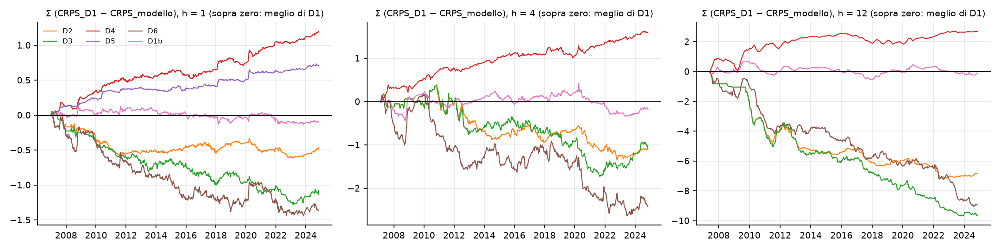
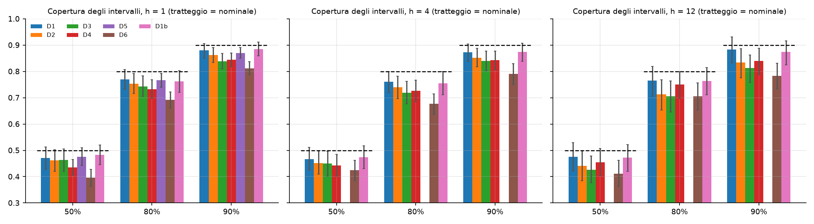
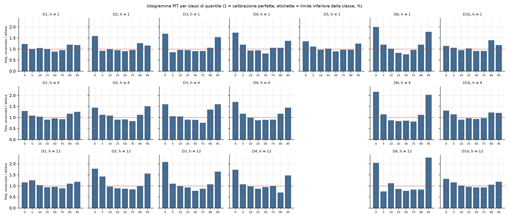
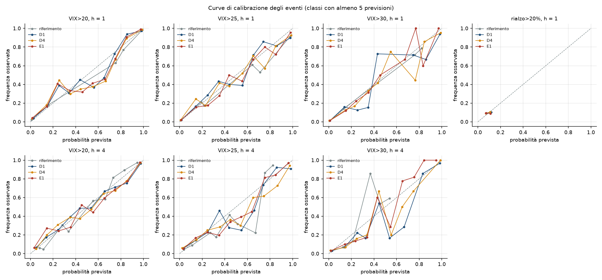

# Fase 2 — Previsione probabilistica attorno a M1 e raccolta dei dati esterni

*Report generato da `python -m src.run_phase2` (Parti A e B) e `python -m src.fetch_external` (Parte C). Ogni numero è letto dai file
`reports/fase2/*.csv` e `*.json` prodotti dal codice. Parti A e B: solo `data/processed/vix_weekly_dev.csv`, sotto la guardia che blocca l'holdout.*

## 1. Sintesi

1. **Il modello di densità migliore è la regressione quantilica sulle variabili dell'HAR (D4)**, a tutti gli orizzonti: CRPS più basso di D1 del 1,56% a h = 1, 1,33% a h = 4, 1,73% a h = 12. Dopo Holm la differenza è significativa per: D4 a h = 1, D5 a h = 1, D4 a h = 4.
2. **I guadagni sono piccoli.** Il margine del modello migliore sul riferimento D1 (M1 + errori passati incondizionati) va dal 1,3% al 1,7% del CRPS: anche per la distribuzione, con il solo VIX, c'è poco da aggiungere.
3. **Condizionare gli errori a fascia e direzione (D2, D3) e le analogie (D6) peggiorano**: meno casi per stimare le code. Significativamente peggiori di D1 dopo Holm: D3 a h = 12, D6 a h = 12.
4. **Tutti gli intervalli coprono meno del nominale.** L'intervallo al 90% copre l'88,0% con D1 e l'84,5% con D4 a h = 1. D4 vince sul CRPS perché è più stretto e si adatta allo stato, non perché sia meglio calibrato.
5. **D1 è mal calibrato per stato**: a h = 1 il suo intervallo al 90% copre il 93,8% partendo da VIX < 15 e il 74,4% partendo da VIX ≥ 30. D4 e D5 riducono questo squilibrio (87,0% e 83,7% per D4).
6. **D5 (GARCH con t asimmetrica, solo h = 1)** migliora D1 del 0,92% (p Holm 0,005), con una copertura dell'intervallo al 90% pari al 87,0%.
7. **Eventi di livello.** Tutte le densità battono la catena di Markov sul Brier: per P(VIX > 25) a h = 1 il guadagno va dal 5,2% all'8,3%. Dopo Holm (74 confronti) restano significativi: VIX>20 a h = 1: D1, D2, D3, D4, D5, D6, D1b, E1; VIX>20 a h = 4: D4.
8. **Il rialzo oltre +20% non è prevedibile.** Nessun modello batte la frequenza storica (Brier skill tra -3,3% e 0,3%; risoluzione praticamente nulla). Coerente con la Fase 1: i picchi arrivano senza preavviso.
9. **Scheda di previsione.** La regola del CRPS più basso sceglie D4 per h = 1, D4 per h = 4, D4 per h = 12. Limite emerso: D4 conosce la distribuzione solo tra il 5° e il 95° percentile, quindi assegna probabilità zero agli eventi oltre la coda.
10. **Dati esterni.** Scaricate 13 serie su 13; con storia insufficiente: oas_ig, oas_hy. Verifica del file: chiusura uguale ai dati ufficiali in 1297 settimane su 1297, `open` uguale all'apertura ufficiale in 1297.

## 2. Parte A — Modelli di densità

### 2.1 Protocollo e scelte fissate prima della valutazione

- **Centro**: previsione di M1 (tipo HAR) in log; la previsione puntuale in punti VIX è la mediana della distribuzione.
- **Errori passati**: all'origine t si usano solo gli errori delle previsioni fatte alle origini i con i + h ≤ t (esito già noto). Numero minimo: **104**.
- **Stesso insieme di origini per tutti i modelli**: h = 1: 933 previsioni, obiettivi dal 2006-12-29 al 2024-11-08, h = 4: 927 previsioni, obiettivi dal 2007-02-09 al 2024-11-08, h = 12: 911 previsioni, obiettivi dal 2007-06-01 al 2024-11-08. Il campione è più corto di quello della Fase 1 perché servono due anni di errori.
- **Quantili**: griglia comune di 19 livelli (0,05 … 0,95), che contiene i sette richiesti (5, 10, 25, 50, 75, 90, 95). **CRPS** = 2 x media della perdita quantilica sulla griglia di 19 quantili: è un'approssimazione che ignora le code oltre il 5° e il 95° percentile.
- **Regole di ripiego**: D2 usa gli errori della fascia di livello (7 fasce della Fase 1) se sono almeno 20, altrimenti tutti; D3 usa la cella fascia × direzione, poi la fascia, poi tutti, con la stessa soglia.
- **D4**: una regressione quantilica diretta per ogni livello e orizzonte, ristimata a ogni origine. Quantili incrociati: riordinati e contati.
- **D5**: GARCH(1,1) a media nulla sui residui in campione di M1, innovazioni t asimmetrica di Hansen; **limitato a h = 1** (scelta fatta prima: nessuna simulazione multi-passo). Stime: 933, fallite: 0.
- **D6**: valore attuale + variazioni osservate dopo le 30 situazioni più simili (non usa M1).
- **Probabilità degli eventi dalle densità**: frequenza empirica per D1, D2, D3, D6, D1b; funzione di ripartizione per D5; per D4 interpolazione lineare sulla griglia, proseguita nelle code con la pendenza dell'ultimo intervallo.
- **E1**: logistica sulle tre variabili dell'HAR, una per evento e orizzonte, con penalità L2 leggera (1,0 sui coefficienti standardizzati) per evitare la separazione perfetta.
- **Riferimenti per gli eventi**: catena di Markov della Fase 0 (soglie 20, 25, 30); frequenza storica espandibile per il rialzo oltre +20%.
- **Test**: Diebold-Mariano sul CRPS contro D1 e sul Brier contro il riferimento; Holm su 16 confronti (densità) e 74 (eventi).

### 2.2 Tabella principale delle densità

|   h | modello   |   n |   CRPS |   CRPS vs D1 (%) |   perdita quantilica media | cop. 50% [IC 95%]   | cop. 80% [IC 95%]   | cop. 90% [IC 95%]   |   incroci |   DM vs D1 |        p |   p Holm |
|----:|:----------|----:|-------:|-----------------:|---------------------------:|:--------------------|:--------------------|:--------------------|----------:|-----------:|---------:|---------:|
|   1 | D1        | 933 | 0.0824 |           0.0000 |                     0.0325 | 47.1 [42.8; 51.2]   | 77.0 [73.2; 80.8]   | 88.0 [85.1; 90.5]   |         0 |     –      |   –      |   –      |
|   1 | D2        | 933 | 0.0829 |          -0.6029 |                     0.0327 | 46.2 [42.0; 50.2]   | 75.3 [71.6; 79.2]   | 86.3 [83.4; 89.1]   |         0 |    -1.5803 |   0.1144 |   0.9151 |
|   1 | D3        | 933 | 0.0835 |          -1.4030 |                     0.0330 | 46.3 [42.1; 50.5]   | 74.3 [70.5; 78.2]   | 83.8 [80.9; 86.8]   |         0 |    -2.5238 |   0.0118 |   0.1295 |
|   1 | D4        | 933 | 0.0811 |           1.5598 |                     0.0317 | 43.5 [40.5; 46.4]   | 73.2 [69.8; 76.8]   | 84.5 [81.8; 87.0]   |       118 |     4.4446 |   0.0000 |   0.0002 |
|   1 | D5        | 933 | 0.0816 |           0.9237 |                     0.0322 | 47.6 [44.3; 51.0]   | 76.6 [74.0; 79.1]   | 87.0 [85.1; 89.0]   |         0 |     3.6187 |   0.0003 |   0.0047 |
|   1 | D6        | 933 | 0.0838 |          -1.7803 |                     0.0333 | 39.5 [36.3; 42.7]   | 69.1 [66.1; 72.1]   | 81.1 [78.8; 83.7]   |         0 |    -2.2675 |   0.0236 |   0.2123 |
|   1 | D1b       | 933 | 0.0825 |          -0.1291 |                     0.0326 | 48.3 [44.6; 52.0]   | 76.2 [72.0; 80.2]   | 88.4 [85.9; 91.1]   |         0 |    -0.3235 |   0.7464 |   1.0000 |
|   4 | D1        | 927 | 0.1293 |           0.0000 |                     0.0515 | 46.7 [42.4; 51.1]   | 76.1 [71.9; 80.0]   | 87.3 [83.8; 90.5]   |         0 |     –      |   –      |   –      |
|   4 | D2        | 927 | 0.1304 |          -0.9035 |                     0.0519 | 45.2 [41.0; 49.8]   | 74.0 [69.7; 78.1]   | 85.2 [81.7; 88.7]   |         0 |    -0.9728 |   0.3309 |   1.0000 |
|   4 | D3        | 927 | 0.1304 |          -0.8393 |                     0.0522 | 45.0 [40.2; 49.6]   | 72.0 [67.7; 76.2]   | 84.0 [80.2; 87.7]   |         0 |    -0.7726 |   0.4399 |   1.0000 |
|   4 | D4        | 927 | 0.1275 |           1.3340 |                     0.0504 | 44.2 [40.2; 48.4]   | 72.6 [68.5; 76.7]   | 84.3 [80.7; 87.7]   |        67 |     3.1989 |   0.0014 |   0.0185 |
|   4 | D6        | 927 | 0.1319 |          -2.0166 |                     0.0525 | 42.4 [38.4; 46.3]   | 67.7 [63.7; 71.5]   | 79.1 [75.0; 83.0]   |         0 |    -1.5364 |   0.1248 |   0.9151 |
|   4 | D1b       | 927 | 0.1295 |          -0.1525 |                     0.0515 | 47.4 [43.1; 51.7]   | 75.5 [71.1; 80.0]   | 87.4 [83.9; 90.7]   |         0 |    -0.2541 |   0.7994 |   1.0000 |
|  12 | D1        | 911 | 0.1700 |           0.0000 |                     0.0677 | 47.5 [42.1; 53.0]   | 76.5 [70.6; 82.0]   | 88.3 [83.3; 93.1]   |         0 |     –      |   –      |   –      |
|  12 | D2        | 911 | 0.1775 |          -4.4197 |                     0.0710 | 44.1 [38.5; 49.8]   | 71.2 [65.3; 76.8]   | 83.3 [77.6; 88.7]   |         0 |    -2.5210 |   0.0119 |   0.1295 |
|  12 | D3        | 911 | 0.1806 |          -6.2331 |                     0.0722 | 42.6 [37.7; 47.9]   | 70.5 [64.5; 76.4]   | 81.3 [75.8; 86.3]   |         0 |    -3.2922 |   0.0010 |   0.0145 |
|  12 | D4        | 911 | 0.1671 |           1.7275 |                     0.0664 | 45.4 [40.4; 50.7]   | 75.1 [69.8; 80.0]   | 84.0 [78.8; 88.7]   |        55 |     1.4795 |   0.1394 |   0.9151 |
|  12 | D6        | 911 | 0.1798 |          -5.7659 |                     0.0723 | 41.2 [36.2; 46.2]   | 70.5 [65.4; 75.6]   | 78.4 [73.4; 83.1]   |         0 |    -3.0469 |   0.0024 |   0.0286 |
|  12 | D1b       | 911 | 0.1702 |          -0.0759 |                     0.0677 | 47.2 [42.1; 52.1]   | 76.4 [71.1; 81.5]   | 87.5 [82.4; 91.6]   |         0 |    -0.0895 |   0.9287 |   1.0000 |

(CRPS vs D1: positivo = meglio di D1. Copertura in percentuale con intervallo di confidenza bootstrap a blocchi.)



Perdita quantilica per ciascun quantile:

|   h | modello   |    q05 |    q10 |    q25 |    q50 |    q75 |    q90 |    q95 |
|----:|:----------|-------:|-------:|-------:|-------:|-------:|-------:|-------:|
|   1 | D1        | 0.0131 | 0.0220 | 0.0399 | 0.0538 | 0.0483 | 0.0305 | 0.0201 |
|   1 | D2        | 0.0128 | 0.0216 | 0.0397 | 0.0545 | 0.0490 | 0.0309 | 0.0204 |
|   1 | D3        | 0.0127 | 0.0214 | 0.0395 | 0.0549 | 0.0495 | 0.0319 | 0.0213 |
|   1 | D4        | 0.0117 | 0.0204 | 0.0390 | 0.0538 | 0.0480 | 0.0299 | 0.0194 |
|   1 | D5        | 0.0127 | 0.0212 | 0.0392 | 0.0537 | 0.0481 | 0.0304 | 0.0202 |
|   1 | D6        | 0.0136 | 0.0226 | 0.0404 | 0.0547 | 0.0491 | 0.0313 | 0.0212 |
|   1 | D1b       | 0.0136 | 0.0225 | 0.0404 | 0.0538 | 0.0480 | 0.0300 | 0.0200 |
|   4 | D1        | 0.0184 | 0.0316 | 0.0603 | 0.0841 | 0.0781 | 0.0520 | 0.0358 |
|   4 | D2        | 0.0176 | 0.0309 | 0.0603 | 0.0851 | 0.0791 | 0.0533 | 0.0366 |
|   4 | D3        | 0.0181 | 0.0312 | 0.0595 | 0.0849 | 0.0789 | 0.0541 | 0.0386 |
|   4 | D4        | 0.0166 | 0.0296 | 0.0585 | 0.0837 | 0.0780 | 0.0518 | 0.0347 |
|   4 | D6        | 0.0183 | 0.0309 | 0.0606 | 0.0851 | 0.0814 | 0.0540 | 0.0373 |
|   4 | D1b       | 0.0189 | 0.0321 | 0.0606 | 0.0839 | 0.0780 | 0.0518 | 0.0352 |
|  12 | D1        | 0.0216 | 0.0381 | 0.0757 | 0.1107 | 0.1058 | 0.0728 | 0.0491 |
|  12 | D2        | 0.0221 | 0.0392 | 0.0785 | 0.1155 | 0.1101 | 0.0780 | 0.0539 |
|  12 | D3        | 0.0230 | 0.0400 | 0.0800 | 0.1168 | 0.1118 | 0.0794 | 0.0544 |
|  12 | D4        | 0.0214 | 0.0372 | 0.0747 | 0.1094 | 0.1040 | 0.0698 | 0.0482 |
|  12 | D6        | 0.0227 | 0.0389 | 0.0778 | 0.1162 | 0.1135 | 0.0797 | 0.0575 |
|  12 | D1b       | 0.0214 | 0.0383 | 0.0761 | 0.1111 | 0.1057 | 0.0720 | 0.0492 |

- **D4 è il migliore a ogni orizzonte.** A h = 1 il guadagno maggiore è sul quantile 5% (perdita quantilica più bassa del 10,6% rispetto a D1); sulla mediana è 0,1%. Quantili incrociati (riordinati): 118 origini su 933 a h = 1, 67 a h = 4, 55 a h = 12.
- **D5** segue a h = 1; **D1b** (centro M7) è indistinguibile da D1 (-0,13%, -0,15%, -0,08%): cambiare il centro non serve.
- **D2, D3 e D6 sono peggiori di D1 a tutti gli orizzonti.** A h = 12 la perdita è marcata (-4,4%, -6,2%, -5,8%): suddividere pochi errori in celle rende instabili le code.

### 2.3 Copertura, larghezza e asimmetria degli errori



Quota di valori reali sopra il limite superiore e sotto il limite inferiore di ogni intervallo (in %; valore nominale per lato: 25, 10 e 5), larghezza media e
errore assoluto medio della mediana:

|   h | modello   |   50%: sopra |   50%: sotto |   50%: larghezza (punti VIX) |   80%: sopra |   80%: sotto |   80%: larghezza (punti VIX) |   90%: sopra |   90%: sotto |   90%: larghezza (punti VIX) |   MAE mediana (punti VIX) |
|----:|:----------|-------------:|-------------:|-----------------------------:|-------------:|-------------:|-----------------------------:|-------------:|-------------:|-----------------------------:|--------------------------:|
|   1 | D1        |        26.15 |        26.80 |                         3.17 |        11.90 |        11.15 |                         6.08 |         5.89 |         6.11 |                         8.44 |                      2.24 |
|   1 | D2        |        26.47 |        27.33 |                         3.23 |        12.11 |        12.54 |                         6.10 |         5.79 |         7.93 |                         8.25 |                      2.27 |
|   1 | D3        |        26.58 |        27.12 |                         3.23 |        12.97 |        12.75 |                         6.03 |         7.72 |         8.47 |                         8.07 |                      2.28 |
|   1 | D4        |        27.87 |        28.62 |                         3.11 |        12.11 |        14.68 |                         5.99 |         6.86 |         8.68 |                         8.00 |                      2.23 |
|   1 | D5        |        25.62 |        26.80 |                         3.19 |        11.04 |        12.33 |                         6.37 |         6.22 |         6.75 |                         8.65 |                      2.23 |
|   1 | D6        |        29.26 |        31.19 |                         2.92 |        14.90 |        15.97 |                         5.70 |         8.90 |         9.97 |                         7.42 |                      2.28 |
|   1 | D1b       |        26.47 |        25.19 |                         3.14 |        12.86 |        10.93 |                         5.97 |         5.89 |         5.68 |                         8.62 |                      2.24 |
|   4 | D1        |        25.89 |        27.40 |                         4.45 |        12.08 |        11.87 |                         9.49 |         6.26 |         6.47 |                        14.48 |                      3.49 |
|   4 | D2        |        25.67 |        29.13 |                         4.67 |        13.16 |        12.84 |                         9.54 |         7.55 |         7.23 |                        14.16 |                      3.53 |
|   4 | D3        |        26.11 |        28.91 |                         4.70 |        14.78 |        13.27 |                         9.36 |         7.98 |         7.98 |                        13.91 |                      3.53 |
|   4 | D4        |        26.54 |        29.23 |                         4.50 |        13.05 |        14.35 |                         9.24 |         7.23 |         8.52 |                        13.24 |                      3.48 |
|   4 | D6        |        28.05 |        29.56 |                         4.35 |        15.75 |        16.50 |                         8.68 |        10.14 |        10.79 |                        11.77 |                      3.52 |
|   4 | D1b       |        26.75 |        25.89 |                         4.38 |        12.19 |        12.30 |                         9.41 |         6.04 |         6.58 |                        14.44 |                      3.47 |
|  12 | D1        |        24.81 |        27.66 |                         6.06 |        11.42 |        12.07 |                        13.71 |         5.93 |         5.82 |                        21.41 |                      4.61 |
|  12 | D2        |        25.36 |        30.52 |                         6.44 |        12.73 |        16.03 |                        14.90 |         7.79 |         8.89 |                        22.41 |                      4.81 |
|  12 | D3        |        26.67 |        30.74 |                         6.32 |        13.61 |        15.92 |                        15.23 |         8.23 |        10.43 |                        22.01 |                      4.86 |
|  12 | D4        |        25.80 |        28.76 |                         5.78 |        10.87 |        14.05 |                        13.22 |         7.35 |         8.67 |                        18.97 |                      4.54 |
|  12 | D6        |        28.10 |        30.74 |                         6.10 |        15.59 |        13.94 |                        13.07 |        11.42 |        10.21 |                        17.74 |                      4.84 |
|  12 | D1b       |        25.14 |        27.66 |                         6.13 |        11.20 |        12.40 |                        13.62 |         5.93 |         6.59 |                        21.40 |                      4.62 |

- **Sottocopertura generale.** L'intervallo di confidenza della copertura al 90% contiene il 90% solo per: D1 a h = 1, D1b a h = 1, D1 a h = 4, D1b a h = 4, D1 a h = 12, D1b a h = 12. Una spiegazione plausibile: gli errori passati sottostimano la dispersione futura quando arrivano episodi più violenti di quelli già visti (il campione di valutazione comprende il 2008, il 2011 e il 2020).
- **Compromesso tra nitidezza e calibrazione.** D4 ha intervalli più stretti di D1 (all'80%, 5,99 punti contro 6,08 a h = 1) e copre meno (73,2% contro 77,0%).
- **Asimmetria.** Per D1 gli sforamenti dell'intervallo al 90% sono quasi simmetrici (5,9% sopra, 6,1% sotto a h = 1). Per D4 sono più frequenti verso il basso (6,9% sopra, 8,7% sotto): il suo limite inferiore è più vicino al centro, e questo gli fa perdere copertura pur migliorando la perdita quantilica. Per D6 gli sforamenti sono i più numerosi su entrambi i lati (8,9% e 10,0%).

### 2.4 Istogramma PIT

Con sette quantili il PIT si legge su otto classi: frequenza con cui il valore reale cade in ciascuna (in %). Frequenze attese: 0-5%: 5%, 5-10%: 5%, 10-25%: 15%, 25-50%: 25%, 50-75%: 25%, 75-90%: 15%, 90-95%: 5%, 95-100%: 5%.



|   h | modello   |   0-5% |   5-10% |   10-25% |   25-50% |   50-75% |   75-90% |   90-95% |   95-100% |
|----:|:----------|-------:|--------:|---------:|---------:|---------:|---------:|---------:|----------:|
|   1 | D1        |    6.1 |     5.0 |     15.6 |     25.0 |     22.1 |     14.3 |      6.0 |       5.9 |
|   1 | D2        |    7.9 |     4.6 |     14.8 |     23.7 |     22.5 |     14.4 |      6.3 |       5.8 |
|   1 | D3        |    8.5 |     4.3 |     14.4 |     23.8 |     22.5 |     13.6 |      5.3 |       7.7 |
|   1 | D4        |    8.7 |     6.0 |     13.9 |     23.5 |     20.0 |     15.8 |      5.3 |       6.9 |
|   1 | D5        |    6.8 |     5.6 |     14.5 |     25.3 |     22.3 |     14.6 |      4.8 |       6.2 |
|   1 | D6        |   10.0 |     6.0 |     15.2 |     20.6 |     19.0 |     14.4 |      6.0 |       8.9 |
|   1 | D1b       |    5.7 |     5.3 |     14.3 |     25.6 |     22.7 |     13.6 |      7.0 |       5.9 |
|   4 | D1        |    6.5 |     5.4 |     15.5 |     22.7 |     24.1 |     13.8 |      5.8 |       6.3 |
|   4 | D2        |    7.2 |     5.6 |     16.3 |     22.4 |     22.8 |     12.5 |      5.6 |       7.6 |
|   4 | D3        |    8.0 |     5.3 |     15.6 |     22.7 |     22.3 |     11.3 |      6.8 |       8.0 |
|   4 | D4        |    8.5 |     5.8 |     14.9 |     21.9 |     22.3 |     13.5 |      5.8 |       7.2 |
|   4 | D6        |   10.8 |     5.7 |     13.1 |     20.9 |     21.5 |     12.3 |      5.6 |      10.1 |
|   4 | D1b       |    6.6 |     5.7 |     13.6 |     24.2 |     23.2 |     14.6 |      6.1 |       6.0 |
|  12 | D1        |    5.8 |     6.3 |     15.6 |     23.5 |     24.0 |     13.4 |      5.5 |       5.9 |
|  12 | D2        |    8.9 |     7.1 |     14.5 |     22.4 |     21.7 |     12.6 |      4.9 |       7.8 |
|  12 | D3        |   10.4 |     5.5 |     14.8 |     23.2 |     19.4 |     13.1 |      5.4 |       8.2 |
|  12 | D4        |    8.7 |     5.4 |     14.7 |     21.7 |     23.7 |     14.9 |      3.5 |       7.4 |
|  12 | D6        |   10.2 |     3.7 |     16.8 |     21.6 |     19.5 |     12.5 |      4.2 |      11.4 |
|  12 | D1b       |    6.6 |     5.8 |     15.3 |     23.9 |     23.3 |     13.9 |      5.3 |       5.9 |

Le classi estreme (sotto il 5° e sopra il 95° percentile) sono più popolate del dovuto per tutti i modelli: le code previste sono troppo corte.

### 2.5 Eventi

Brier score (più basso è meglio; RIF = riferimento):

| evento     |   h |   n |   freq. evento |    RIF |     D1 |     D2 |     D3 |     D4 |       D5 |     D6 |    D1b |     E1 |
|:-----------|----:|----:|---------------:|-------:|-------:|-------:|-------:|-------:|---------:|-------:|-------:|-------:|
| VIX>20     |   1 | 933 |         0.3666 | 0.0929 | 0.0773 | 0.0783 | 0.0795 | 0.0763 |   0.0767 | 0.0801 | 0.0775 | 0.0779 |
| VIX>25     |   1 | 933 |         0.1844 | 0.0688 | 0.0643 | 0.0647 | 0.0652 | 0.0631 |   0.0635 | 0.0649 | 0.0647 | 0.0637 |
| VIX>30     |   1 | 933 |         0.0922 | 0.0363 | 0.0313 | 0.0312 | 0.0315 | 0.0322 |   0.0316 | 0.0329 | 0.0309 | 0.0312 |
| rialzo>20% |   1 | 933 |         0.0932 | 0.0850 | 0.0854 | 0.0864 | 0.0877 | 0.0848 |   0.0864 | 0.0877 | 0.0851 | 0.0847 |
| VIX>20     |   4 | 927 |         0.3689 | 0.1363 | 0.1249 | 0.1262 | 0.1276 | 0.1220 |   –      | 0.1315 | 0.1278 | 0.1251 |
| VIX>25     |   4 | 927 |         0.1855 | 0.1025 | 0.0971 | 0.0971 | 0.0967 | 0.0984 |   –      | 0.1018 | 0.0982 | 0.0993 |
| VIX>30     |   4 | 927 |         0.0928 | 0.0599 | 0.0489 | 0.0491 | 0.0505 | 0.0500 |   –      | 0.0519 | 0.0488 | 0.0496 |
| VIX>20     |  12 | 911 |         0.3754 | 0.1898 | 0.1629 | 0.1729 | 0.1771 | 0.1629 |   –      | 0.1757 | 0.1642 | 0.1650 |
| VIX>25     |  12 | 911 |         0.1888 | 0.1346 | 0.1292 | 0.1393 | 0.1413 | 0.1279 |   –      | 0.1407 | 0.1302 | 0.1249 |
| VIX>30     |  12 | 911 |         0.0944 | 0.0817 | 0.0764 | 0.0783 | 0.0795 | 0.0739 |   –      | 0.0817 | 0.0745 | 0.0746 |

Brier skill rispetto al riferimento, in % (positivo = meglio; * = significativo al 5% dopo Holm):

| evento     |   h | D1     | D2     | D3     | D4     | D5     | D6     | D1b    | E1     |
|:-----------|----:|:-------|:-------|:-------|:-------|:-------|:-------|:-------|:-------|
| VIX>20     |   1 | +16.8* | +15.8* | +14.4* | +17.9* | +17.4* | +13.7* | +16.6* | +16.1* |
| VIX>25     |   1 | +6.6   | +5.9   | +5.2   | +8.3   | +7.7   | +5.7   | +6.0   | +7.4   |
| VIX>30     |   1 | +13.8  | +13.9  | +13.1  | +11.1  | +12.8  | +9.4   | +14.7  | +13.9  |
| rialzo>20% |   1 | -0.5   | -1.6   | -3.3*  | +0.2   | -1.7   | -3.2   | -0.2   | +0.3   |
| VIX>20     |   4 | +8.4   | +7.4   | +6.4   | +10.5* |   –    | +3.5   | +6.2   | +8.2   |
| VIX>25     |   4 | +5.3   | +5.2   | +5.7   | +4.0   |   –    | +0.6   | +4.2   | +3.1   |
| VIX>30     |   4 | +18.4  | +18.0  | +15.8  | +16.6  |   –    | +13.5  | +18.5  | +17.1  |
| VIX>20     |  12 | +14.2  | +8.9   | +6.7   | +14.2  |   –    | +7.4   | +13.5  | +13.1  |
| VIX>25     |  12 | +4.0   | -3.4   | -4.9   | +5.0   |   –    | -4.5   | +3.3   | +7.2   |
| VIX>30     |  12 | +6.5   | +4.1   | +2.7   | +9.6   |   –    | +0.0   | +8.8   | +8.8   |

Scomposizione del Brier (h = 1 e 4; affidabilità: più bassa è meglio; risoluzione: più alta è meglio):

| evento     |   h | modello   |   prob. media |   freq. evento |   brier |   affidabilità |   risoluzione |   incertezza |
|:-----------|----:|:----------|--------------:|---------------:|--------:|---------------:|--------------:|-------------:|
| VIX>20     |   1 | RIF       |        0.3741 |         0.3666 |  0.0929 |         0.0019 |        0.1418 |       0.2322 |
| VIX>20     |   1 | D1        |        0.3656 |         0.3666 |  0.0773 |         0.0030 |        0.1567 |       0.2322 |
| VIX>20     |   1 | D4        |        0.3608 |         0.3666 |  0.0763 |         0.0044 |        0.1592 |       0.2322 |
| VIX>20     |   1 | D5        |        0.3639 |         0.3666 |  0.0767 |         0.0042 |        0.1602 |       0.2322 |
| VIX>20     |   1 | E1        |        0.3554 |         0.3666 |  0.0779 |         0.0035 |        0.1565 |       0.2322 |
| VIX>25     |   1 | RIF       |        0.1939 |         0.1844 |  0.0688 |         0.0013 |        0.0830 |       0.1504 |
| VIX>25     |   1 | D1        |        0.1859 |         0.1844 |  0.0643 |         0.0018 |        0.0872 |       0.1504 |
| VIX>25     |   1 | D4        |        0.1797 |         0.1844 |  0.0631 |         0.0016 |        0.0881 |       0.1504 |
| VIX>25     |   1 | D5        |        0.1843 |         0.1844 |  0.0635 |         0.0018 |        0.0886 |       0.1504 |
| VIX>25     |   1 | E1        |        0.1889 |         0.1844 |  0.0637 |         0.0014 |        0.0870 |       0.1504 |
| VIX>30     |   1 | RIF       |        0.0918 |         0.0922 |  0.0363 |         0.0004 |        0.0479 |       0.0837 |
| VIX>30     |   1 | D1        |        0.0955 |         0.0922 |  0.0313 |         0.0024 |        0.0539 |       0.0837 |
| VIX>30     |   1 | D4        |        0.0907 |         0.0922 |  0.0322 |         0.0016 |        0.0522 |       0.0837 |
| VIX>30     |   1 | D5        |        0.0941 |         0.0922 |  0.0316 |         0.0032 |        0.0549 |       0.0837 |
| VIX>30     |   1 | E1        |        0.0920 |         0.0922 |  0.0312 |         0.0010 |        0.0529 |       0.0837 |
| rialzo>20% |   1 | RIF       |        0.0746 |         0.0932 |  0.0850 |         0.0003 |        0.0000 |       0.0846 |
| rialzo>20% |   1 | D1        |        0.0864 |         0.0932 |  0.0854 |         0.0002 |        0.0000 |       0.0846 |
| rialzo>20% |   1 | D4        |        0.0775 |         0.0932 |  0.0848 |         0.0003 |        0.0000 |       0.0846 |
| rialzo>20% |   1 | D5        |        0.0873 |         0.0932 |  0.0864 |         0.0017 |        0.0001 |       0.0846 |
| rialzo>20% |   1 | E1        |        0.0774 |         0.0932 |  0.0847 |         0.0006 |        0.0000 |       0.0846 |
| VIX>20     |   4 | RIF       |        0.3922 |         0.3689 |  0.1363 |         0.0036 |        0.1006 |       0.2328 |
| VIX>20     |   4 | D1        |        0.3647 |         0.3689 |  0.1249 |         0.0012 |        0.1090 |       0.2328 |
| VIX>20     |   4 | D4        |        0.3650 |         0.3689 |  0.1220 |         0.0017 |        0.1133 |       0.2328 |
| VIX>20     |   4 | E1        |        0.3601 |         0.3689 |  0.1251 |         0.0038 |        0.1105 |       0.2328 |
| VIX>25     |   4 | RIF       |        0.2063 |         0.1855 |  0.1025 |         0.0061 |        0.0549 |       0.1511 |
| VIX>25     |   4 | D1        |        0.1889 |         0.1855 |  0.0971 |         0.0046 |        0.0577 |       0.1511 |
| VIX>25     |   4 | D4        |        0.1803 |         0.1855 |  0.0984 |         0.0031 |        0.0547 |       0.1511 |
| VIX>25     |   4 | E1        |        0.1963 |         0.1855 |  0.0993 |         0.0042 |        0.0541 |       0.1511 |
| VIX>30     |   4 | RIF       |        0.0950 |         0.0928 |  0.0599 |         0.0031 |        0.0271 |       0.0842 |
| VIX>30     |   4 | D1        |        0.1041 |         0.0928 |  0.0489 |         0.0032 |        0.0373 |       0.0842 |
| VIX>30     |   4 | D4        |        0.0919 |         0.0928 |  0.0500 |         0.0030 |        0.0370 |       0.0842 |
| VIX>30     |   4 | E1        |        0.0953 |         0.0928 |  0.0496 |         0.0030 |        0.0373 |       0.0842 |



- **Soglie di livello.** Le probabilità ricavate dalle densità sono migliori di quelle della catena di Markov a h = 1 e h = 4 per tutte e tre le soglie. Il guadagno viene dalla risoluzione: una densità continua sa quanto il VIX è vicino alla soglia, la catena solo in quale fascia si trova.
- **Dopo Holm** restano significativi: VIX>20 a h = 1: D1, D2, D3, D4, D5, D6, D1b, E1; VIX>20 a h = 4: D4. Gli altri guadagni hanno lo stesso segno ma non superano la correzione su 74 confronti.
- **E1 (logistica diretta) non fa meglio delle densità**: per P(VIX > 25) a h = 1 ha Brier 0,0637 contro 0,0631 di D4 e 0,0643 di D1. Non serve un modello separato per gli eventi.
- **Rialzo oltre +20%.** Frequenza osservata 9,3%. Nessun modello migliora la frequenza storica; significativamente peggiori dopo Holm: D3 per rialzo>20% a h = 1. La risoluzione è prossima a zero per tutti: l'evento non è prevedibile con il solo VIX.
- **h = 12.** Confronti significativi dopo Holm: 0. A questo orizzonte nessun modello si distingue in modo dimostrabile dalla catena di Markov.

### 2.6 Per sottoperiodo, fascia di partenza e sottoinsiemi a posteriori

Per ogni suddivisione: CRPS rispetto a D1 in % (positivo = meglio) e copertura dell'intervallo al 90% in %. h = 1 e 4; le tabelle complete, compreso h = 12 e
gli eventi, sono in `reports/fase2/a_densita_*.csv` e `a_eventi_*.csv`. Test non corretti per confronti multipli.

**Sottoperiodo (data dell'obiettivo)** — CRPS vs D1:

|   h | sottoperiodo   |   n |   D1 |   D2 |   D3 |   D4 |    D5 |   D6 |   D1b |
|----:|:---------------|----:|-----:|-----:|-----:|-----:|------:|-----:|------:|
|   1 | 2005-2009      | 158 |  0.0 | -2.8 | -3.3 |  2.8 |   2.0 | -3.3 |   0.1 |
|   1 | 2010-2014      | 260 |  0.0 | -0.8 | -1.1 |  1.4 |   0.6 | -2.4 |  -0.0 |
|   1 | 2015-2019      | 261 |  0.0 |  0.5 | -1.5 |  0.5 |   0.6 | -1.3 |  -0.2 |
|   1 | 2020-2024      | 254 |  0.0 | -0.3 | -0.6 |  2.2 |   1.0 | -0.8 |  -0.3 |
|   4 | 2005-2009      | 152 |  0.0 | -0.5 | -0.5 |  2.6 |   –   |  0.6 |   0.9 |
|   4 | 2010-2014      | 260 |  0.0 | -2.4 | -1.4 |  1.5 |   –   | -4.4 |  -0.3 |
|   4 | 2015-2019      | 261 |  0.0 |  0.6 | -1.1 |  0.1 |   –   | -0.4 |   0.3 |
|   4 | 2020-2024      | 254 |  0.0 | -1.3 | -0.3 |  1.6 |   –   | -3.1 |  -1.2 |

Copertura al 90%:

|   h | sottoperiodo   |   n |   D1 |   D2 |   D3 |   D4 |    D5 |   D6 |   D1b |
|----:|:---------------|----:|-----:|-----:|-----:|-----:|------:|-----:|------:|
|   1 | 2005-2009      | 158 | 88.0 | 86.1 | 84.8 | 86.1 |  87.3 | 81.0 |  88.0 |
|   1 | 2010-2014      | 260 | 88.1 | 86.9 | 83.1 | 82.3 |  88.1 | 79.2 |  89.6 |
|   1 | 2015-2019      | 261 | 86.6 | 82.8 | 80.5 | 81.6 |  84.7 | 78.9 |  87.7 |
|   1 | 2020-2024      | 254 | 89.4 | 89.4 | 87.4 | 88.6 |  88.2 | 85.4 |  88.2 |
|   4 | 2005-2009      | 152 | 84.9 | 84.9 | 85.5 | 82.9 |   –   | 72.4 |  84.2 |
|   4 | 2010-2014      | 260 | 88.1 | 84.2 | 82.3 | 84.6 |   –   | 77.7 |  88.8 |
|   4 | 2015-2019      | 261 | 84.7 | 81.6 | 79.3 | 80.5 |   –   | 79.7 |  84.3 |
|   4 | 2020-2024      | 254 | 90.6 | 90.2 | 89.8 | 88.6 |   –   | 83.9 |  90.9 |

**Fascia di partenza** — CRPS vs D1:

|   h | fascia_origine   |   n |   D1 |   D2 |   D3 |   D4 |    D5 |   D6 |   D1b |
|----:|:-----------------|----:|-----:|-----:|-----:|-----:|------:|-----:|------:|
|   1 | <15              | 324 |  0.0 | -0.2 | -1.3 |  0.7 |   0.5 | -1.3 |   0.7 |
|   1 | 15-20            | 267 |  0.0 | -1.6 | -2.8 |  0.4 |   0.2 | -2.9 |  -1.2 |
|   1 | 20-25            | 170 |  0.0 | -0.0 | -0.1 |  1.7 |   0.8 | -3.6 |  -0.4 |
|   1 | 25-30            |  86 |  0.0 | -0.7 | -1.6 |  3.4 |   1.3 | -0.8 |  -2.1 |
|   1 | >=30             |  86 |  0.0 | -0.1 | -0.1 |  4.9 |   3.9 |  2.2 |   2.3 |
|   4 | <15              | 321 |  0.0 | -1.2 | -0.9 |  2.0 |   –   | -0.6 |   0.2 |
|   4 | 15-20            | 266 |  0.0 | -1.4 | -1.5 |  0.2 |   –   | -3.2 |  -0.3 |
|   4 | 20-25            | 168 |  0.0 | -0.2 | -0.5 |  2.3 |   –   | -2.5 |  -1.7 |
|   4 | 25-30            |  86 |  0.0 | -0.5 |  0.9 |  1.6 |   –   | -4.5 |  -1.9 |
|   4 | >=30             |  86 |  0.0 | -0.2 | -0.7 |  1.1 |   –   |  0.2 |   3.3 |

Copertura al 90%:

|   h | fascia_origine   |   n |   D1 |   D2 |   D3 |   D4 |    D5 |   D6 |   D1b |
|----:|:-----------------|----:|-----:|-----:|-----:|-----:|------:|-----:|------:|
|   1 | <15              | 324 | 93.8 | 87.7 | 84.0 | 87.0 |  89.8 | 82.4 |  93.8 |
|   1 | 15-20            | 267 | 86.9 | 88.0 | 85.8 | 81.3 |  85.8 | 82.4 |  88.0 |
|   1 | 20-25            | 170 | 85.3 | 85.9 | 81.8 | 80.6 |  82.4 | 74.1 |  85.3 |
|   1 | 25-30            |  86 | 88.4 | 84.9 | 87.2 | 93.0 |  91.9 | 90.7 |  88.4 |
|   1 | >=30             |  86 | 74.4 | 77.9 | 77.9 | 83.7 |  84.9 | 76.7 |  75.6 |
|   4 | <15              | 321 | 91.6 | 82.9 | 81.9 | 87.5 |   –   | 83.5 |  91.6 |
|   4 | 15-20            | 266 | 84.2 | 88.3 | 86.1 | 78.9 |   –   | 75.6 |  85.7 |
|   4 | 20-25            | 168 | 86.9 | 87.5 | 86.3 | 82.7 |   –   | 78.0 |  85.1 |
|   4 | 25-30            |  86 | 84.9 | 81.4 | 81.4 | 84.9 |   –   | 81.4 |  84.9 |
|   4 | >=30             |  86 | 83.7 | 83.7 | 83.7 | 90.7 |   –   | 73.3 |  83.7 |

**Dopo un picco** (etichetta assegnata a posteriori) — CRPS vs D1 e copertura al 90%:

|   h | dopo_picco                   |   n |   D1 |   D2 |   D3 |   D4 |    D5 |   D6 |   D1b |
|----:|:-----------------------------|----:|-----:|-----:|-----:|-----:|------:|-----:|------:|
|   1 | altre origini                | 754 |  0.0 | -0.3 | -1.1 |  1.8 |   0.9 | -0.7 |   0.0 |
|   1 | entro 12 sett. dopo un picco | 179 |  0.0 | -1.9 | -2.9 |  0.6 |   1.0 | -6.2 |  -0.9 |
|   4 | altre origini                | 748 |  0.0 | -0.7 | -0.7 |  1.4 |   –   | -1.2 |   0.2 |
|   4 | entro 12 sett. dopo un picco | 179 |  0.0 | -1.7 | -1.5 |  0.9 |   –   | -5.9 |  -1.9 |

|   h | dopo_picco                   |   n |   D1 |   D2 |   D3 |   D4 |    D5 |   D6 |   D1b |
|----:|:-----------------------------|----:|-----:|-----:|-----:|-----:|------:|-----:|------:|
|   1 | altre origini                | 754 | 88.5 | 86.5 | 84.2 | 84.6 |  87.0 | 81.3 |  88.9 |
|   1 | entro 12 sett. dopo un picco | 179 | 86.0 | 85.5 | 82.1 | 83.8 |  87.2 | 80.4 |  86.6 |
|   4 | altre origini                | 748 | 86.4 | 84.1 | 82.9 | 84.1 |   –   | 79.3 |  86.5 |
|   4 | entro 12 sett. dopo un picco | 179 | 91.1 | 89.9 | 88.8 | 84.9 |   –   | 78.2 |  91.1 |

**Dentro un periodo calmo** (etichetta assegnata a posteriori) — CRPS vs D1 e copertura al 90%:

|   h | periodo_calmo           |   n |   D1 |   D2 |   D3 |   D4 |    D5 |   D6 |   D1b |
|----:|:------------------------|----:|-----:|-----:|-----:|-----:|------:|-----:|------:|
|   1 | dentro un periodo calmo | 246 |  0.0 |  0.1 | -0.2 |  1.6 |   0.8 |  0.6 |   0.8 |
|   1 | altre origini           | 687 |  0.0 | -0.8 | -1.7 |  1.6 |   1.0 | -2.4 |  -0.4 |
|   4 | dentro un periodo calmo | 243 |  0.0 | -1.0 | -0.2 |  2.3 |   –   | -0.3 |   0.7 |
|   4 | altre origini           | 684 |  0.0 | -0.9 | -1.0 |  1.1 |   –   | -2.5 |  -0.4 |

|   h | periodo_calmo           |   n |   D1 |   D2 |   D3 |   D4 |    D5 |   D6 |   D1b |
|----:|:------------------------|----:|-----:|-----:|-----:|-----:|------:|-----:|------:|
|   1 | dentro un periodo calmo | 246 | 94.7 | 87.8 | 84.6 | 89.0 |  90.7 | 84.6 |  94.7 |
|   1 | altre origini           | 687 | 85.6 | 85.7 | 83.6 | 82.8 |  85.7 | 79.9 |  86.2 |
|   4 | dentro un periodo calmo | 243 | 92.6 | 83.1 | 82.3 | 88.9 |   –   | 84.0 |  92.6 |
|   4 | altre origini           | 684 | 85.4 | 86.0 | 84.6 | 82.6 |   –   | 77.3 |  85.5 |

P(VIX > 25): Brier skill rispetto alla catena di Markov per fascia di partenza (%):

|   h | fascia_origine   |   n |   freq. evento (%) |   D1 |   D2 |   D3 |   D4 |    D5 |   D6 |   D1b |   E1 |
|----:|:-----------------|----:|-------------------:|-----:|-----:|-----:|-----:|------:|-----:|------:|-----:|
|   1 | <15              | 324 |                0.3 |  0.1 | -0.1 | -0.4 |  0.2 |  -0.1 | -0.6 |   0.2 |  0.2 |
|   1 | 15-20            | 267 |                3.4 |  1.4 |  0.4 |  0.2 |  0.7 |   0.6 | -2.7 |   1.2 |  1.4 |
|   1 | 20-25            | 170 |               18.8 | 10.2 |  9.0 |  8.2 | 10.8 |   9.7 |  8.4 |  10.2 |  9.9 |
|   1 | 25-30            |  86 |               59.3 |  4.5 |  3.8 |  3.1 |  7.6 |   7.9 |  5.8 |   3.6 |  4.8 |
|   1 | >=30             |  86 |               91.9 |  7.0 |  8.9 |  8.2 | 11.8 |   9.7 |  7.1 |   4.4 | 14.7 |
|   4 | <15              | 321 |                2.2 | -0.3 | -1.5 | -2.1 | -1.5 |   –   | -2.1 |  -0.2 |  0.2 |
|   4 | 15-20            | 266 |               10.5 | -0.1 |  0.1 | -2.2 | -2.5 |   –   | -1.5 |  -0.7 |  0.9 |
|   4 | 20-25            | 168 |               20.2 |  8.8 |  6.1 |  4.5 |  7.6 |   –   |  4.7 |   7.9 |  3.8 |
|   4 | 25-30            |  86 |               38.4 |  3.0 |  5.1 | 11.9 |  1.2 |   –   | -4.9 |   1.0 | -3.0 |
|   4 | >=30             |  86 |               81.4 | 15.3 | 17.7 | 18.3 | 16.7 |   –   |  6.6 |  13.3 | 18.3 |

- **D1 è calibrato in media ma non per stato.** Copre troppo quando il VIX è basso e troppo poco quando è alto: a h = 1, 93,8% sotto 15 e 74,4% da 30 in su. Gli errori in log sono più ampi a livelli alti, e una distribuzione unica non può saperlo.
- **D4 guadagna di più dove D1 è più sbagliato**: CRPS migliore del 4,9% partendo da VIX ≥ 30 e del 3,4% da 25-30 (h = 1).
- **Periodi calmi.** Dentro un periodo calmo D1 copre il 94,7% (intervalli troppo larghi), D4 l'89,0%; fuori, 85,6% e 82,8%.
- **Dopo un picco** nessun modello si distingue nettamente; D6 perde di più (-6,2% a h = 1).
- **Eventi per fascia.** Per P(VIX > 25) il guadagno sulla catena di Markov si vede solo partendo da 20 in su; sotto 20 l'evento è quasi impossibile e non c'è nulla da guadagnare. Nella fascia 20-25, dove la Fase 0 aveva trovato la catena non informativa, a h = 1 il Brier migliora del 10,2% con D1 e del 10,8% con D4.

### 2.7 Cosa implica per il modello di previsione

1. **La distribuzione va fatta dipendere dallo stato in modo continuo** (regressione quantilica o varianza condizionata), non per celle: D4 e D5 migliorano D1, D2 e D3 lo peggiorano.
2. **Gli intervalli vanno letti come un po' ottimistici**: la copertura reale è alcuni punti sotto la nominale per tutti i modelli. Una correzione di calibrazione (per esempio allargare gli intervalli in base alla copertura passata) è un'estensione naturale, da decidere prima di usarla.
3. **Un solo modello non basta per tutto.** D4 è il migliore sul CRPS ma non descrive le code oltre il 5° e il 95° percentile; D5 le descrive ma esiste solo a h = 1; le densità empiriche (D1) danno probabilità non nulle anche per gli eventi lontani dalla mediana.
4. **Gli eventi si ricavano dalla densità**: non serve un modello dedicato (E1 non aggiunge nulla).
5. **Il rialzo oltre +20% va comunicato come frequenza di base** (circa 9% delle settimane), non come previsione condizionata.

## 3. Parte B — Scheda di previsione

La funzione `src.fase2.scheda.scheda(df, t, scelta)` produce la scheda all'origine t usando solo i dati fino a t. Regola fissata prima: per ogni orizzonte
il modello con il CRPS medio più basso tra D1-D6 (h = 1: D4, h = 4: D4, h = 12: D4). D1b è escluso perché è solo un controllo.

**Esempio: scheda al 2024-11-08** (ultima data del campione di sviluppo; VIX all'origine: 14,94). Valori in punti VIX.
Nessun confronto con il valore realizzato: le settimane successive sono nell'holdout.

|   orizzonte (settimane) | modello   |   mediana | intervallo 50%   | intervallo 80%   | intervallo 90%   | P(VIX>20)   | P(VIX>25)   | P(VIX>30)   | P(rialzo>20%)   |
|------------------------:|:----------|----------:|:-----------------|:-----------------|:-----------------|:------------|:------------|:------------|:----------------|
|                       1 | D4        |      15.2 | 14.6 – 16.6      | 14.3 – 17.5      | 14.2 – 18.0      | 0.0%        | 0.0%        | 0.0%        | 6.0%            |
|                       4 | D4        |      15.4 | 14.2 – 17.3      | 13.4 – 21.1      | 13.1 – 22.6      | 12.6%       | 0.0%        | 0.0%        | –               |
|                      12 | D4        |      15.8 | 13.8 – 19.1      | 13.1 – 25.5      | 12.2 – 28.2      | 20.8%       | 10.6%       | 2.0%        | –               |

- La mediana è la previsione puntuale in punti VIX; gli intervalli sono asimmetrici verso l'alto, come ci si aspetta partendo da un VIX basso.
- **Limite della regola.** In questa scheda 5 probabilità valgono esattamente zero (VIX>20 a h = 1, VIX>25 a h = 1, VIX>30 a h = 1, VIX>25 a h = 4, VIX>30 a h = 4): D4 conosce solo i quantili tra il 5° e il 95° e, oltre, prosegue in linea retta fino a zero. Una probabilità pari a zero per un evento possibile non è una previsione accettabile. La regola era fissata e non l'ho cambiata; nella sezione 6 propongo come correggerla.

**Cosa implica per il modello di previsione.** La scheda è pronta nella forma (mediana, tre intervalli, quattro probabilità), ma le probabilità degli eventi
lontani dalla mediana vanno prese da una densità con code definite. Va deciso prima dell'apertura dell'holdout.

## 4. Parte C — Raccolta dei dati esterni

Comando separato: `python -m src.fetch_external` (ultimo scarico: 2026-11-13). Nessun modello, nessuna analisi, nessuna correlazione:
solo raccolta, documentazione e allineamento. **Serie scaricate: 13 su 13.**

### 4.1 Inventario

| serie   | descrizione                                                           | fonte                                                                 | frequenza             | prima data   | ultima data   |   osservazioni | prima settimana dev con valore   | settimane dev con valore   |   settimane mancanti dopo l'inizio (dev) | giorni feriali senza valore, festività comprese (dev)   |   ritardo usato (giorni) |
|:--------|:----------------------------------------------------------------------|:----------------------------------------------------------------------|:----------------------|:-------------|:--------------|---------------:|:---------------------------------|:---------------------------|-----------------------------------------:|:--------------------------------------------------------|-------------------------:|
| vix     | VIX, indice (OHLC)                                                    | Cboe Global Markets                                                   | giornaliera           | 1990-01-02   | 2026-11-12    |           9315 | 2000-01-07                       | 1297 / 1297                |                                        0 | 297                                                     |                        0 |
| vix9d   | VIX a 9 giorni (OHLC)                                                 | Cboe Global Markets                                                   | giornaliera           | 2011-01-04   | 2026-11-12    |           3989 | 2011-01-07                       | 723 / 1297                 |                                        0 | 128                                                     |                        0 |
| vix3m   | VIX a 3 mesi (OHLC)                                                   | Cboe Global Markets                                                   | giornaliera           | 2009-09-18   | 2026-11-12    |           4315 | 2009-09-18                       | 791 / 1297                 |                                        0 | 139                                                     |                        0 |
| vix6m   | VIX a 6 mesi (OHLC)                                                   | Cboe Global Markets                                                   | giornaliera           | 2008-01-02   | 2026-11-12    |           4747 | 2008-01-04                       | 880 / 1297                 |                                        0 | 154                                                     |                        0 |
| vvix    | VVIX, volatilità del VIX                                              | Cboe Global Markets                                                   | giornaliera           | 2006-03-06   | 2026-11-12    |           5146 | 2006-03-10                       | 973 / 1297                 |                                        2 | 232                                                     |                        0 |
| spx     | S&P 500, chiusura                                                     | Cboe Global Markets                                                   | giornaliera           | 1975-01-02   | 2026-11-12    |          13076 | 2000-01-07                       | 1297 / 1297                |                                        0 | 434                                                     |                        0 |
| dgs2    | Rendimento dei titoli di Stato USA, scadenza costante 2 anni (%)      | U.S. Department of the Treasury, Daily Treasury Par Yield Curve Rates | giornaliera           | 1999-01-04   | 2026-11-12    |           6970 | 2000-01-07                       | 1297 / 1297                |                                        0 | 275                                                     |                        0 |
| dgs10   | Rendimento dei titoli di Stato USA, scadenza costante 10 anni (%)     | U.S. Department of the Treasury, Daily Treasury Par Yield Curve Rates | giornaliera           | 1999-01-04   | 2026-11-12    |           6970 | 2000-01-07                       | 1297 / 1297                |                                        0 | 275                                                     |                        0 |
| nfci    | National Financial Conditions Index (NFCI)                            | Federal Reserve Bank of Chicago                                       | settimanale (venerdì) | 1971-01-08   | 2026-04-24    |           2886 | 2000-01-07                       | 1297 / 1297                |                                        0 | –                                                       |                        5 |
| oas_ig  | Differenziale di credito investment grade (ICE BofA US Corporate OAS) | ICE BofA via FRED (Federal Reserve Bank of St. Louis)                 | giornaliera           | 2023-11-14   | 2026-11-12    |            784 | 2023-11-17                       | 52 / 1297                  |                                        0 | 3                                                       |                        1 |
| oas_hy  | Differenziale di credito high yield (ICE BofA US High Yield OAS)      | ICE BofA via FRED (Federal Reserve Bank of St. Louis)                 | giornaliera           | 2023-11-14   | 2026-11-12    |            785 | 2023-11-17                       | 52 / 1297                  |                                        0 | 3                                                       |                        1 |
| vx1     | Future sul VIX, prima scadenza mensile, prezzo di regolamento         | Cboe Futures Exchange (CFE)                                           | giornaliera           | 2004-03-26   | 2026-11-12    |           5698 | 2004-03-26                       | 1077 / 1297                |                                        0 | 187                                                     |                        0 |
| vx2     | Future sul VIX, seconda scadenza mensile, prezzo di regolamento       | Cboe Futures Exchange (CFE)                                           | giornaliera           | 2004-03-26   | 2026-11-12    |           5698 | 2004-03-26                       | 1077 / 1297                |                                        0 | 187                                                     |                        0 |

Le colonne «prima/ultima data» e «osservazioni» riguardano l'intera serie scaricata; tutti gli altri conteggi sono calcolati **solo fino al 2024-11-08**.
Nessun valore successivo a quella data è stampato o riportato.

Fonti, indirizzi e ritardi di pubblicazione:

| serie   | indirizzo                                                                                                                                                                               | data di scarico   | ritardo di pubblicazione                                                                                                                             | avvertenze                                                                                                                                                                 |
|:--------|:----------------------------------------------------------------------------------------------------------------------------------------------------------------------------------------|:------------------|:-----------------------------------------------------------------------------------------------------------------------------------------------------|:---------------------------------------------------------------------------------------------------------------------------------------------------------------------------|
| vix     | https://cdn.cboe.com/api/global/us_indices/daily_prices/VIX_History.csv                                                                                                                 | 2026-11-13        | nessuno: valore di chiusura noto il giorno stesso                                                                                                    |                                                                                                                                                                            |
| vix9d   | https://cdn.cboe.com/api/global/us_indices/daily_prices/VIX9D_History.csv                                                                                                               | 2026-11-13        | nessuno                                                                                                                                              |                                                                                                                                                                            |
| vix3m   | https://cdn.cboe.com/api/global/us_indices/daily_prices/VIX3M_History.csv                                                                                                               | 2026-11-13        | nessuno                                                                                                                                              |                                                                                                                                                                            |
| vix6m   | https://cdn.cboe.com/api/global/us_indices/daily_prices/VIX6M_History.csv                                                                                                               | 2026-11-13        | nessuno                                                                                                                                              |                                                                                                                                                                            |
| vvix    | https://cdn.cboe.com/api/global/us_indices/daily_prices/VVIX_History.csv                                                                                                                | 2026-11-13        | nessuno                                                                                                                                              |                                                                                                                                                                            |
| spx     | https://cdn.cboe.com/api/global/us_indices/daily_prices/SPX_History.csv                                                                                                                 | 2026-11-13        | nessuno: chiusura nota il giorno stesso                                                                                                              |                                                                                                                                                                            |
| dgs2    | https://home.treasury.gov/resource-center/data-chart-center/interest-rates/daily-treasury-rates.csv/ANNO/all?type=daily_treasury_yield_curve&field_tdr_date_value=ANNO&page&_format=csv | 2026-11-13        | nessuno: curva pubblicata dal Tesoro la sera dello stesso giorno                                                                                     |                                                                                                                                                                            |
| dgs10   | https://home.treasury.gov/resource-center/data-chart-center/interest-rates/daily-treasury-rates.csv/ANNO/all?type=daily_treasury_yield_curve&field_tdr_date_value=ANNO&page&_format=csv | 2026-11-13        | nessuno: curva pubblicata dal Tesoro la sera dello stesso giorno                                                                                     |                                                                                                                                                                            |
| nfci    | https://www.chicagofed.org/-/media/publications/nfci/nfci-data-series-csv.csv                                                                                                           | 2026-11-13        | 5 giorni: il valore della settimana che termina il venerdì è pubblicato il mercoledì successivo; la serie viene inoltre rivista a ogni pubblicazione | serie rivista a ogni pubblicazione: il file scaricato contiene i valori rivisti a oggi, non quelli noti in tempo reale                                                     |
| oas_ig  | https://fred.stlouisfed.org/graph/fredgraph.csv?id=BAMLC0A0CM                                                                                                                           | 2026-11-13        | 1 giorno: pubblicato il giorno lavorativo successivo                                                                                                 | FRED distribuisce solo gli ultimi anni di questa serie (limite di licenza ICE): la storia scaricata copre una parte minima del campione                                    |
| oas_hy  | https://fred.stlouisfed.org/graph/fredgraph.csv?id=BAMLH0A0HYM2                                                                                                                         | 2026-11-13        | 1 giorno: pubblicato il giorno lavorativo successivo                                                                                                 | FRED distribuisce solo gli ultimi anni di questa serie (limite di licenza ICE): la storia scaricata copre una parte minima del campione                                    |
| vx1     | https://www.cboe.com/us/futures/market_statistics/historical_data/product/list/VX/                                                                                                      | 2026-11-13        | nessuno: prezzo di regolamento pubblicato a fine seduta                                                                                              | prima del 26/03/2007 i prezzi d'archivio sono divisi per 10 (cambio di scala del contratto); nei file d'archivio 2004-2013 la scadenza è dedotta dall'ultima data presente |
| vx2     | https://www.cboe.com/us/futures/market_statistics/historical_data/product/list/VX/                                                                                                      | 2026-11-13        | nessuno: prezzo di regolamento pubblicato a fine seduta                                                                                              | prima del 26/03/2007 i prezzi d'archivio sono divisi per 10 (cambio di scala del contratto); nei file d'archivio 2004-2013 la scadenza è dedotta dall'ultima data presente |

**Serie da procurare a mano** (non sostituite con altro):

| serie   | descrizione                                                           | fonte                                                 | problema                                                                                                                                                                                        | file da procurare a mano                                                                                                                                                              |
|:--------|:----------------------------------------------------------------------|:------------------------------------------------------|:------------------------------------------------------------------------------------------------------------------------------------------------------------------------------------------------|:--------------------------------------------------------------------------------------------------------------------------------------------------------------------------------------|
| oas_ig  | Differenziale di credito investment grade (ICE BofA US Corporate OAS) | ICE BofA via FRED (Federal Reserve Bank of St. Louis) | scaricata ma con storia insufficiente (dal 2023-11-14): FRED distribuisce solo gli ultimi anni di questa serie (limite di licenza ICE): la storia scaricata copre una parte minima del campione | storia completa di BAMLC0A0CM (dal 1996) da ICE Data Indices o da un fornitore con licenza, in CSV con colonne data e valore, da mettere in data/external/raw/fred/BAMLC0A0CM.csv     |
| oas_hy  | Differenziale di credito high yield (ICE BofA US High Yield OAS)      | ICE BofA via FRED (Federal Reserve Bank of St. Louis) | scaricata ma con storia insufficiente (dal 2023-11-14): FRED distribuisce solo gli ultimi anni di questa serie (limite di licenza ICE): la storia scaricata copre una parte minima del campione | storia completa di BAMLH0A0HYM2 (dal 1996) da ICE Data Indices o da un fornitore con licenza, in CSV con colonne data e valore, da mettere in data/external/raw/fred/BAMLH0A0HYM2.csv |

### 4.2 File prodotti, allineamento e divisione dev/holdout

- **Originali**: `data/external/raw/`, salvati così come scaricati (impronta sha256 nell'inventario `reports/fase2/c_inventario.json`).
- **Allineamento settimanale**: per ogni data settimanale, ultimo valore con data di osservazione + ritardo <= data; mancante se più vecchio di 14 giorni. Per ogni serie è salvata anche la data dell'osservazione usata (colonna `<serie>_data_oss`): un test verifica che non sia mai successiva alla data settimanale meno il ritardo.
- **Sviluppo**: `data/external/dev/esterni_settimanali_dev.csv`, `data/external/dev/esterni_giornalieri_dev.csv` (date ≤ 2024-11-08).
- **Holdout**: `data/external/holdout/esterni_settimanali_holdout.csv`, `data/external/holdout/esterni_giornalieri_holdout.csv`. La guardia usata da `run_phase1` e `run_phase2` blocca l'apertura di tutto ciò che sta in `data/external/holdout/` e in `data/external/raw/` (gli originali contengono anche il periodo di holdout).
- **Serie con storia più corta del campione** (prima settimana con valore dopo il 2005): vix9d (dal 2011-01-07), vix3m (dal 2009-09-18), vix6m (dal 2008-01-04), vvix (dal 2006-03-10), oas_ig (dal 2023-11-17), oas_hy (dal 2023-11-17).
- **Pubblicazione nel repository**: `data/external/` è escluso dal repository (`.gitignore`): contiene dati di terzi (Cboe, ICE, S&P) la cui ridistribuzione pubblica non è una decisione che spetta a me. Nel repository ci sono il programma di scarico e l'inventario.

### 4.3 Verifica del nostro file con il VIX giornaliero ufficiale

Dal VIX giornaliero di Cboe ho ricostruito le barre settimanali (lunedì–domenica: chiusura dell'ultima seduta, massimo e minimo della settimana,
apertura della prima seduta) e le ho confrontate con il file grezzo, **solo sul periodo di sviluppo** (2000-01-03 → 2024-11-08,
1297 settimane; tolleranza 0,006 punti).

| colonna | settimane uguali | settimane diverse | differenza massima | differenza mediana tra le diverse |
|---|---|---|---|---|
| `close` | 1297 | 0 | 0,00 | 0,00 |
| `high` | 1297 | 0 | 0,00 | 0,00 |
| `low` | 1297 | 0 | 0,00 | 0,00 |
| `open` | 1297 | 0 | 0,00 | 0,00 |

Ultima seduta della settimana uguale in 1297 settimane su 1297; numero di sedute uguale in 1297.
**Chiusura, massimo e minimo coincidono in tutte le settimane.**

**Cosa dice sulla colonna `open`.** Confronto della colonna `open` del file grezzo con cinque candidati ricavati dai dati ufficiali:

| candidato | settimane uguali (su 1297) | differenza assoluta mediana |
|---|---|---|
| apertura ufficiale del primo giorno della settimana | 1297 | 0,000 |
| chiusura ufficiale della settimana precedente | 42 | 0,600 |
| massimo ufficiale del primo giorno | 86 | 0,390 |
| minimo ufficiale del primo giorno | 55 | 0,570 |
| chiusura ufficiale del primo giorno | 11 | 0,600 |

- **La colonna `open` del nostro file è l'apertura ufficiale Cboe della prima seduta della settimana**: coincide in 1297 settimane su 1297. Non è un errore del file.
- **Le due stranezze segnalate in Fase 0 sono nella fonte ufficiale.** Il salto tra chiusura e apertura successiva, calcolato sui dati ufficiali, ha mediana 3,1% ed è positivo nel 80% delle settimane, come nel file. Le settimane in cui le barre ufficiali sono incoerenti (apertura fuori dall'intervallo minimo–massimo) sono 1: 2004-11-08 (apertura ufficiale 2,58, minimo 12,64, massimo 14,48). Il valore anomalo del 2004 è quindi presente tale e quale nei dati Cboe.
- **Conclusione.** Il file è una trascrizione fedele dei dati ufficiali. È il valore di apertura pubblicato da Cboe a non essere confrontabile con la chiusura precedente (una spiegazione plausibile, che non ho verificato, è che l'apertura dell'indice sia calcolata sulle prime quotazioni delle opzioni, con differenziali denaro-lettera più ampi). La decisione di non usare `open` resta corretta, per un motivo diverso da quello ipotizzato in Fase 0: non un errore di trascrizione, ma un limite della grandezza stessa.

**Cosa implica per il modello di previsione.** Nulla, per ora: i dati esterni non sono stati usati né analizzati. Per la Fase 3 contano tre vincoli
pratici emersi dall'inventario: le serie iniziano in date diverse (alcune ben dopo il 2000), quindi i modelli che le usano avranno campioni di valutazione
più corti; alcune serie hanno un ritardo di pubblicazione o vengono riviste; la colonna `open` del nostro file resta esclusa.

## 5. Problemi e ambiguità

1. **CRPS approssimato** sulla griglia 5–95%: non misura la qualità delle code estreme, che è proprio dove i modelli differiscono di più. La classifica potrebbe cambiare con un CRPS esatto.
2. **D4 e le code.** La regola di estrapolazione lineare oltre la griglia produce probabilità zero per eventi lontani. Era fissata prima e l'ho lasciata; incide sugli eventi (Brier di D4) e sulla scheda.
3. **D4, quantili incrociati**: 118, 67 e 55 origini (h = 1, 4, 12), riordinati. La regressione quantilica è stimata con minimi quadrati ripesati (verificata contro statsmodels in un test) e ristimata a ogni origine.
4. **D5 solo a h = 1** e stimato sui residui in campione di M1, non sugli errori fuori campione usati da D1–D3: le due famiglie non hanno esattamente la stessa base informativa (entrambe usano solo dati fino all'origine).
5. **Regole di ripiego di D2 e D3** (sotto 20 casi) e **penalità di E1**: scelte mie, fissate prima della valutazione.
6. **Fasce**: D2 e D3 usano le 7 fasce della Fase 1; le tabelle per fascia di partenza usano le 5 fasce della Fase 0, per confrontabilità con i report precedenti.
7. **Campione di valutazione più corto** della Fase 1 (dal 2006-12-29): i numeri di M1 e della catena di Markov qui non coincidono con quelli dei report precedenti.
8. **Copertura**: gli intervalli di confidenza sono bootstrap a blocchi di 26 settimane; a h = 4 e 12 gli errori sono sovrapposti.
9. **Holm** è applicato separatamente alle due tabelle principali (16 e 74 confronti). Le tabelle per sottogruppo non sono corrette.
10. **Etichette a posteriori** («dopo un picco», «periodo calmo»): come in Fase 1, servono solo a suddividere la valutazione.
11. **Scelta del modello per la scheda**: fatta sul CRPS dell'intero walk-forward di sviluppo; all'ultima data di sviluppo tutti quegli esiti erano noti. Per date precedenti la scelta andrebbe rifatta con i soli esiti noti a quella data.
12. **Evento «rialzo oltre +20%»**: definito sulla chiusura settimanale (chiusura successiva / chiusura attuale − 1 > 0,20).
13. **Dati esterni: scarico.** Lo scarico usa `curl` di sistema, perché da Python la verifica dei certificati falliva in questo ambiente; la verifica TLS resta attiva. Durante lo sviluppo FRED non ha risposto ai primi tentativi; l'inventario riporta l'esito dell'ultimo scarico. Serie da procurare a mano: oas_ig, oas_hy.
14. **Dati esterni: ritardi.** I ritardi di disponibilità usati nell'allineamento (0 giorni per prezzi e rendimenti, 1 per i differenziali di credito, 5 per l'NFCI) sono mie stime prudenti dei calendari di pubblicazione, da confermare.
15. **NFCI.** L'NFCI scaricato si ferma al 2026-04-24, mesi prima della data di scarico (2026-11-13): l'indirizzo usato potrebbe non essere più aggiornato dalla fonte. Il file contiene i valori rivisti a oggi, non quelli noti in tempo reale: usarlo in un walk-forward introduce un look-ahead da revisione che il ritardo di 5 giorni non elimina.
16. **Future sul VIX.** Serie continue costruite da me a partire dai singoli contratti: due scadenze mensili più vicine, prezzo di regolamento, prezzi d'archivio divisi per 10 prima del 26/03/2007, scadenza dedotta dall'ultima data per i file 2004-2013. Per i contratti presenti in entrambe le fonti Cboe (archivio 2004-2013 ed elenco dal 2013) il file recente ha la precedenza e l'archivio colma i buchi. Come controllo di coerenza della scala ho verificato, sul solo periodo di sviluppo, che il rapporto tra prima scadenza e VIX resti vicino a 1 in ogni anno: è l'unico confronto con il VIX fatto in questa fase e riguarda la costruzione del dato, non la sua capacità previsiva. Regole da verificare in Fase 3 prima dell'uso.
17. **Dati esterni non pubblicati nel repository** (dati di terzi): chi clona il repository deve rieseguire lo scarico e può ottenere valori leggermente diversi per le serie soggette a revisione.
18. **Verifica del file**: fatta sul solo periodo di sviluppo; le settimane di holdout del file grezzo non sono state confrontate.

## 6. Proposte per la Fase 3 (dati esterni)

**Prima della Fase 3, due correzioni alla scheda da decidere:**
(a) probabilità degli eventi prese da una densità con code definite (propongo D1 per gli eventi e D4 per mediana e intervalli, oppure D5 a h = 1);
(b) eventuale ricalibrazione della larghezza degli intervalli sulla copertura passata.

**Protocollo proposto.** Stesso walk-forward; per ogni modello con dati esterni, valutazione sul campione in cui tutte le sue variabili esistono,
confrontato con M1 (punto) e con il migliore tra D1 e D4 (densità) **ricalcolati sulle stesse origini**; variabili allineate con i ritardi dell'inventario;
elenco chiuso; Holm; holdout aperto una sola volta alla fine, per il solo modello scelto.

**Elenco chiuso proposto** (ogni modello = M1 più un blocco di variabili, stessa regressione diretta per h = 1, 4, 12):

| sigla | variabili aggiunte a M1 | motivo | inizio dei dati |
|---|---|---|---|
| X1 | pendenza della struttura a termine degli indici: VIX3M / VIX − 1 | misura diretta di quanto il mercato si aspetta che il VIX rientri | 2009 |
| X2 | future: VX1 / VIX − 1 e VX2 / VX1 − 1 | stessa informazione, storia più lunga, prezzi negoziati | 2004 |
| X3 | VVIX (livello in log) | incertezza sul VIX stesso; candidato per la dispersione più che per il centro | 2006 |
| X4 | S&P 500: rendimento a 1 e 4 settimane, volatilità realizzata a 4 settimane, distanza dal massimo a 52 settimane | il VIX reagisce ai ribassi azionari; la volatilità realizzata àncora il livello | 2000 |
| X5 | tassi e credito: pendenza 10 anni − 2 anni, variazione a 4 settimane dei differenziali investment grade e high yield | condizioni macro-finanziarie lente | 2000 per i tassi; i differenziali solo se arriva la storia completa (sezione 4.1), altrimenti X5 usa i soli tassi |
| X6 | tutte le variabili di X1–X5 con penalità ridge, intensità scelta solo dentro la finestra di stima | verifica se i blocchi si sommano senza sovradattare | campione comune |
| X7 | media semplice delle previsioni di X1–X5 | controllo robusto, come M7 | campione comune |
| QX | regressione quantilica (come D4) con il blocco risultato migliore tra X1–X5 | porta l'informazione esterna nella distribuzione | come il blocco |
| EX | probabilità degli eventi ricavate da QX | coerenza con la Fase 2 | come il blocco |

Non propongo l'NFCI nell'elenco, per il problema delle revisioni (punto 15): entrerebbe solo con dati in tempo reale. VIX9D e VIX6M restano fuori
dall'elenco principale (storia corta il primo, ridondante con VIX3M il secondo) ma sono disponibili.

**Decisioni richieste prima della Fase 3:** (i) le due correzioni alla scheda; (ii) se pubblicare `data/external/` nel repository; (iii) conferma dei ritardi
di disponibilità; (iv) NFCI: escluso, oppure ammesso con l'avvertenza sulle revisioni; (v) elenco dei modelli: approvato, ridotto o modificato;
(vi) come trattare le serie non scaricate, se ce ne sono (sezione 4.1).

## 7. Riproducibilità

```
python -m src.run_phase0      # Fase 0 (invariata)
python -m src.run_phase1      # Fase 1 (invariata)
python -m src.run_phase2      # Fase 2, Parti A e B e questo report (circa 5 minuti)
python -m src.fetch_external  # Fase 2, Parte C: scarico dei dati esterni (richiede rete e curl; non deterministico)
python -m pytest              # test
```

Versioni e seed: `reports/fase2/run_manifest.json`. Quantili e CRPS per ogni origine: `reports/fase2/a_quantili.csv`; probabilità degli eventi:
`reports/fase2/a_eventi_previsioni.csv`; inventario dei dati esterni: `reports/fase2/c_inventario.json`.
