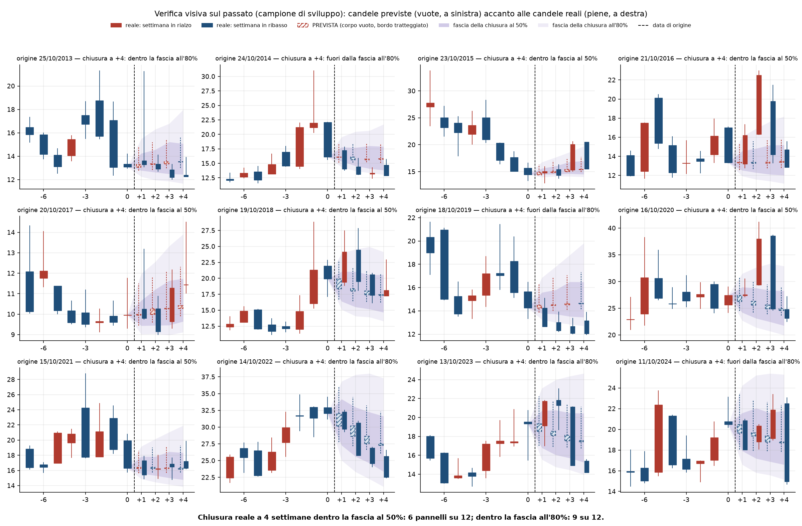

# Fase 2b — Programma di previsione con grafico a candele

*Report generato da `python -m src.run_phase2b`. Ogni numero è letto dai file `reports/fase2b/*.csv` e `*.json`. Le misure di questo report usano solo
il campione di sviluppo (2000-01-07 → 2024-11-08, 1297 settimane), sotto la guardia che blocca l'holdout.
La previsione corrente è in [previsione_corrente.md](previsione_corrente.md) ed è prodotta da `python -m src.forecast`.*

## 1. Sintesi

1. **Il programma.** `python -m src.forecast` legge lo storico, esclude la settimana incompleta e produce per le settimane +1 … +4: candela prevista (apertura, massimo, minimo, chiusura), fasce della chiusura al 50/80/90%, P(VIX > 20/25/30), lettura della situazione, tabella e grafici. Nessun modello nuovo: M1, D4 e D1 delle fasi precedenti, più la regressione di M1 applicata a massimo e minimo.
2. **Errore sulla chiusura.** L'errore assoluto medio della mediana cresce da 2,23 punti a 1 settimana a 3,48 a 4 settimane (2,82 e 3,21 a 2 e 3).
3. **Le fasce coprono meno del nominale a tutti gli orizzonti**: la fascia all'80% contiene la chiusura reale tra il 71,9% e il 73,2% delle volte, quella al 50% tra il 43,3% e il 44,6%. Il programma mostra questi numeri accanto a ogni fascia, senza ricalibrare.
4. **Minimo settimanale**: il modello batte il riferimento semplice a tutti gli orizzonti (errore più basso dal 12,4% al 19,2%).
5. **Massimo settimanale**: il guadagno è molto più piccolo (dal 0,6% al 5,6%); l'intervallo di confidenza esclude lo zero per h = 2, 3, 4; a 1 settimana modello e riferimento sono equivalenti.
6. **Verifica visiva (G3)**: Chiusura reale a 4 settimane dentro la fascia al 50%: 6 pannelli su 12; dentro la fascia all'80%: 9 su 12.

## 2. Chiusura: errore, larghezza e copertura per h = 1, 2, 3, 4

Stesso protocollo della Fase 2: finestra espandibile, ristima a ogni origine, almeno 104 errori passati con esito noto, stesso insieme di origini
per tutti gli orizzonti disponibili. Mediana e fasce: D4. Per h = 2 e 3 nessuna nuova scelta: sono gli stessi modelli, qui misurati per la prima volta.

|     h |       n |   errore assoluto medio, mediana D4 (punti) |   errore assoluto medio, M1 (punti) |   RMSE, mediana D4 (punti) |   CRPS (log) |   quantili riordinati |
|------:|--------:|--------------------------------------------:|------------------------------------:|---------------------------:|-------------:|----------------------:|
| 1.000 | 933.000 |                                       2.234 |                               2.270 |                      3.546 |        0.081 |               119.000 |
| 2.000 | 931.000 |                                       2.815 |                               2.867 |                      4.658 |        0.103 |                59.000 |
| 3.000 | 929.000 |                                       3.208 |                               3.290 |                      5.476 |        0.118 |                45.000 |
| 4.000 | 927.000 |                                       3.483 |                               3.553 |                      6.020 |        0.128 |                67.000 |

Larghezza media delle fasce (punti VIX) e copertura misurata (%, con intervallo di confidenza bootstrap a blocchi):

|   h |   n |   larghezza 50% (punti) | copertura 50% [IC 95%]   |   larghezza 80% (punti) | copertura 80% [IC 95%]   |   larghezza 90% (punti) | copertura 90% [IC 95%]   |
|----:|----:|------------------------:|:-------------------------|------------------------:|:-------------------------|------------------------:|:-------------------------|
|   1 | 933 |                    3.11 | 43.5 [40.5; 46.5]        |                    5.99 | 73.2 [69.6; 76.8]        |                    8.00 | 84.5 [81.8; 87.1]        |
|   2 | 931 |                    3.73 | 43.3 [39.7; 47.2]        |                    7.63 | 71.9 [68.4; 75.2]        |                   10.42 | 83.6 [79.8; 86.9]        |
|   3 | 929 |                    4.22 | 44.6 [41.0; 48.3]        |                    8.70 | 72.7 [68.5; 76.8]        |                   12.66 | 83.6 [80.3; 86.8]        |
|   4 | 927 |                    4.50 | 44.2 [40.3; 48.6]        |                    9.24 | 72.6 [68.5; 76.7]        |                   13.24 | 84.3 [80.7; 87.5]        |

Quota di chiusure reali sopra il limite superiore / sotto il limite inferiore di ogni fascia (%; valore nominale per lato: 25, 10, 5):

|   h | 50%: sopra / sotto   | 80%: sopra / sotto   | 90%: sopra / sotto   |
|----:|:---------------------|:---------------------|:---------------------|
|   1 | 27.9 / 28.6          | 12.1 / 14.7          | 6.9 / 8.7            |
|   2 | 26.5 / 30.2          | 12.6 / 15.6          | 7.5 / 8.9            |
|   3 | 25.6 / 29.8          | 11.6 / 15.7          | 8.0 / 8.4            |
|   4 | 26.5 / 29.2          | 13.1 / 14.3          | 7.2 / 8.5            |

- **La mediana di D4 è leggermente più precisa di M1** a tutti gli orizzonti (2,23 contro 2,27 punti a h = 1; 3,48 contro 3,55 a h = 4).
- **Copertura.** Per nessuna fascia e nessun orizzonte l’intervallo di confidenza della copertura contiene il valore nominale: la sottocopertura è statisticamente chiara ovunque. Gli sforamenti verso il basso sono un po' più frequenti di quelli verso l'alto.
- **h = 2 e 3 si comportano come h = 1 e 4**: nessuna anomalia negli orizzonti intermedi.
- I numeri per h = 1 e h = 4 coincidono con quelli della Fase 2 a meno di differenze numeriche minime (qui il logaritmo è calcolato dalla chiusura, in Fase 2 era letto dal file con 6 decimali).

**Misura aggiuntiva, non richiesta: probabilità di D1.** Poiché il programma mostra P(VIX > 20/25/30) anche a 2 e 3 settimane, dove non erano mai state misurate, riporto frequenza osservata, probabilità media e Brier. Nessuna scelta dipende da questa tabella.

|   h | evento   |   n |   frequenza osservata |   probabilità media |   brier |   affidabilità |   risoluzione |
|----:|:---------|----:|----------------------:|--------------------:|--------:|---------------:|--------------:|
|   1 | VIX>20   | 933 |                0.3666 |              0.3656 |  0.0773 |         0.0030 |        0.1567 |
|   1 | VIX>25   | 933 |                0.1833 |              0.1859 |  0.0646 |         0.0017 |        0.0861 |
|   1 | VIX>30   | 933 |                0.0922 |              0.0955 |  0.0313 |         0.0024 |        0.0539 |
|   2 | VIX>20   | 931 |                0.3673 |              0.3667 |  0.0960 |         0.0020 |        0.1371 |
|   2 | VIX>25   | 931 |                0.1837 |              0.1876 |  0.0809 |         0.0029 |        0.0722 |
|   2 | VIX>30   | 931 |                0.0924 |              0.0998 |  0.0388 |         0.0019 |        0.0464 |
|   3 | VIX>20   | 929 |                0.3681 |              0.3661 |  0.1141 |         0.0016 |        0.1189 |
|   3 | VIX>25   | 929 |                0.1841 |              0.1891 |  0.0886 |         0.0022 |        0.0631 |
|   3 | VIX>30   | 929 |                0.0926 |              0.1027 |  0.0470 |         0.0028 |        0.0395 |
|   4 | VIX>20   | 927 |                0.3689 |              0.3647 |  0.1249 |         0.0012 |        0.1090 |
|   4 | VIX>25   | 927 |                0.1845 |              0.1889 |  0.0969 |         0.0050 |        0.0575 |
|   4 | VIX>30   | 927 |                0.0928 |              0.1041 |  0.0489 |         0.0032 |        0.0373 |

## 3. Massimo e minimo settimanali

Modello: la stessa regressione diretta di M1 (ultima chiusura, media a 4 e a 12 settimane delle chiusure) con obiettivo log(massimo) e log(minimo) della settimana t + h.
Riferimento: ultima chiusura × mediana storica del rapporto tra massimo (o minimo) della settimana t + h e chiusura della settimana t, calcolata sulla storia disponibile.
Gli errori del modello sono misurati sui valori finali della candela, cioè dopo i vincoli (massimo ≥ apertura e chiusura previste; minimo ≤ apertura e chiusura previste).

| obiettivo   |   h |   n |   errore assoluto medio, modello |   errore assoluto medio, riferimento | guadagno sul riferimento (punti) [IC 95%]   |   guadagno (%) |    DM |     p | correzioni del vincolo   |   errore medio con segno (reale − previsto) |   quota di settimane in cui il reale va oltre il previsto |
|:------------|----:|----:|---------------------------------:|-------------------------------------:|:--------------------------------------------|---------------:|------:|------:|:-------------------------|--------------------------------------------:|----------------------------------------------------------:|
| massimo     |   1 | 933 |                            2.116 |                                2.128 | +0.013 [-0.026; +0.050]                     |          0.603 | 0.562 | 0.575 | 0 (0.0%)                 |                                       0.628 |                                                     0.466 |
| massimo     |   2 | 931 |                            3.331 |                                3.395 | +0.064 [+0.011; +0.115]                     |          1.886 | 1.727 | 0.084 | 0 (0.0%)                 |                                       0.819 |                                                     0.468 |
| massimo     |   3 | 929 |                            3.973 |                                4.155 | +0.182 [+0.118; +0.249]                     |          4.372 | 3.409 | 0.001 | 0 (0.0%)                 |                                       0.949 |                                                     0.454 |
| massimo     |   4 | 927 |                            4.360 |                                4.619 | +0.259 [+0.123; +0.420]                     |          5.612 | 3.131 | 0.002 | 0 (0.0%)                 |                                       1.073 |                                                     0.443 |
| minimo      |   1 | 933 |                            1.220 |                                1.510 | +0.290 [+0.203; +0.393]                     |         19.227 | 5.442 | 0.000 | 22 (2.4%)                |                                      -0.260 |                                                     0.576 |
| minimo      |   2 | 931 |                            1.838 |                                2.148 | +0.310 [+0.217; +0.417]                     |         14.431 | 4.699 | 0.000 | 11 (1.2%)                |                                      -0.202 |                                                     0.589 |
| minimo      |   3 | 929 |                            2.247 |                                2.563 | +0.317 [+0.225; +0.407]                     |         12.359 | 4.732 | 0.000 | 13 (1.4%)                |                                      -0.136 |                                                     0.582 |
| minimo      |   4 | 927 |                            2.521 |                                2.891 | +0.370 [+0.258; +0.496]                     |         12.810 | 5.288 | 0.000 | 7 (0.8%)                 |                                      -0.088 |                                                     0.593 |

(Guadagno positivo = il modello sbaglia meno del riferimento. DM = Diebold-Mariano sull'errore assoluto, non corretto per confronti multipli.)

- **Minimo**: il modello è migliore del riferimento a ogni orizzonte, con intervallo di confidenza che esclude lo zero per h = 1, 2, 3, 4.
- **Massimo**: guadagno piccolo; intervallo che esclude lo zero solo per h = 2, 3, 4. In nessun caso il riferimento è migliore del modello.
- **Il massimo è più difficile del minimo**: errore assoluto medio di 2,12 punti contro 1,22 a h = 1, e di 4,36 contro 2,52 a h = 4. I picchi dentro la settimana non sono prevedibili.
- **Il massimo previsto è superato meno di una volta su due** (47% a h = 1), ma quando viene superato lo è di molto: l'errore medio con segno è positivo (0,63 punti a h = 1, 1,07 a h = 4). L'ombra superiore della candela prevista è un valore tipico, non un limite.
- **Vincoli.** Correzioni del massimo previsto: 0 in tutto il walk-forward; del minimo: 22 origini su 933 a h = 1 e 7 a h = 4.

## 4. Verifica visiva sul passato (G3)

Regola fissa: 12 origini, una ogni 52 settimane a ritroso a partire da 4 settimane prima dell'ultima data di sviluppo. Tutte le origini e gli esiti stanno nel campione di sviluppo.



| origine    |   chiusura all'origine |   chiusura prevista a +4 |   fascia_50_inf |   fascia_50_sup |   fascia_80_inf |   fascia_80_sup |   chiusura reale a +4 | dentro la fascia 50%   | dentro la fascia 80%   |
|:-----------|-----------------------:|-------------------------:|----------------:|----------------:|----------------:|----------------:|----------------------:|:-----------------------|:-----------------------|
| 2013-10-25 |                  13.09 |                    13.53 |           12.45 |           15.07 |           11.67 |           17.97 |                 12.26 | no                     | sì                     |
| 2014-10-24 |                  16.11 |                    15.84 |           13.82 |           17.90 |           13.05 |           21.73 |                 12.90 | no                     | no                     |
| 2015-10-23 |                  14.46 |                    15.43 |           14.52 |           16.99 |           14.03 |           19.72 |                 15.47 | sì                     | sì                     |
| 2016-10-21 |                  13.34 |                    13.47 |           12.02 |           15.18 |           11.15 |           18.17 |                 12.85 | sì                     | sì                     |
| 2017-10-20 |                   9.97 |                    10.43 |            9.64 |           11.73 |            9.12 |           13.91 |                 11.43 | sì                     | sì                     |
| 2018-10-19 |                  19.89 |                    17.37 |           14.67 |           20.56 |           13.29 |           24.14 |                 18.14 | sì                     | sì                     |
| 2019-10-18 |                  14.25 |                    14.62 |           13.45 |           16.48 |           12.71 |           19.81 |                 12.05 | no                     | no                     |
| 2020-10-16 |                  27.41 |                    24.62 |           21.74 |           28.26 |           19.97 |           32.88 |                 23.10 | sì                     | sì                     |
| 2021-10-15 |                  16.30 |                    16.20 |           14.78 |           18.33 |           13.86 |           21.92 |                 16.29 | sì                     | sì                     |
| 2022-10-14 |                  32.02 |                    27.31 |           23.37 |           31.63 |           21.11 |           37.30 |                 22.52 | no                     | sì                     |
| 2023-10-13 |                  19.32 |                    17.45 |           15.25 |           20.44 |           13.97 |           24.65 |                 14.17 | no                     | sì                     |
| 2024-10-11 |                  20.46 |                    18.73 |           16.59 |           21.80 |           15.16 |           25.30 |                 14.94 | no                     | no                     |

**Chiusura reale a 4 settimane dentro la fascia al 50%: 6 pannelli su 12; dentro la fascia all'80%: 9 su 12.** Dodici casi sono pochi (meno di 20): il conteggio serve a vedere, non a misurare. La misura è la copertura della sezione 2.

## 5. Problemi e ambiguità

1. **Dati successivi all'8 novembre 2024.** `src.forecast` li legge come storia. Il modello D1 usa, per costruzione, gli errori delle proprie previsioni passate fino all'origine: con un'origine nel 2026 questo comprende errori relativi al periodo 2024-2026, usati come ingrediente del modello e mai mostrati né riassunti. L'ho inteso compatibile con «solo come storia da cui prevedere»; se non lo è, D1 va stimato con errori fino al confine di sviluppo.
2. **L'holdout non è più "mai visto".** La scheda corrente e il grafico G1 mostrano le chiusure degli ultimi due anni e i casi simili possono cadere in quel periodo. Nessuna misura di errore è stata calcolata lì e nessuna scelta è stata fatta su quei dati, ma una valutazione finale sull'holdout non sarà più alla cieca per chi ha guardato la scheda.
3. **Settimana incompleta**: riconosciuta dalla colonna `note` valorizzata, come in Fase 0. Un file aggiornato in cui l'ultima settimana è parziale ma senza nota verrebbe trattato come completo.
4. **Date delle settimane previste**: origine + 7 giorni per settimana; sono indicative, perché l'ultima seduta della settimana può non essere un venerdì.
5. **Riferimento per massimo e minimo a h > 1**: ho usato il rapporto tra il massimo (minimo) della settimana t + h e la chiusura della settimana t. È la mia lettura di «chiusura precedente» per gli orizzonti oltre il primo.
6. **Fasce (D4) e probabilità (D1) vengono da modelli diversi**: possono non essere coerenti tra loro al decimale (per esempio una probabilità di superare 25 diversa da quella implicita nelle fasce).
7. **Corpo e ombre delle candele previste hanno natura diversa**: il corpo unisce due mediane successive, le ombre vengono da due regressioni separate. Una candela prevista non è la previsione di una candela «tipica», che avrebbe corpo più ampio: è un riassunto di quattro numeri.
8. **Lettura della situazione**: massimo e minimo delle ultime 12 settimane sono calcolati sulle chiusure; «ultimi 5 anni» = 260 settimane; la soglia dei 20 casi è segnalata nel testo quando non è raggiunta.
9. **Casi simili**: scelti in ordine di somiglianza scartando quelli a meno di 8 settimane da un caso già scelto; è una selezione illustrativa, diversa dal modello M6 (che usa i 30 più vicini senza distanza minima).
10. **G1**: i percorsi dei casi simili sono nel pannello di ingrandimento sotto il grafico a 2 anni, dove le quattro settimane di previsione sarebbero troppo strette per contenerli. **G2**: storia come linea delle chiusure e riquadro con le candele, perché a quella scala le candele non sono leggibili.
11. **Origine minima**: servono almeno 367 settimane di storia (circa 7 anni), altrimenti D1 non ha i 104 errori richiesti e il comando si ferma con un messaggio.
12. **Quantili riordinati**: D4 ha prodotto quantili incrociati in 119 origini (h = 1), 59 origini (h = 2), 45 origini (h = 3), 67 origini (h = 4); sono riordinati, come in Fase 2.
13. **Misura aggiuntiva**: la tabella sulle probabilità di D1 (sezione 2) non era richiesta; l'ho aggiunta perché il programma mostra quelle probabilità anche a 2 e 3 settimane.
14. **Test multipli**: i confronti con il riferimento sono otto e non sono corretti.

## 6. Riproducibilità

```
python -m src.run_phase2b     # misure di sviluppo per h = 1-4, G3 e questo report (circa 4 minuti)
python -m src.forecast        # previsione corrente: scheda, tabella, JSON, G1 e G2
python -m pytest              # test
```
