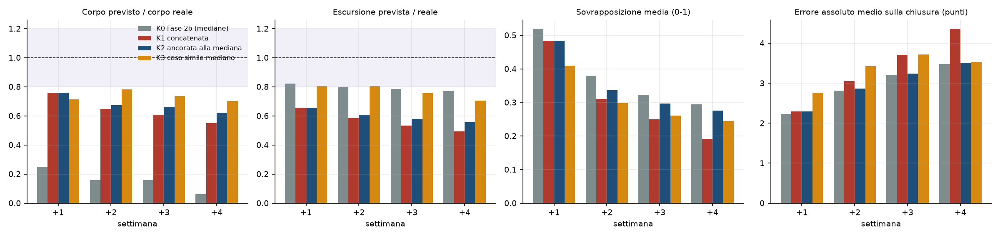
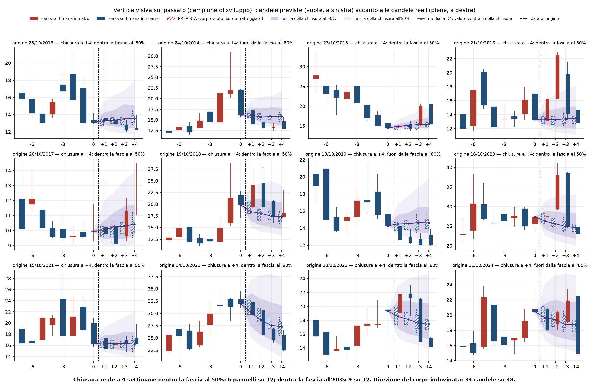

# Fase 2c — Candele previste realistiche e misurabili

*Report generato da `python -m src.run_phase2c`. Ogni numero è letto dai file `reports/fase2c/*.csv` e `*.json`. Solo campione di sviluppo
(2000-01-07 → 2024-11-08), sotto la guardia che blocca l'holdout. Previsione corrente: [previsione_corrente.md](previsione_corrente.md).*

## 1. Sintesi

1. **Costruzione scelta: K2 ancorata alla mediana.** Nessuna delle quattro costruzioni rispetta il vincolo di realismo (corpo ed escursione tra 0,8 e 1,2 volte quelli reali a h = 1): è stata applicata la regola di riserva (rapporto del corpo più vicino a 1), con uno spareggio tra K1 e K2 confermato il 2026-11-16 (sezione 4).
2. **Il problema di partenza è risolto solo in parte.** Il corpo medio delle candele passa dal 25% di quello reale (K0, Fase 2b) al 76% (K2) a 1 settimana, e dal 6% al 62% a 4 settimane. Restano più piccole del reale perché l'ampiezza è una mediana, e la mediana dei corpi (0,087 in log) è più bassa della media (0,112).
3. **La direzione del corpo non è prevedibile.** Il modello scelto (L1) indovina la direzione nel 63,8% dei casi a 1 settimana; chi prevede sempre la direzione più frequente (L0) nel 63,8%. **Il guadagno è nullo** a tutti gli orizzonti (differenze di accuratezza: 0,0%, 0,1%, 0,0%, 0,0%); nessun confronto con L0 è significativo dopo Holm (0 su 8).
4. **Perché le candele sono quasi sempre in ribasso.** L'apertura ufficiale è in mediana il 3,1% sopra la chiusura precedente e la settimana chiude sopra la propria apertura solo nel 36,2% dei casi. Nel walk-forward la quota di candele disegnate in rialzo a h = 1 è 0,0%.
5. **Ampiezza e ombre: guadagno quasi nullo sulla mediana storica.** Intervallo di confidenza che esclude lo zero solo per: corpo a h = 1.
6. **K0 resta la migliore per errore e sovrapposizione**, come previsto: sovrapposizione media 0,379 contro 0,348 di K2; errore sulla chiusura a h = 4 di 3,48 punti contro 3,51. Ma i suoi corpi sono irrealistici.
7. **K1 (concatenata) deriva**: concatenando quattro settimane «più probabili», tutte in ribasso, la chiusura si allontana dal centro. A h = 4 l'errore sulla chiusura è 4,37 punti contro 3,51 di K2.
8. **K3 (caso simile mediano)** ha l'escursione più realistica dopo K0 (81% a h = 1) ma gli errori più alti a 1 settimana (2,76 punti sulla chiusura).
9. **La chiusura reale cade dentro l'escursione prevista meno di una volta su due**: 47% a h = 1 e 31% a h = 4 per K2. La candela non è un intervallo di confidenza: per quello ci sono le fasce.
10. **Programma.** `src.forecast` disegna le candele K2 con la probabilità della direzione e la linea della mediana D4, tiene un registro delle previsioni e con `--verifica` le confronta con le settimane completate.

## 2. Componenti (Parte A)

Walk-forward a finestra espandibile, ristima a ogni origine, h = 1, 2, 3, 4, stesse origini della Fase 2b (933 previsioni a h = 1,
obiettivi dal 2006-12-29 al 2024-11-08).
**Settimane escluse dalle stime** (apertura fuori dall'intervallo minimo–massimo): 2004-11-12 (open 2,58, minimo 12,64, massimo 14,48).
Sono escluse sia come obiettivo sia come variabile.

### A1. Apertura

Rapporto tra apertura ufficiale e chiusura precedente: la previsione è la mediana storica sulla storia disponibile. Nel walk-forward è rimasta tra
1,0285 e 1,0337 (ultimo valore: 1,0313). L'errore sull'apertura prevista è nella pagella (sezione 3).

### A2. Direzione del corpo

P(chiusura > apertura) nella settimana t + h. L0 = frequenza storica; L1 = logistica sulle variabili dell'HAR; L2 = logistica su variabili dell'HAR e aggiuntive.
Regola: per ogni orizzonte si usa il modello con il Brier più basso. Test: Diebold-Mariano sul Brier contro L0, Holm su 8 confronti.

|   h | modello   |   n |   freq. rialzo |   prob. media |   accuratezza |   brier |   affidabilità |   risoluzione |   Brier skill vs L0 |   DM vs L0 |        p |   p Holm | scelto   |
|----:|:----------|----:|---------------:|--------------:|--------------:|--------:|---------------:|--------------:|--------------------:|-----------:|---------:|---------:|:---------|
|   1 | L0        | 933 |         0.3623 |        0.3495 |        0.6377 |  0.2319 |         0.0002 |        0.0000 |              0.0000 |     –      |   –      |   –      |          |
|   1 | L1        | 933 |         0.3623 |        0.3538 |        0.6377 |  0.2306 |         0.0006 |        0.0011 |              0.0058 |     0.8466 |   0.3974 |   1.0000 | sì       |
|   1 | L2        | 933 |         0.3623 |        0.3613 |        0.6259 |  0.2338 |         0.0048 |        0.0031 |             -0.0084 |    -0.7703 |   0.4413 |   1.0000 |          |
|   2 | L0        | 931 |         0.3630 |        0.3496 |        0.6370 |  0.2321 |         0.0002 |        0.0000 |              0.0000 |     –      |   –      |   –      |          |
|   2 | L1        | 931 |         0.3630 |        0.3539 |        0.6380 |  0.2311 |         0.0024 |        0.0011 |              0.0047 |     0.7176 |   0.4732 |   1.0000 | sì       |
|   2 | L2        | 931 |         0.3630 |        0.3559 |        0.6241 |  0.2338 |         0.0052 |        0.0022 |             -0.0073 |    -0.7699 |   0.4416 |   1.0000 |          |
|   3 | L0        | 929 |         0.3638 |        0.3496 |        0.6362 |  0.2324 |         0.0002 |        0.0000 |              0.0000 |     –      |   –      |   –      |          |
|   3 | L1        | 929 |         0.3638 |        0.3540 |        0.6362 |  0.2308 |         0.0011 |        0.0005 |              0.0072 |     1.5510 |   0.1212 |   0.9699 | sì       |
|   3 | L2        | 929 |         0.3638 |        0.3438 |        0.6362 |  0.2325 |         0.0023 |        0.0010 |             -0.0004 |    -0.0558 |   0.9555 |   1.0000 |          |
|   4 | L0        | 927 |         0.3635 |        0.3496 |        0.6365 |  0.2324 |         0.0002 |        0.0000 |              0.0000 |     –      |   –      |   –      |          |
|   4 | L1        | 927 |         0.3635 |        0.3523 |        0.6365 |  0.2312 |         0.0006 |        0.0005 |              0.0049 |     1.0523 |   0.2929 |   1.0000 | sì       |
|   4 | L2        | 927 |         0.3635 |        0.3538 |        0.6365 |  0.2339 |         0.0026 |        0.0001 |             -0.0065 |    -0.9554 |   0.3396 |   1.0000 |          |

**Quanto migliora la direzione rispetto al riferimento: non migliora.**
- Accuratezza del modello scelto meno accuratezza di L0: h = 1: 0,0%, h = 2: 0,1%, h = 3: 0,0%, h = 4: 0,0%.
- Brier skill di L1 su L0: h = 1: 0,58%, h = 2: 0,47%, h = 3: 0,72%, h = 4: 0,49%; di L2: h = 1: -0,84%, h = 2: -0,73%, h = 3: -0,04%, h = 4: -0,65%. Nessuno è significativo.
- L1 è scelto perché ha il Brier più basso, ma la differenza da L0 è dentro il rumore: le sue probabilità restano quasi sempre sotto 0,5, quindi la direzione disegnata è quasi sempre il ribasso (quota di candele in rialzo: 0,0% a h = 1, 0,3% a h = 2, 0,0% a h = 3, 0,0% a h = 4).
- Le variabili della candela dell'ultima settimana (L2) peggiorano leggermente: escursione, ombre e posizione della chiusura non dicono nulla sulla direzione della settimana successiva.

Per fascia di partenza (h = 1 e 4):

|   h | fascia di partenza   |   n |   freq. rialzo |   accuratezza L0 |   accuratezza L1 |   accuratezza L2 |   Brier skill L1 (%) |   Brier skill L2 (%) |
|----:|:---------------------|----:|---------------:|-----------------:|-----------------:|-----------------:|---------------------:|---------------------:|
|   1 | <15                  | 324 |          0.410 |            0.590 |            0.590 |            0.586 |                1.570 |                1.541 |
|   1 | 15-20                | 267 |          0.382 |            0.618 |            0.618 |            0.592 |               -0.380 |               -2.611 |
|   1 | 20-25                | 170 |          0.341 |            0.659 |            0.659 |            0.647 |               -1.372 |               -4.367 |
|   1 | 25-30                |  86 |          0.233 |            0.767 |            0.767 |            0.767 |                3.805 |               -1.963 |
|   1 | >=30                 |  86 |          0.291 |            0.709 |            0.709 |            0.698 |                0.847 |                3.486 |
|   4 | <15                  | 321 |          0.405 |            0.595 |            0.595 |            0.595 |                1.358 |                0.478 |
|   4 | 15-20                | 266 |          0.395 |            0.605 |            0.605 |            0.605 |               -0.335 |               -1.125 |
|   4 | 20-25                | 168 |          0.304 |            0.696 |            0.696 |            0.696 |                1.057 |               -0.780 |
|   4 | 25-30                |  86 |          0.267 |            0.733 |            0.733 |            0.733 |                2.923 |                1.663 |
|   4 | >=30                 |  86 |          0.326 |            0.674 |            0.674 |            0.674 |               -3.542 |               -5.570 |

Dopo un rialzo oltre il 30% in 4 settimane (111 origini su 933 a h = 1):

|   h | rialzo oltre il 30% in 4 settimane   |   n |   freq. rialzo |   accuratezza L0 |   accuratezza L1 |   accuratezza L2 |   Brier skill L1 (%) |   Brier skill L2 (%) |
|----:|:-------------------------------------|----:|---------------:|-----------------:|-----------------:|-----------------:|---------------------:|---------------------:|
|   1 | no                                   | 822 |          0.367 |            0.633 |            0.633 |            0.624 |                1.049 |               -0.009 |
|   1 | sì                                   | 111 |          0.324 |            0.676 |            0.676 |            0.640 |               -3.047 |               -7.271 |
|   4 | no                                   | 816 |          0.369 |            0.631 |            0.631 |            0.631 |                0.656 |               -0.155 |
|   4 | sì                                   | 111 |          0.324 |            0.676 |            0.676 |            0.676 |               -0.760 |               -4.510 |

Per sottoperiodo:

|   h | sottoperiodo   |   n |   freq. rialzo |   accuratezza L0 |   accuratezza L1 |   accuratezza L2 |   Brier skill L1 (%) |   Brier skill L2 (%) |
|----:|:---------------|----:|---------------:|-----------------:|-----------------:|-----------------:|---------------------:|---------------------:|
|   1 | 2005-2009      | 158 |          0.405 |            0.595 |            0.595 |            0.589 |               -2.212 |               -4.970 |
|   1 | 2010-2014      | 260 |          0.369 |            0.631 |            0.631 |            0.604 |                0.744 |               -0.081 |
|   1 | 2015-2019      | 261 |          0.360 |            0.640 |            0.640 |            0.632 |                1.859 |                0.170 |
|   1 | 2020-2024      | 254 |          0.331 |            0.669 |            0.669 |            0.665 |                0.981 |                0.138 |
|   4 | 2005-2009      | 152 |          0.414 |            0.586 |            0.586 |            0.586 |               -1.239 |               -6.195 |
|   4 | 2010-2014      | 260 |          0.369 |            0.631 |            0.631 |            0.631 |                0.307 |               -0.227 |
|   4 | 2015-2019      | 261 |          0.360 |            0.640 |            0.640 |            0.640 |                0.779 |               -0.082 |
|   4 | 2020-2024      | 254 |          0.331 |            0.669 |            0.669 |            0.669 |                1.565 |                2.029 |

I ribassi tendono a essere più frequenti quando il livello di partenza è alto. L1, che ha il livello tra le variabili, ne coglie una piccola parte (Brier skill positivo in alcune fasce), ma non abbastanza da cambiare la direzione prevista.
La calibrazione per classi di probabilità è in `reports/fase2c/direzione_calibrazione.csv`: a h = 1 le probabilità di rialzo di L1 stanno tra 0,1 e 0,5, per il 63% nella classe 0,3-0,4.

### A3 e A4. Ampiezza del corpo e ombre

Regressione sulla mediana con variabili dell'HAR e aggiuntive; riferimento: mediana storica. Valori in log.

| componente            |   h |   n |   media reale |   mediana reale |   previsione media |   errore assoluto medio, modello |   errore assoluto medio, mediana storica | guadagno sul riferimento [IC 95%]   |   guadagno (%) |      DM |      p |
|:----------------------|----:|----:|--------------:|----------------:|-------------------:|---------------------------------:|-----------------------------------------:|:------------------------------------|---------------:|--------:|-------:|
| A3 ampiezza del corpo |   1 | 933 |        0.1121 |          0.0872 |             0.0839 |                           0.0682 |                                   0.0707 | +0.0024 [+0.0004; +0.0047]          |         3.4506 |  2.2096 | 0.0274 |
| A3 ampiezza del corpo |   2 | 931 |        0.1123 |          0.0873 |             0.0793 |                           0.0704 |                                   0.0707 | +0.0003 [-0.0007; +0.0012]          |         0.4260 |  0.5582 | 0.5768 |
| A3 ampiezza del corpo |   3 | 929 |        0.1123 |          0.0873 |             0.0793 |                           0.0703 |                                   0.0707 | +0.0004 [-0.0008; +0.0015]          |         0.5290 |  0.6599 | 0.5095 |
| A3 ampiezza del corpo |   4 | 927 |        0.1124 |          0.0873 |             0.0766 |                           0.0712 |                                   0.0707 | -0.0005 [-0.0013; +0.0002]          |        -0.7334 | -1.3269 | 0.1849 |
| A4 ombra inferiore    |   1 | 933 |        0.0484 |          0.0347 |             0.0353 |                           0.0348 |                                   0.0351 | +0.0003 [-0.0008; +0.0014]          |         0.8938 |  0.5971 | 0.5506 |
| A4 ombra inferiore    |   2 | 931 |        0.0483 |          0.0344 |             0.0339 |                           0.0353 |                                   0.0351 | -0.0002 [-0.0011; +0.0007]          |        -0.6245 | -0.4693 | 0.6390 |
| A4 ombra inferiore    |   3 | 929 |        0.0484 |          0.0347 |             0.0320 |                           0.0351 |                                   0.0352 | +0.0001 [-0.0004; +0.0006]          |         0.1445 |  0.1488 | 0.8818 |
| A4 ombra inferiore    |   4 | 927 |        0.0484 |          0.0347 |             0.0310 |                           0.0354 |                                   0.0351 | -0.0003 [-0.0010; +0.0004]          |        -0.8625 | -0.8038 | 0.4217 |
| A4 ombra superiore    |   1 | 933 |        0.0719 |          0.0540 |             0.0415 |                           0.0488 |                                   0.0493 | +0.0005 [-0.0002; +0.0012]          |         1.0989 |  1.7499 | 0.0805 |
| A4 ombra superiore    |   2 | 931 |        0.0720 |          0.0540 |             0.0432 |                           0.0489 |                                   0.0494 | +0.0005 [-0.0002; +0.0013]          |         1.0957 |  1.3770 | 0.1688 |
| A4 ombra superiore    |   3 | 929 |        0.0721 |          0.0541 |             0.0416 |                           0.0493 |                                   0.0496 | +0.0002 [-0.0006; +0.0011]          |         0.5027 |  0.6255 | 0.5318 |
| A4 ombra superiore    |   4 | 927 |        0.0722 |          0.0541 |             0.0427 |                           0.0493 |                                   0.0496 | +0.0004 [-0.0004; +0.0012]          |         0.7097 |  0.9171 | 0.3593 |

- Guadagno con intervallo di confidenza che esclude lo zero: corpo a h = 1. Casi in cui il riferimento è migliore: ombra inf a h = 2, corpo a h = 4, ombra inf a h = 4.
- La previsione media del corpo (0,084 a h = 1) è vicina alla mediana reale (0,087) e lontana dalla media reale (0,112): è questo che tiene il rapporto del corpo sotto 0,8.

**Cosa implica.** Di una candela settimanale del VIX si prevede bene solo l'apertura. Direzione, ampiezza e ombre della settimana successiva sono, con il solo VIX, quasi indistinguibili dalle loro frequenze e mediane storiche.

## 3. Pagella delle quattro costruzioni (Parte C)

Costruzioni: K0 Fase 2b (mediane); K1 concatenata; K2 ancorata alla mediana; K3 caso simile mediano. K1 e K2 usano la direzione di L1, l'ampiezza di A3 e le ombre di A4; a h = 1 coincidono per costruzione.

Direzione, realismo, sovrapposizione (frazioni tra 0 e 1):

|   h | costruzione   |   n |   direzione del corpo indovinata |   direzione della chiusura vs origine |   corpo previsto / reale |   escursione prevista / reale | sovrapposizione [IC 95%]   |   chiusura reale nel corpo previsto |   chiusura reale nell'escursione prevista |
|----:|:--------------|----:|---------------------------------:|--------------------------------------:|-------------------------:|------------------------------:|:---------------------------|------------------------------------:|------------------------------------------:|
|   1 | K0            | 933 |                            0.576 |                                 0.580 |                    0.249 |                         0.823 | 0.520 [0.507; 0.532]       |                               0.074 |                                     0.509 |
|   1 | K1            | 933 |                            0.636 |                                 0.541 |                    0.758 |                         0.655 | 0.483 [0.470; 0.496]       |                               0.264 |                                     0.469 |
|   1 | K2            | 933 |                            0.636 |                                 0.541 |                    0.758 |                         0.655 | 0.483 [0.469; 0.497]       |                               0.264 |                                     0.469 |
|   1 | K3            | 933 |                            0.527 |                                 0.501 |                    0.712 |                         0.806 | 0.410 [0.391; 0.430]       |                               0.199 |                                     0.443 |
|   2 | K0            | 931 |                            0.537 |                                 0.610 |                    0.159 |                         0.797 | 0.379 [0.359; 0.400]       |                               0.039 |                                     0.425 |
|   2 | K1            | 931 |                            0.636 |                                 0.528 |                    0.647 |                         0.584 | 0.311 [0.291; 0.332]       |                               0.194 |                                     0.375 |
|   2 | K2            | 931 |                            0.636 |                                 0.526 |                    0.674 |                         0.609 | 0.336 [0.317; 0.355]       |                               0.198 |                                     0.375 |
|   2 | K3            | 931 |                            0.549 |                                 0.538 |                    0.783 |                         0.805 | 0.297 [0.283; 0.312]       |                               0.184 |                                     0.367 |
|   3 | K0            | 929 |                            0.538 |                                 0.634 |                    0.160 |                         0.785 | 0.323 [0.300; 0.347]       |                               0.038 |                                     0.367 |
|   3 | K1            | 929 |                            0.635 |                                 0.530 |                    0.609 |                         0.534 | 0.249 [0.232; 0.268]       |                               0.168 |                                     0.326 |
|   3 | K2            | 929 |                            0.635 |                                 0.561 |                    0.661 |                         0.580 | 0.296 [0.277; 0.315]       |                               0.184 |                                     0.342 |
|   3 | K3            | 929 |                            0.590 |                                 0.572 |                    0.735 |                         0.756 | 0.261 [0.245; 0.277]       |                               0.155 |                                     0.320 |
|   4 | K0            | 927 |                            0.542 |                                 0.634 |                    0.063 |                         0.770 | 0.294 [0.273; 0.314]       |                               0.024 |                                     0.357 |
|   4 | K1            | 927 |                            0.635 |                                 0.547 |                    0.551 |                         0.493 | 0.192 [0.173; 0.211]       |                               0.148 |                                     0.278 |
|   4 | K2            | 927 |                            0.635 |                                 0.575 |                    0.621 |                         0.556 | 0.275 [0.252; 0.299]       |                               0.169 |                                     0.306 |
|   4 | K3            | 927 |                            0.540 |                                 0.612 |                    0.702 |                         0.704 | 0.245 [0.225; 0.265]       |                               0.140 |                                     0.299 |

Errore assoluto medio in punti VIX:

|   h | costruzione   |   errore apertura |   errore massimo |   errore minimo |   errore chiusura |
|----:|:--------------|------------------:|-----------------:|----------------:|------------------:|
|   1 | K0            |              0.85 |             2.12 |            1.22 |              2.23 |
|   1 | K1            |              0.74 |             2.25 |            1.22 |              2.29 |
|   1 | K2            |              0.74 |             2.25 |            1.22 |              2.29 |
|   1 | K3            |              0.95 |             2.82 |            1.64 |              2.76 |
|   2 | K0            |              2.33 |             3.33 |            1.84 |              2.82 |
|   2 | K1            |              2.37 |             3.80 |            1.91 |              3.05 |
|   2 | K2            |              2.27 |             3.49 |            1.83 |              2.87 |
|   2 | K3            |              2.83 |             4.12 |            2.31 |              3.43 |
|   3 | K0            |              2.89 |             3.97 |            2.25 |              3.21 |
|   3 | K1            |              3.15 |             4.68 |            2.45 |              3.71 |
|   3 | K2            |              2.86 |             4.03 |            2.19 |              3.24 |
|   3 | K3            |              3.49 |             4.84 |            2.71 |              3.71 |
|   4 | K0            |              3.24 |             4.36 |            2.52 |              3.48 |
|   4 | K1            |              3.78 |             5.46 |            3.02 |              4.37 |
|   4 | K2            |              3.22 |             4.39 |            2.44 |              3.51 |
|   4 | K3            |              3.72 |             4.81 |            2.68 |              3.53 |

Errore assoluto medio in percentuale del valore reale:

|   h | costruzione   |   errore % apertura |   errore % massimo |   errore % minimo |   errore % chiusura |
|----:|:--------------|--------------------:|-------------------:|------------------:|--------------------:|
|   1 | K0            |                 4.2 |                8.4 |               6.5 |                10.5 |
|   1 | K1            |                 3.4 |                8.7 |               6.5 |                10.4 |
|   1 | K2            |                 3.4 |                8.7 |               6.5 |                10.4 |
|   1 | K3            |                 4.4 |               12.0 |               8.6 |                13.6 |
|   2 | K0            |                10.4 |               13.3 |               9.9 |                13.1 |
|   2 | K1            |                10.6 |               14.5 |              10.0 |                13.7 |
|   2 | K2            |                10.4 |               13.4 |               9.7 |                12.9 |
|   2 | K3            |                13.5 |               17.1 |              12.3 |                16.4 |
|   3 | K0            |                12.8 |               15.7 |              11.9 |                14.5 |
|   3 | K1            |                13.8 |               17.6 |              12.6 |                16.3 |
|   3 | K2            |                12.9 |               15.2 |              11.4 |                14.3 |
|   3 | K3            |                16.2 |               19.8 |              14.4 |                17.4 |
|   4 | K0            |                14.0 |               17.2 |              13.3 |                15.7 |
|   4 | K1            |                16.3 |               20.4 |              15.4 |                19.1 |
|   4 | K2            |                14.2 |               16.3 |              12.5 |                15.3 |
|   4 | K3            |                16.9 |               19.1 |              14.1 |                16.0 |

Chiusura: quota di previsioni entro il 10% e entro il 20% dal valore reale:

|   h | serie      |   n |   entro il 10% (%) |   entro il 20% (%) |   errore assoluto medio (punti) |
|----:|:-----------|----:|-------------------:|-------------------:|--------------------------------:|
|   1 | mediana D4 | 933 |               57.4 |               87.6 |                             2.2 |
|   1 | K0         | 933 |               57.4 |               87.6 |                             2.2 |
|   1 | K1         | 933 |               58.0 |               86.6 |                             2.3 |
|   1 | K2         | 933 |               58.0 |               86.6 |                             2.3 |
|   1 | K3         | 933 |               48.2 |               77.6 |                             2.8 |
|   2 | mediana D4 | 931 |               49.8 |               79.1 |                             2.8 |
|   2 | K0         | 931 |               49.8 |               79.1 |                             2.8 |
|   2 | K1         | 931 |               47.7 |               77.3 |                             3.0 |
|   2 | K2         | 931 |               50.2 |               78.5 |                             2.9 |
|   2 | K3         | 931 |               42.3 |               68.5 |                             3.4 |
|   3 | mediana D4 | 929 |               43.1 |               74.1 |                             3.2 |
|   3 | K0         | 929 |               43.1 |               74.1 |                             3.2 |
|   3 | K1         | 929 |               38.8 |               68.6 |                             3.7 |
|   3 | K2         | 929 |               46.0 |               74.5 |                             3.2 |
|   3 | K3         | 929 |               38.4 |               66.5 |                             3.7 |
|   4 | mediana D4 | 927 |               41.0 |               70.3 |                             3.5 |
|   4 | K0         | 927 |               41.0 |               70.3 |                             3.5 |
|   4 | K1         | 927 |               32.6 |               60.5 |                             4.4 |
|   4 | K2         | 927 |               43.4 |               73.0 |                             3.5 |
|   4 | K3         | 927 |               41.7 |               69.6 |                             3.5 |

- **Realismo.** Rapporto del corpo a h = 1: K0 0,25, K1 0,76, K2 0,76, K3 0,71. Rapporto dell'escursione: K0 0,82, K1 0,66, K2 0,66, K3 0,81. Nessuna costruzione ha entrambi i rapporti tra 0,8 e 1,2.
- **Sovrapposizione media su h = 1-4**: K0 0,379, K1 0,309, K2 0,348, K3 0,303.
- **Errore sulla chiusura più basso**: K0 a h = 1, K0 a h = 2, K0 a h = 3, K0 a h = 4. La chiusura di K0 è la mediana D4: era previsto che fosse la più precisa.
- **Direzione della chiusura rispetto all'origine**: K0 la indovina nel 63,4% dei casi a h = 4, K2 nel 57,5%. Per sapere se il VIX sarà più alto o più basso di oggi vale la mediana, non la candela.
- **Direzione del corpo**: K1 e K2 la indovinano nel 63,6% dei casi a h = 1, K0 nel 57,6%, K3 nel 52,7%. Il vantaggio di K1 e K2 è quello di disegnare quasi sempre la direzione più frequente.

Per fascia di partenza — sovrapposizione media (h = 1 e 4):

|   h | fascia di partenza   |   n |    K0 |    K1 |    K2 |    K3 |
|----:|:---------------------|----:|------:|------:|------:|------:|
|   1 | <15                  | 324 | 0.515 | 0.470 | 0.470 | 0.404 |
|   1 | 15-20                | 267 | 0.520 | 0.478 | 0.478 | 0.404 |
|   1 | 20-25                | 170 | 0.521 | 0.499 | 0.499 | 0.422 |
|   1 | 25-30                |  86 | 0.560 | 0.519 | 0.519 | 0.422 |
|   1 | >=30                 |  86 | 0.499 | 0.482 | 0.482 | 0.415 |
|   4 | <15                  | 321 | 0.346 | 0.129 | 0.323 | 0.284 |
|   4 | 15-20                | 266 | 0.260 | 0.219 | 0.231 | 0.219 |
|   4 | 20-25                | 168 | 0.275 | 0.220 | 0.250 | 0.231 |
|   4 | 25-30                |  86 | 0.272 | 0.253 | 0.279 | 0.222 |
|   4 | >=30                 |  86 | 0.262 | 0.225 | 0.282 | 0.227 |

Per fascia di partenza — direzione del corpo indovinata:

|   h | fascia di partenza   |   n |    K0 |    K1 |    K2 |    K3 |
|----:|:---------------------|----:|------:|------:|------:|------:|
|   1 | <15                  | 324 | 0.488 | 0.587 | 0.587 | 0.531 |
|   1 | 15-20                | 267 | 0.538 | 0.617 | 0.617 | 0.474 |
|   1 | 20-25                | 170 | 0.639 | 0.657 | 0.657 | 0.533 |
|   1 | 25-30                |  86 | 0.767 | 0.767 | 0.767 | 0.581 |
|   1 | >=30                 |  86 | 0.709 | 0.709 | 0.709 | 0.616 |
|   4 | <15                  | 321 | 0.448 | 0.592 | 0.592 | 0.511 |
|   4 | 15-20                | 266 | 0.543 | 0.604 | 0.604 | 0.536 |
|   4 | 20-25                | 168 | 0.683 | 0.695 | 0.695 | 0.551 |
|   4 | 25-30                |  86 | 0.616 | 0.733 | 0.733 | 0.593 |
|   4 | >=30                 |  86 | 0.535 | 0.674 | 0.674 | 0.581 |

Dopo un rialzo oltre il 30% in 4 settimane — sovrapposizione, direzione del corpo, errore sulla chiusura (punti):

|   h | rialzo oltre il 30% in 4 settimane   |   n |    K0 |    K1 |    K2 |    K3 |
|----:|:-------------------------------------|----:|------:|------:|------:|------:|
|   1 | no                                   | 822 | 0.522 | 0.483 | 0.483 | 0.412 |
|   1 | sì                                   | 111 | 0.504 | 0.482 | 0.482 | 0.392 |
|   4 | no                                   | 816 | 0.296 | 0.193 | 0.280 | 0.249 |
|   4 | sì                                   | 111 | 0.276 | 0.185 | 0.242 | 0.210 |

|   h | rialzo oltre il 30% in 4 settimane   |   n |    K0 |    K1 |    K2 |    K3 |
|----:|:-------------------------------------|----:|------:|------:|------:|------:|
|   1 | no                                   | 822 | 0.562 | 0.631 | 0.631 | 0.539 |
|   1 | sì                                   | 111 | 0.676 | 0.676 | 0.676 | 0.441 |
|   4 | no                                   | 816 | 0.542 | 0.629 | 0.629 | 0.547 |
|   4 | sì                                   | 111 | 0.541 | 0.676 | 0.676 | 0.486 |

|   h | rialzo oltre il 30% in 4 settimane   |   n |   K0 |   K1 |   K2 |   K3 |
|----:|:-------------------------------------|----:|-----:|-----:|-----:|-----:|
|   1 | no                                   | 822 | 1.94 | 2.00 | 2.00 | 2.42 |
|   1 | sì                                   | 111 | 4.43 | 4.48 | 4.48 | 5.29 |
|   4 | no                                   | 816 | 3.13 | 4.00 | 3.15 | 3.20 |
|   4 | sì                                   | 111 | 6.06 | 7.07 | 6.18 | 5.93 |

Per sottoperiodo — sovrapposizione media:

|   h | sottoperiodo   |   n |    K0 |    K1 |    K2 |    K3 |
|----:|:---------------|----:|------:|------:|------:|------:|
|   1 | 2005-2009      | 158 | 0.530 | 0.494 | 0.494 | 0.393 |
|   1 | 2010-2014      | 260 | 0.504 | 0.466 | 0.466 | 0.376 |
|   1 | 2015-2019      | 261 | 0.508 | 0.463 | 0.463 | 0.419 |
|   1 | 2020-2024      | 254 | 0.543 | 0.515 | 0.515 | 0.446 |
|   4 | 2005-2009      | 152 | 0.287 | 0.172 | 0.258 | 0.227 |
|   4 | 2010-2014      | 260 | 0.285 | 0.213 | 0.260 | 0.247 |
|   4 | 2015-2019      | 261 | 0.293 | 0.201 | 0.292 | 0.256 |
|   4 | 2020-2024      | 254 | 0.307 | 0.172 | 0.284 | 0.240 |

La pagella completa per ogni gruppo (tutte le misure, tutti gli orizzonti) è in `reports/fase2c/pagella_gruppi.csv`.

## 4. Costruzione scelta e perché

**Regola fissata prima:** tra le costruzioni con rapporto del corpo e rapporto dell'escursione entrambi tra 0,8 e 1,2 a h = 1, quella con la sovrapposizione media più alta su h = 1-4;
se nessuna rispetta il vincolo, quella con il rapporto del corpo più vicino a 1.

- Costruzioni che rispettano il vincolo: **nessuna**.
- Esito: nessuna costruzione rispetta il vincolo: scelta quella con il rapporto del corpo a h = 1 più vicino a 1.
- **Spareggio (confermato il 2026-11-16).** K1 e K2 hanno esattamente lo stesso rapporto del corpo a h = 1 (0,7579): a un passo sono la stessa candela per costruzione. La regola non dice come risolvere la parità. Ho usato il criterio principale della regola stessa, la sovrapposizione media su h = 1-4 (K1 0,309, K2 0,348), che dà **K2**. È un criterio scelto dopo aver visto i risultati, poi confermato: d’ora in poi fa parte della regola.
- **Scelta: K2 ancorata alla mediana.**

## 5. Verifica visiva (G3) e programma

Stesse 12 origini della Fase 2b, candele K2, fasce D4 e linea della mediana.

| origine    |   chiusura all'origine |   mediana D4 a +4 |   chiusura della candela a +4 |   chiusura reale a +4 | nella fascia 50%   | nella fascia 80%   |   direzioni indovinate su 4 | chiusura reale nell'escursione della candela +4   |
|:-----------|-----------------------:|------------------:|------------------------------:|----------------------:|:-------------------|:-------------------|----------------------------:|:--------------------------------------------------|
| 2013-10-25 |                  13.09 |             13.53 |                         13.14 |                 12.26 | no                 | sì                 |                           4 | no                                                |
| 2014-10-24 |                  16.11 |             15.84 |                         15.00 |                 12.90 | no                 | no                 |                           3 | no                                                |
| 2015-10-23 |                  14.46 |             15.43 |                         14.82 |                 15.47 | sì                 | sì                 |                           2 | sì                                                |
| 2016-10-21 |                  13.34 |             13.47 |                         12.76 |                 12.85 | sì                 | sì                 |                           2 | sì                                                |
| 2017-10-20 |                   9.97 |             10.43 |                          9.89 |                 11.43 | sì                 | sì                 |                           2 | no                                                |
| 2018-10-19 |                  19.89 |             17.37 |                         16.40 |                 18.14 | sì                 | sì                 |                           2 | sì                                                |
| 2019-10-18 |                  14.25 |             14.62 |                         13.97 |                 12.05 | no                 | no                 |                           4 | no                                                |
| 2020-10-16 |                  27.41 |             24.62 |                         23.69 |                 23.10 | sì                 | sì                 |                           2 | sì                                                |
| 2021-10-15 |                  16.30 |             16.20 |                         15.39 |                 16.29 | sì                 | sì                 |                           3 | sì                                                |
| 2022-10-14 |                  32.02 |             27.31 |                         25.91 |                 22.52 | no                 | sì                 |                           4 | no                                                |
| 2023-10-13 |                  19.32 |             17.45 |                         16.70 |                 14.17 | no                 | sì                 |                           3 | no                                                |
| 2024-10-11 |                  20.46 |             18.73 |                         17.79 |                 14.94 | no                 | no                 |                           2 | no                                                |

**Chiusura reale a 4 settimane dentro la fascia al 50%: 6 pannelli su 12; dentro la fascia all'80%: 9 su 12. Direzione del corpo indovinata: 33 candele su 48.** Sono pochi casi (12 origini): servono a vedere, non a misurare.

Novità del programma `python -m src.forecast`:

- usa la costruzione scelta e scrive accanto a ogni candela la probabilità della direzione;
- nel grafico aggiunge la linea della mediana D4; fasce e probabilità di D4 e D1 non cambiano;
- **registro**: ogni esecuzione senza `--origine` aggiunge a `reports/registro_previsioni.csv` candele e fasce previste, con data di origine e data di esecuzione; una previsione con la stessa origine non viene duplicata né riscritta;
- **`--verifica`**: confronta il registro con le settimane completate nel file e mostra la pagella dal vivo (errori, direzione, sovrapposizione, copertura delle fasce), con l'avviso quando i casi sono meno di 20. Il registro non serve a scegliere modelli;
- **settimana incompleta senza nota**: l'ultima riga è esclusa anche quando ha meno sedute di quelle attese e l'ultima seduta non è l'ultima attesa della settimana; la decisione è sempre annunciata a schermo.

## 6. Problemi e ambiguità

1. **Vincolo di realismo non rispettato da nessuna costruzione**: applicata la regola di riserva. Lo spareggio tra K1 e K2 è stato deciso dopo aver visto i risultati e poi confermato (sezione 4).
2. **Perché il corpo resta piccolo.** A3 è una regressione sulla mediana, come richiesto; la distribuzione dei corpi è asimmetrica e la mediana è circa il 78% della media. Con questa componente il rapporto non può arrivare a 1: per arrivarci servirebbe prevedere la media, cosa fuori dall'elenco chiuso.
3. **Modello di direzione scelto sull'intero walk-forward** e poi usato nella pagella delle candele sullo stesso campione: la pagella di K1 e K2 è leggermente ottimistica. Poiché L1 non differisce da L0, l'effetto è trascurabile.
4. **Scelta della direzione per orizzonte**: ho applicato «il Brier più basso» separatamente a ogni h; ha scelto L1 ovunque.
5. **Stesse righe di stima per L1 e L2**: entrambe escludono le settimane con apertura incoerente, per un confronto alla pari.
6. **Corpo ed escursione sono misurati in punti VIX** (|chiusura − apertura| e massimo − minimo); la sovrapposizione è intersezione su unione degli intervalli minimo–massimo.
7. **K3**: tra i 30 casi più simili, quello con variazione a 4 settimane più vicina alla mediana (con 30 casi la mediana cade tra due valori); sono esclusi i casi le cui 4 settimane successive contengono un'apertura incoerente. Il caso mediano tende a essere un caso tranquillo: per questo anche K3 ha corpi più piccoli del reale.
8. **K0 e mediana D4** sono lette da `reports/fase2b/previsioni_dev.csv`: `run_phase2c` richiede che `run_phase2b` sia stato eseguito.
9. **«Rialzo oltre il 30% in 4 settimane»**: variazione semplice della chiusura superiore a 0,30; 111 origini a h = 1.
10. **Direzione del corpo e direzione del VIX sono cose diverse.** Una candela in ribasso (chiusura sotto l'apertura ufficiale) può accompagnare un VIX più alto della chiusura precedente, perché l'apertura è già più alta. La scheda lo spiega; resta una fonte di equivoci.
11. **Registro.** Registra solo le esecuzioni senza `--origine`; conserva la prima registrazione per ogni origine; la data di esecuzione viene dall'orologio del computer. La prima riga del registro (origine 6 novembre 2026) è stata scritta dopo la data della settimana +1: `--verifica` lo segnala nella colonna `registrata_prima_dell_esito`.
12. **`--verifica` calcola errori su dati successivi all'8 novembre 2024**: è lo scopo dichiarato del comando; riguarda solo previsioni già scritte nel registro.
13. **Settimana incompleta.** Il calendario delle sedute attese è a regole, senza chiusure straordinarie. Dai dati risulta che da maggio 2022 il VIX ha un valore anche in molte festività (settimane con 5 sedute): da quella data tolgo dalle sedute attese solo Venerdì Santo, Natale e Capodanno. È una regola dedotta dal file di sviluppo.
14. **Confronti multipli**: Holm solo sulla tabella della direzione; le tabelle di ampiezze e pagella non sono corrette.

## 7. Proposte per il passo successivo

1. **Decidere cosa deve rappresentare la candela.** Oggi è «la settimana più probabile»: per costruzione è più piccola della settimana media e quasi sempre in ribasso. Se si vuole un corpo di dimensione realistica, l'ampiezza va prevista come media (o come un quantile più alto della mediana, fissato prima): è una modifica di una riga, ma cambia il significato della candela.
2. **Due candele per settimana invece di una**: lo scenario di rialzo e quello di ribasso, ciascuno con la sua probabilità e la sua ampiezza tipica. Motivo: la direzione non è prevedibile (63,8% contro 63,8%), quindi mostrarne una sola nasconde un terzo abbondante dei casi.
3. **Togliere dal modello ciò che non guadagna**: direzione = frequenza storica (L0), ombre = mediana storica. Stesso risultato, programma più semplice e più onesto.
4. **Lasciare lavorare il registro.** Dopo almeno 20 settimane verificate, confrontare la pagella dal vivo con quella di sviluppo. È l'unica misura fuori campione che resta, visto che l'holdout è stato in parte guardato.
5. **Dati giornalieri del VIX** (già scaricati in Fase 2, non usati): escursione e direzione dentro la settimana dipendono da ciò che accade tra una seduta e l'altra. È l'estensione più promettente per le candele, ma è un dato nuovo e richiede una decisione.
6. **Fase 3 (dati esterni)**, rinviata: resta la strada per migliorare la chiusura centrale.
