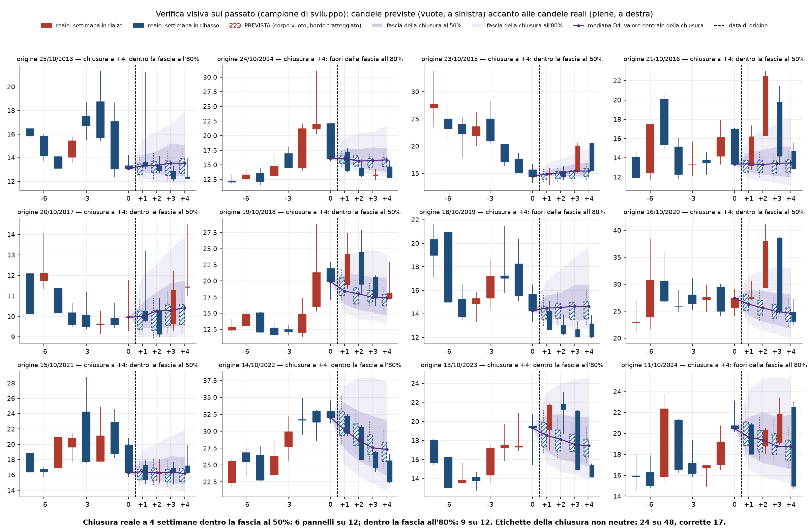
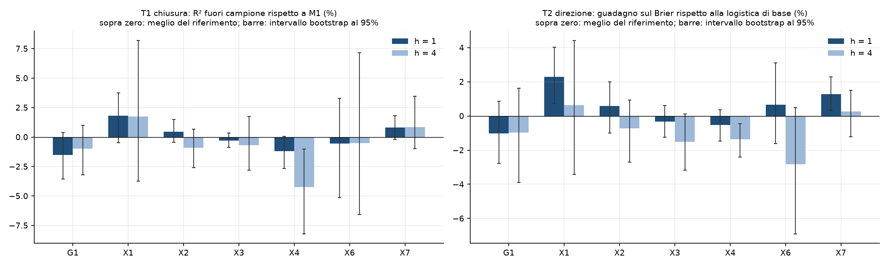
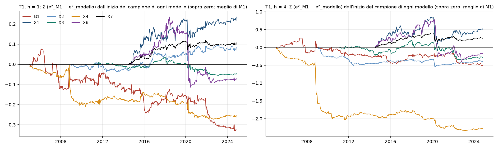

# Fase 3 — Informazioni nuove: VIX giornaliero e dati di mercato

*Generato da `python -m src.run_phase3`. Campione di sviluppo: 1297 settimane dal 2000-01-07 al 2024-11-08; dati giornalieri fino al 2024-11-08.
L'holdout (VIX ed esterni) non è stato letto: il comando gira sotto la guardia. Tutti i numeri vengono da `reports/fase3/`.*

## Sintesi

1. **Candele (Parte 0).** Con ampiezze medie al posto delle mediane, a 1 settimana il corpo medio previsto passa dal 75,8% all'85,6% di quello reale e l'escursione dal 65,5% al 79,6%; a 4 settimane corpo 74,7%, escursione 72,6%. Restano sotto il 100% perché negli anni valutati corpi e ombre sono stati più ampi della media di tutta la storia.
2. **Regressione o media storica.** La regressione batte la media storica solo per: ampiezza del corpo a h = 1, ampiezza del corpo a h = 2. Per tutto il resto il programma usa la media storica; la direzione del corpo è la frequenza storica (L0).
3. **Etichetta della chiusura** (rispetto all'origine, probabilità D1, «neutra» tra 40% e 60%): è neutra nel 69% dei casi a 1 settimana e nel 57% a 4; quando non è neutra è corretta nel 64% dei casi a 1 settimana (291 casi) e nel 71% a 4 (394 casi).
4. **VIX giornaliero da solo (G1): nessun guadagno distinguibile da zero sulla chiusura** (h = 1: R² rispetto a M1 -1,5% [-3,6%; +0,4%], nessuna differenza distinguibile da zero; h = 4: R² rispetto a M1 -1,0% [-3,2%; +1,0%], nessuna differenza distinguibile da zero) e nessun guadagno distinguibile da zero sulla direzione.
5. **Dati di mercato.** Il blocco migliore sulla chiusura è X1 struttura a termine (VIX3M): h = 1: R² rispetto a M1 +1,8% [-0,5%; +3,7%], guadagno significativo dopo Holm, ma con intervallo bootstrap che comprende lo zero; h = 4: R² rispetto a M1 +1,7% [-3,8%; +8,2%], nessuna differenza distinguibile da zero. Gli altri blocchi: X2 +0,5% a h = 1 e -0,9% a h = 4; X3 -0,3% a h = 1 e -0,7% a h = 4; X4 -1,2% a h = 1 e -4,3% a h = 4.
6. **Combinazioni.** X6 tutte le variabili, ridge: -0,5% a h = 1 e -0,5% a h = 4 sulla chiusura; X7 media delle previsioni: +0,8% a h = 1 e +0,9% a h = 4 sulla chiusura: mettere insieme tutte le variabili non fa meglio del blocco migliore da solo.
7. **Chiusura: la regola sceglie X1 struttura a termine (VIX3M)** (significativo dopo Holm a h = 1; guadagno medio sui due orizzonti +1,8%). Modelli significativi: X1. h = 1: +1,8% [-0,5%; +3,7%]; h = 4: +1,7% [-3,8%; +8,2%]. Cautele: l'intervallo bootstrap del guadagno comprende lo zero a h = 1 e h = 4; il test di Diebold-Mariano (che non corregge per i parametri in più) non è significativo a nessun orizzonte; il campione di valutazione parte dal 27/06/2014 (542 previsioni a h = 1, contro le 1037 di M1).
8. **Direzione: nessun modello è significativamente migliore del riferimento dopo Holm (né a h = 1 né a h = 4). Resta il riferimento (logistica con le variabili di M1).** Sulla direzione il blocco con il guadagno medio più alto è X1 struttura a termine (VIX3M) (h = 1: guadagno sul Brier +2,3% [+0,7%; +4,0%], guadagno con intervallo sopra zero, ma non significativo dopo Holm; h = 4: guadagno sul Brier +0,6% [-3,4%; +4,4%], nessuna differenza distinguibile da zero).
9. **Fasce (T3).** X1 struttura a termine (VIX3M): h = 1: CRPS +1,3% [+0,3%; +2,2%] rispetto a D4 (p = 0,064), copertura della fascia all'80% 78,4% contro 73,4% di D4, larghezza 6,3 punti contro 5,7; h = 4: CRPS +1,1% [-2,1%; +4,3%] rispetto a D4 (p = 0,478), copertura della fascia all'80% 74,4% contro 71,4% di D4, larghezza 9,0 punti contro 8,7.
10. **Fascia 13-22** (531 origini a h = 1 per i modelli con tutta la storia). Guadagno sulla chiusura con intervallo sopra zero: nessun modello; sulla direzione: X1 a h = 1, X7 a h = 1. **Nulla di tutto questo è entrato nel programma di previsione**, che cambia solo per la Parte 0.

## 1. Parte 0 — Nuova definizione delle candele

**Decisioni applicate** (prese prima di questa fase): costruzione K2 confermata; ampiezza del corpo e ombre previste come **media** condizionata, non più mediana; direzione del corpo dalla
frequenza storica (L0); ombre e ampiezza dalla media storica quando la regressione non la batte; etichetta sul grafico = direzione della chiusura rispetto alla chiusura dell'origine; linea di
riferimento principale = media a 12 settimane.

**Cambio di definizione, dichiarato.** Nella Fase 2c la candela mostrava «la settimana più probabile» (mediane). Ora mostra «una settimana di dimensioni medie»: corpo ed escursione sono medie,
quindi più grandi delle mediane (le ampiezze hanno una coda lunga a destra). È una scelta nostra, non il risultato di una selezione sui dati.

**Regola per «batte»** (fissata nel codice prima di guardare i risultati, perché la consegna non la precisava): la regressione è usata solo se nel walk-forward di sviluppo ha errore quadratico medio
più basso della media storica **e** il test di Diebold-Mariano ha p < 0,05, separatamente per ogni componente e orizzonte. Esito: ampiezza del corpo: h = 1 regressione, h = 2 regressione, h = 3 media, h = 4 media; ombra superiore: h = 1 media, h = 2 media, h = 3 media, h = 4 media; ombra inferiore: h = 1 media, h = 2 media, h = 3 media, h = 4 media.

### 1.1 Regressione contro media storica

Ampiezze in logaritmi (0,10 ≈ 10%). La media storica è quella delle settimane note all'origine (finestra espandibile).

| componente         |   h |   n |   media reale |   previsione media, regressione |   previsione media, media storica | guadagno della regressione sull'errore quadratico [IC 95%]   |      DM |      p | usata nel programma   |
|:-------------------|----:|----:|--------------:|--------------------------------:|----------------------------------:|:-------------------------------------------------------------|--------:|-------:|:----------------------|
| ampiezza del corpo |   1 | 933 |        0.1121 |                          0.0980 |                            0.0961 | +8,5% [+3,3%; +13,5%]                                        |  3.0641 | 0.0022 | regressione           |
| ombra superiore    |   1 | 933 |        0.0719 |                          0.0620 |                            0.0591 | +4,9% [+0,1%; +8,1%]                                         |  1.6617 | 0.0969 | media storica         |
| ombra inferiore    |   1 | 933 |        0.0484 |                          0.0448 |                            0.0421 | +10,0% [+0,2%; +18,4%]                                       |  1.7152 | 0.0866 | media storica         |
| ampiezza del corpo |   2 | 931 |        0.1123 |                          0.0976 |                            0.0962 | +2,6% [+0,7%; +4,4%]                                         |  2.0223 | 0.0434 | regressione           |
| ombra superiore    |   2 | 931 |        0.0720 |                          0.0621 |                            0.0589 | +1,6% [-1,1%; +3,4%]                                         |  1.1287 | 0.2593 | media storica         |
| ombra inferiore    |   2 | 931 |        0.0483 |                          0.0438 |                            0.0422 | +2,6% [-4,2%; +7,9%]                                         |  0.7677 | 0.4428 | media storica         |
| ampiezza del corpo |   3 | 929 |        0.1123 |                          0.0970 |                            0.0964 | -0,2% [-2,2%; +1,7%]                                         | -0.2201 | 0.8259 | media storica         |
| ombra superiore    |   3 | 929 |        0.0721 |                          0.0608 |                            0.0588 | +1,2% [-2,2%; +3,7%]                                         |  0.7506 | 0.4531 | media storica         |
| ombra inferiore    |   3 | 929 |        0.0484 |                          0.0434 |                            0.0422 | +1,0% [-3,1%; +4,2%]                                         |  0.3303 | 0.7412 | media storica         |
| ampiezza del corpo |   4 | 927 |        0.1124 |                          0.0968 |                            0.0961 | -0,6% [-2,2%; +1,1%]                                         | -0.7039 | 0.4817 | media storica         |
| ombra superiore    |   4 | 927 |        0.0722 |                          0.0610 |                            0.0588 | +1,6% [-0,5%; +3,5%]                                         |  1.4331 | 0.1522 | media storica         |
| ombra inferiore    |   4 | 927 |        0.0484 |                          0.0434 |                            0.0423 | +0,9% [-4,3%; +6,0%]                                         |  0.2826 | 0.7776 | media storica         |

Nota: la previsione media (0,096 per il corpo a 1 settimana) è più bassa della media reale delle settimane valutate (0,112):
le medie sono calcolate su tutta la storia fino all'origine, e negli anni valutati corpi e ombre sono stati più ampi che all'inizio del campione. È questo, e non più la differenza tra media e mediana,
a tenere i rapporti sotto 1.

### 1.2 Nuovi rapporti corpo ed escursione previsti / reali

Stesse origini della Fase 2c (933 previsioni a 1 settimana, date previste dal 2006-12-29 al 2024-11-08).
Errori medi in punti VIX.

|   h | candele                            |   n |   corpo previsto / reale |   escursione prevista / reale | sovrapposizione [IC 95%]   |   chiusura reale nel corpo previsto |   chiusura reale nell'escursione prevista |   errore medio apertura |   errore medio massimo |   errore medio minimo |   errore medio chiusura della candela |
|----:|:-----------------------------------|----:|-------------------------:|------------------------------:|:---------------------------|------------------------------------:|------------------------------------------:|------------------------:|-----------------------:|----------------------:|--------------------------------------:|
|   1 | K2 Fase 2c (mediane, direzione L1) | 933 |                    0.758 |                         0.655 | 0.483 [0.470; 0.498]       |                               0.264 |                                     0.469 |                   0.736 |                  2.251 |                 1.221 |                                 2.293 |
|   1 | K2 Fase 3 (medie, direzione L0)    | 933 |                    0.856 |                         0.796 | 0.517 [0.504; 0.530]       |                               0.318 |                                     0.576 |                   0.736 |                  2.139 |                 1.302 |                                 2.355 |
|   2 | K2 Fase 2c (mediane, direzione L1) | 931 |                    0.674 |                         0.609 | 0.336 [0.316; 0.355]       |                               0.198 |                                     0.375 |                   2.267 |                  3.492 |                 1.832 |                                 2.866 |
|   2 | K2 Fase 3 (medie, direzione L0)    | 931 |                    0.806 |                         0.764 | 0.379 [0.357; 0.401]       |                               0.243 |                                     0.483 |                   2.267 |                  3.397 |                 1.859 |                                 2.925 |
|   3 | K2 Fase 2c (mediane, direzione L1) | 929 |                    0.661 |                         0.580 | 0.296 [0.278; 0.314]       |                               0.184 |                                     0.342 |                   2.864 |                  4.031 |                 2.187 |                                 3.237 |
|   3 | K2 Fase 3 (medie, direzione L0)    | 929 |                    0.761 |                         0.737 | 0.335 [0.315; 0.356]       |                               0.224 |                                     0.442 |                   2.864 |                  3.964 |                 2.247 |                                 3.316 |
|   4 | K2 Fase 2c (mediane, direzione L1) | 927 |                    0.621 |                         0.556 | 0.275 [0.253; 0.298]       |                               0.169 |                                     0.306 |                   3.217 |                  4.391 |                 2.435 |                                 3.515 |
|   4 | K2 Fase 3 (medie, direzione L0)    | 927 |                    0.747 |                         0.726 | 0.314 [0.289; 0.339]       |                               0.213 |                                     0.413 |                   3.217 |                  4.344 |                 2.470 |                                 3.574 |

- A 1 settimana il rapporto del corpo è 0,856 (dentro l'intervallo 0,8–1,2 usato come criterio di realismo nella Fase 2c) e quello dell'escursione è 0,796 (fuori dall'intervallo).
- Sovrapposizione con la candela reale: più alta a tutti gli orizzonti. Quota di chiusure reali dentro l'escursione prevista: più alta a tutti gli orizzonti.
- **Errore sulla chiusura della candela: più alto a tutti gli orizzonti** (2,35 punti contro 2,29 a 1 settimana): un corpo più grande in una direzione fissa porta la chiusura della candela più lontano dal centro.
  La previsione centrale della chiusura resta la mediana D4, non la chiusura della candela.

### 1.3 Etichetta della chiusura

Sopra ogni candela prevista è scritta la direzione della chiusura rispetto alla chiusura dell'origine (per la settimana +1 coincide con la chiusura della settimana prima; le settimane +2 e +3 seguono
la stessa regola della +4). La probabilità è quella del modello D1, già usato per le probabilità di superare 20, 25 e 30: nessun modello nuovo. Tra 40% e 60% l'etichetta è «neutra».

|   h |   n |   freq. chiusura sopra l'origine |   quota «neutra» |   quota «rialzo» |   quota «ribasso» |   n non neutre | accuratezza delle etichette non neutre [IC 95%]   |   n «rialzo» |   corrette «rialzo» |   n «ribasso» |   corrette «ribasso» |   Brier D1 |   Brier frequenza storica |   guadagno sul Brier |   p (DM) |
|----:|----:|---------------------------------:|-----------------:|-----------------:|------------------:|---------------:|:--------------------------------------------------|-------------:|--------------------:|--------------:|---------------------:|-----------:|--------------------------:|---------------------:|---------:|
|   1 | 933 |                            0.457 |            0.688 |            0.035 |             0.277 |            291 | 63,9% [58,7%; 69,8%]                              |           33 |               0.515 |           258 |                0.655 |      0.243 |                     0.249 |                0.021 |    0.121 |
|   2 | 931 |                            0.470 |            0.691 |            0.043 |             0.266 |            288 | 67,0% [61,8%; 73,0%]                              |           40 |               0.575 |           248 |                0.685 |      0.238 |                     0.250 |                0.047 |    0.005 |
|   3 | 929 |                            0.469 |            0.623 |            0.062 |             0.314 |            350 | 69,4% [64,6%; 74,4%]                              |           58 |               0.655 |           292 |                0.702 |      0.230 |                     0.250 |                0.081 |    0.000 |
|   4 | 927 |                            0.452 |            0.575 |            0.091 |             0.334 |            394 | 71,1% [66,8%; 75,8%]                              |           84 |               0.667 |           310 |                0.723 |      0.227 |                     0.249 |                0.086 |    0.000 |

L'etichetta è neutra nella maggior parte dei casi a tutti gli orizzonti. Quando indica «ribasso» è corretta più spesso di quando indica «rialzo» a tutti gli orizzonti; i casi «rialzo» sono 33 a 1 settimana e 84 a 4.

### 1.4 Grafico e programma

- Linea di riferimento principale: media a 12 settimane («livello recente»), spessa e prolungata fino alla settimana +4; la mediana storica è una linea grigia sottile.
- Verifica visiva sul passato rifatta con le nuove candele: Chiusura reale a 4 settimane dentro la fascia al 50%: 6 pannelli su 12; dentro la fascia all'80%: 9 su 12. Etichette della chiusura non neutre: 24 su 48, corrette 17.

- Il registro non riscrive mai un'origine già registrata: le previsioni scritte prima di questa fase restano con le candele di allora (colonna `costruzione` = K2); le nuove hanno `costruzione` = K2m
  e due colonne in più (`p_chiusura_sopra_origine`, `etichetta_chiusura`). `--verifica` misura anche l'esito dell'etichetta.

## 2. Dati e variabili

Serie usate: vix, vix3m, vvix, spx, vx1, vx2 (giornaliere, scaricate nella Fase 2). Ritardi di pubblicazione dall'inventario: vix 0, vix3m 0, vvix 0, spx 0, vx1 0, vx2 0 giorni.
Esclusi per decisione: indice delle condizioni finanziarie e differenziali di credito (non vengono nemmeno letti).

**Regola di allineamento** (fissata prima della valutazione). La settimana t va dal giorno dopo la data settimanale precedente fino all'ultima seduta della settimana t. Di ogni serie si prende
l'ultimo valore dentro la settimana; per i rapporti, l'ultima seduta della settimana in cui tutte le serie del rapporto hanno un valore. Se nella settimana non c'è nessun valore la variabile è
mancante e quell'origine esce dalla stima e dalla valutazione del blocco: nessun valore viene portato avanti.

| blocco   | variabile           | descrizione                                                                                    | prima settimana valida   |   settimane valide |   mancanti dopo l'inizio |
|:---------|:--------------------|:-----------------------------------------------------------------------------------------------|:-------------------------|-------------------:|-------------------------:|
| G1       | g_var1              | VIX: variazione (log) dell'ultima seduta                                                       | 2000-01-07               |               1297 |                        0 |
| G1       | g_var3              | VIX: variazione (log) delle ultime 3 sedute                                                    | 2000-01-07               |               1297 |                        0 |
| G1       | g_sd5               | VIX: deviazione standard delle variazioni giornaliere, ultime 5 sedute                         | 2000-01-07               |               1297 |                        0 |
| G1       | g_sd20              | VIX: deviazione standard delle variazioni giornaliere, ultime 20 sedute                        | 2000-01-07               |               1297 |                        0 |
| G1       | g_chiusura_su_media | VIX: chiusura settimanale rispetto alla media delle chiusure giornaliere della settimana (log) | 2000-01-07               |               1297 |                        0 |
| G1       | g_sedute_dal_max10  | VIX: sedute trascorse dal massimo delle ultime 10 sedute                                       | 2000-01-07               |               1297 |                        0 |
| G1       | g_max_var5          | VIX: massima variazione giornaliera (log) delle ultime 5 sedute                                | 2000-01-07               |               1297 |                        0 |
| X1       | x1_vix3m_su_vix     | VIX3M / VIX − 1                                                                                | 2009-09-18               |                791 |                        0 |
| X2       | x2_vx1_su_vix       | VX1 / VIX − 1                                                                                  | 2004-03-26               |               1077 |                        0 |
| X2       | x2_vx2_su_vx1       | VX2 / VX1 − 1                                                                                  | 2004-03-26               |               1077 |                        0 |
| X3       | x3_log_vvix         | log(VVIX)                                                                                      | 2006-03-10               |                969 |                        6 |
| X4       | x4_rend1            | S&P 500: rendimento (log) a 1 settimana                                                        | 2000-01-14               |               1296 |                        0 |
| X4       | x4_rend4            | S&P 500: rendimento (log) a 4 settimane                                                        | 2000-02-04               |               1293 |                        0 |
| X4       | x4_volreal4         | S&P 500: volatilità realizzata a 4 settimane, annualizzata (%)                                 | 2000-02-04               |               1293 |                        0 |
| X4       | x4_vix_meno_volreal | VIX − volatilità realizzata a 4 settimane                                                      | 2000-02-04               |               1293 |                        0 |
| X4       | x4_dist_max52       | S&P 500: distanza (log) dal massimo a 52 settimane                                             | 2000-02-04               |               1293 |                        0 |

## 3. Protocollo

- Ogni modello = variabili di M1 (ultima chiusura, media a 4 e a 12 settimane, in log) + variabili del blocco. Walk-forward con finestra espandibile e ristima a ogni passo.
- Un'origine è ammessa quando il blocco ha almeno 249 settimane valide: per i blocchi con tutta la storia è la regola di M1. Prime date previste a h = 1: G1 31/12/2004, X1 27/06/2014, X2 02/01/2009, X3 28/01/2011, X4 31/12/2004, X6 27/06/2014, X7 27/06/2014.
- **Riferimento sulle stesse origini.** Il riferimento è quello vero, stimato su tutta la storia dal 2000 (M1; frequenza storica e logistica di base; D4), valutato sulle sole origini del modello.
  Per T1 è riportato anche il confronto con M1 stimato sulla stessa finestra più corta del blocco.
- T1: Clark-West a una coda (il modello contiene M1), Holm su 14 test. T2: Diebold-Mariano sul Brier, Holm su 14 test contro la logistica di base e su 16 contro la frequenza storica.
- X6: penalità ridge solo sulle variabili dei blocchi, intensità scelta nella griglia [0.01, 0.03, 0.1, 0.3, 1.0, 3.0, 10.0] (× numero di coppie) sulle ultime 104 coppie della finestra di stima. La penalità massima
  (10.0) è stata scelta nel 38% delle origini a h = 1 e nel 50% a h = 4 per T1 (con la penalità massima X6 resta vicino a M1 stimato sulla stessa finestra).
- X7: media semplice delle previsioni dei cinque blocchi, sulle origini in cui esistono tutte.
- Intervalli di confidenza: bootstrap a blocchi di 26 settimane, 2000 repliche.

## 4. Tabella principale

### 4.1 T1 — Chiusura (log VIX)

Riferimento M1 su tutte le sue origini: RMSE log 0,1434 a h = 1 (1037 previsioni) e 0,2274 a h = 4 (1034).
In ogni riga «M1» è il riferimento ricalcolato sulle origini del modello.

|   h | modello                        |    n | prima data prevista   |   RMSE log |   RMSE log M1 |   MAE log |   MAE log M1 | R² vs M1 [IC 95%]    | R² vs M1 stimato sulla stessa finestra   |   Clark-West |   p (una coda) |   p Holm | significativo dopo Holm   |   p DM (due code) |
|----:|:-------------------------------|-----:|:----------------------|-----------:|--------------:|----------:|-------------:|:---------------------|:-----------------------------------------|-------------:|---------------:|---------:|:--------------------------|------------------:|
|   1 | G1 VIX giornaliero             | 1037 | 2004-12-31            |     0.1445 |        0.1434 |    0.1065 |       0.1061 | -1,5% [-3,6%; +0,4%] | -1,5%                                    |       0.6274 |         0.2652 |   1.0000 | no                        |            0.1366 |
|   1 | X1 struttura a termine (VIX3M) |  542 | 2014-06-27            |     0.1539 |        0.1553 |    0.1121 |       0.1128 | +1,8% [-0,5%; +3,7%] | +1,6%                                    |       3.0873 |         0.0010 |   0.0141 | sì                        |            0.1825 |
|   1 | X2 future (VX1, VX2)           |  828 | 2009-01-02            |     0.1463 |        0.1466 |    0.1080 |       0.1080 | +0,5% [-0,5%; +1,5%] | +0,5%                                    |       2.1756 |         0.0148 |   0.1775 | no                        |            0.4263 |
|   1 | X3 VVIX                        |  720 | 2011-01-28            |     0.1494 |        0.1492 |    0.1101 |       0.1103 | -0,3% [-0,9%; +0,3%] | -0,1%                                    |       0.0486 |         0.4806 |   1.0000 | no                        |            0.5052 |
|   1 | X4 S&P 500                     | 1037 | 2004-12-31            |     0.1443 |        0.1434 |    0.1064 |       0.1061 | -1,2% [-2,7%; +0,1%] | -1,2%                                    |      -0.1413 |         0.5562 |   1.0000 | no                        |            0.1169 |
|   1 | X6 tutte le variabili, ridge   |  542 | 2014-06-27            |     0.1558 |        0.1553 |    0.1121 |       0.1128 | -0,5% [-5,2%; +3,3%] | -0,7%                                    |       1.7029 |         0.0443 |   0.3986 | no                        |            0.7757 |
|   1 | X7 media delle previsioni      |  542 | 2014-06-27            |     0.1547 |        0.1553 |    0.1122 |       0.1128 | +0,8% [-0,2%; +1,8%] | +0,6%                                    |       2.0276 |         0.0213 |   0.2130 | no                        |            0.1446 |
|   4 | G1 VIX giornaliero             | 1034 | 2005-01-21            |     0.2285 |        0.2274 |    0.1660 |       0.1657 | -1,0% [-3,2%; +1,0%] | -1,0%                                    |       0.9165 |         0.1797 |   1.0000 | no                        |            0.3645 |
|   4 | X1 struttura a termine (VIX3M) |  539 | 2014-07-18            |     0.2380 |        0.2401 |    0.1741 |       0.1758 | +1,7% [-3,8%; +8,2%] | +1,0%                                    |       2.1711 |         0.0150 |   0.1775 | no                        |            0.5142 |
|   4 | X2 future (VX1, VX2)           |  825 | 2009-01-23            |     0.2273 |        0.2263 |    0.1662 |       0.1657 | -0,9% [-2,6%; +0,7%] | -0,4%                                    |      -0.2695 |         0.6062 |   1.0000 | no                        |            0.1956 |
|   4 | X3 VVIX                        |  717 | 2011-02-18            |     0.2327 |        0.2318 |    0.1711 |       0.1717 | -0,7% [-2,8%; +1,7%] | +0,0%                                    |       0.6036 |         0.2731 |   1.0000 | no                        |            0.5819 |
|   4 | X4 S&P 500                     | 1034 | 2005-01-21            |     0.2322 |        0.2274 |    0.1698 |       0.1657 | -4,3% [-8,2%; -1,0%] | -4,3%                                    |      -2.3152 |         0.9897 |   1.0000 | no                        |            0.0178 |
|   4 | X6 tutte le variabili, ridge   |  539 | 2014-07-18            |     0.2407 |        0.2401 |    0.1761 |       0.1758 | -0,5% [-6,6%; +7,2%] | -1,3%                                    |       2.3363 |         0.0097 |   0.1266 | no                        |            0.8537 |
|   4 | X7 media delle previsioni      |  539 | 2014-07-18            |     0.2391 |        0.2401 |    0.1742 |       0.1758 | +0,9% [-1,0%; +3,5%] | +0,1%                                    |       1.6143 |         0.0532 |   0.4258 | no                        |            0.3487 |

In punti VIX e quota di previsioni entro il 10% e il 20% dal valore reale:

|   h | modello                        |    n |   RMSE punti |   RMSE punti M1 |   MAE punti |   MAE punti M1 |   entro il 10% |   entro il 10%, M1 |   entro il 20% |   entro il 20%, M1 |
|----:|:-------------------------------|-----:|-------------:|----------------:|------------:|---------------:|---------------:|-------------------:|---------------:|-------------------:|
|   1 | G1 VIX giornaliero             | 1037 |        3.385 |           3.380 |       2.153 |          2.146 |          0.585 |              0.579 |          0.872 |              0.875 |
|   1 | X1 struttura a termine (VIX3M) |  542 |        3.336 |           3.362 |       2.106 |          2.137 |          0.566 |              0.559 |          0.858 |              0.854 |
|   1 | X2 future (VX1, VX2)           |  828 |        3.252 |           3.269 |       2.142 |          2.145 |          0.575 |              0.575 |          0.870 |              0.871 |
|   1 | X3 VVIX                        |  720 |        3.227 |           3.221 |       2.091 |          2.096 |          0.567 |              0.564 |          0.871 |              0.864 |
|   1 | X4 S&P 500                     | 1037 |        3.474 |           3.380 |       2.156 |          2.146 |          0.576 |              0.579 |          0.879 |              0.875 |
|   1 | X6 tutte le variabili, ridge   |  542 |        3.516 |           3.362 |       2.136 |          2.137 |          0.581 |              0.559 |          0.867 |              0.854 |
|   1 | X7 media delle previsioni      |  542 |        3.348 |           3.362 |       2.123 |          2.137 |          0.568 |              0.559 |          0.862 |              0.854 |
|   4 | G1 VIX giornaliero             | 1034 |        5.747 |           5.702 |       3.377 |          3.353 |          0.390 |              0.397 |          0.696 |              0.691 |
|   4 | X1 struttura a termine (VIX3M) |  539 |        5.462 |           5.451 |       3.260 |          3.327 |          0.367 |              0.377 |          0.646 |              0.653 |
|   4 | X2 future (VX1, VX2)           |  825 |        5.243 |           5.185 |       3.288 |          3.255 |          0.384 |              0.390 |          0.695 |              0.690 |
|   4 | X3 VVIX                        |  717 |        5.246 |           5.234 |       3.239 |          3.260 |          0.365 |              0.374 |          0.675 |              0.667 |
|   4 | X4 S&P 500                     | 1034 |        5.975 |           5.702 |       3.481 |          3.353 |          0.384 |              0.397 |          0.679 |              0.691 |
|   4 | X6 tutte le variabili, ridge   |  539 |        5.634 |           5.451 |       3.366 |          3.327 |          0.362 |              0.377 |          0.651 |              0.653 |
|   4 | X7 media delle previsioni      |  539 |        5.453 |           5.451 |       3.290 |          3.327 |          0.373 |              0.377 |          0.651 |              0.653 |

### 4.2 T2 — Direzione della chiusura rispetto all'origine

Evento: chiusura a t + h sopra la chiusura a t. Riferimenti: frequenza storica e logistica con le sole variabili di M1.

|   h | modello                         |    n |   freq. rialzo |   accuratezza |   accuratezza base |   Brier |   Brier base |   Brier frequenza |   affidabilità (0 = calibrato) |   risoluzione | guadagno sul Brier vs logistica di base [IC 95%]   |   p vs base |   p Holm vs base | significativo dopo Holm (vs base)   |   guadagno sul Brier vs frequenza |   p vs frequenza |   p Holm vs frequenza |
|----:|:--------------------------------|-----:|---------------:|--------------:|-------------------:|--------:|-------------:|------------------:|-------------------------------:|--------------:|:---------------------------------------------------|------------:|-----------------:|:------------------------------------|----------------------------------:|-----------------:|----------------------:|
|   1 | frequenza storica (riferimento) | 1037 |         0.4609 |        0.5391 |             0.5738 |  0.2489 |       0.2435 |            0.2489 |                         0.0003 |        0.0000 | –                                                  |      –      |           –      | –                                   |                            –      |           –      |                –      |
|   1 | logistica di base (riferimento) | 1037 |         0.4609 |        0.5738 |             0.5738 |  0.2435 |       0.2435 |            0.2489 |                         0.0037 |        0.0069 | –                                                  |      –      |           –      | –                                   |                            0.0217 |           0.0276 |                0.1380 |
|   1 | G1 VIX giornaliero              | 1037 |         0.4609 |        0.5776 |             0.5738 |  0.2459 |       0.2435 |            0.2489 |                         0.0035 |        0.0065 | -1,0% [-2,8%; +0,8%]                               |      0.2322 |           1.0000 | no                                  |                            0.0118 |           0.3723 |                0.4325 |
|   1 | X1 struttura a termine (VIX3M)  |  542 |         0.4336 |        0.6052 |             0.5756 |  0.2358 |       0.2413 |            0.2473 |                         0.0037 |        0.0112 | +2,3% [+0,7%; +4,0%]                               |      0.0228 |           0.2735 | no                                  |                            0.0464 |           0.0186 |                0.1211 |
|   1 | X2 future (VX1, VX2)            |  828 |         0.4444 |        0.5761 |             0.5785 |  0.2399 |       0.2413 |            0.2482 |                         0.0040 |        0.0092 | +0,6% [-1,0%; +2,0%]                               |      0.4795 |           1.0000 | no                                  |                            0.0335 |           0.0086 |                0.0688 |
|   1 | X3 VVIX                         |  720 |         0.4486 |        0.5819 |             0.5722 |  0.2427 |       0.2419 |            0.2481 |                         0.0037 |        0.0078 | -0,3% [-1,2%; +0,6%]                               |      0.5936 |           1.0000 | no                                  |                            0.0217 |           0.0952 |                0.3809 |
|   1 | X4 S&P 500                      | 1037 |         0.4609 |        0.5583 |             0.5738 |  0.2448 |       0.2435 |            0.2489 |                         0.0025 |        0.0060 | -0,5% [-1,5%; +0,4%]                               |      0.3761 |           1.0000 | no                                  |                            0.0165 |           0.1442 |                0.4325 |
|   1 | X6 tutte le variabili, ridge    |  542 |         0.4336 |        0.5923 |             0.5756 |  0.2398 |       0.2413 |            0.2473 |                         0.0023 |        0.0095 | +0,6% [-1,6%; +3,1%]                               |      0.6470 |           1.0000 | no                                  |                            0.0305 |           0.1560 |                0.4325 |
|   1 | X7 media delle previsioni       |  542 |         0.4336 |        0.5923 |             0.5756 |  0.2383 |       0.2413 |            0.2473 |                         0.0031 |        0.0111 | +1,3% [+0,3%; +2,3%]                               |      0.0100 |           0.1304 | no                                  |                            0.0365 |           0.0173 |                0.1211 |
|   4 | frequenza storica (riferimento) | 1034 |         0.4555 |        0.5445 |             0.6199 |  0.2491 |       0.2258 |            0.2491 |                         0.0003 |        0.0000 | –                                                  |      –      |           –      | –                                   |                            –      |           –      |                –      |
|   4 | logistica di base (riferimento) | 1034 |         0.4555 |        0.6199 |             0.6199 |  0.2258 |       0.2258 |            0.2491 |                         0.0015 |        0.0210 | –                                                  |      –      |           –      | –                                   |                            0.0935 |           0.0000 |                0.0002 |
|   4 | G1 VIX giornaliero              | 1034 |         0.4555 |        0.6315 |             0.6199 |  0.2280 |       0.2258 |            0.2491 |                         0.0022 |        0.0210 | -1,0% [-3,9%; +1,6%]                               |      0.4859 |           1.0000 | no                                  |                            0.0847 |           0.0002 |                0.0024 |
|   4 | X1 struttura a termine (VIX3M)  |  539 |         0.4842 |        0.6512 |             0.6382 |  0.2188 |       0.2202 |            0.2524 |                         0.0067 |        0.0370 | +0,6% [-3,4%; +4,4%]                               |      0.7583 |           1.0000 | no                                  |                            0.1331 |           0.0003 |                0.0033 |
|   4 | X2 future (VX1, VX2)            |  825 |         0.4461 |        0.6230 |             0.6352 |  0.2243 |       0.2227 |            0.2478 |                         0.0014 |        0.0235 | -0,7% [-2,7%; +0,9%]                               |      0.4689 |           1.0000 | no                                  |                            0.0947 |           0.0002 |                0.0029 |
|   4 | X3 VVIX                         |  717 |         0.4644 |        0.6151 |             0.6276 |  0.2283 |       0.2249 |            0.2499 |                         0.0051 |        0.0236 | -1,5% [-3,2%; +0,1%]                               |      0.1086 |           1.0000 | no                                  |                            0.0863 |           0.0016 |                0.0162 |
|   4 | X4 S&P 500                      | 1034 |         0.4555 |        0.6141 |             0.6199 |  0.2289 |       0.2258 |            0.2491 |                         0.0011 |        0.0186 | -1,4% [-2,4%; -0,4%]                               |      0.0075 |           0.1055 | no                                  |                            0.0812 |           0.0003 |                0.0033 |
|   4 | X6 tutte le variabili, ridge    |  539 |         0.4842 |        0.6345 |             0.6382 |  0.2265 |       0.2202 |            0.2524 |                         0.0033 |        0.0260 | -2,8% [-6,9%; +0,5%]                               |      0.1626 |           1.0000 | no                                  |                            0.1028 |           0.0020 |                0.0180 |
|   4 | X7 media delle previsioni       |  539 |         0.4842 |        0.6401 |             0.6382 |  0.2197 |       0.2202 |            0.2524 |                         0.0030 |        0.0312 | +0,3% [-1,2%; +1,5%]                               |      0.6793 |           1.0000 | no                                  |                            0.1297 |           0.0000 |                0.0001 |

Accuratezza e quota di settimane quando la probabilità della direzione prevista è almeno 60%, 65% e 70% (soglie fissate prima):

|   h | modello                         |    n |   accuratezza (tutte) | prob. ≥ 60%: quota (n) → accuratezza   | prob. ≥ 65%: quota (n) → accuratezza   | prob. ≥ 70%: quota (n) → accuratezza   |
|----:|:--------------------------------|-----:|----------------------:|:---------------------------------------|:---------------------------------------|:---------------------------------------|
|   1 | logistica di base (riferimento) | 1037 |                 0.574 | 16,3% (169) → 62,1%                    | 5,6% (58) → 62,1%                      | 1,7% (18, meno di 20) → 55,6%          |
|   1 | G1 VIX giornaliero              | 1037 |                 0.578 | 32,7% (339) → 60,2%                    | 14,6% (151) → 60,9%                    | 6,9% (72) → 59,7%                      |
|   1 | X1 struttura a termine (VIX3M)  |  542 |                 0.605 | 43,4% (235) → 65,1%                    | 23,6% (128) → 68,8%                    | 7,7% (42) → 71,4%                      |
|   1 | X2 future (VX1, VX2)            |  828 |                 0.576 | 28,0% (232) → 66,4%                    | 11,1% (92) → 78,3%                     | 3,3% (27) → 66,7%                      |
|   1 | X3 VVIX                         |  720 |                 0.582 | 26,9% (194) → 61,3%                    | 11,4% (82) → 67,1%                     | 4,6% (33) → 75,8%                      |
|   1 | X4 S&P 500                      | 1037 |                 0.558 | 26,6% (276) → 64,9%                    | 9,0% (93) → 63,4%                      | 3,0% (31) → 58,1%                      |
|   1 | X6 tutte le variabili, ridge    |  542 |                 0.592 | 44,3% (240) → 66,2%                    | 25,3% (137) → 67,9%                    | 14,9% (81) → 69,1%                     |
|   1 | X7 media delle previsioni       |  542 |                 0.592 | 29,7% (161) → 70,2%                    | 9,8% (53) → 71,7%                      | 4,2% (23) → 73,9%                      |
|   4 | logistica di base (riferimento) | 1034 |                 0.620 | 45,4% (469) → 69,5%                    | 25,1% (260) → 76,9%                    | 13,8% (143) → 83,2%                    |
|   4 | G1 VIX giornaliero              | 1034 |                 0.632 | 54,4% (562) → 68,1%                    | 34,6% (358) → 71,5%                    | 21,4% (221) → 74,7%                    |
|   4 | X1 struttura a termine (VIX3M)  |  539 |                 0.651 | 62,5% (337) → 72,4%                    | 45,5% (245) → 71,8%                    | 31,9% (172) → 72,7%                    |
|   4 | X2 future (VX1, VX2)            |  825 |                 0.623 | 46,5% (384) → 72,1%                    | 29,7% (245) → 76,7%                    | 16,8% (139) → 81,3%                    |
|   4 | X3 VVIX                         |  717 |                 0.615 | 50,6% (363) → 66,7%                    | 30,7% (220) → 72,7%                    | 18,7% (134) → 82,1%                    |
|   4 | X4 S&P 500                      | 1034 |                 0.614 | 48,5% (501) → 67,9%                    | 27,8% (287) → 74,9%                    | 14,3% (148) → 80,4%                    |
|   4 | X6 tutte le variabili, ridge    |  539 |                 0.635 | 61,0% (329) → 68,4%                    | 43,6% (235) → 72,3%                    | 28,6% (154) → 75,3%                    |
|   4 | X7 media delle previsioni       |  539 |                 0.640 | 53,2% (287) → 71,8%                    | 34,0% (183) → 77,0%                    | 20,4% (110) → 80,0%                    |

Calibrazione della logistica di base e del blocco con il guadagno medio più alto (X1 struttura a termine (VIX3M)); tutte le classi sono in `reports/fase3/t2_calibrazione.csv`:

|   h | modello                         | classe di probabilità   |   n |   probabilità media |   frequenza osservata |
|----:|:--------------------------------|:------------------------|----:|--------------------:|----------------------:|
|   1 | logistica di base (riferimento) | 0.1-0.2                 |   3 |               0.173 |                 1.000 |
|   1 | logistica di base (riferimento) | 0.2-0.3                 |  15 |               0.268 |                 0.333 |
|   1 | logistica di base (riferimento) | 0.3-0.4                 | 119 |               0.363 |                 0.345 |
|   1 | logistica di base (riferimento) | 0.4-0.5                 | 368 |               0.454 |                 0.394 |
|   1 | logistica di base (riferimento) | 0.5-0.6                 | 500 |               0.545 |                 0.534 |
|   1 | logistica di base (riferimento) | 0.6-0.7                 |  32 |               0.617 |                 0.531 |
|   1 | X1 struttura a termine (VIX3M)  | 0.0-0.1                 |   2 |               0.083 |                 0.500 |
|   1 | X1 struttura a termine (VIX3M)  | 0.1-0.2                 |   5 |               0.166 |                 0.400 |
|   1 | X1 struttura a termine (VIX3M)  | 0.2-0.3                 |  33 |               0.262 |                 0.242 |
|   1 | X1 struttura a termine (VIX3M)  | 0.3-0.4                 | 112 |               0.353 |                 0.330 |
|   1 | X1 struttura a termine (VIX3M)  | 0.4-0.5                 | 151 |               0.455 |                 0.377 |
|   1 | X1 struttura a termine (VIX3M)  | 0.5-0.6                 | 156 |               0.547 |                 0.519 |
|   1 | X1 struttura a termine (VIX3M)  | 0.6-0.7                 |  81 |               0.643 |                 0.593 |
|   1 | X1 struttura a termine (VIX3M)  | 0.7-0.8                 |   2 |               0.708 |                 0.500 |
|   4 | logistica di base (riferimento) | 0.0-0.1                 |  16 |               0.056 |                 0.250 |
|   4 | logistica di base (riferimento) | 0.1-0.2                 |  37 |               0.164 |                 0.135 |
|   4 | logistica di base (riferimento) | 0.2-0.3                 |  89 |               0.258 |                 0.169 |
|   4 | logistica di base (riferimento) | 0.3-0.4                 | 159 |               0.357 |                 0.365 |
|   4 | logistica di base (riferimento) | 0.4-0.5                 | 253 |               0.451 |                 0.435 |
|   4 | logistica di base (riferimento) | 0.5-0.6                 | 312 |               0.550 |                 0.551 |
|   4 | logistica di base (riferimento) | 0.6-0.7                 | 167 |               0.638 |                 0.635 |
|   4 | logistica di base (riferimento) | 0.7-0.8                 |   1 |               0.714 |                 1.000 |
|   4 | X1 struttura a termine (VIX3M)  | 0.0-0.1                 |  11 |               0.048 |                 0.182 |
|   4 | X1 struttura a termine (VIX3M)  | 0.1-0.2                 |  43 |               0.161 |                 0.163 |
|   4 | X1 struttura a termine (VIX3M)  | 0.2-0.3                 |  73 |               0.248 |                 0.288 |
|   4 | X1 struttura a termine (VIX3M)  | 0.3-0.4                 |  82 |               0.351 |                 0.280 |
|   4 | X1 struttura a termine (VIX3M)  | 0.4-0.5                 |  87 |               0.456 |                 0.575 |
|   4 | X1 struttura a termine (VIX3M)  | 0.5-0.6                 | 115 |               0.553 |                 0.609 |
|   4 | X1 struttura a termine (VIX3M)  | 0.6-0.7                 |  83 |               0.644 |                 0.723 |
|   4 | X1 struttura a termine (VIX3M)  | 0.7-0.8                 |  40 |               0.739 |                 0.600 |
|   4 | X1 struttura a termine (VIX3M)  | 0.8-0.9                 |   5 |               0.815 |                 0.800 |

### 4.3 T3 — Fasce

Eseguito solo per i modelli scelti dalle regole (X1). Regressione quantilica come D4 con le variabili del blocco in più; riferimento D4 sulle stesse origini.

|   h | modello                        |   n |   CRPS | guadagno sul CRPS vs D4 [IC 95%]   |   p (DM) |   copertura 50% |   copertura 80% |   copertura 90% |   larghezza 50% (punti) |   larghezza 80% (punti) |   larghezza 90% (punti) |   errore medio della mediana (punti) |   previsioni con quantili incrociati |
|----:|:-------------------------------|----:|-------:|:-----------------------------------|---------:|----------------:|----------------:|----------------:|------------------------:|------------------------:|------------------------:|-------------------------------------:|-------------------------------------:|
|   1 | X1 struttura a termine (VIX3M) | 542 | 0.0835 | +1,3% [+0,3%; +2,2%]               |   0.0643 |          0.5092 |          0.7841 |          0.8708 |                  3.3269 |                  6.3414 |                  8.4086 |                               2.0767 |                                  112 |
|   1 | D4 (riferimento)               | 542 | 0.0846 | –                                  |   –      |          0.4557 |          0.7343 |          0.8487 |                  2.9449 |                  5.7284 |                  7.6684 |                               2.1037 |                                   45 |
|   4 | X1 struttura a termine (VIX3M) | 539 | 0.1296 | +1,1% [-2,1%; +4,3%]               |   0.4776 |          0.4583 |          0.7440 |          0.8386 |                  4.0884 |                  8.9510 |                 12.5185 |                               3.2268 |                                   95 |
|   4 | D4 (riferimento)               | 539 | 0.1309 | –                                  |   –      |          0.4286 |          0.7143 |          0.8404 |                  4.2022 |                  8.6576 |                 12.6839 |                               3.2652 |                                   20 |

## 5. Fascia 13-22 e casi dopo un rialzo oltre il 30%

Fascia 13-22: chiusura all'origine tra 13 e 22, estremi inclusi. Nelle tabelle di questa sezione i p-value non sono corretti per i confronti multipli: servono a descrivere, non a scegliere.

### 5.1 Fascia 13-22 — Chiusura

|   h | modello                        |   casi |   RMSE log |   RMSE log M1 |   MAE punti |   MAE punti M1 | R² vs M1 [IC 95%]    |   Clark-West |   p (una coda, non corretto) |   entro il 10% |   entro il 10%, M1 |   entro il 20% |   entro il 20%, M1 |
|----:|:-------------------------------|-------:|-----------:|--------------:|------------:|---------------:|:---------------------|-------------:|-----------------------------:|---------------:|-------------------:|---------------:|-------------------:|
|   1 | G1 VIX giornaliero             |    531 |     0.1467 |        0.1451 |      1.9388 |         1.9261 | -2,2% [-4,7%; +0,4%] |      -0.1852 |                       0.5734 |         0.5386 |             0.5235 |         0.8644 |             0.8701 |
|   1 | X1 struttura a termine (VIX3M) |    299 |     0.1602 |        0.1611 |      2.0956 |         2.1266 | +1,1% [-1,5%; +3,6%] |       1.7931 |                       0.0365 |         0.5017 |             0.4916 |         0.8428 |             0.8361 |
|   1 | X2 future (VX1, VX2)           |    460 |     0.1468 |        0.1471 |      1.9455 |         1.9497 | +0,5% [-0,4%; +1,5%] |       1.6332 |                       0.0512 |         0.5391 |             0.5304 |         0.8717 |             0.8717 |
|   1 | X3 VVIX                        |    424 |     0.1495 |        0.1491 |      1.9645 |         1.9654 | -0,5% [-1,2%; +0,2%] |      -0.5858 |                       0.7210 |         0.5189 |             0.5236 |         0.8750 |             0.8656 |
|   1 | X4 S&P 500                     |    531 |     0.1459 |        0.1451 |      1.9305 |         1.9261 | -1,2% [-2,1%; -0,1%] |      -1.5626 |                       0.9409 |         0.5254 |             0.5235 |         0.8682 |             0.8701 |
|   1 | X6 tutte le variabili, ridge   |    299 |     0.1610 |        0.1611 |      2.0996 |         2.1266 | +0,1% [-2,7%; +2,8%] |       1.3800 |                       0.0838 |         0.5217 |             0.4916 |         0.8629 |             0.8361 |
|   1 | X7 media delle previsioni      |    299 |     0.1610 |        0.1611 |      2.1157 |         2.1266 | +0,1% [-1,1%; +1,4%] |       0.4495 |                       0.3266 |         0.4983 |             0.4916 |         0.8462 |             0.8361 |
|   4 | G1 VIX giornaliero             |    528 |     0.2429 |        0.2403 |      3.2876 |         3.2725 | -2,2% [-5,2%; +0,6%] |      -0.4725 |                       0.6817 |         0.3504 |             0.3617 |         0.6496 |             0.6383 |
|   4 | X1 struttura a termine (VIX3M) |    296 |     0.2495 |        0.2518 |      3.2998 |         3.3587 | +1,8% [-2,3%; +8,4%] |       1.6445 |                       0.0500 |         0.3581 |             0.3615 |         0.6182 |             0.6115 |
|   4 | X2 future (VX1, VX2)           |    457 |     0.2399 |        0.2393 |      3.2045 |         3.2142 | -0,6% [-1,9%; +1,2%] |      -0.4454 |                       0.6720 |         0.3632 |             0.3720 |         0.6761 |             0.6586 |
|   4 | X3 VVIX                        |    421 |     0.2403 |        0.2379 |      3.2116 |         3.1747 | -2,0% [-5,0%; +0,8%] |      -0.8344 |                       0.7980 |         0.3325 |             0.3634 |         0.6532 |             0.6437 |
|   4 | X4 S&P 500                     |    528 |     0.2432 |        0.2403 |      3.3009 |         3.2725 | -2,4% [-4,4%; -0,6%] |      -2.5438 |                       0.9945 |         0.3523 |             0.3617 |         0.6345 |             0.6383 |
|   4 | X6 tutte le variabili, ridge   |    296 |     0.2487 |        0.2518 |      3.3018 |         3.3587 | +2,4% [-0,7%; +7,3%] |       2.7369 |                       0.0031 |         0.3514 |             0.3615 |         0.6284 |             0.6115 |
|   4 | X7 media delle previsioni      |    296 |     0.2517 |        0.2518 |      3.3416 |         3.3587 | +0,1% [-1,7%; +2,9%] |       0.3378 |                       0.3678 |         0.3547 |             0.3615 |         0.6149 |             0.6115 |

### 5.2 Fascia 13-22 — Direzione

|   h | modello                        |   casi |   freq. rialzo |   accuratezza |   accuratezza base |   Brier |   Brier base | guadagno sul Brier vs base [IC 95%]   | prob. ≥ 60%: quota (n) → accuratezza   |
|----:|:-------------------------------|-------:|---------------:|--------------:|-------------------:|--------:|-------------:|:--------------------------------------|:---------------------------------------|
|   1 | G1 VIX giornaliero             |    531 |         0.4350 |        0.5367 |             0.5254 |  0.2511 |       0.2485 | -1,1% [-3,2%; +1,1%]                  | 22,2% (118) → 55,9%                    |
|   1 | X1 struttura a termine (VIX3M) |    299 |         0.4013 |        0.5686 |             0.5217 |  0.2409 |       0.2483 | +3,0% [+0,9%; +5,3%]                  | 32,8% (98) → 63,3%                     |
|   1 | X2 future (VX1, VX2)           |    460 |         0.4326 |        0.5391 |             0.5283 |  0.2462 |       0.2478 | +0,6% [-1,2%; +2,4%]                  | 15,9% (73) → 67,1%                     |
|   1 | X3 VVIX                        |    424 |         0.4245 |        0.5425 |             0.5236 |  0.2489 |       0.2480 | -0,4% [-1,4%; +0,7%]                  | 17,0% (72) → 58,3%                     |
|   1 | X4 S&P 500                     |    531 |         0.4350 |        0.5160 |             0.5254 |  0.2482 |       0.2485 | +0,1% [-0,9%; +1,1%]                  | 12,2% (65) → 64,6%                     |
|   1 | X6 tutte le variabili, ridge   |    299 |         0.4013 |        0.5552 |             0.5217 |  0.2467 |       0.2483 | +0,7% [-2,0%; +3,7%]                  | 33,1% (99) → 64,6%                     |
|   1 | X7 media delle previsioni      |    299 |         0.4013 |        0.5418 |             0.5217 |  0.2449 |       0.2483 | +1,4% [+0,1%; +2,7%]                  | 17,1% (51) → 68,6%                     |
|   4 | G1 VIX giornaliero             |    528 |         0.4621 |        0.5701 |             0.5473 |  0.2486 |       0.2428 | -2,4% [-6,9%; +1,2%]                  | 40,0% (211) → 59,7%                    |
|   4 | X1 struttura a termine (VIX3M) |    296 |         0.4932 |        0.6081 |             0.5845 |  0.2330 |       0.2382 | +2,2% [-2,3%; +6,3%]                  | 48,3% (143) → 71,3%                    |
|   4 | X2 future (VX1, VX2)           |    457 |         0.4595 |        0.5536 |             0.5733 |  0.2393 |       0.2385 | -0,3% [-3,0%; +2,1%]                  | 34,4% (157) → 67,5%                    |
|   4 | X3 VVIX                        |    421 |         0.4561 |        0.5463 |             0.5772 |  0.2427 |       0.2383 | -1,8% [-3,5%; -0,2%]                  | 36,6% (154) → 63,0%                    |
|   4 | X4 S&P 500                     |    528 |         0.4621 |        0.5379 |             0.5473 |  0.2449 |       0.2428 | -0,9% [-1,7%; -0,0%]                  | 28,6% (151) → 63,6%                    |
|   4 | X6 tutte le variabili, ridge   |    296 |         0.4932 |        0.5811 |             0.5845 |  0.2400 |       0.2382 | -0,8% [-4,4%; +2,3%]                  | 46,6% (138) → 65,2%                    |
|   4 | X7 media delle previsioni      |    296 |         0.4932 |        0.5912 |             0.5845 |  0.2375 |       0.2382 | +0,3% [-1,4%; +1,7%]                  | 37,8% (112) → 67,9%                    |

### 5.3 Fascia 13-22 — Fasce

|   h | modello                        |   casi |   CRPS | guadagno sul CRPS vs D4   |   copertura 50% |   copertura 80% |   copertura 90% |   larghezza 80% (punti) |
|----:|:-------------------------------|-------:|-------:|:--------------------------|----------------:|----------------:|----------------:|------------------------:|
|   1 | X1 struttura a termine (VIX3M) |    299 | 0.0877 | +2,1%                     |          0.4381 |          0.7324 |          0.8428 |                  5.6157 |
|   1 | D4 (riferimento)               |    299 | 0.0896 | –                         |          0.3813 |          0.6823 |          0.8094 |                  5.1505 |
|   4 | X1 struttura a termine (VIX3M) |    296 | 0.1337 | +2,4%                     |          0.4223 |          0.7399 |          0.8209 |                  8.5216 |
|   4 | D4 (riferimento)               |    296 | 0.1370 | –                         |          0.3818 |          0.6892 |          0.8074 |                  8.1277 |

Guadagno sulla chiusura con intervallo bootstrap tutto sopra zero: nessun modello. Con intervallo tutto sotto zero: X4 a h = 1, X4 a h = 4.

### 5.4 Dopo un rialzo oltre il 30% in 4 settimane — Chiusura

|   h | modello                        |   casi |   RMSE log |   RMSE log M1 |   MAE punti |   MAE punti M1 | R² vs M1 [IC 95%]      |   Clark-West |   p (una coda, non corretto) |   entro il 10% |   entro il 10%, M1 |   entro il 20% |   entro il 20%, M1 |
|----:|:-------------------------------|-------:|-----------:|--------------:|------------:|---------------:|:-----------------------|-------------:|-----------------------------:|---------------:|-------------------:|---------------:|-------------------:|
|   1 | G1 VIX giornaliero             |    115 |     0.2025 |        0.2025 |      4.3263 |         4.3914 | -0,1% [-7,6%; +6,4%]   |       0.9118 |                       0.1809 |         0.3565 |             0.3304 |         0.6783 |             0.6783 |
|   1 | X1 struttura a termine (VIX3M) |     66 |     0.2031 |        0.2040 |      3.7600 |         3.8350 | +0,9% [-3,1%; +5,6%]   |       0.8452 |                       0.1990 |         0.4394 |             0.4091 |         0.6970 |             0.6667 |
|   1 | X2 future (VX1, VX2)           |     91 |     0.2012 |        0.2011 |      3.9295 |         3.9544 | -0,1% [-3,1%; +2,7%]   |       0.2858 |                       0.3875 |         0.3846 |             0.3626 |         0.6923 |             0.6703 |
|   1 | X3 VVIX                        |     85 |     0.2023 |        0.2033 |      3.8786 |         3.8901 | +0,9% [-0,7%; +2,8%]   |       1.0827 |                       0.1395 |         0.3765 |             0.3765 |         0.6588 |             0.6588 |
|   1 | X4 S&P 500                     |    115 |     0.2041 |        0.2025 |      4.3873 |         4.3914 | -1,6% [-5,3%; +1,7%]   |       0.3028 |                       0.3810 |         0.3304 |             0.3304 |         0.6957 |             0.6783 |
|   1 | X6 tutte le variabili, ridge   |     66 |     0.2102 |        0.2040 |      3.9617 |         3.8350 | -6,1% [-19,3%; +6,3%]  |      -0.0014 |                       0.5005 |         0.4848 |             0.4091 |         0.6667 |             0.6667 |
|   1 | X7 media delle previsioni      |     66 |     0.2035 |        0.2040 |      3.8127 |         3.8350 | +0,5% [-2,1%; +3,0%]   |       0.6205 |                       0.2675 |         0.4242 |             0.4091 |         0.6818 |             0.6667 |
|   4 | G1 VIX giornaliero             |    115 |     0.3044 |        0.3054 |      6.0520 |         5.9686 | +0,6% [-5,7%; +4,5%]   |       1.1922 |                       0.1166 |         0.3130 |             0.3043 |         0.5391 |             0.5391 |
|   4 | X1 struttura a termine (VIX3M) |     66 |     0.2785 |        0.2824 |      4.6749 |         4.8355 | +2,7% [-12,9%; +22,8%] |       0.9096 |                       0.1815 |         0.3030 |             0.2879 |         0.5455 |             0.5303 |
|   4 | X2 future (VX1, VX2)           |     91 |     0.2750 |        0.2777 |      4.8216 |         4.8952 | +1,9% [-1,3%; +6,2%]   |       1.3750 |                       0.0846 |         0.3077 |             0.2747 |         0.5495 |             0.5275 |
|   4 | X3 VVIX                        |     85 |     0.2760 |        0.2808 |      4.8147 |         4.9405 | +3,4% [-0,2%; +8,1%]   |       2.1562 |                       0.0155 |         0.2824 |             0.2588 |         0.5412 |             0.5294 |
|   4 | X4 S&P 500                     |    115 |     0.3168 |        0.3054 |      6.3552 |         5.9686 | -7,6% [-16,4%; +3,3%]  |      -1.0325 |                       0.8491 |         0.2870 |             0.3043 |         0.5130 |             0.5391 |
|   4 | X6 tutte le variabili, ridge   |     66 |     0.2773 |        0.2824 |      4.8507 |         4.8355 | +3,6% [-9,8%; +20,9%]  |       2.3850 |                       0.0085 |         0.2727 |             0.2879 |         0.4848 |             0.5303 |
|   4 | X7 media delle previsioni      |     66 |     0.2794 |        0.2824 |      4.7829 |         4.8355 | +2,1% [-2,3%; +8,4%]   |       1.2100 |                       0.1131 |         0.3030 |             0.2879 |         0.5152 |             0.5303 |

### 5.5 Dopo un rialzo oltre il 30% in 4 settimane — Direzione

|   h | modello                        |   casi |   freq. rialzo |   accuratezza |   accuratezza base |   Brier |   Brier base | guadagno sul Brier vs base [IC 95%]   | prob. ≥ 60%: quota (n) → accuratezza   |
|----:|:-------------------------------|-------:|---------------:|--------------:|-------------------:|--------:|-------------:|:--------------------------------------|:---------------------------------------|
|   1 | G1 VIX giornaliero             |    115 |         0.3217 |        0.6783 |             0.6870 |  0.2379 |       0.2384 | +0,2% [-7,7%; +8,7%]                  | 65,2% (75) → 65,3%                     |
|   1 | X1 struttura a termine (VIX3M) |     66 |         0.2424 |        0.7424 |             0.7727 |  0.2095 |       0.2155 | +2,8% [-4,2%; +12,1%]                 | 84,8% (56) → 73,2%                     |
|   1 | X2 future (VX1, VX2)           |     91 |         0.2637 |        0.7363 |             0.7473 |  0.2187 |       0.2197 | +0,5% [-3,6%; +4,1%]                  | 63,7% (58) → 70,7%                     |
|   1 | X3 VVIX                        |     85 |         0.2588 |        0.7647 |             0.7529 |  0.2164 |       0.2207 | +2,0% [-0,3%; +5,1%]                  | 64,7% (55) → 70,9%                     |
|   1 | X4 S&P 500                     |    115 |         0.3217 |        0.6522 |             0.6870 |  0.2434 |       0.2384 | -2,1% [-4,8%; +1,1%]                  | 60,0% (69) → 62,3%                     |
|   1 | X6 tutte le variabili, ridge   |     66 |         0.2424 |        0.7576 |             0.7727 |  0.2074 |       0.2155 | +3,7% [-6,5%; +17,3%]                 | 89,4% (59) → 72,9%                     |
|   1 | X7 media delle previsioni      |     66 |         0.2424 |        0.7576 |             0.7727 |  0.2099 |       0.2155 | +2,6% [-0,6%; +6,9%]                  | 77,3% (51) → 74,5%                     |
|   4 | G1 VIX giornaliero             |    115 |         0.2174 |        0.7739 |             0.7739 |  0.1737 |       0.1793 | +3,1% [-5,0%; +12,0%]                 | 94,8% (109) → 78,9%                    |
|   4 | X1 struttura a termine (VIX3M) |     66 |         0.2273 |        0.7879 |             0.7727 |  0.1696 |       0.1664 | -1,9% [-7,4%; +6,9%]                  | 97,0% (64) → 78,1%                     |
|   4 | X2 future (VX1, VX2)           |     91 |         0.2198 |        0.7802 |             0.7802 |  0.1741 |       0.1754 | +0,7% [-3,4%; +7,7%]                  | 98,9% (90) → 78,9%                     |
|   4 | X3 VVIX                        |     85 |         0.2353 |        0.7647 |             0.7647 |  0.1871 |       0.1845 | -1,4% [-5,1%; +4,7%]                  | 98,8% (84) → 76,2%                     |
|   4 | X4 S&P 500                     |    115 |         0.2174 |        0.7652 |             0.7739 |  0.1800 |       0.1793 | -0,4% [-3,7%; +2,6%]                  | 93,0% (107) → 78,5%                    |
|   4 | X6 tutte le variabili, ridge   |     66 |         0.2273 |        0.7727 |             0.7727 |  0.1728 |       0.1664 | -3,8% [-10,0%; +4,6%]                 | 98,5% (65) → 78,5%                     |
|   4 | X7 media delle previsioni      |     66 |         0.2273 |        0.7727 |             0.7727 |  0.1679 |       0.1664 | -0,9% [-4,0%; +4,1%]                  | 98,5% (65) → 78,5%                     |

I casi sono pochi (115 con tutta la storia, meno per i blocchi che partono più tardi): gli intervalli sono larghi e nessuna conclusione è solida.

## 6. Sottoperiodi e fasce di partenza

R² rispetto a M1 (tra parentesi il numero di previsioni). Tutte le metriche sono in `reports/fase3/t1_gruppi.csv`, `t2_gruppi.csv` e `t3_gruppi.csv`.

|   h | sottoperiodo   | G1          | X1          | X2          | X3          | X4           | X6          | X7          |
|----:|:---------------|:------------|:------------|:------------|:------------|:-------------|:------------|:------------|
|   1 | 2000-2004      | -3,3% (1)   | –           | –           | –           | -53,6% (1)   | –           | –           |
|   1 | 2005-2009      | -2,1% (261) | –           | -1,9% (53)  | –           | -4,7% (261)  | –           | –           |
|   1 | 2010-2014      | -1,2% (260) | +5,9% (27)  | -0,1% (260) | -0,3% (205) | +0,2% (260)  | +3,0% (27)  | +1,6% (27)  |
|   1 | 2015-2019      | -0,2% (261) | +2,5% (261) | +1,0% (261) | +0,2% (261) | -0,1% (261)  | +2,0% (261) | +1,5% (261) |
|   1 | 2020-2024      | -3,0% (254) | +0,3% (254) | +0,5% (254) | -0,9% (254) | -1,1% (254)  | -4,0% (254) | -0,1% (254) |
|   4 | 2005-2009      | -0,4% (259) | –           | -47,0% (50) | –           | -15,4% (259) | –           | –           |
|   4 | 2010-2014      | -1,7% (260) | +11,0% (24) | -1,5% (260) | -1,5% (202) | -1,2% (260)  | +9,5% (24)  | +3,7% (24)  |
|   4 | 2015-2019      | +0,2% (261) | +4,7% (261) | +0,6% (261) | +1,9% (261) | -0,2% (261)  | +4,2% (261) | +2,5% (261) |
|   4 | 2020-2024      | -1,9% (254) | -1,9% (254) | -0,3% (254) | -2,7% (254) | -1,8% (254)  | -5,9% (254) | -0,9% (254) |

|   h | fascia di partenza   | G1          | X1          | X2          | X3          | X4          | X6          | X7          |
|----:|:---------------------|:------------|:------------|:------------|:------------|:------------|:------------|:------------|
|   1 | <15                  | +0,1% (417) | +2,4% (231) | +1,3% (299) | -0,3% (299) | -0,0% (417) | +1,9% (231) | +1,7% (231) |
|   1 | 15-20                | -2,5% (278) | -0,8% (151) | -0,9% (247) | -1,4% (224) | -2,8% (278) | -2,2% (151) | -1,0% (151) |
|   1 | 20-25                | -4,5% (170) | +6,2% (89)  | +3,0% (142) | +0,0% (105) | +1,2% (170) | +4,8% (89)  | +2,3% (89)  |
|   1 | 25-30                | -11,2% (86) | +3,2% (44)  | -4,3% (69)  | -1,0% (50)  | -0,7% (86)  | -3,7% (44)  | -1,9% (44)  |
|   1 | >=30                 | +7,2% (86)  | -0,2% (27)  | +0,4% (71)  | +3,5% (42)  | -4,4% (86)  | -12,5% (27) | +3,7% (27)  |
|   4 | <15                  | +1,2% (417) | -0,5% (231) | -1,4% (299) | -1,2% (299) | -2,4% (417) | +0,0% (231) | +0,5% (231) |
|   4 | 15-20                | -2,8% (277) | +1,9% (150) | -0,6% (246) | -2,5% (223) | -3,3% (277) | +3,1% (150) | -0,3% (150) |
|   4 | 20-25                | -2,5% (168) | +5,8% (87)  | +2,9% (140) | -1,1% (103) | +0,8% (168) | +2,6% (87)  | +2,1% (87)  |
|   4 | 25-30                | +1,5% (86)  | +4,8% (44)  | +0,3% (69)  | +2,1% (50)  | -0,3% (86)  | -6,7% (44)  | +3,4% (44)  |
|   4 | >=30                 | -1,4% (86)  | +3,0% (27)  | -8,4% (71)  | +9,2% (42)  | -21,5% (86) | -22,9% (27) | +3,9% (27)  |

Guadagno sul Brier rispetto alla logistica di base:

|   h | sottoperiodo   | G1          | X1          | X2          | X3          | X4          | X6          | X7          |
|----:|:---------------|:------------|:------------|:------------|:------------|:------------|:------------|:------------|
|   1 | 2000-2004      | +18,4% (1)  | –           | –           | –           | -14,3% (1)  | –           | –           |
|   1 | 2005-2009      | -2,1% (261) | –           | -2,0% (53)  | –           | -1,2% (261) | –           | –           |
|   1 | 2010-2014      | -0,8% (260) | +4,1% (27)  | -0,1% (260) | -0,4% (205) | +0,3% (260) | +3,2% (27)  | +2,6% (27)  |
|   1 | 2015-2019      | +2,8% (261) | +1,9% (261) | +1,3% (261) | +1,0% (261) | -0,5% (261) | +1,8% (261) | +2,1% (261) |
|   1 | 2020-2024      | -4,1% (254) | +2,5% (254) | +1,0% (254) | -1,7% (254) | -0,8% (254) | -0,8% (254) | +0,2% (254) |
|   4 | 2005-2009      | -0,5% (259) | –           | -6,4% (50)  | –           | -3,7% (259) | –           | –           |
|   4 | 2010-2014      | -0,8% (260) | -3,2% (24)  | -1,4% (260) | -2,2% (202) | -0,5% (260) | -4,4% (24)  | -1,3% (24)  |
|   4 | 2015-2019      | +0,1% (261) | +2,0% (261) | +0,1% (261) | +0,4% (261) | -0,1% (261) | +0,3% (261) | +1,4% (261) |
|   4 | 2020-2024      | -2,7% (254) | -0,4% (254) | +0,1% (254) | -2,9% (254) | -1,0% (254) | -5,8% (254) | -0,7% (254) |

|   h | fascia di partenza   | G1          | X1          | X2          | X3          | X4          | X6          | X7          |
|----:|:---------------------|:------------|:------------|:------------|:------------|:------------|:------------|:------------|
|   1 | <15                  | +0,6% (417) | +1,1% (231) | +1,3% (299) | -0,4% (299) | +0,4% (417) | +1,4% (231) | +1,3% (231) |
|   1 | 15-20                | -1,6% (278) | +2,2% (151) | -0,6% (247) | -0,8% (224) | -1,2% (278) | -2,4% (151) | +0,8% (151) |
|   1 | 20-25                | -2,9% (170) | +6,8% (89)  | +3,1% (142) | -0,2% (105) | +1,1% (170) | +6,6% (89)  | +2,5% (89)  |
|   1 | 25-30                | -8,0% (86)  | +0,7% (44)  | -2,5% (69)  | -3,5% (50)  | -1,4% (86)  | -5,8% (44)  | -1,7% (44)  |
|   1 | >=30                 | +3,6% (86)  | +1,6% (27)  | -0,1% (71)  | +7,0% (42)  | -5,4% (86)  | +5,0% (27)  | +5,3% (27)  |
|   4 | <15                  | +1,0% (417) | -1,1% (231) | -1,2% (299) | -1,7% (299) | -0,4% (417) | -1,2% (231) | +0,4% (231) |
|   4 | 15-20                | -3,7% (277) | +6,0% (150) | -0,1% (246) | -1,1% (223) | -1,1% (277) | +1,9% (150) | +1,0% (150) |
|   4 | 20-25                | -0,8% (168) | -2,9% (87)  | +1,6% (140) | -2,2% (103) | -1,5% (168) | -8,3% (87)  | -1,0% (87)  |
|   4 | 25-30                | -0,9% (86)  | -3,4% (44)  | -2,6% (69)  | -0,7% (50)  | -0,7% (86)  | -18,0% (44) | -1,2% (44)  |
|   4 | >=30                 | -1,9% (86)  | -0,9% (27)  | -4,8% (71)  | -1,5% (42)  | -8,6% (86)  | -15,6% (27) | +0,8% (27)  |

Fasce (T3) per sottoperiodo:

|   h | gruppo    | modello                        |   casi |   CRPS | guadagno sul CRPS vs D4   |   copertura 50% |   copertura 80% |   copertura 90% |   larghezza 80% (punti) |
|----:|:----------|:-------------------------------|-------:|-------:|:--------------------------|----------------:|----------------:|----------------:|------------------------:|
|   1 | 2010-2014 | X1 struttura a termine (VIX3M) |     27 | 0.0962 | +1,7%                     |          0.3704 |          0.7037 |          0.7778 |                  4.5885 |
|   1 | 2010-2014 | D4 (riferimento)               |     27 | 0.0979 | –                         |          0.4074 |          0.5926 |          0.8148 |                  4.3552 |
|   1 | 2015-2019 | X1 struttura a termine (VIX3M) |    261 | 0.0859 | +1,9%                     |          0.4559 |          0.7318 |          0.8391 |                  5.1386 |
|   1 | 2015-2019 | D4 (riferimento)               |    261 | 0.0876 | –                         |          0.4176 |          0.6858 |          0.8161 |                  4.7692 |
|   1 | 2020-2024 | X1 struttura a termine (VIX3M) |    254 | 0.0797 | +0,5%                     |          0.5787 |          0.8465 |          0.9134 |                  7.7636 |
|   1 | 2020-2024 | D4 (riferimento)               |    254 | 0.0801 | –                         |          0.5000 |          0.7992 |          0.8858 |                  6.8599 |
|   4 | 2010-2014 | X1 struttura a termine (VIX3M) |     24 | 0.1448 | +3,7%                     |          0.3333 |          0.5833 |          0.7083 |                  7.1157 |
|   4 | 2010-2014 | D4 (riferimento)               |     24 | 0.1504 | –                         |          0.4167 |          0.6667 |          0.7500 |                  6.7749 |
|   4 | 2015-2019 | X1 struttura a termine (VIX3M) |    261 | 0.1286 | +2,3%                     |          0.4138 |          0.6897 |          0.8161 |                  7.9063 |
|   4 | 2015-2019 | D4 (riferimento)               |    261 | 0.1317 | –                         |          0.3985 |          0.6705 |          0.8046 |                  7.3630 |
|   4 | 2020-2024 | X1 struttura a termine (VIX3M) |    254 | 0.1291 | -0,6%                     |          0.5157 |          0.8150 |          0.8740 |                 10.1978 |
|   4 | 2020-2024 | D4 (riferimento)               |    254 | 0.1283 | –                         |          0.4606 |          0.7638 |          0.8858 |                 10.1658 |

## 7. Quanto aggiungono le informazioni nuove

**VIX giornaliero da solo (G1).** Sulla chiusura: h = 1: R² rispetto a M1 -1,5% [-3,6%; +0,4%], nessuna differenza distinguibile da zero; h = 4: R² rispetto a M1 -1,0% [-3,2%; +1,0%], nessuna differenza distinguibile da zero. Sulla direzione: h = 1: guadagno sul Brier -1,0% [-2,8%; +0,8%], nessuna differenza distinguibile da zero; h = 4: guadagno sul Brier -1,0% [-3,9%; +1,6%], nessuna differenza distinguibile da zero.
In sintesi, rispetto alle tre variabili settimanali di M1, sapere come il VIX si è mosso dentro la settimana porta a: **nessun guadagno distinguibile da zero** sulla chiusura; **nessun guadagno distinguibile da zero** sulla direzione.

**Dati di mercato.**

- X1 struttura a termine (VIX3M). Chiusura: h = 1: R² rispetto a M1 +1,8% [-0,5%; +3,7%], guadagno significativo dopo Holm, ma con intervallo bootstrap che comprende lo zero; h = 4: R² rispetto a M1 +1,7% [-3,8%; +8,2%], nessuna differenza distinguibile da zero. Direzione: h = 1: guadagno sul Brier +2,3% [+0,7%; +4,0%], guadagno con intervallo sopra zero, ma non significativo dopo Holm; h = 4: guadagno sul Brier +0,6% [-3,4%; +4,4%], nessuna differenza distinguibile da zero.
- X2 future (VX1, VX2). Chiusura: h = 1: R² rispetto a M1 +0,5% [-0,5%; +1,5%], nessuna differenza distinguibile da zero; h = 4: R² rispetto a M1 -0,9% [-2,6%; +0,7%], nessuna differenza distinguibile da zero. Direzione: h = 1: guadagno sul Brier +0,6% [-1,0%; +2,0%], nessuna differenza distinguibile da zero; h = 4: guadagno sul Brier -0,7% [-2,7%; +0,9%], nessuna differenza distinguibile da zero.
- X3 VVIX. Chiusura: h = 1: R² rispetto a M1 -0,3% [-0,9%; +0,3%], nessuna differenza distinguibile da zero; h = 4: R² rispetto a M1 -0,7% [-2,8%; +1,7%], nessuna differenza distinguibile da zero. Direzione: h = 1: guadagno sul Brier -0,3% [-1,2%; +0,6%], nessuna differenza distinguibile da zero; h = 4: guadagno sul Brier -1,5% [-3,2%; +0,1%], nessuna differenza distinguibile da zero.
- X4 S&P 500. Chiusura: h = 1: R² rispetto a M1 -1,2% [-2,7%; +0,1%], nessuna differenza distinguibile da zero; h = 4: R² rispetto a M1 -4,3% [-8,2%; -1,0%], peggioramento (intervallo tutto sotto zero). Direzione: h = 1: guadagno sul Brier -0,5% [-1,5%; +0,4%], nessuna differenza distinguibile da zero; h = 4: guadagno sul Brier -1,4% [-2,4%; -0,4%], peggioramento (intervallo tutto sotto zero).

**Combinazioni.**

- X6 tutte le variabili, ridge. Chiusura: h = 1: R² rispetto a M1 -0,5% [-5,2%; +3,3%], nessuna differenza distinguibile da zero; h = 4: R² rispetto a M1 -0,5% [-6,6%; +7,2%], nessuna differenza distinguibile da zero. Direzione: h = 1: guadagno sul Brier +0,6% [-1,6%; +3,1%], nessuna differenza distinguibile da zero; h = 4: guadagno sul Brier -2,8% [-6,9%; +0,5%], nessuna differenza distinguibile da zero.
- X7 media delle previsioni. Chiusura: h = 1: R² rispetto a M1 +0,8% [-0,2%; +1,8%], nessuna differenza distinguibile da zero; h = 4: R² rispetto a M1 +0,9% [-1,0%; +3,5%], nessuna differenza distinguibile da zero. Direzione: h = 1: guadagno sul Brier +1,3% [+0,3%; +2,3%], guadagno con intervallo sopra zero, ma non significativo dopo Holm; h = 4: guadagno sul Brier +0,3% [-1,2%; +1,5%], nessuna differenza distinguibile da zero.

In punti VIX le differenze sono piccole in ogni caso: l'errore assoluto medio a h = 1 del blocco migliore sulla chiusura (X1) è 2,11 contro 2,14 di M1 sulle stesse origini,
e la quota di previsioni entro il 10% dal valore reale è 56,6% contro 55,9%.

## 8. Quali variabili pesano

Coefficienti standardizzati (deviazioni standard dell'obiettivo per deviazione standard della variabile) della regressione T1. La stabilità del segno è giudicata con regressioni separate per
sottoperiodo (almeno 104 coppie): «stabile» solo se il segno è lo stesso in tutti i sottoperiodi e ai due orizzonti.

- **G1 VIX giornaliero.** Pesa di più «VIX: massima variazione giornaliera (log) delle ultime 5 sedute» (coefficiente standardizzato -0.041 a h = 1 e -0.030 a h = 4: valori più alti → VIX previsto più basso; stesso segno in 3 sottoperiodi su 5 a h = 1; stesso segno in 3 sottoperiodi su 5 a h = 4: **segno non stabile nel tempo**); poi «VIX: variazione (log) delle ultime 3 sedute» (coefficiente standardizzato -0.016 a h = 1 e -0.028 a h = 4: valori più alti → VIX previsto più basso; stesso segno in 2 sottoperiodi su 5 a h = 1; stesso segno in 3 sottoperiodi su 5 a h = 4: **segno non stabile nel tempo**).
- **X1 struttura a termine (VIX3M).** Pesa di più «VIX3M / VIX − 1» (coefficiente standardizzato +0.099 a h = 1 e +0.131 a h = 4: valori più alti → VIX previsto più alto; stesso segno in 3 sottoperiodi su 3 a h = 1; stesso segno in 3 sottoperiodi su 3 a h = 4: **segno stabile nel tempo**).
- **X2 future (VX1, VX2).** Pesa di più «VX1 / VIX − 1» (coefficiente standardizzato +0.054 a h = 1 e +0.032 a h = 4: valori più alti → VIX previsto più alto; stesso segno in 4 sottoperiodi su 4 a h = 1; stesso segno in 3 sottoperiodi su 4 a h = 4: **segno non stabile nel tempo**); poi «VX2 / VX1 − 1» (coefficiente standardizzato +0.001 a h = 1 e +0.025 a h = 4: valori più alti → VIX previsto più alto; stesso segno in 1 sottoperiodi su 4 a h = 1; stesso segno in 2 sottoperiodi su 4 a h = 4: **segno non stabile nel tempo**).
- **X3 VVIX.** Pesa di più «log(VVIX)» (coefficiente standardizzato -0.014 a h = 1 e -0.054 a h = 4: valori più alti → VIX previsto più basso; stesso segno in 2 sottoperiodi su 4 a h = 1; stesso segno in 3 sottoperiodi su 4 a h = 4: **segno non stabile nel tempo**).
- **X4 S&P 500.** Pesa di più «S&P 500: volatilità realizzata a 4 settimane, annualizzata (%)» (coefficiente standardizzato +0.070 a h = 1 e +0.101 a h = 4: valori più alti → VIX previsto più alto; stesso segno in 2 sottoperiodi su 5 a h = 1; stesso segno in 1 sottoperiodi su 5 a h = 4: **segno non stabile nel tempo**); poi «VIX − volatilità realizzata a 4 settimane» (coefficiente standardizzato +0.027 a h = 1 e +0.033 a h = 4: valori più alti → VIX previsto più alto; stesso segno in 1 sottoperiodi su 5 a h = 1; stesso segno in 1 sottoperiodi su 5 a h = 4: **segno non stabile nel tempo**).

| blocco   |   h | variabile                                                                                      |   coefficiente standardizzato, ultima origine |   media sulle origini |   quota di origini con lo stesso segno |   sottoperiodi con lo stesso segno |   sottoperiodi stimati | coefficiente per sottoperiodo (regressioni separate)                                          |
|:---------|----:|:-----------------------------------------------------------------------------------------------|----------------------------------------------:|----------------------:|---------------------------------------:|-----------------------------------:|-----------------------:|:----------------------------------------------------------------------------------------------|
| G1       |   1 | VIX: variazione (log) dell'ultima seduta                                                       |                                        -0.010 |                 0.017 |                                  0.234 |                              2.000 |                  5.000 | 2000-2004: +0.041; 2005-2009: +0.017; 2010-2014: +0.040; 2015-2019: -0.036; 2020-2024: -0.083 |
| G1       |   1 | VIX: variazione (log) delle ultime 3 sedute                                                    |                                        -0.016 |                 0.027 |                                  0.311 |                              2.000 |                  5.000 | 2000-2004: +0.111; 2005-2009: +0.046; 2010-2014: +0.001; 2015-2019: -0.049; 2020-2024: -0.115 |
| G1       |   1 | VIX: deviazione standard delle variazioni giornaliere, ultime 5 sedute                         |                                         0.009 |                 0.016 |                                  0.833 |                              2.000 |                  5.000 | 2000-2004: +0.008; 2005-2009: -0.004; 2010-2014: +0.110; 2015-2019: -0.016; 2020-2024: -0.145 |
| G1       |   1 | VIX: deviazione standard delle variazioni giornaliere, ultime 20 sedute                        |                                        -0.016 |                -0.008 |                                  0.703 |                              3.000 |                  5.000 | 2000-2004: +0.026; 2005-2009: -0.009; 2010-2014: -0.025; 2015-2019: -0.054; 2020-2024: +0.064 |
| G1       |   1 | VIX: chiusura settimanale rispetto alla media delle chiusure giornaliere della settimana (log) |                                         0.003 |                -0.078 |                                  0.033 |                              2.000 |                  5.000 | 2000-2004: -0.206; 2005-2009: -0.094; 2010-2014: -0.044; 2015-2019: +0.058; 2020-2024: +0.159 |
| G1       |   1 | VIX: sedute trascorse dal massimo delle ultime 10 sedute                                       |                                         0.009 |                 0.025 |                                  1.000 |                              3.000 |                  5.000 | 2000-2004: +0.021; 2005-2009: +0.040; 2010-2014: -0.006; 2015-2019: +0.115; 2020-2024: -0.110 |
| G1       |   1 | VIX: massima variazione giornaliera (log) delle ultime 5 sedute                                |                                        -0.041 |                -0.039 |                                  0.961 |                              3.000 |                  5.000 | 2000-2004: -0.063; 2005-2009: +0.002; 2010-2014: -0.116; 2015-2019: -0.042; 2020-2024: +0.065 |
| X1       |   1 | VIX3M / VIX − 1                                                                                |                                         0.099 |                 0.102 |                                  1.000 |                              3.000 |                  3.000 | 2010-2014: +0.094; 2015-2019: +0.161; 2020-2024: +0.072                                       |
| X2       |   1 | VX1 / VIX − 1                                                                                  |                                         0.054 |                 0.049 |                                  1.000 |                              4.000 |                  4.000 | 2005-2009: +0.053; 2010-2014: +0.051; 2015-2019: +0.070; 2020-2024: +0.057                    |
| X2       |   1 | VX2 / VX1 − 1                                                                                  |                                         0.001 |                -0.013 |                                  0.107 |                              1.000 |                  4.000 | 2005-2009: -0.009; 2010-2014: -0.012; 2015-2019: -0.046; 2020-2024: +0.037                    |
| X3       |   1 | log(VVIX)                                                                                      |                                        -0.014 |                -0.021 |                                  1.000 |                              2.000 |                  4.000 | 2005-2009: -0.020; 2010-2014: +0.003; 2015-2019: -0.004; 2020-2024: +0.015                    |
| X4       |   1 | S&P 500: rendimento (log) a 1 settimana                                                        |                                         0.012 |                 0.023 |                                  1.000 |                              2.000 |                  5.000 | 2000-2004: +0.061; 2005-2009: -0.003; 2010-2014: +0.034; 2015-2019: -0.037; 2020-2024: -0.009 |
| X4       |   1 | S&P 500: rendimento (log) a 4 settimane                                                        |                                        -0.012 |                -0.020 |                                  1.000 |                              4.000 |                  5.000 | 2000-2004: -0.017; 2005-2009: -0.035; 2010-2014: +0.026; 2015-2019: -0.050; 2020-2024: -0.021 |
| X4       |   1 | S&P 500: volatilità realizzata a 4 settimane, annualizzata (%)                                 |                                         0.070 |                -0.003 |                                  0.509 |                              2.000 |                  5.000 | 2000-2004: -0.272; 2005-2009: -0.035; 2010-2014: +0.224; 2015-2019: -0.407; 2020-2024: +0.060 |
| X4       |   1 | VIX − volatilità realizzata a 4 settimane                                                      |                                         0.027 |                -0.016 |                                  0.321 |                              1.000 |                  5.000 | 2000-2004: -0.149; 2005-2009: -0.056; 2010-2014: +0.086; 2015-2019: -0.298; 2020-2024: -0.012 |
| X4       |   1 | S&P 500: distanza (log) dal massimo a 52 settimane                                             |                                        -0.010 |                -0.023 |                                  1.000 |                              1.000 |                  5.000 | 2000-2004: -0.081; 2005-2009: +0.015; 2010-2014: +0.049; 2015-2019: +0.026; 2020-2024: +0.042 |
| G1       |   4 | VIX: variazione (log) dell'ultima seduta                                                       |                                         0.020 |                 0.034 |                                  0.996 |                              4.000 |                  5.000 | 2000-2004: +0.020; 2005-2009: +0.030; 2010-2014: +0.099; 2015-2019: -0.028; 2020-2024: +0.008 |
| G1       |   4 | VIX: variazione (log) delle ultime 3 sedute                                                    |                                        -0.028 |                 0.012 |                                  0.418 |                              3.000 |                  5.000 | 2000-2004: +0.065; 2005-2009: +0.077; 2010-2014: -0.061; 2015-2019: -0.148; 2020-2024: -0.025 |
| G1       |   4 | VIX: deviazione standard delle variazioni giornaliere, ultime 5 sedute                         |                                        -0.032 |                -0.015 |                                  0.779 |                              4.000 |                  5.000 | 2000-2004: -0.028; 2005-2009: +0.007; 2010-2014: -0.117; 2015-2019: -0.064; 2020-2024: -0.036 |
| G1       |   4 | VIX: deviazione standard delle variazioni giornaliere, ultime 20 sedute                        |                                        -0.004 |                -0.019 |                                  0.895 |                              2.000 |                  5.000 | 2000-2004: -0.033; 2005-2009: -0.006; 2010-2014: +0.004; 2015-2019: +0.031; 2020-2024: +0.137 |
| G1       |   4 | VIX: chiusura settimanale rispetto alla media delle chiusure giornaliere della settimana (log) |                                        -0.022 |                -0.096 |                                  0.876 |                              3.000 |                  5.000 | 2000-2004: -0.140; 2005-2009: -0.208; 2010-2014: -0.028; 2015-2019: +0.114; 2020-2024: +0.066 |
| G1       |   4 | VIX: sedute trascorse dal massimo delle ultime 10 sedute                                       |                                         0.015 |                 0.031 |                                  1.000 |                              4.000 |                  5.000 | 2000-2004: +0.014; 2005-2009: +0.057; 2010-2014: +0.022; 2015-2019: +0.075; 2020-2024: -0.060 |
| G1       |   4 | VIX: massima variazione giornaliera (log) delle ultime 5 sedute                                |                                        -0.030 |                -0.015 |                                  0.721 |                              3.000 |                  5.000 | 2000-2004: +0.013; 2005-2009: -0.002; 2010-2014: +0.075; 2015-2019: -0.030; 2020-2024: -0.065 |
| X1       |   4 | VIX3M / VIX − 1                                                                                |                                         0.131 |                 0.110 |                                  1.000 |                              3.000 |                  3.000 | 2010-2014: +0.080; 2015-2019: +0.184; 2020-2024: +0.036                                       |
| X2       |   4 | VX1 / VIX − 1                                                                                  |                                         0.032 |                 0.015 |                                  0.703 |                              3.000 |                  4.000 | 2005-2009: +0.039; 2010-2014: -0.067; 2015-2019: +0.002; 2020-2024: +0.084                    |
| X2       |   4 | VX2 / VX1 − 1                                                                                  |                                         0.025 |                -0.012 |                                  0.406 |                              2.000 |                  4.000 | 2005-2009: -0.010; 2010-2014: +0.014; 2015-2019: +0.089; 2020-2024: -0.036                    |
| X3       |   4 | log(VVIX)                                                                                      |                                        -0.054 |                -0.072 |                                  1.000 |                              3.000 |                  4.000 | 2005-2009: -0.044; 2010-2014: -0.014; 2015-2019: -0.073; 2020-2024: +0.035                    |
| X4       |   4 | S&P 500: rendimento (log) a 1 settimana                                                        |                                         0.009 |                 0.014 |                                  0.975 |                              2.000 |                  5.000 | 2000-2004: -0.004; 2005-2009: +0.007; 2010-2014: +0.019; 2015-2019: -0.069; 2020-2024: -0.020 |
| X4       |   4 | S&P 500: rendimento (log) a 4 settimane                                                        |                                         0.016 |                -0.015 |                                  0.251 |                              2.000 |                  5.000 | 2000-2004: -0.027; 2005-2009: -0.063; 2010-2014: +0.170; 2015-2019: -0.015; 2020-2024: +0.004 |
| X4       |   4 | S&P 500: volatilità realizzata a 4 settimane, annualizzata (%)                                 |                                         0.101 |                -0.083 |                                  0.487 |                              1.000 |                  5.000 | 2000-2004: -1.116; 2005-2009: -0.053; 2010-2014: +0.605; 2015-2019: -0.232; 2020-2024: -0.411 |
| X4       |   4 | VIX − volatilità realizzata a 4 settimane                                                      |                                         0.033 |                -0.073 |                                  0.286 |                              1.000 |                  5.000 | 2000-2004: -0.604; 2005-2009: -0.169; 2010-2014: +0.276; 2015-2019: -0.295; 2020-2024: -0.399 |
| X4       |   4 | S&P 500: distanza (log) dal massimo a 52 settimane                                             |                                        -0.037 |                -0.065 |                                  1.000 |                              1.000 |                  5.000 | 2000-2004: -0.219; 2005-2009: +0.113; 2010-2014: +0.203; 2015-2019: +0.163; 2020-2024: +0.125 |

## 9. Modelli scelti dalle regole

- **Chiusura: la regola sceglie X1 struttura a termine (VIX3M)** (significativo dopo Holm a h = 1; guadagno medio sui due orizzonti +1,8%). Modelli significativi: X1. h = 1: +1,8% [-0,5%; +3,7%]; h = 4: +1,7% [-3,8%; +8,2%]. Cautele: l'intervallo bootstrap del guadagno comprende lo zero a h = 1 e h = 4; il test di Diebold-Mariano (che non corregge per i parametri in più) non è significativo a nessun orizzonte; il campione di valutazione parte dal 27/06/2014 (542 previsioni a h = 1, contro le 1037 di M1).
- **Direzione: nessun modello è significativamente migliore del riferimento dopo Holm (né a h = 1 né a h = 4). Resta il riferimento (logistica con le variabili di M1).**
- Per sottoperiodo il guadagno di X1 sulla chiusura è: h = 1: 2010-2014 +5,9% (27 casi), 2015-2019 +2,5% (261 casi), 2020-2024 +0,3% (254 casi); h = 4: 2010-2014 +11,0% (24 casi), 2015-2019 +4,7% (261 casi), 2020-2024 -1,9% (254 casi).
- **Fasce.** X1 struttura a termine (VIX3M): h = 1: CRPS +1,3% [+0,3%; +2,2%] rispetto a D4 (p = 0,064), copertura della fascia all'80% 78,4% contro 73,4% di D4, larghezza 6,3 punti contro 5,7; h = 4: CRPS +1,1% [-2,1%; +4,3%] rispetto a D4 (p = 0,478), copertura della fascia all'80% 74,4% contro 71,4% di D4, larghezza 9,0 punti contro 8,7.
- **Nessuno di questi modelli è stato integrato in `src.forecast`**: in questa fase si misura soltanto.

## 10. Cosa servirebbe per portarli nel programma

1. **Aggiornamento dei dati a ogni esecuzione.** Oggi `src.forecast` legge solo il file settimanale del VIX. Per usare un blocco di mercato dovrebbe scaricare (o ricevere) a ogni esecuzione le serie giornaliere
   necessarie (per X1: vix3m, vix), aggiornate fino all'ultima seduta della settimana di origine.
2. **Controllo di allineamento.** Se l'ultima data della serie esterna è precedente all'ultima seduta della settimana di origine, la variabile è mancante: il programma deve dirlo e ripiegare su M1/D4, non usare un valore vecchio.
3. **Permesso di lettura.** `src.forecast` è l'unico comando autorizzato a leggere il VIX successivo all'8 novembre 2024, e solo come storia. Lo stesso permesso andrebbe esteso ai dati esterni, con la stessa regola; la parte di holdout
   dei dati esterni resta chiusa fino alla valutazione finale.
4. **Coerenza tra i pezzi.** Se la chiusura centrale venisse dal blocco scelto, fasce e probabilità dovrebbero venire dallo stesso insieme di variabili (T3), altrimenti centro, fasce e probabilità userebbero informazioni diverse.
5. **Storia più corta.** Alcuni blocchi di mercato hanno meno storia di M1 (prima settimana valida: G1 2000-01-07, X1 2009-09-18, X2 2004-03-26, X3 2006-03-10, X4 2000-02-04): le stime sono meno precise e i campioni di valutazione più recenti non contengono il 2008.
6. **Riproducibilità.** I dati esterni non sono nel repository e i fornitori possono rivederli: servirebbe salvare a ogni esecuzione i valori usati (come fa il registro per le previsioni).

## 11. Problemi e ambiguità

1. **«Batte» non era definito** per la scelta tra regressione e media storica (Parte 0): è stato fissato come errore quadratico più basso e Diebold-Mariano con p < 0,05, per componente e orizzonte. Con un criterio meno severo
   (solo errore più basso) la regressione sarebbe usata in più casi: la tabella 1.1 permette di vederlo.
2. **Le candele restano più piccole di quelle reali** anche con le medie (corpo 86%, escursione 80% a 1 settimana), perché corpi e ombre sono cresciuti nel tempo e la media espandibile li insegue.
3. **Etichetta.** La consegna la definiva per le settimane +1 e +4; per +2 e +3 è stata usata la stessa regola (rispetto all'origine). La probabilità viene da D1, non dai modelli T2 di questa fase, che non sono nel programma.
4. **Registro.** Una previsione già registrata prima di questa fase resta con le candele della Fase 2c: registro e scheda corrente possono mostrare candele diverse per la stessa origine. Il registro non è stato modificato.
5. **VIX giornaliero.** Il file di sviluppo dei dati esterni contiene solo le chiusure giornaliere: «massimo delle ultime 10 sedute» è il massimo delle chiusure. «Massima variazione giornaliera» è stata letta come la più alta
   delle variazioni con il loro segno (non in valore assoluto). Tutte le variazioni sono differenze di logaritmo.
6. **Settimane senza valore.** Settimane mancanti dopo l'inizio della serie: x3_log_vvix 6. Settimane in cui l'ultima seduta del VIX non ha un valore dell'altra serie (dopo il suo inizio): vix: 0; vix3m: 0; vvix: 14 (2006-03-10, 2006-03-24, 2006-03-31…); spx: 1 (2004-06-11); vx1: 1 (2004-06-11); vx2: 1 (2004-06-11).
   In quei casi si usa l'ultima seduta della settimana in cui ci sono tutti i valori necessari, oppure la variabile è mancante.
7. **Quale M1 come riferimento.** «Ricalcolato sulle stesse origini» è stato letto come M1 stimato su tutta la storia e valutato sulle origini del modello. Il confronto con M1 stimato sulla stessa finestra corta è in tabella e dà numeri vicini.
8. **Test.** Clark-West è usato per tutti i modelli, anche per X7 (una media di modelli, non un modello annidato in senso stretto). È un test a una coda che corregge per il rumore dei parametri in più: può essere significativo
   anche quando l'errore fuori campione è quasi uguale. Per questo sono riportati anche intervallo bootstrap e Diebold-Mariano.
9. **Campioni diversi.** I blocchi partono in date diverse (G1 31/12/2004, X1 27/06/2014, X2 02/01/2009, X3 28/01/2011, X4 31/12/2004, X6 27/06/2014, X7 27/06/2014): i loro R² non sono confrontabili tra loro, solo ciascuno con M1 sulle stesse origini.
10. **Quantili incrociati in T3.** X1 struttura a termine (VIX3M) a h = 1: 112 previsioni su 542 (D4: 45); X1 struttura a termine (VIX3M) a h = 4: 95 previsioni su 539 (D4: 20). I quantili vengono riordinati, come per D4.
11. **T3 «per il blocco scelto dalla regola».** Letto come: per ogni modello scelto da una delle due regole (chiusura o direzione).
12. **Dati esterni non pubblicati.** `python -m src.run_phase3` richiede `python -m src.fetch_external`; senza i dati esterni la Parte 0 è comunque rigenerabile da sola (`python -m src.fase3.valuta_candele`) e i test che li usano vengono saltati.
13. **Molti confronti sullo stesso campione.** Dopo cinque fasi il campione di sviluppo è stato usato per molti modelli: Holm corregge dentro questa fase, non tra le fasi. La conferma vera resta l'holdout, mai toccato.
14. **Domande ancora aperte dalle fasi precedenti:** se pubblicare `data/external/`; i file completi dei differenziali di credito (qui esclusi); l'uso in D1, nel programma, degli errori passati successivi all'8 novembre 2024 come dato d'ingresso.
