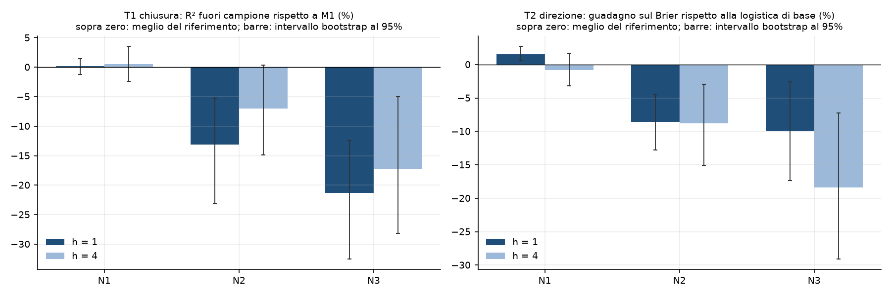
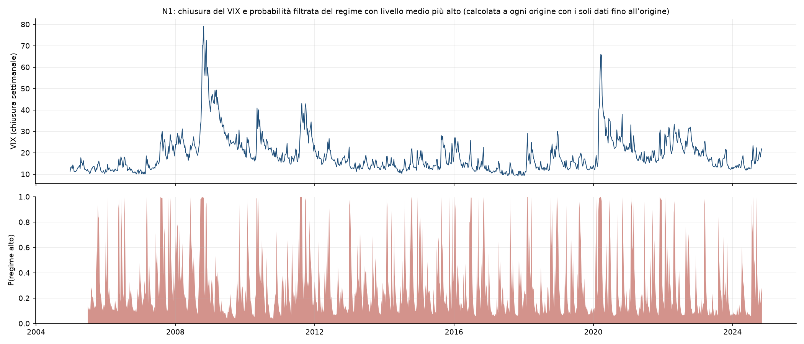
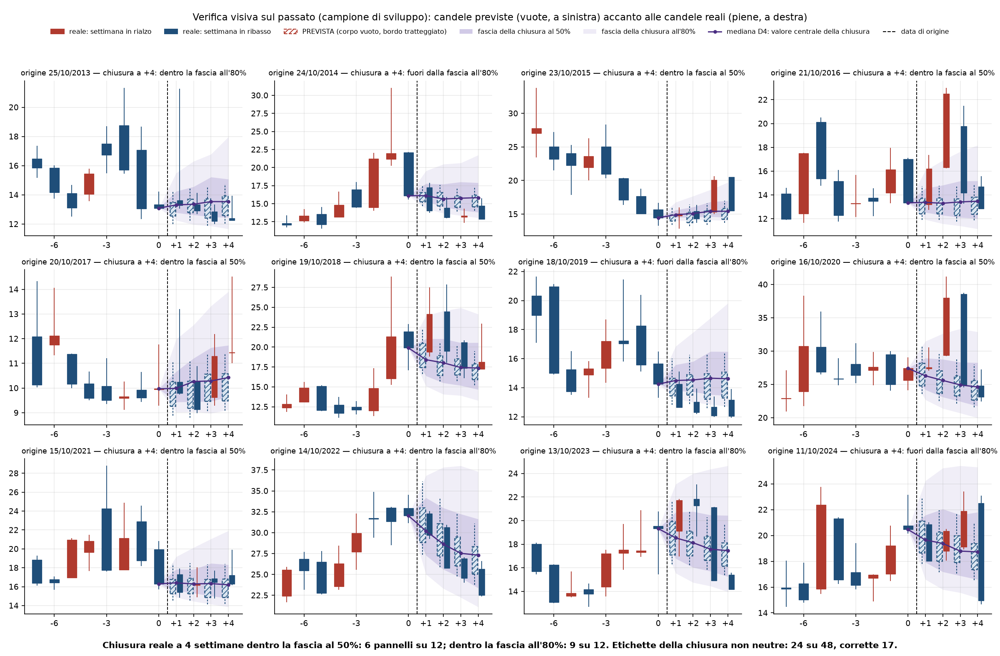

# Fase 4 — Ultima fase di costruzione: candele, modelli non lineari e a regimi, versioni finaliste

*Generato da `python -m src.run_phase4`. Campione di sviluppo fino al 2024-11-08. L'holdout (VIX e dati esterni) non è stato letto: il comando gira sotto la guardia.
Tutti i numeri vengono da `reports/fase4/`.*

## Sintesi

1. **Candele (Parte A).** La regola sceglie **A1 media su 260 settimane, regressione su 520**: a 1 settimana il corpo previsto passa dall'85,6% al 91,0% di quello reale e l'escursione dal 79,6% all'89,3%; a 4 settimane corpo 83,5%, escursione 83,4%.
2. **Spareggio confermato il 2026-11-16:** A1 e A2 sono in parità esatta sul criterio (stesso corpo a +1); è stata presa A1 per una regola di spareggio fissata nel codice prima dei risultati (sezione 1.3).
3. **Gradient boosting (N2, N3): verdetto negativo.** N2 è peggiore di M1 (significativo dopo Holm a h = 1) (R² -13,1% a h = 1, -7,0% a h = 4); N3, con i dati di mercato, è significativamente peggiore di M1 a tutti e due gli orizzonti (-21,3% e -17,3%). Anche sulla direzione fanno peggio della logistica di base.
4. **Modello a regimi (N1), chiusura: nessun guadagno.** h = 1: +0,2% [-1,3%; +1,5%], nessuna differenza distinguibile da zero; h = 4: +0,5% [-2,4%; +3,5%], nessuna differenza distinguibile da zero.
5. **Modello a regimi (N1), direzione:** h = 1: +1,6% [+0,5%; +2,7%], significativamente migliore dopo Holm; h = 4: -0,8% [-3,2%; +1,7%], nessuna differenza distinguibile da zero. **Passa la regola** (significativo dopo Holm a un orizzonte) ed entra tra i finalisti come F3.
6. **I due regimi** (ultima stima): livello medio 16,0 e 18,9, variabilità settimanale 0,080 e 0,180 (log), durata media 7,7 e 2,8 settimane: i regimi si distinguono più per la variabilità che per il livello. Stime non valide: 1 su 40.
7. **Versioni congelate:** F1 solo storico del VIX, F2 con struttura a termine (VIX3M), F3 modello a regimi (N1), in `versioni/*.json` con parametri, finestre, regole, impronta dei sorgenti e commit. È ciò che verrà esaminato sull'holdout.
8. **F1 contro F2 nello sviluppo** (542 origini a h = 1, dal 2014-06-20). h = 1: errore assoluto medio della chiusura centrale 2,08 punti contro 2,10 di F1 (differenza +0,027 [-0,015; +0,067]; test sull'errore quadratico: p = 0,82), copertura della fascia all'80% 78,4% contro 73,4%, Brier della direzione +3,0% [+0,4%; +5,4%] (p = 0,04); h = 4: errore assoluto medio della chiusura centrale 3,23 punti contro 3,27 di F1 (differenza +0,039 [-0,055; +0,128]; test sull'errore quadratico: p = 0,80), copertura della fascia all'80% 74,4% contro 71,4%, Brier della direzione -1,1% [-4,7%; +2,5%] (p = 0,60).
9. **F1 contro F3.** h = 1: errore assoluto medio della chiusura centrale 2,08 punti contro 2,10 di F1 (differenza +0,023 [-0,014; +0,069]; test sull'errore quadratico: p = 0,52), copertura della fascia all'80% 75,8% contro 73,4%, Brier della direzione +1,4% [-1,1%; +3,9%] (p = 0,30); h = 4: errore assoluto medio della chiusura centrale 3,27 punti contro 3,27 di F1 (differenza -0,009 [-0,092; +0,071]; test sull'errore quadratico: p = 0,24), copertura della fascia all'80% 81,3% contro 71,4%, Brier della direzione +1,4% [-3,0%; +6,0%] (p = 0,51).
10. **Programma e piano.** `python -m src.forecast --versione f1|f2|f3` (predefinita f1), `--aggiorna` per i dati di F2 con ripiego su f1, registro con la versione, scheda con la tabella di confronto. Il piano d'esame è in `reports/piano_esame_holdout.md`; **l'holdout non è stato aperto**.

## 1. Parte A — Dimensioni delle candele

**Varianti** (elenco chiuso) per le ampiezze di corpo, ombra superiore e ombra inferiore:

- A0 media espandibile, regressione su tutta la storia (Fase 3).
- A1 media su 260 settimane, regressione su 520.
- A2 media su 104 settimane, regressione su 520.

Tra le varianti cambia solo la finestra. Restano come nella Fase 3: quale componente usa la regressione (corpo a +1 e +2) e quale la media (tutto il resto), il rapporto di apertura,
la direzione del corpo (frequenza storica) e la costruzione K2. «Ultime N settimane» = le ultime N coppie origine-esito con esito noto all'origine.

**Regola** (dalla consegna): la variante con il rapporto corpo previsto / reale più vicino a 1 a h = 1, purché il suo errore quadratico sulle ampiezze non sia significativamente peggiore di A0
(Diebold-Mariano, p < 0,05); altrimenti resta A0. «Errore quadratico sulle ampiezze» è stato fissato prima come la somma, per ogni origine, degli errori quadratici in log di corpo e due ombre a h = 1.

### 1.1 Pagella completa delle candele

Stesse origini delle Fasi 2c e 3 (933 previsioni a 1 settimana, date previste dal 2006-12-29 al 2024-11-08).
Errori medi in punti VIX. La pagella per fascia di partenza, sottoperiodo, casi dopo un rialzo oltre il 30% e fascia 13-22 è in `reports/fase4/a_pagella_gruppi.csv`.

|   h | variante   |   n |   corpo previsto / reale |   escursione prevista / reale | sovrapposizione [IC 95%]   |   direzione del corpo indovinata |   chiusura reale nel corpo previsto |   chiusura reale nell'escursione prevista |   errore medio apertura |   errore medio massimo |   errore medio minimo |   errore medio chiusura della candela |   chiusura della candela entro il 10% |   entro il 20% |
|----:|:-----------|----:|-------------------------:|------------------------------:|:---------------------------|---------------------------------:|------------------------------------:|------------------------------------------:|------------------------:|-----------------------:|----------------------:|--------------------------------------:|--------------------------------------:|---------------:|
|   1 | A0         | 933 |                    0.856 |                         0.796 | 0.517 [0.504; 0.530]       |                            0.636 |                               0.318 |                                     0.576 |                   0.736 |                  2.139 |                 1.302 |                                 2.355 |                                 0.580 |          0.855 |
|   1 | A1         | 933 |                    0.910 |                         0.893 | 0.519 [0.506; 0.531]       |                            0.636 |                               0.334 |                                     0.616 |                   0.736 |                  2.115 |                 1.386 |                                 2.408 |                                 0.558 |          0.845 |
|   1 | A2         | 933 |                    0.910 |                         0.899 | 0.519 [0.507; 0.532]       |                            0.636 |                               0.334 |                                     0.618 |                   0.736 |                  2.110 |                 1.393 |                                 2.408 |                                 0.558 |          0.845 |
|   2 | A0         | 931 |                    0.806 |                         0.764 | 0.379 [0.357; 0.401]       |                            0.635 |                               0.243 |                                     0.483 |                   2.267 |                  3.397 |                 1.859 |                                 2.925 |                                 0.483 |          0.777 |
|   2 | A1         | 931 |                    0.857 |                         0.857 | 0.391 [0.369; 0.411]       |                            0.635 |                               0.262 |                                     0.535 |                   2.267 |                  3.361 |                 1.905 |                                 2.960 |                                 0.488 |          0.779 |
|   2 | A2         | 931 |                    0.857 |                         0.864 | 0.392 [0.370; 0.413]       |                            0.635 |                               0.262 |                                     0.537 |                   2.267 |                  3.360 |                 1.910 |                                 2.960 |                                 0.488 |          0.779 |
|   3 | A0         | 929 |                    0.761 |                         0.737 | 0.335 [0.314; 0.357]       |                            0.635 |                               0.224 |                                     0.442 |                   2.864 |                  3.964 |                 2.247 |                                 3.316 |                                 0.450 |          0.728 |
|   3 | A1         | 929 |                    0.848 |                         0.847 | 0.348 [0.328; 0.368]       |                            0.635 |                               0.242 |                                     0.490 |                   2.864 |                  3.948 |                 2.289 |                                 3.363 |                                 0.446 |          0.728 |
|   3 | A2         | 929 |                    0.877 |                         0.866 | 0.352 [0.331; 0.373]       |                            0.635 |                               0.254 |                                     0.498 |                   2.864 |                  3.949 |                 2.292 |                                 3.380 |                                 0.448 |          0.720 |
|   4 | A0         | 927 |                    0.747 |                         0.726 | 0.314 [0.290; 0.340]       |                            0.635 |                               0.213 |                                     0.413 |                   3.217 |                  4.344 |                 2.470 |                                 3.574 |                                 0.423 |          0.725 |
|   4 | A1         | 927 |                    0.835 |                         0.834 | 0.328 [0.302; 0.353]       |                            0.635 |                               0.243 |                                     0.475 |                   3.217 |                  4.321 |                 2.513 |                                 3.620 |                                 0.426 |          0.716 |
|   4 | A2         | 927 |                    0.864 |                         0.853 | 0.329 [0.305; 0.354]       |                            0.635 |                               0.243 |                                     0.488 |                   3.217 |                  4.328 |                 2.539 |                                 3.638 |                                 0.425 |          0.713 |

### 1.2 Errore sulle ampiezze

Ampiezze in logaritmi. DM positivo = la variante ha errore quadratico più basso di A0.

|   h | componente         | metodo      | variante   |   n |   media reale |   previsione media |   errore quadratico medio | errore quadratico rispetto ad A0   |   DM vs A0 (positivo = meglio di A0) |         p |
|----:|:-------------------|:------------|:-----------|----:|--------------:|-------------------:|--------------------------:|:-----------------------------------|-------------------------------------:|----------:|
|   1 | ampiezza del corpo | regressione | A0         | 933 |       0.11212 |            0.09799 |                   0.00892 | –                                  |                              –       |   –       |
|   1 | ampiezza del corpo | regressione | A1         | 933 |       0.11212 |            0.10508 |                   0.00887 | -0,5%                              |                              0.57557 |   0.56504 |
|   1 | ampiezza del corpo | regressione | A2         | 933 |       0.11212 |            0.10508 |                   0.00887 | -0,5%                              |                              0.57557 |   0.56504 |
|   1 | ombra superiore    | media       | A0         | 933 |       0.07191 |            0.05908 |                   0.00595 | –                                  |                              –       |   –       |
|   1 | ombra superiore    | media       | A1         | 933 |       0.07191 |            0.07013 |                   0.00577 | -2,9%                              |                              2.35176 |   0.01889 |
|   1 | ombra superiore    | media       | A2         | 933 |       0.07191 |            0.07081 |                   0.00577 | -3,0%                              |                              2.03574 |   0.04206 |
|   1 | ombra inferiore    | media       | A0         | 933 |       0.04842 |            0.04213 |                   0.00299 | –                                  |                              –       |   –       |
|   1 | ombra inferiore    | media       | A1         | 933 |       0.04842 |            0.04795 |                   0.00297 | -0,9%                              |                              1.00604 |   0.31466 |
|   1 | ombra inferiore    | media       | A2         | 933 |       0.04842 |            0.04871 |                   0.00295 | -1,4%                              |                              1.01357 |   0.31105 |
|   1 | somma delle tre    |   –         | A0         | 933 |       –       |            –       |                   0.01785 | –                                  |                              –       |   –       |
|   1 | somma delle tre    |   –         | A1         | 933 |       –       |            –       |                   0.01761 | -1,4%                              |                              2.39516 |   0.01681 |
|   1 | somma delle tre    |   –         | A2         | 933 |       –       |            –       |                   0.01759 | -1,5%                              |                              2.30427 |   0.02143 |
|   4 | ampiezza del corpo | media       | A0         | 927 |       0.11238 |            0.09614 |                   0.00978 | –                                  |                              –       |   –       |
|   4 | ampiezza del corpo | media       | A1         | 927 |       0.11238 |            0.10823 |                   0.00966 | -1,3%                              |                              1.23754 |   0.21620 |
|   4 | ampiezza del corpo | media       | A2         | 927 |       0.11238 |            0.11071 |                   0.00968 | -1,1%                              |                              0.75516 |   0.45035 |
|   4 | ombra superiore    | media       | A0         | 927 |       0.07220 |            0.05882 |                   0.00599 | –                                  |                              –       |   –       |
|   4 | ombra superiore    | media       | A1         | 927 |       0.07220 |            0.07011 |                   0.00581 | -2,9%                              |                              1.99190 |   0.04668 |
|   4 | ombra superiore    | media       | A2         | 927 |       0.07220 |            0.07084 |                   0.00580 | -3,1%                              |                              1.78963 |   0.07384 |
|   4 | ombra inferiore    | media       | A0         | 927 |       0.04843 |            0.04226 |                   0.00300 | –                                  |                              –       |   –       |
|   4 | ombra inferiore    | media       | A1         | 927 |       0.04843 |            0.04801 |                   0.00299 | -0,6%                              |                              0.50008 |   0.61714 |
|   4 | ombra inferiore    | media       | A2         | 927 |       0.04843 |            0.04877 |                   0.00299 | -0,5%                              |                              0.27451 |   0.78375 |
|   4 | somma delle tre    |   –         | A0         | 927 |       –       |            –       |                   0.01877 | –                                  |                              –       |   –       |
|   4 | somma delle tre    |   –         | A1         | 927 |       –       |            –       |                   0.01846 | -1,7%                              |                              1.99855 |   0.04595 |
|   4 | somma delle tre    |   –         | A2         | 927 |       –       |            –       |                   0.01847 | -1,6%                              |                              1.52799 |   0.12686 |

### 1.3 Esito della regola

- Rapporto del corpo a h = 1: A0 0,856; A1 0,910; A2 0,910. Candidata: A1; errore quadratico sulle ampiezze a h = 1: 0,01761 contro 0,01785 di A0 (DM = 2,40, p = 0,017): non peggiore, anzi significativamente più basso.
- **Scelta: A1 media su 260 settimane, regressione su 520.** A1 ha il rapporto del corpo più vicino a 1 a h = 1 e un errore quadratico sulle ampiezze non significativamente peggiore di A0.
- **Parità esatta tra A1 e A2 a h = 1** (rapporto 0,910): a +1 il corpo è previsto dalla stessa regressione su 520 settimane, quindi le due varianti danno lo stesso corpo. La regola non dice come sciogliere la parità: nel codice era fissato, prima di guardare i risultati, che vince la prima dell'elenco (A1, la finestra più lunga e più vicina ad A0). Con uno spareggio diverso, per esempio il rapporto medio su h = 1-4 (A1 0,863; A2 0,877), la scelta sarebbe A2. **Spareggio confermato il 2026-11-16: fa parte della regola, e la variante congelata resta A1.**
- Le candele restano un po' più piccole di quelle reali (corpo 91,0%, escursione 89,3% a 1 settimana), ma il ritardo della media espandibile è in gran parte recuperato.
  L'errore sulla chiusura della candela aumenta (2,41 punti contro 2,35 di A0 a 1 settimana):
  una candela più grande in una direzione fissa si allontana di più dal centro. La previsione centrale resta la chiusura centrale, non la chiusura della candela.

## 2. Parte B — Ultimo tentativo: modelli a regimi e non lineari

### 2.1 Che cosa è stato provato

- **N1 autoregressivo a 2 regimi.** x_t − μ(S_t) = φ (x_(t−1) − μ(S_(t−1))) + σ(S_t) ε_t sul log della chiusura, con S_t catena di Markov a due stati: media e varianza diverse per regime, φ comune.
  Ristima ogni 26 settimane; tra una ristima e l'altra parametri fermi e probabilità filtrate ricalcolate a ogni origine. Previsione a h passi esatta dalle probabilità filtrate
  (somma sui percorsi di regime): T1 = media, T2 = probabilità che la chiusura superi quella dell'origine. Stime non valide: 1 su 40 (2004-12-23);
  per le 26 origini senza una stima valida precedente è stato usato un AR(1) a un solo regime, come fissato prima.
- **N2 gradient boosting, solo VIX.** Variabili di M1, variabili della candela della Fase 2c (escursione, posizione, ombra_sup, ombra_inf, dlog1, dlog4) e variabili giornaliere G1. Iperparametri fissi: 200 alberi, profondità 3,
  tasso di apprendimento 0,05, sottocampionamento 0,8, seed 12345. Ristima ogni 13 settimane.
  Per T1 l'albero prevede la variazione x(t+h) − x(t) (gli alberi non estrapolano i livelli); per T2 è un classificatore con gli stessi iperparametri.
- **N3 gradient boosting, VIX + mercato.** Come N2 con in più le variabili X1-X4, sul campione comune (prima data prevista 2014-06-27).
- Riferimenti sulle stesse origini: M1 su tutta la storia; frequenza storica e logistica di base. Test: Diebold-Mariano a due code (i tre modelli non contengono M1 come caso particolare), Holm su 6 test per la chiusura
  e su 6 per la direzione. Regola come nella Fase 3.

### 2.2 T1 — Chiusura

|   h | modello                             |    n | prima data prevista   |   RMSE log |   RMSE log M1 |   MAE punti |   MAE punti M1 | R² vs M1 [IC 95%]       |   DM (positivo = meglio di M1) |   p (due code) |   p Holm | esito                                    |   entro il 10% |   entro il 10%, M1 |   entro il 20% |   entro il 20%, M1 |
|----:|:------------------------------------|-----:|:----------------------|-----------:|--------------:|------------:|---------------:|:------------------------|-------------------------------:|---------------:|---------:|:-----------------------------------------|---------------:|-------------------:|---------------:|-------------------:|
|   1 | N1 autoregressivo a 2 regimi        | 1037 | 2004-12-31            |     0.1433 |        0.1434 |      2.1067 |         2.1458 | +0,2% [-1,3%; +1,5%]    |                         0.2130 |         0.8314 |   1.0000 | nessuna differenza distinguibile da zero |         0.5805 |             0.5786 |         0.8775 |             0.8746 |
|   1 | N2 gradient boosting, solo VIX      | 1036 | 2005-01-07            |     0.1525 |        0.1435 |      2.2504 |         2.1463 | -13,1% [-23,2%; -5,2%]  |                        -4.3454 |         0.0000 |   0.0001 | significativamente peggiore dopo Holm    |         0.5618 |             0.5792 |         0.8562 |             0.8745 |
|   1 | N3 gradient boosting, VIX + mercato |  542 | 2014-06-27            |     0.1711 |        0.1553 |      2.3299 |         2.1373 | -21,3% [-32,5%; -12,4%] |                        -3.9245 |         0.0001 |   0.0005 | significativamente peggiore dopo Holm    |         0.5240 |             0.5590 |         0.8210 |             0.8542 |
|   4 | N1 autoregressivo a 2 regimi        | 1034 | 2005-01-21            |     0.2268 |        0.2274 |      3.2844 |         3.3534 | +0,5% [-2,4%; +3,5%]    |                         0.3507 |         0.7259 |   1.0000 | nessuna differenza distinguibile da zero |         0.3994 |             0.3965 |         0.7041 |             0.6905 |
|   4 | N2 gradient boosting, solo VIX      | 1033 | 2005-01-28            |     0.2353 |        0.2275 |      3.4999 |         3.3548 | -7,0% [-14,9%; +0,3%]   |                        -2.2193 |         0.0267 |   0.0801 | nessuna differenza distinguibile da zero |         0.3921 |             0.3969 |         0.6621 |             0.6902 |
|   4 | N3 gradient boosting, VIX + mercato |  539 | 2014-07-18            |     0.2601 |        0.2401 |      3.6823 |         3.3273 | -17,3% [-28,2%; -5,0%]  |                        -2.7596 |         0.0060 |   0.0239 | significativamente peggiore dopo Holm    |         0.3321 |             0.3766 |         0.6160 |             0.6531 |

### 2.3 T2 — Direzione della chiusura rispetto all'origine

|   h | modello                             |    n |   freq. rialzo |   accuratezza |   accuratezza base |   Brier |   Brier base |   Brier frequenza |   affidabilità (0 = calibrato) |   risoluzione | guadagno sul Brier vs logistica di base [IC 95%]   |   p vs base |   p Holm vs base | esito                                    |   guadagno sul Brier vs frequenza |   p Holm vs frequenza |
|----:|:------------------------------------|-----:|---------------:|--------------:|-------------------:|--------:|-------------:|------------------:|-------------------------------:|--------------:|:---------------------------------------------------|------------:|-----------------:|:-----------------------------------------|----------------------------------:|----------------------:|
|   1 | N1 autoregressivo a 2 regimi        | 1037 |         0.4609 |        0.5931 |             0.5738 |  0.2397 |       0.2435 |            0.2489 |                         0.0013 |        0.0089 | +1,6% [+0,5%; +2,7%]                               |      0.0042 |           0.0168 | significativamente migliore dopo Holm    |                            0.0370 |                0.0041 |
|   1 | N2 gradient boosting, solo VIX      | 1036 |         0.4604 |        0.5647 |             0.5734 |  0.2645 |       0.2436 |            0.2489 |                         0.0225 |        0.0071 | -8,6% [-12,8%; -4,5%]                              |      0.0001 |           0.0007 | significativamente peggiore dopo Holm    |                           -0.0627 |                0.0394 |
|   1 | N3 gradient boosting, VIX + mercato |  542 |         0.4336 |        0.5609 |             0.5756 |  0.2652 |       0.2413 |            0.2473 |                         0.0318 |        0.0122 | -9,9% [-17,3%; -2,6%]                              |      0.0068 |           0.0197 | significativamente peggiore dopo Holm    |                           -0.0724 |                0.1929 |
|   4 | N1 autoregressivo a 2 regimi        | 1034 |         0.4555 |        0.6228 |             0.6199 |  0.2276 |       0.2258 |            0.2491 |                         0.0017 |        0.0206 | -0,8% [-3,2%; +1,7%]                               |      0.4913 |           0.4913 | nessuna differenza distinguibile da zero |                            0.0862 |                0.0019 |
|   4 | N2 gradient boosting, solo VIX      | 1033 |         0.4550 |        0.6021 |             0.6196 |  0.2458 |       0.2259 |            0.2490 |                         0.0143 |        0.0157 | -8,8% [-15,2%; -2,9%]                              |      0.0066 |           0.0197 | significativamente peggiore dopo Holm    |                            0.0129 |                1.0000 |
|   4 | N3 gradient boosting, VIX + mercato |  539 |         0.4842 |        0.6067 |             0.6382 |  0.2608 |       0.2202 |            0.2524 |                         0.0324 |        0.0195 | -18,4% [-29,1%; -7,3%]                             |      0.0013 |           0.0063 | significativamente peggiore dopo Holm    |                           -0.0332 |                1.0000 |

Accuratezza e quota di settimane quando la probabilità della direzione prevista è almeno 60%, 65% e 70%:

|   h | modello                             |    n |   accuratezza (tutte) | prob. ≥ 60%: quota (n) → accuratezza   | prob. ≥ 65%: quota (n) → accuratezza   | prob. ≥ 70%: quota (n) → accuratezza   |
|----:|:------------------------------------|-----:|----------------------:|:---------------------------------------|:---------------------------------------|:---------------------------------------|
|   1 | N1 autoregressivo a 2 regimi        | 1037 |                 0.593 | 26,6% (276) → 64,9%                    | 10,1% (105) → 70,5%                    | 3,4% (35) → 65,7%                      |
|   1 | N2 gradient boosting, solo VIX      | 1036 |                 0.565 | 65,3% (677) → 56,6%                    | 49,3% (511) → 57,5%                    | 34,5% (357) → 57,7%                    |
|   1 | N3 gradient boosting, VIX + mercato |  542 |                 0.561 | 73,1% (396) → 59,6%                    | 62,7% (340) → 61,8%                    | 48,7% (264) → 61,0%                    |
|   4 | N1 autoregressivo a 2 regimi        | 1034 |                 0.623 | 54,2% (560) → 68,8%                    | 30,3% (313) → 72,2%                    | 16,3% (169) → 73,4%                    |
|   4 | N2 gradient boosting, solo VIX      | 1033 |                 0.602 | 75,3% (778) → 63,4%                    | 62,8% (649) → 65,6%                    | 50,0% (517) → 68,3%                    |
|   4 | N3 gradient boosting, VIX + mercato |  539 |                 0.607 | 83,1% (448) → 62,1%                    | 73,1% (394) → 63,2%                    | 63,3% (341) → 64,2%                    |

Calibrazione per classi di probabilità: `reports/fase4/b_t2_calibrazione.csv`.

### 2.4 Fascia 13-22 e casi dopo un rialzo oltre il 30%

Chiusura, fascia 13-22:

|   h | modello                             |   casi |   RMSE log |   RMSE log M1 |   MAE punti |   MAE punti M1 | R² vs M1 [IC 95%]       |   p DM (non corretto) |   entro il 10% |   entro il 10%, M1 |
|----:|:------------------------------------|-------:|-----------:|--------------:|------------:|---------------:|:------------------------|----------------------:|---------------:|-------------------:|
|   1 | N1 autoregressivo a 2 regimi        |    531 |     0.1456 |        0.1451 |      1.9014 |         1.9261 | -0,8% [-3,3%; +1,5%]    |                0.4880 |         0.5367 |             0.5235 |
|   1 | N2 gradient boosting, solo VIX      |    531 |     0.1535 |        0.1451 |      2.0070 |         1.9261 | -11,9% [-19,9%; -5,8%]  |                0.0008 |         0.5461 |             0.5235 |
|   1 | N3 gradient boosting, VIX + mercato |    299 |     0.1751 |        0.1611 |      2.2511 |         2.1266 | -18,2% [-24,4%; -11,8%] |                0.0004 |         0.4816 |             0.4916 |
|   4 | N1 autoregressivo a 2 regimi        |    528 |     0.2419 |        0.2403 |      3.2611 |         3.2725 | -1,4% [-4,7%; +2,3%]    |                0.3804 |         0.3466 |             0.3617 |
|   4 | N2 gradient boosting, solo VIX      |    528 |     0.2470 |        0.2403 |      3.3358 |         3.2725 | -5,7% [-14,2%; +2,6%]   |                0.1769 |         0.3636 |             0.3617 |
|   4 | N3 gradient boosting, VIX + mercato |    296 |     0.2649 |        0.2518 |      3.4316 |         3.3587 | -10,7% [-21,1%; +3,1%]  |                0.1809 |         0.3412 |             0.3615 |

Direzione, fascia 13-22:

|   h | modello                             |   casi |   freq. rialzo |   accuratezza |   accuratezza base |   Brier |   Brier base | guadagno sul Brier vs base [IC 95%]   |   p DM (non corretto) |
|----:|:------------------------------------|-------:|---------------:|--------------:|-------------------:|--------:|-------------:|:--------------------------------------|----------------------:|
|   1 | N1 autoregressivo a 2 regimi        |    531 |         0.4350 |        0.5631 |             0.5254 |  0.2438 |       0.2485 | +1,9% [-0,1%; +4,1%]                  |                0.0203 |
|   1 | N2 gradient boosting, solo VIX      |    531 |         0.4350 |        0.5405 |             0.5254 |  0.2636 |       0.2485 | -6,1% [-11,3%; -1,0%]                 |                0.0390 |
|   1 | N3 gradient boosting, VIX + mercato |    299 |         0.4013 |        0.5418 |             0.5217 |  0.2713 |       0.2483 | -9,3% [-19,3%; -0,3%]                 |                0.0574 |
|   4 | N1 autoregressivo a 2 regimi        |    528 |         0.4621 |        0.5530 |             0.5473 |  0.2459 |       0.2428 | -1,3% [-4,7%; +2,0%]                  |                0.3771 |
|   4 | N2 gradient boosting, solo VIX      |    528 |         0.4621 |        0.5549 |             0.5473 |  0.2600 |       0.2428 | -7,1% [-15,4%; +0,5%]                 |                0.1098 |
|   4 | N3 gradient boosting, VIX + mercato |    296 |         0.4932 |        0.5743 |             0.5845 |  0.2659 |       0.2382 | -11,6% [-24,4%; +1,2%]                |                0.0791 |

Chiusura, dopo un rialzo oltre il 30% in 4 settimane:

|   h | modello                             |   casi |   RMSE log |   RMSE log M1 |   MAE punti |   MAE punti M1 | R² vs M1 [IC 95%]       |   p DM (non corretto) |   entro il 10% |   entro il 10%, M1 |
|----:|:------------------------------------|-------:|-----------:|--------------:|------------:|---------------:|:------------------------|----------------------:|---------------:|-------------------:|
|   1 | N1 autoregressivo a 2 regimi        |    115 |     0.1998 |        0.2025 |      4.2580 |         4.3914 | +2,7% [-3,2%; +8,8%]    |                0.2778 |         0.3304 |             0.3304 |
|   1 | N2 gradient boosting, solo VIX      |    115 |     0.2230 |        0.2025 |      4.6367 |         4.3914 | -21,3% [-41,7%; -2,9%]  |                0.0209 |         0.3565 |             0.3304 |
|   1 | N3 gradient boosting, VIX + mercato |     66 |     0.2388 |        0.2040 |      4.3398 |         3.8350 | -37,0% [-66,4%; -8,5%]  |                0.0170 |         0.3636 |             0.4091 |
|   4 | N1 autoregressivo a 2 regimi        |    115 |     0.3022 |        0.3054 |      5.8621 |         5.9686 | +2,0% [-3,2%; +7,1%]    |                0.5146 |         0.3391 |             0.3043 |
|   4 | N2 gradient boosting, solo VIX      |    115 |     0.3176 |        0.3054 |      6.3749 |         5.9686 | -8,2% [-28,6%; +4,0%]   |                0.3102 |         0.3130 |             0.3043 |
|   4 | N3 gradient boosting, VIX + mercato |     66 |     0.3096 |        0.2824 |      5.8504 |         4.8355 | -20,2% [-47,5%; +11,9%] |                0.0649 |         0.3333 |             0.2879 |

Direzione, dopo un rialzo oltre il 30% in 4 settimane:

|   h | modello                             |   casi |   freq. rialzo |   accuratezza |   accuratezza base |   Brier |   Brier base | guadagno sul Brier vs base [IC 95%]   |   p DM (non corretto) |
|----:|:------------------------------------|-------:|---------------:|--------------:|-------------------:|--------:|-------------:|:--------------------------------------|----------------------:|
|   1 | N1 autoregressivo a 2 regimi        |    115 |         0.3217 |        0.6696 |             0.6870 |  0.2288 |       0.2384 | +4,0% [+0,2%; +8,4%]                  |                0.0250 |
|   1 | N2 gradient boosting, solo VIX      |    115 |         0.3217 |        0.6000 |             0.6870 |  0.2522 |       0.2384 | -5,8% [-21,5%; +9,5%]                 |                0.3622 |
|   1 | N3 gradient boosting, VIX + mercato |     66 |         0.2424 |        0.6970 |             0.7727 |  0.2073 |       0.2155 | +3,8% [-23,9%; +28,5%]                |                0.7651 |
|   4 | N1 autoregressivo a 2 regimi        |    115 |         0.2174 |        0.7739 |             0.7739 |  0.1829 |       0.1793 | -2,0% [-12,8%; +4,5%]                 |                0.6310 |
|   4 | N2 gradient boosting, solo VIX      |    115 |         0.2174 |        0.7304 |             0.7739 |  0.2088 |       0.1793 | -16,5% [-39,2%; +4,7%]                |                0.1102 |
|   4 | N3 gradient boosting, VIX + mercato |     66 |         0.2273 |        0.7121 |             0.7727 |  0.2271 |       0.1664 | -36,4% [-65,0%; +0,8%]                |                0.0788 |

### 2.5 Sottoperiodi e fasce di partenza

R² rispetto a M1 (tra parentesi il numero di previsioni); tutte le metriche in `reports/fase4/b_t1_gruppi.csv` e `b_t2_gruppi.csv`.

|   h | sottoperiodo   | N1          | N2           | N3           |
|----:|:---------------|:------------|:-------------|:-------------|
|   1 | 2000-2004      | +1,5% (1)   | –            | –            |
|   1 | 2005-2009      | +0,0% (261) | -22,5% (261) | –            |
|   1 | 2010-2014      | +0,2% (260) | -5,5% (260)  | +2,3% (27)   |
|   1 | 2015-2019      | -0,5% (261) | -20,7% (261) | -30,3% (261) |
|   1 | 2020-2024      | +1,0% (254) | -4,7% (254)  | -14,5% (254) |
|   4 | 2005-2009      | -1,6% (259) | -6,7% (258)  | –            |
|   4 | 2010-2014      | +2,7% (260) | -2,4% (260)  | +22,6% (24)  |
|   4 | 2015-2019      | +2,2% (261) | -7,2% (261)  | -17,0% (261) |
|   4 | 2020-2024      | -1,2% (254) | -10,7% (254) | -21,5% (254) |

|   h | fascia di partenza   | N1          | N2           | N3           |
|----:|:---------------------|:------------|:-------------|:-------------|
|   1 | <15                  | +0,4% (417) | -19,6% (416) | -27,4% (231) |
|   1 | 15-20                | -1,6% (278) | -8,4% (278)  | -21,3% (151) |
|   1 | 20-25                | -2,2% (170) | -9,7% (170)  | -2,4% (89)   |
|   1 | 25-30                | -1,1% (86)  | -30,6% (86)  | -77,4% (44)  |
|   1 | >=30                 | +8,7% (86)  | -3,4% (86)   | +9,8% (27)   |
|   4 | <15                  | +1,9% (417) | -4,1% (416)  | -18,2% (231) |
|   4 | 15-20                | -2,5% (277) | -7,4% (277)  | -9,4% (150)  |
|   4 | 20-25                | -3,2% (168) | -13,5% (168) | -20,8% (87)  |
|   4 | 25-30                | -2,1% (86)  | -5,3% (86)   | -30,8% (44)  |
|   4 | >=30                 | +12,6% (86) | -7,1% (86)   | -31,6% (27)  |

Guadagno sul Brier rispetto alla logistica di base:

|   h | sottoperiodo   | N1          | N2           | N3           |
|----:|:---------------|:------------|:-------------|:-------------|
|   1 | 2000-2004      | +22,9% (1)  | –            | –            |
|   1 | 2005-2009      | +0,8% (261) | -14,9% (261) | –            |
|   1 | 2010-2014      | +1,5% (260) | -6,9% (260)  | +19,0% (27)  |
|   1 | 2015-2019      | +2,2% (261) | -8,1% (261)  | -13,4% (261) |
|   1 | 2020-2024      | +1,7% (254) | -4,0% (254)  | -9,2% (254)  |
|   4 | 2005-2009      | -2,0% (259) | -6,3% (258)  | –            |
|   4 | 2010-2014      | -0,6% (260) | -5,5% (260)  | -30,9% (24)  |
|   4 | 2015-2019      | -0,9% (261) | -13,4% (261) | -19,5% (261) |
|   4 | 2020-2024      | +0,3% (254) | -10,2% (254) | -16,3% (254) |

|   h | fascia di partenza   | N1          | N2           | N3           |
|----:|:---------------------|:------------|:-------------|:-------------|
|   1 | <15                  | +1,3% (417) | -7,5% (416)  | -10,5% (231) |
|   1 | 15-20                | +1,7% (278) | -10,1% (278) | -10,9% (151) |
|   1 | 20-25                | +0,8% (170) | -6,6% (170)  | -10,3% (89)  |
|   1 | 25-30                | +1,2% (86)  | -15,0% (86)  | -8,4% (44)   |
|   1 | >=30                 | +4,1% (86)  | -6,2% (86)   | +3,0% (27)   |
|   4 | <15                  | +1,7% (417) | -6,5% (416)  | -14,4% (231) |
|   4 | 15-20                | -2,1% (277) | -9,2% (277)  | -12,7% (150) |
|   4 | 20-25                | -5,9% (168) | -15,5% (168) | -24,3% (87)  |
|   4 | 25-30                | -3,4% (86)  | -6,2% (86)   | -15,9% (44)  |
|   4 | >=30                 | +3,0% (86)  | -8,4% (86)   | -129,8% (27) |

### 2.6 I due regimi di N1

Regimi ordinati per livello medio. Ultima stima (2024-05-31, 1274 settimane): regime basso con livello medio 16,0 e deviazione standard settimanale 0,080 (log);
regime alto con livello medio 18,9 e deviazione standard 0,180; φ = 0,952. Durata media: 7,7 settimane nel regime basso, 2,8 nel regime alto.
Tra le 39 stime valide: livello basso tra 14,9 e 17,6, livello alto tra 17,2 e 20,8,
durata media del regime alto tra 2,5 e 4,8 settimane. La probabilità filtrata del regime alto supera il 50% nel 19% delle origini.
I due livelli medi sono vicini: il modello non separa «VIX basso» da «VIX alto», ma settimane tranquille da settimane agitate (la variabilità del regime alto è circa 2,2 volte quella del regime basso).

Una stima ogni 4 (tutte in `reports/fase4/b_regimi_stime.csv`):

| data della stima   |   settimane usate |   livello medio, regime basso |   livello medio, regime alto |   dev. std. settimanale (log), basso |   dev. std. (log), alto |   phi |   prob. di restare, basso |   prob. di restare, alto |   durata media (settimane), basso |   durata media, alto |
|:-------------------|------------------:|------------------------------:|-----------------------------:|-------------------------------------:|------------------------:|------:|--------------------------:|-------------------------:|----------------------------------:|---------------------:|
| 2005-06-24         |               286 |                        17.220 |                       19.794 |                                0.063 |                   0.098 | 0.966 |                     0.826 |                    0.662 |                             5.755 |                2.955 |
| 2007-06-22         |               390 |                        15.416 |                       18.002 |                                0.066 |                   0.111 | 0.971 |                     0.863 |                    0.647 |                             7.302 |                2.835 |
| 2009-06-19         |               494 |                        17.011 |                       20.136 |                                0.076 |                   0.140 | 0.969 |                     0.924 |                    0.790 |                            13.104 |                4.769 |
| 2011-06-17         |               598 |                        17.608 |                       20.824 |                                0.080 |                   0.153 | 0.963 |                     0.908 |                    0.664 |                            10.911 |                2.979 |
| 2013-06-14         |               702 |                        17.252 |                       20.082 |                                0.075 |                   0.149 | 0.958 |                     0.866 |                    0.676 |                             7.472 |                3.089 |
| 2015-06-12         |               806 |                        16.565 |                       19.302 |                                0.075 |                   0.148 | 0.959 |                     0.851 |                    0.630 |                             6.691 |                2.702 |
| 2017-06-09         |               910 |                        16.243 |                       19.091 |                                0.079 |                   0.168 | 0.956 |                     0.865 |                    0.624 |                             7.407 |                2.662 |
| 2019-06-07         |              1014 |                        15.712 |                       18.452 |                                0.076 |                   0.169 | 0.957 |                     0.841 |                    0.602 |                             6.308 |                2.514 |
| 2021-06-04         |              1118 |                        15.860 |                       18.738 |                                0.080 |                   0.183 | 0.953 |                     0.869 |                    0.630 |                             7.653 |                2.701 |
| 2023-06-02         |              1222 |                        16.196 |                       19.096 |                                0.081 |                   0.182 | 0.952 |                     0.870 |                    0.627 |                             7.710 |                2.683 |

### 2.7 Verdetto

- **Gradient boosting, solo VIX (N2): negativo.** Chiusura: h = 1: -13,1% [-23,2%; -5,2%], significativamente peggiore dopo Holm; h = 4: -7,0% [-14,9%; +0,3%], nessuna differenza distinguibile da zero. Direzione: h = 1: -8,6% [-12,8%; -4,5%], significativamente peggiore dopo Holm; h = 4: -8,8% [-15,2%; -2,9%], significativamente peggiore dopo Holm.
- **Gradient boosting con i dati di mercato (N3): negativo.** Chiusura: h = 1: -21,3% [-32,5%; -12,4%], significativamente peggiore dopo Holm; h = 4: -17,3% [-28,2%; -5,0%], significativamente peggiore dopo Holm. Direzione: h = 1: -9,9% [-17,3%; -2,6%], significativamente peggiore dopo Holm; h = 4: -18,4% [-29,1%; -7,3%], significativamente peggiore dopo Holm.
  Variabili con più peso negli alberi all'ultima origine (h = 1): N2 dlog1 12%, g_sd5 12%, ombra_inf 8%; N3 x1_vix3m_su_vix 11%, g_sd5 7%, dlog1 6%.
  Lettura nostra, non misurata: con circa mille settimane e un segnale debole gli alberi si adattano al rumore del campione di stima, mentre M1 ha solo quattro parametri.
- **Modello a regimi (N1).** Chiusura: h = 1: +0,2% [-1,3%; +1,5%], nessuna differenza distinguibile da zero; h = 4: +0,5% [-2,4%; +3,5%], nessuna differenza distinguibile da zero. Direzione: h = 1: +1,6% [+0,5%; +2,7%], significativamente migliore dopo Holm; h = 4: -0,8% [-3,2%; +1,7%], nessuna differenza distinguibile da zero.
- **Esito della regola.** Nessun modello passa la regola sulla chiusura; **N1 autoregressivo a 2 regimi passa la regola sulla direzione**. Entra tra i finalisti come F3: N1 autoregressivo a 2 regimi.
- **Cautele su N1.** Il guadagno è piccolo e riguarda solo la direzione a 1 settimana; a 4 settimane non si vede. La probabilità di N1 è quella del modello (mistura di normali), confrontata con la logistica di base come chiedeva la regola; il confronto con la probabilità D1 usata dal programma è nella Parte C.

## 3. Parte C — Versioni finaliste

### 3.1 Definizioni

- **F1 solo storico del VIX.** Chiusura centrale e fasce: D4 (regressione quantilica sulle variabili di M1). Probabilità ed etichetta: D1 (errori passati attorno al centro M1). Candele K2 con le ampiezze A1.
- **F2 con struttura a termine (VIX3M).** Stessa costruzione con X1 = VIX3M / VIX − 1 in più: centro M1 + X1; chiusura centrale e fasce dalla regressione quantilica con X1; probabilità ed etichetta dagli errori passati attorno al centro M1 + X1
  (almeno 104, come D1); stesse candele di F1, ancorate alla chiusura centrale di F2 (la candela +1 è quindi identica a quella di F1). Se X1 manca all'origine si ripiega su F1.
- **F3 modello a regimi (N1).** Tutto dalla distribuzione prevista da N1: centro = media, chiusura centrale = mediana, fasce = quantili, probabilità ed etichetta = probabilità del modello (quella misurata nella Parte B); stesse candele di F1, ancorate alla chiusura centrale di F3.

Lettura adottata dove la consegna lasciava margine: in ogni versione la «chiusura centrale» mostrata è la mediana della distribuzione (come D4 in F1), mentre il «centro» è il valore attorno a cui si misurano gli errori passati;
nelle tabelle sono riportati entrambi.

### 3.2 Configurazioni congelate

`python -m src.fase4.congela` scrive `versioni/f1.json`, `versioni/f2.json` e `versioni/f3.json`: dati usati, modello del centro, della chiusura centrale, delle fasce, delle probabilità e dell'etichetta, orizzonti, griglia dei quantili,
soglie, numero minimo di errori, regole di ammissione e di ripiego, finestre e assegnazione delle ampiezze delle candele, scelte fatte dalle regole di questa fase, impronta SHA-256 dei file sorgente che definiscono i modelli
e hash del commit del codice. Un test verifica che i file coincidano con la configurazione ricostruita dal codice e che i sorgenti non siano cambiati dopo il congelamento. Il programma legge da lì la variante delle ampiezze.

### 3.3 Programma

- `python -m src.forecast --versione f1|f2|f3` (predefinita: f1). La scheda mostra la versione richiesta e una tabella di confronto con le altre versioni calcolabili (chiusura centrale, fasce, etichetta, probabilità).
- `--aggiorna` scarica dal sito Cboe i file giornalieri di VIX e VIX3M in `data/external/forecast` (non pubblicata). Vengono usati solo i valori fino all'ultima seduta della settimana di origine; la serie settimanale di X1 usata
  viene salvata in `reports/previsione/f2_valori_usati_AAAA-MM-GG.csv` e i valori dell'origine, con l'impronta dei file, nel JSON della previsione.
- Se VIX3M manca nella settimana di origine (file assenti o più vecchi dell'origine) il programma avvisa a schermo e, se era stata chiesta f2, ripiega su f1.
- Il registro salva la versione: una previsione è identificata da origine + versione e non viene mai duplicata né riscritta. Le righe scritte prima di questa fase restano senza versione. `--verifica` produce la pagella dal vivo per versione.

### 3.4 Confronto fianco a fianco nello sviluppo

Stesse origini per tutte le versioni: quelle ammesse per F2, 542 a h = 1 (origini dal 2014-06-20, date previste fino al 2024-11-08) e 539 a h = 4.
I numeri di F1 sono quelli del programma (D4, D1, candele A1), letti dai file delle fasi precedenti; F2 e F3 sono calcolate in walk-forward.
L'etichetta di F2 richiede 104 errori passati attorno al suo centro: esiste dal 2016-06-17; le righe sull'etichetta usano le 438 origini (a h = 1) in cui esiste per tutte le versioni.
h = 2 e 3 sono in `reports/fase4/c_confronto.csv`.

| misura                                           | F1, h = 1   | F2, h = 1   | F3, h = 1   | F1, h = 4   | F2, h = 4   | F3, h = 4   |
|:-------------------------------------------------|:------------|:------------|:------------|:------------|:------------|:------------|
| previsioni                                       | 542         | 542         | 542         | 539         | 539         | 539         |
| chiusura centrale: errore assoluto medio (punti) | 2,104       | 2,077       | 2,080       | 3,265       | 3,227       | 3,275       |
| chiusura centrale: RMSE in log                   | 0,156       | 0,156       | 0,156       | 0,243       | 0,242       | 0,240       |
| chiusura centrale entro il 10% dal reale         | 57,9%       | 60,9%       | 57,9%       | 39,3%       | 39,7%       | 39,5%       |
| chiusura centrale entro il 20% dal reale         | 86,2%       | 87,3%       | 85,8%       | 67,5%       | 68,8%       | 67,3%       |
| centro: errore assoluto medio (punti)            | 2,137       | 2,106       | 2,091       | 3,327       | 3,260       | 3,292       |
| centro: RMSE in log                              | 0,155       | 0,154       | 0,155       | 0,240       | 0,238       | 0,239       |
| fascia 50%: copertura                            | 45,6%       | 50,9%       | 47,6%       | 42,9%       | 45,8%       | 51,0%       |
| fascia 50%: larghezza (punti)                    | 2,945       | 3,327       | 2,737       | 4,202       | 4,089       | 4,781       |
| fascia 80%: copertura                            | 73,4%       | 78,4%       | 75,8%       | 71,4%       | 74,4%       | 81,3%       |
| fascia 80%: larghezza (punti)                    | 5,728       | 6,341       | 5,627       | 8,657       | 8,951       | 9,816       |
| fascia 90%: copertura                            | 84,9%       | 87,1%       | 88,0%       | 84,0%       | 83,9%       | 91,5%       |
| fascia 90%: larghezza (punti)                    | 7,668       | 8,409       | 7,979       | 12,683      | 12,519      | 13,502      |
| etichette confrontabili                          | 438         | 438         | 438         | 432         | 432         | 432         |
| etichetta: quota di «neutre»                     | 63,9%       | 44,1%       | 73,1%       | 50,2%       | 40,7%       | 44,4%       |
| etichetta: non neutre (numero)                   | 158         | 245         | 118         | 215         | 256         | 240         |
| etichetta: corrette tra le non neutre            | 64,6%       | 66,9%       | 69,5%       | 68,8%       | 66,8%       | 70,0%       |
| direzione: Brier                                 | 0,241       | 0,234       | 0,238       | 0,229       | 0,231       | 0,225       |
| candele: corpo previsto / reale                  | 0,926       | 0,926       | 0,926       | 0,849       | 0,831       | 0,858       |
| candele: escursione prevista / reale             | 0,890       | 0,890       | 0,890       | 0,832       | 0,814       | 0,841       |
| candele: sovrapposizione                         | 0,516       | 0,516       | 0,516       | 0,329       | 0,337       | 0,333       |
| candele: chiusura reale nell'escursione prevista | 64,4%       | 64,4%       | 64,4%       | 46,2%       | 48,2%       | 47,3%       |
| candele: errore medio apertura                   | 0,651       | 0,651       | 0,651       | 2,986       | 2,957       | 3,017       |
| candele: errore medio massimo                    | 2,183       | 2,183       | 2,183       | 4,255       | 4,225       | 4,261       |
| candele: errore medio minimo                     | 1,341       | 1,341       | 1,341       | 2,440       | 2,433       | 2,446       |
| candele: errore medio chiusura della candela     | 2,315       | 2,315       | 2,315       | 3,447       | 3,464       | 3,422       |

Differenze rispetto a F1 (positivo = la versione fa meglio di F1), con intervallo bootstrap e test di Diebold-Mariano non corretti per i confronti multipli:

| gruppo           |   h | versione                           |   n | errore assoluto medio: F1 − versione (punti) [IC 95%]   | R² della chiusura centrale vs F1 [IC 95%]   |   p DM (chiusura) |   etichette | guadagno sul Brier della direzione vs F1 [IC 95%]   |   p DM (direzione) |
|:-----------------|----:|:-----------------------------------|----:|:--------------------------------------------------------|:--------------------------------------------|------------------:|------------:|:----------------------------------------------------|-------------------:|
| tutte le origini |   1 | F2 con struttura a termine (VIX3M) | 542 | +0.027 [-0.015; +0.067]                                 | -0,4% [-4,5%; +3,4%]                        |             0.817 |         438 | +3,0% [+0,4%; +5,4%]                                |              0.039 |
| tutte le origini |   1 | F3 modello a regimi (N1)           | 542 | +0.023 [-0.014; +0.069]                                 | +0,8% [-1,2%; +2,3%]                        |             0.519 |         438 | +1,4% [-1,1%; +3,9%]                                |              0.299 |
| fascia 13-22     |   1 | F2 con struttura a termine (VIX3M) | 299 | +0.048 [+0.005; +0.098]                                 | -0,5% [-3,7%; +2,9%]                        |             0.781 |         228 | +4,6% [+0,5%; +8,8%]                                |              0.035 |
| fascia 13-22     |   1 | F3 modello a regimi (N1)           | 299 | +0.009 [-0.031; +0.053]                                 | -0,9% [-3,9%; +1,8%]                        |             0.539 |         228 | +0,4% [-3,8%; +4,1%]                                |              0.843 |
| tutte le origini |   4 | F2 con struttura a termine (VIX3M) | 539 | +0.039 [-0.055; +0.128]                                 | +0,7% [-4,5%; +6,8%]                        |             0.804 |         432 | -1,1% [-4,7%; +2,5%]                                |              0.597 |
| tutte le origini |   4 | F3 modello a regimi (N1)           | 539 | -0.009 [-0.092; +0.071]                                 | +2,3% [-1,9%; +5,9%]                        |             0.237 |         432 | +1,4% [-3,0%; +6,0%]                                |              0.513 |
| fascia 13-22     |   4 | F2 con struttura a termine (VIX3M) | 296 | +0.047 [-0.043; +0.132]                                 | +0,5% [-4,3%; +7,8%]                        |             0.861 |         223 | +0,2% [-4,5%; +4,8%]                                |              0.943 |
| fascia 13-22     |   4 | F3 modello a regimi (N1)           | 296 | +0.004 [-0.086; +0.085]                                 | +1,5% [-3,1%; +5,3%]                        |             0.436 |         223 | +2,0% [-3,6%; +6,7%]                                |              0.486 |

Confronti con p < 0,05 (non corretto) tra tutti gli orizzonti 1-4: F2 a h = 1 (direzione).

### 3.5 Fascia 13-22

299 origini a h = 1.

| misura                                           | F1, h = 1   | F2, h = 1   | F3, h = 1   | F1, h = 4   | F2, h = 4   | F3, h = 4   |
|:-------------------------------------------------|:------------|:------------|:------------|:------------|:------------|:------------|
| previsioni                                       | 299         | 299         | 299         | 296         | 296         | 296         |
| chiusura centrale: errore assoluto medio (punti) | 2,078       | 2,031       | 2,069       | 3,326       | 3,279       | 3,322       |
| chiusura centrale: RMSE in log                   | 0,161       | 0,162       | 0,162       | 0,254       | 0,253       | 0,252       |
| chiusura centrale entro il 10% dal reale         | 52,5%       | 55,5%       | 52,5%       | 35,1%       | 35,8%       | 34,1%       |
| chiusura centrale entro il 20% dal reale         | 85,6%       | 87,0%       | 84,6%       | 63,9%       | 65,9%       | 65,9%       |
| centro: errore assoluto medio (punti)            | 2,127       | 2,096       | 2,087       | 3,359       | 3,300       | 3,328       |
| centro: RMSE in log                              | 0,161       | 0,160       | 0,161       | 0,252       | 0,249       | 0,251       |
| fascia 50%: copertura                            | 38,1%       | 43,8%       | 41,1%       | 38,2%       | 42,2%       | 46,6%       |
| fascia 50%: larghezza (punti)                    | 2,583       | 2,915       | 2,504       | 3,864       | 3,892       | 4,534       |
| fascia 80%: copertura                            | 68,2%       | 73,2%       | 71,2%       | 68,9%       | 74,0%       | 81,1%       |
| fascia 80%: larghezza (punti)                    | 5,150       | 5,615       | 5,174       | 8,128       | 8,522       | 9,296       |
| fascia 90%: copertura                            | 80,9%       | 84,3%       | 86,6%       | 80,7%       | 82,1%       | 91,6%       |
| fascia 90%: larghezza (punti)                    | 6,837       | 7,537       | 7,389       | 11,877      | 12,171      | 12,785      |
| etichette confrontabili                          | 228         | 228         | 228         | 223         | 223         | 223         |
| etichetta: quota di «neutre»                     | 67,5%       | 45,2%       | 85,5%       | 63,2%       | 48,4%       | 76,2%       |
| etichetta: non neutre (numero)                   | 74          | 125         | 33          | 82          | 115         | 53          |
| etichetta: corrette tra le non neutre            | 63,5%       | 66,4%       | 63,6%       | 64,6%       | 62,6%       | 67,9%       |
| direzione: Brier                                 | 0,247       | 0,235       | 0,246       | 0,247       | 0,246       | 0,242       |
| candele: corpo previsto / reale                  | 0,812       | 0,812       | 0,812       | 0,786       | 0,775       | 0,794       |
| candele: escursione prevista / reale             | 0,891       | 0,891       | 0,891       | 0,812       | 0,801       | 0,820       |
| candele: sovrapposizione                         | 0,521       | 0,521       | 0,521       | 0,310       | 0,317       | 0,314       |
| candele: chiusura reale nell'escursione prevista | 60,5%       | 60,5%       | 60,5%       | 40,9%       | 45,6%       | 41,2%       |
| candele: errore medio apertura                   | 0,593       | 0,593       | 0,593       | 2,872       | 2,843       | 2,901       |
| candele: errore medio massimo                    | 2,039       | 2,039       | 2,039       | 4,177       | 4,143       | 4,178       |
| candele: errore medio minimo                     | 1,196       | 1,196       | 1,196       | 2,397       | 2,377       | 2,396       |
| candele: errore medio chiusura della candela     | 2,198       | 2,198       | 2,198       | 3,527       | 3,515       | 3,494       |

### 3.6 Lettura del confronto

- **F2.** h = 1: errore assoluto medio della chiusura centrale 2,08 punti contro 2,10 di F1 (differenza +0,027 [-0,015; +0,067]; test sull'errore quadratico: p = 0,82), copertura della fascia all'80% 78,4% contro 73,4%, Brier della direzione +3,0% [+0,4%; +5,4%] (p = 0,04); h = 4: errore assoluto medio della chiusura centrale 3,23 punti contro 3,27 di F1 (differenza +0,039 [-0,055; +0,128]; test sull'errore quadratico: p = 0,80), copertura della fascia all'80% 74,4% contro 71,4%, Brier della direzione -1,1% [-4,7%; +2,5%] (p = 0,60).
- **F3.** h = 1: errore assoluto medio della chiusura centrale 2,08 punti contro 2,10 di F1 (differenza +0,023 [-0,014; +0,069]; test sull'errore quadratico: p = 0,52), copertura della fascia all'80% 75,8% contro 73,4%, Brier della direzione +1,4% [-1,1%; +3,9%] (p = 0,30); h = 4: errore assoluto medio della chiusura centrale 3,27 punti contro 3,27 di F1 (differenza -0,009 [-0,092; +0,071]; test sull'errore quadratico: p = 0,24), copertura della fascia all'80% 81,3% contro 71,4%, Brier della direzione +1,4% [-3,0%; +6,0%] (p = 0,51).
- Le differenze sulla chiusura centrale sono di pochi centesimi di punto e gli intervalli comprendono lo zero. Le differenze più visibili sono sulle fasce (larghezza e copertura) e sulla quota di etichette neutre.
- Le candele a +1 sono identiche tra le versioni per costruzione; da +2 cambia solo l'ancoraggio.
- Questo confronto è sullo stesso campione su cui i modelli sono stati scelti: non è una conferma. La conferma è l'esame sull'holdout.

Chiusura reale a 4 settimane dentro la fascia al 50%: 6 pannelli su 12; dentro la fascia all'80%: 9 su 12. Etichette della chiusura non neutre: 24 su 48, corrette 17.

## 4. Piano d'esame

`reports/piano_esame_holdout.md` fissa versioni esaminate, procedura, metriche, tabelle e criteri per dichiarare una versione migliore di un'altra. È solo scritto: nessun codice d'esame è stato eseguito e l'holdout non è stato aperto.

## 5. Problemi e ambiguità

1. **Parità tra A1 e A2 (spareggio confermato).** **Parità esatta tra A1 e A2 a h = 1** (rapporto 0,910): a +1 il corpo è previsto dalla stessa regressione su 520 settimane, quindi le due varianti danno lo stesso corpo. La regola non dice come sciogliere la parità: nel codice era fissato, prima di guardare i risultati, che vince la prima dell'elenco (A1, la finestra più lunga e più vicina ad A0). Con uno spareggio diverso, per esempio il rapporto medio su h = 1-4 (A1 0,863; A2 0,877), la scelta sarebbe A2. **Spareggio confermato il 2026-11-16: fa parte della regola, e la variante congelata resta A1.**
2. **Che cosa cambia tra le varianti.** La consegna dà le finestre; è stato tenuto fermo quale componente usa la regressione e quale la media (corpo a +1 e +2: regressione), come in A0.
3. **«Errore quadratico sulle ampiezze».** Letto come somma degli errori quadratici di corpo e due ombre a h = 1. La tabella 1.2 riporta anche le singole componenti e h = 4.
4. **N1: definizione di stima valida e ripiego iniziale.** La prima stima (2004-12-23) non è valida; non esistendo una stima precedente, per le prime 26 origini è stato usato un AR(1) (fissato prima).
5. **N1: T2 dal modello.** La probabilità della direzione di N1 è quella della sua distribuzione prevista, non una logistica: è il motivo per cui può differire da M1 anche a parità di previsione media.
6. **N2/N3: obiettivo dell'albero.** Per T1 l'albero prevede la variazione e non il livello. È una scelta fatta prima della valutazione; con l'obiettivo sul livello gli alberi non potrebbero prevedere valori fuori da quelli già visti.
7. **Test per la Parte B.** Diebold-Mariano e non Clark-West, perché N1-N3 non contengono M1. Holm dentro la Parte B, non tra le fasi.
8. **F3 non era prevista come certa.** N1 passa solo sulla direzione a h = 1 e con un guadagno piccolo; la versione è stata costruita perché la regola lo chiede. Le sue fasce sono parametriche (mistura di normali) e nello sviluppo coprono
   81,3% a h = 4 per la fascia all'80%.
9. **Etichetta di F2 disponibile più tardi.** Servono 104 errori attorno al centro M1 + X1: nello sviluppo l'etichetta di F2 parte dal 2016-06-17. Nell'esame sull'holdout il problema non si pone.
10. **Campioni diversi per le misure mostrate nel programma.** Accanto a F1 il programma mostra le misure su tutte le origini dal 2006; accanto a F2 e F3 quelle sulle origini comuni dal 2014. La scheda lo dice.
11. **Registro.** Con la versione nella chiave, per l'origine già registrata prima di questa fase il registro contiene sia la riga vecchia (senza versione) sia le nuove. Le previsioni registrate dopo la data della settimana prevista
    sono segnalate dalla colonna `registrata_prima_dell_esito` della verifica.
12. **Dati per F2 nel programma.** I file Cboe sono scaricati interi e troncati all'origine; non sono nel repository. Viene pubblicata solo la serie settimanale di X1 usata per l'origine.
13. **Nuova dipendenza.** scikit-learn (versione fissata in `requirements.txt`) serve solo a N2 e N3, che non sono tra i finalisti.
14. **Log della chiusura.** Nella Parte C il log è ricalcolato dalla chiusura, come fa il programma; nelle Parti A e B e nelle fasi precedenti si usa la colonna del file di sviluppo, arrotondata a 6 decimali.
    La differenza è trascurabile sulle medie ma sposta di qualche millesimo di punto i quantili della regressione quantilica: un test confronta il file della Parte C con il programma.
15. **Molti confronti sullo stesso campione.** Dopo sei fasi il campione di sviluppo è stato usato per molte scelte. I guadagni di F2 e F3 su F1 sono piccoli e in parte attesi per selezione: l'holdout dirà se reggono.
