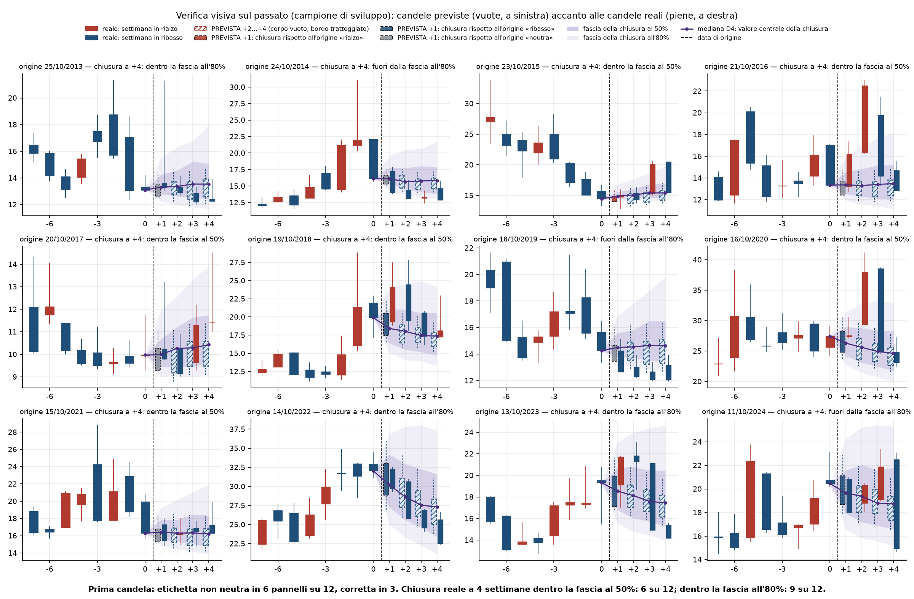

# Fase 4b — La prima candela: direzione, corpo, minimo; sfidante e nuovo congelamento

*Generato da `python -m src.run_phase4b`. Campione di sviluppo fino al 2024-11-08. L'holdout non è stato letto: il comando gira sotto la guardia.
Tutti i numeri vengono da `reports/fase4b/`. I modelli delle versioni non sono stati ricalcolati: probabilità, chiusure centrali e candele K2 vengono dai file della Fase 4.*

**Decisioni applicate:** la previsione si fa una sola volta, alla chiusura settimanale; priorità a chiusura, minimo e direzione della candela +1; il massimo non si ricalibra; all'esame vanno F1 e una sola sfidante.

## Sintesi

1. **Direzione della prima candela (Parte A).** Sulle 438 origini in cui esistono tutti i candidati (dal 2016-06-17), Brier: P1 0,2410; P2 0,2339; P3 0,2376; P4 0,2350; P5 0,2327. Significativamente migliori di P1 dopo Holm: P4, P5.
2. **Sfidante (Parte B).** Il Brier più basso tra P2-P5 è di **P5 media di F2 e F3** (0,2327 contro 0,2410 di P1, +3,4% [+1,8%; +5,2%]). FS usa quella probabilità per la settimana +1 e la costruzione di F2 per chiusura centrale, fasce e settimane +2…+4.
3. **Etichette di FS a +1** (origini comuni): non neutre nel 37,9% dei casi, corrette nel 69,3%; F1: 36,1% e 64,6%; F2 da sola: 55,9% e 66,9%. I «rialzo» restano pochi (12 per FS).
4. **Corpo della prima candela (Parte C).** **Resta K2**, con il solo colore legato all'etichetta: la sovrapposizione media di K4 è più bassa di quella di K2. Sovrapposizione: K4 0,503 contro K2 0,519; errore medio sulla chiusura: K4 2,25 contro K2 2,41 punti (più basso in modo significativo, p < 0,0001).
5. **Attenzione, da decidere:** la regola respinge K4 per la sola sovrapposizione, mentre sulla chiusura — la prima delle priorità dichiarate — K4 è migliore. Con l'etichetta di FS sulle origini comuni K4 avrebbe anche la sovrapposizione più alta (0,529 contro 0,521). La regola è stata applicata come scritta, a F1 su tutte le origini.
6. **Minimo della prima candela (Parte D).** La regola sceglie **M1q**: errore assoluto medio 1,21 punti contro 1,39 di M0 (DM p < 0,0001); minimi entro il 5% dal reale 50,6% contro 40,4%; previsti troppo bassi 52,5% contro 71,1%.
7. **Prezzo del nuovo minimo.** L'escursione prevista si stringe (rapporto con la reale da 0,893 a 0,788) e la chiusura reale cade dentro l'escursione prevista meno spesso (dal 61,6% al 52,2%). Nel 43% dei casi il minimo di M1q starebbe sopra il corpo e viene portato al fondo del corpo.
8. **Massimo.** Non ricalibrato, come deciso: il massimo reale supera quello previsto nel 54,3% dei casi; errore medio 2,12 punti.
9. **Versioni congelate di nuovo:** `versioni/f1.json` e `versioni/fs.json` (prima candela K2 + M1q, colore secondo l'etichetta). Con K2 la prima candela ha gli stessi quattro valori in F1 e in FS: tra le due versioni cambiano solo etichetta e colore.
10. **Piano d'esame aggiornato:** due versioni (F1 e FS), i tre criteri di prima più un criterio dedicato alla prima candela (direzione quando non neutra, minimo, chiusura). **L'holdout non è stato aperto.**

## 1. Prima candela: prima e dopo

«Prima» = stato della Fase 4 (candela K2 con ampiezze A1, minimo della candela, etichetta della versione). «Dopo» = scelte di questa fase: costruzione K2, minimo M1q, colore secondo l'etichetta.
Errori in punti VIX. Tutte le misure riguardano la settimana +1.

### 1.1 F1 su tutte le sue origini (933, date previste dal 2006-12-29 al 2024-11-08)

| misura                                         | F1 prima   | F1 dopo   |
|:-----------------------------------------------|:-----------|:----------|
| origini                                        | 933        | 933       |
| direzione: Brier                               | 0,243      | 0,243     |
| etichetta: quota di non neutre                 | 31,2%      | 31,2%     |
| etichetta: non neutre (numero)                 | 291        | 291       |
| etichetta: corrette tra le non neutre          | 63,9%      | 63,9%     |
| etichette «rialzo» (numero)                    | 33         | 33        |
| corrette tra i «rialzo»                        | 51,5%      | 51,5%     |
| etichette «ribasso» (numero)                   | 258        | 258       |
| corrette tra i «ribasso»                       | 65,5%      | 65,5%     |
| apertura: errore medio (punti)                 | 0,736      | 0,736     |
| massimo: errore medio (punti)                  | 2,115      | 2,115     |
| massimo reale sopra il previsto                | 54,3%      | 54,3%     |
| minimo: errore medio (punti)                   | 1,386      | 1,206     |
| minimo: errore mediano (punti)                 | 0,952      | 0,754     |
| minimo entro il 5% dal reale                   | 40,4%      | 50,6%     |
| minimo entro il 10% dal reale                  | 73,2%      | 81,7%     |
| minimi previsti troppo bassi                   | 71,1%      | 52,5%     |
| chiusura della candela: errore medio (punti)   | 2,408      | 2,408     |
| chiusura della candela: errore mediano (punti) | 1,372      | 1,372     |
| sovrapposizione con la candela reale           | 0,519      | 0,521     |
| chiusura reale nel corpo previsto              | 33,4%      | 33,4%     |
| chiusura reale nell'escursione prevista        | 61,6%      | 52,2%     |
| direzione del corpo indovinata                 | 63,6%      | 63,6%     |
| corpo previsto / reale                         | 0,910      | 0,910     |
| escursione prevista / reale                    | 0,893      | 0,788     |

### 1.2 Origini comuni a tutti i candidati (438, origini dal 2016-06-17 al 2024-11-01)

La colonna «F2 prima» è la sfidante com'era nella Fase 4 (costruzione di F2 con la sua etichetta); «FS dopo» è la sfidante congelata ora.

| misura                                         | F1 prima   | F1 dopo   | F2 prima (Fase 4)   | FS dopo   |
|:-----------------------------------------------|:-----------|:----------|:--------------------|:----------|
| origini                                        | 438        | 438       | 438                 | 438       |
| direzione: Brier                               | 0,241      | 0,241     | 0,234               | 0,233     |
| etichetta: quota di non neutre                 | 36,1%      | 36,1%     | 55,9%               | 37,9%     |
| etichetta: non neutre (numero)                 | 158        | 158       | 245                 | 166       |
| etichetta: corrette tra le non neutre          | 64,6%      | 64,6%     | 66,9%               | 69,3%     |
| etichette «rialzo» (numero)                    | 12         | 12        | 22                  | 12        |
| corrette tra i «rialzo»                        | 25,0%      | 25,0%     | 59,1%               | 66,7%     |
| etichette «ribasso» (numero)                   | 146        | 146       | 223                 | 154       |
| corrette tra i «ribasso»                       | 67,8%      | 67,8%     | 67,7%               | 69,5%     |
| apertura: errore medio (punti)                 | 0,640      | 0,640     | 0,640               | 0,640     |
| massimo: errore medio (punti)                  | 2,186      | 2,186     | 2,186               | 2,186     |
| massimo reale sopra il previsto                | 51,1%      | 51,1%     | 51,1%               | 51,1%     |
| minimo: errore medio (punti)                   | 1,384      | 1,129     | 1,384               | 1,129     |
| minimo: errore mediano (punti)                 | 0,953      | 0,706     | 0,953               | 0,706     |
| minimo entro il 5% dal reale                   | 36,1%      | 50,5%     | 36,1%               | 50,5%     |
| minimo entro il 10% dal reale                  | 69,2%      | 81,7%     | 69,2%               | 81,7%     |
| minimi previsti troppo bassi                   | 77,2%      | 59,1%     | 77,2%               | 59,1%     |
| chiusura della candela: errore medio (punti)   | 2,349      | 2,349     | 2,349               | 2,349     |
| chiusura della candela: errore mediano (punti) | 1,322      | 1,322     | 1,322               | 1,322     |
| sovrapposizione con la candela reale           | 0,521      | 0,539     | 0,521               | 0,539     |
| chiusura reale nel corpo previsto              | 39,5%      | 39,5%     | 39,5%               | 39,5%     |
| chiusura reale nell'escursione prevista        | 67,8%      | 59,8%     | 67,8%               | 59,8%     |
| direzione del corpo indovinata                 | 66,1%      | 66,1%     | 66,1%               | 66,1%     |
| corpo previsto / reale                         | 0,954      | 0,954     | 0,954               | 0,954     |
| escursione prevista / reale                    | 0,927      | 0,836     | 0,927               | 0,836     |

### 1.3 Fascia 13-22, origini comuni (228)

| misura                                         | F1 dopo   | FS dopo   |
|:-----------------------------------------------|:----------|:----------|
| origini                                        | 228       | 228       |
| direzione: Brier                               | 0,247     | 0,237     |
| etichetta: quota di non neutre                 | 32,5%     | 29,8%     |
| etichetta: non neutre (numero)                 | 74        | 68        |
| etichetta: corrette tra le non neutre          | 63,5%     | 67,6%     |
| etichette «rialzo» (numero)                    | 3         | 0         |
| corrette tra i «rialzo»                        | 0,0%      | –         |
| etichette «ribasso» (numero)                   | 71        | 68        |
| corrette tra i «ribasso»                       | 66,2%     | 67,6%     |
| apertura: errore medio (punti)                 | 0,560     | 0,560     |
| massimo: errore medio (punti)                  | 2,122     | 2,122     |
| massimo reale sopra il previsto                | 49,1%     | 49,1%     |
| minimo: errore medio (punti)                   | 0,986     | 0,986     |
| minimo: errore mediano (punti)                 | 0,755     | 0,755     |
| minimo entro il 5% dal reale                   | 48,2%     | 48,2%     |
| minimo entro il 10% dal reale                  | 81,1%     | 81,1%     |
| minimi previsti troppo bassi                   | 53,1%     | 53,1%     |
| chiusura della candela: errore medio (punti)   | 2,251     | 2,251     |
| chiusura della candela: errore mediano (punti) | 1,335     | 1,335     |
| sovrapposizione con la candela reale           | 0,527     | 0,527     |
| chiusura reale nel corpo previsto              | 33,8%     | 33,8%     |
| chiusura reale nell'escursione prevista        | 53,1%     | 53,1%     |
| direzione del corpo indovinata                 | 66,5%     | 66,5%     |
| corpo previsto / reale                         | 0,837     | 0,837     |
| escursione prevista / reale                    | 0,792     | 0,792     |

## 2. Parte A — Direzione della prima candela

Probabilità che la chiusura della settimana +1 sia sopra la chiusura all'origine. Candidati (elenco chiuso): P1 F1; P2 F2; P3 F3; P4 media di F1, F2 e F3; P5 media di F2 e F3.
Stesse origini per tutti: quelle in cui esistono le tre probabilità (438; l'etichetta di F2 richiede 104 errori passati, quindi si parte dal 2016-06-17).
Etichetta non neutra quando la probabilità è almeno 60% in una direzione. Test di Diebold-Mariano sul Brier contro P1, Holm sui 4 confronti.

| candidato               |   casi |   Brier |   affidabilità (0 = calibrato) |   risoluzione | non neutre: quota (n) → corrette   | «rialzo»: n → corrette   | «ribasso»: n → corrette   | guadagno sul Brier vs P1 [IC 95%]   |   DM vs P1 |   p (due code) |   p Holm |
|:------------------------|-------:|--------:|-------------------------------:|--------------:|:-----------------------------------|:-------------------------|:--------------------------|:------------------------------------|-----------:|---------------:|---------:|
| P1 F1                   |    438 |  0.2410 |                         0.0071 |        0.0100 | 36,1% (158) → 64,6%                | 12 → 25,0%               | 146 → 67,8%               | –                                   |     –      |         –      |   –      |
| P2 F2                   |    438 |  0.2339 |                         0.0022 |        0.0139 | 55,9% (245) → 66,9%                | 22 → 59,1%               | 223 → 67,7%               | +3,0% [+0,5%; +5,4%]                |     2.0652 |         0.0395 |   0.0790 |
| P3 F3                   |    438 |  0.2376 |                         0.0035 |        0.0086 | 26,9% (118) → 69,5%                | 22 → 68,2%               | 96 → 69,8%                | +1,4% [-1,1%; +3,9%]                |     1.0396 |         0.2991 |   0.2991 |
| P4 media di F1, F2 e F3 |    438 |  0.2350 |                         0.0043 |        0.0134 | 35,4% (155) → 69,0%                | 12 → 58,3%               | 143 → 69,9%               | +2,5% [+1,4%; +3,7%]                |     3.9322 |         0.0001 |   0.0004 |
| P5 media di F2 e F3     |    438 |  0.2327 |                         0.0042 |        0.0150 | 37,9% (166) → 69,3%                | 12 → 66,7%               | 154 → 69,5%               | +3,4% [+1,8%; +5,2%]                |     3.6365 |         0.0003 |   0.0009 |

Per fascia di partenza (numero di casi in colonna; con meno di 20 casi il dato è solo indicativo):

| fascia di partenza   | candidato               |   casi |   Brier |   affidabilità (0 = calibrato) |   risoluzione | non neutre: quota (n) → corrette   | «rialzo»: n → corrette   | «ribasso»: n → corrette   | guadagno sul Brier vs P1   |
|:---------------------|:------------------------|-------:|--------:|-------------------------------:|--------------:|:-----------------------------------|:-------------------------|:--------------------------|:---------------------------|
| <15                  | P1 F1                   |    177 |  0.2491 |                         0.0112 |        0.0128 | 11,3% (20) → 45,0%                 | 11 → 27,3%               | 9 → 66,7%                 | –                          |
| <15                  | P2 F2                   |    177 |  0.2447 |                         0.0018 |        0.0079 | 28,2% (50) → 62,0%                 | 18 → 55,6%               | 32 → 65,6%                | +1,8%                      |
| <15                  | P3 F3                   |    177 |  0.2472 |                         0.0086 |        0.0098 | 13,6% (24) → 70,8%                 | 22 → 68,2%               | 2 → 100,0%                | +0,7%                      |
| <15                  | P4 media di F1, F2 e F3 |    177 |  0.2443 |                         0.0054 |        0.0096 | 10,2% (18) → 55,6%                 | 12 → 58,3%               | 6 → 50,0%                 | +1,9%                      |
| <15                  | P5 media di F2 e F3     |    177 |  0.2427 |                         0.0033 |        0.0093 | 10,2% (18) → 66,7%                 | 12 → 66,7%               | 6 → 66,7%                 | +2,6%                      |
| 15-20                | P1 F1                   |    123 |  0.2559 |                         0.0162 |        0.0092 | 39,8% (49) → 57,1%                 | 1 → 0,0%                 | 48 → 58,3%                | –                          |
| 15-20                | P2 F2                   |    123 |  0.2479 |                         0.0110 |        0.0146 | 61,0% (75) → 60,0%                 | 4 → 75,0%                | 71 → 59,2%                | +3,1%                      |
| 15-20                | P3 F3                   |    123 |  0.2510 |                         0.0046 |        0.0007 | 17,9% (22) → 50,0%                 | 0 → –                    | 22 → 50,0%                | +1,9%                      |
| 15-20                | P4 media di F1, F2 e F3 |    123 |  0.2489 |                         0.0036 |        0.0032 | 33,3% (41) → 58,5%                 | 0 → –                    | 41 → 58,5%                | +2,7%                      |
| 15-20                | P5 media di F2 e F3     |    123 |  0.2462 |                         0.0100 |        0.0116 | 35,0% (43) → 58,1%                 | 0 → –                    | 43 → 58,1%                | +3,8%                      |
| 20-25                | P1 F1                   |     73 |  0.2132 |                         0.0182 |        0.0219 | 45,2% (33) → 81,8%                 | 0 → –                    | 33 → 81,8%                | –                          |
| 20-25                | P2 F2                   |     73 |  0.1993 |                         0.0099 |        0.0269 | 76,7% (56) → 76,8%                 | 0 → –                    | 56 → 76,8%                | +6,5%                      |
| 20-25                | P3 F3                   |     73 |  0.2166 |                         0.0115 |        0.0068 | 28,8% (21) → 81,0%                 | 0 → –                    | 21 → 81,0%                | -1,6%                      |
| 20-25                | P4 media di F1, F2 e F3 |     73 |  0.2075 |                         0.0152 |        0.0217 | 49,3% (36) → 83,3%                 | 0 → –                    | 36 → 83,3%                | +2,7%                      |
| 20-25                | P5 media di F2 e F3     |     73 |  0.2052 |                         0.0110 |        0.0170 | 58,9% (43) → 79,1%                 | 0 → –                    | 43 → 79,1%                | +3,8%                      |
| 25-30                | P1 F1                   |     38 |  0.2422 |                         0.0401 |        0.0350 | 76,3% (29) → 55,2%                 | 0 → –                    | 29 → 55,2%                | –                          |
| 25-30                | P2 F2                   |     38 |  0.2448 |                         0.0281 |        0.0182 | 97,4% (37) → 62,2%                 | 0 → –                    | 37 → 62,2%                | -1,1%                      |
| 25-30                | P3 F3                   |     38 |  0.2365 |                         0.0031 |        0.0058 | 63,2% (24) → 62,5%                 | 0 → –                    | 24 → 62,5%                | +2,4%                      |
| 25-30                | P4 media di F1, F2 e F3 |     38 |  0.2393 |                         0.0074 |        0.0105 | 86,8% (33) → 63,6%                 | 0 → –                    | 33 → 63,6%                | +1,2%                      |
| 25-30                | P5 media di F2 e F3     |     38 |  0.2386 |                         0.0087 |        0.0108 | 92,1% (35) → 62,9%                 | 0 → –                    | 35 → 62,9%                | +1,5%                      |
| >=30                 | P1 F1                   |     27 |  0.1942 |                         0.0894 |        0.0512 | 100,0% (27) → 81,5%                | 0 → –                    | 27 → 81,5%                | –                          |
| >=30                 | P2 F2                   |     27 |  0.1777 |                         0.0638 |        0.0398 | 100,0% (27) → 81,5%                | 0 → –                    | 27 → 81,5%                | +8,5%                      |
| >=30                 | P3 F3                   |     27 |  0.1711 |                         0.0222 |        0.0019 | 100,0% (27) → 81,5%                | 0 → –                    | 27 → 81,5%                | +11,9%                     |
| >=30                 | P4 media di F1, F2 e F3 |     27 |  0.1790 |                         0.1200 |        0.0916 | 100,0% (27) → 81,5%                | 0 → –                    | 27 → 81,5%                | +7,8%                      |
| >=30                 | P5 media di F2 e F3     |     27 |  0.1722 |                         0.1155 |        0.0933 | 100,0% (27) → 81,5%                | 0 → –                    | 27 → 81,5%                | +11,3%                     |

Fascia 13-22 (p non corretti per i confronti multipli):

| candidato               |   casi |   Brier |   affidabilità (0 = calibrato) |   risoluzione | non neutre: quota (n) → corrette   | «rialzo»: n → corrette   | «ribasso»: n → corrette   | guadagno sul Brier vs P1 [IC 95%]   |   DM vs P1 |   p (due code) |
|:------------------------|-------:|--------:|-------------------------------:|--------------:|:-----------------------------------|:-------------------------|:--------------------------|:------------------------------------|-----------:|---------------:|
| P1 F1                   |    228 |  0.2465 |                         0.0126 |        0.0065 | 32,5% (74) → 63,5%                 | 3 → 0,0%                 | 71 → 66,2%                | –                                   |     –      |         –      |
| P2 F2                   |    228 |  0.2353 |                         0.0019 |        0.0109 | 54,8% (125) → 66,4%                | 5 → 60,0%                | 120 → 66,7%               | +4,6% [+0,7%; +8,8%]                |     2.1173 |         0.0353 |
| P3 F3                   |    228 |  0.2456 |                         0.0066 |        0.0004 | 14,5% (33) → 63,6%                 | 0 → –                    | 33 → 63,6%                | +0,4% [-3,9%; +3,9%]                |     0.1986 |         0.8428 |
| P4 media di F1, F2 e F3 |    228 |  0.2396 |                         0.0047 |        0.0064 | 28,9% (66) → 66,7%                 | 1 → 0,0%                 | 65 → 67,7%                | +2,8% [+0,6%; +5,1%]                |     3.1114 |         0.0021 |
| P5 media di F2 e F3     |    228 |  0.2369 |                         0.0063 |        0.0104 | 29,8% (68) → 67,6%                 | 0 → –                    | 68 → 67,6%                | +3,9% [+0,6%; +7,2%]                |     2.9065 |         0.0040 |

Calibrazione di P1 e del candidato scelto (tutte le classi in `reports/fase4b/a_calibrazione.csv`):

| candidato           | classe di probabilità   |   n |   probabilità media |   frequenza osservata |
|:--------------------|:------------------------|----:|--------------------:|----------------------:|
| P1 F1               | 0.0-0.1                 |   1 |               0.071 |                 1.000 |
| P1 F1               | 0.1-0.2                 |   6 |               0.142 |                 0.333 |
| P1 F1               | 0.2-0.3                 |  26 |               0.255 |                 0.192 |
| P1 F1               | 0.3-0.4                 | 113 |               0.357 |                 0.345 |
| P1 F1               | 0.4-0.5                 | 133 |               0.450 |                 0.444 |
| P1 F1               | 0.5-0.6                 | 147 |               0.541 |                 0.524 |
| P1 F1               | 0.6-0.7                 |  12 |               0.642 |                 0.250 |
| P5 media di F2 e F3 | 0.1-0.2                 |   4 |               0.178 |                 0.750 |
| P5 media di F2 e F3 | 0.2-0.3                 |  39 |               0.261 |                 0.205 |
| P5 media di F2 e F3 | 0.3-0.4                 | 111 |               0.356 |                 0.324 |
| P5 media di F2 e F3 | 0.4-0.5                 | 144 |               0.451 |                 0.410 |
| P5 media di F2 e F3 | 0.5-0.6                 | 128 |               0.542 |                 0.562 |
| P5 media di F2 e F3 | 0.6-0.7                 |  12 |               0.623 |                 0.667 |

## 3. Parte B — Scelta della sfidante

Regola fissata nella consegna: la sfidante è costruita attorno al candidato con il Brier più basso a h = 1 tra P2, P3, P4 e P5; per chiusura centrale, fasce e orizzonti +2…+4 usa la costruzione di F2 se il candidato contiene P2, altrimenti quella di F3.

- Brier: P1 0,2410; P2 0,2339; P3 0,2376; P4 0,2350; P5 0,2327.
- **Candidato scelto: P5 media di F2 e F3.** Costruzione di base: F2.
- **FS**: per la settimana +1 la probabilità che la chiusura superi quella dell'origine è la media semplice delle probabilità di F2 e F3; chiusura centrale, fasce, probabilità di superare 20, 25 e 30,
  etichette e candele delle settimane +2…+4 sono quelle di F2. Se VIX3M manca all'origine, FS non è calcolabile e il programma ripiega su F1.
- Il margine tra i candidati migliori è piccolo (0,2327 contro 0,2339 del secondo): la regola sceglie il più basso senza un test tra candidati.

## 4. Parte C — Corpo e colore della prima candela

**K4** (solo settimana +1): apertura = chiusura all'origine × rapporto di apertura; se l'etichetta è «ribasso» chiusura = chiusura all'origine × exp(−d), con d = media delle variazioni log assolute delle settimane in calo
nelle ultime 260 settimane; se è «rialzo» chiusura = chiusura all'origine × exp(+u), con u = media delle variazioni log delle settimane in rialzo; se è «neutra» chiusura = chiusura centrale della versione; ombre come ora.
Nel campione d è stato tra 7,5% e 11,4%, u tra 7,5% e 15,2%.

**Regola** (dalla consegna): K4 se la sovrapposizione media non è più bassa di quella di K2 e l'errore sulla chiusura della candela non è significativamente peggiore (DM, p < 0,05); altrimenti K2 con il solo colore legato all'etichetta.
Fissato prima di guardare i risultati: la regola si applica a F1 su tutte le sue origini (il campione più lungo) e la costruzione scelta vale anche per FS.

| versione   | campione         | costruzione   |   n |   errore medio apertura |   errore medio massimo |   errore medio minimo |   errore medio chiusura |   errore mediano chiusura | sovrapposizione [IC 95%]   |   chiusura reale nel corpo |   chiusura reale nell'escursione |   direzione del corpo |   corpo previsto / reale |   escursione prevista / reale |
|:-----------|:-----------------|:--------------|----:|------------------------:|-----------------------:|----------------------:|------------------------:|--------------------------:|:---------------------------|---------------------------:|---------------------------------:|----------------------:|-------------------------:|------------------------------:|
| F1         | tutte le origini | K2            | 933 |                   0.736 |                  2.115 |                 1.386 |                   2.408 |                     1.372 | 0.519 [0.506; 0.531]       |                      0.334 |                            0.616 |                 0.636 |                    0.910 |                         0.893 |
| F1         | tutte le origini | K4            | 933 |                   0.736 |                  2.131 |                 1.277 |                   2.248 |                     1.451 | 0.503 [0.487; 0.519]       |                      0.152 |                            0.484 |                 0.625 |                    0.574 |                         0.744 |
| F1         | origini comuni   | K2            | 438 |                   0.640 |                  2.186 |                 1.384 |                   2.349 |                     1.322 | 0.521 [0.503; 0.537]       |                      0.395 |                            0.678 |                 0.661 |                    0.954 |                         0.927 |
| F1         | origini comuni   | K4            | 438 |                   0.640 |                  2.205 |                 1.190 |                   2.137 |                     1.277 | 0.519 [0.498; 0.539]       |                      0.164 |                            0.537 |                 0.642 |                    0.586 |                         0.767 |
| FS         | origini comuni   | K2            | 438 |                   0.640 |                  2.186 |                 1.384 |                   2.349 |                     1.322 | 0.521 [0.503; 0.538]       |                      0.395 |                            0.678 |                 0.661 |                    0.954 |                         0.927 |
| FS         | origini comuni   | K4            | 438 |                   0.640 |                  2.173 |                 1.188 |                   2.102 |                     1.178 | 0.529 [0.507; 0.549]       |                      0.196 |                            0.553 |                 0.642 |                    0.631 |                         0.786 |

K4 e K2 per etichetta (F1, tutte le origini; etichette di F1: neutra 642, ribasso 258, rialzo 33):

| etichetta   | costruzione   |   casi |   errore medio minimo |   errore medio chiusura |   sovrapposizione |   chiusura reale nel corpo |   chiusura reale nell'escursione |   direzione del corpo |   corpo previsto / reale |
|:------------|:--------------|-------:|----------------------:|------------------------:|------------------:|---------------------------:|---------------------------------:|----------------------:|-------------------------:|
| neutra      | K2            |    642 |                 1.095 |                   1.910 |             0.512 |                      0.346 |                            0.640 |                 0.605 |                    0.876 |
| neutra      | K4            |    642 |                 0.866 |                   1.695 |             0.501 |                      0.098 |                            0.472 |                 0.602 |                    0.337 |
| rialzo      | K2            |     33 |                 0.645 |                   0.905 |             0.572 |                      0.333 |                            0.788 |                 0.625 |                    1.079 |
| rialzo      | K4            |     33 |                 0.637 |                   1.583 |             0.484 |                      0.212 |                            0.515 |                 0.375 |                    1.432 |
| ribasso     | K2            |    258 |                 2.204 |                   3.837 |             0.528 |                      0.306 |                            0.535 |                 0.716 |                    0.943 |
| ribasso     | K4            |    258 |                 2.382 |                   3.710 |             0.511 |                      0.279 |                            0.512 |                 0.716 |                    0.811 |

- **Esito.** **Resta K2**, con il solo colore legato all'etichetta: la sovrapposizione media di K4 è più bassa di quella di K2.
- Errore sulla chiusura della candela: K4 2,248 punti, K2 2,408 (DM = 4,42, p < 0,0001: più basso in modo significativo).
- Sovrapposizione: K4 0,503, K2 0,519. K4 ha un corpo molto più piccolo (0,57 del reale contro 0,91):
  quando l'etichetta è neutra — la maggior parte dei casi — la chiusura va sulla chiusura centrale, vicina all'origine, e la candela copre meno della settimana reale.
- Sulle origini comuni: con l'etichetta di F1 la sovrapposizione è 0,519 (K4) contro 0,521 (K2); con l'etichetta di FS è 0,529 contro 0,521.
- **Colore.** La prima candela prevista è piena e colorata secondo l'etichetta: rossa «rialzo», blu «ribasso», grigia «neutra», con bordo tratteggiato perché è una previsione. Le candele +2…+4 restano vuote e tratteggiate. La legenda è aggiornata.
  Con K2 il corpo resta disegnato verso il basso: una candela rossa (etichetta «rialzo») può avere la chiusura sotto l'apertura. Il colore dice la direzione della chiusura rispetto all'origine, non il verso del corpo.

Prima candela: etichetta non neutra in 6 pannelli su 12, corretta in 3. Chiusura reale a 4 settimane dentro la fascia al 50%: 6 su 12; dentro la fascia all'80%: 9 su 12.

## 5. Parte D — Minimo della prima candela

Varianti (elenco chiuso): **M0** = minimo della candela scelta nella Parte C (K2: fondo del corpo meno l'ombra inferiore media); **M1q** = regressione sulla mediana di ln(minimo della settimana +1 / chiusura all'origine)
sulle variabili di M1, stimata sulle ultime 520 settimane. Il minimo mostrato non può stare sopra il corpo: se M1q è più alto del fondo del corpo, vale il fondo del corpo («M1q senza vincolo» è riportato per confronto).
Regola: M1q se l'errore assoluto medio è più basso con DM p < 0,05; altrimenti M0. Applicata a F1 su tutte le sue origini.

| versione   | campione                              | variante          |   n |   errore assoluto medio (punti) |   errore assoluto mediano |   entro il 5% |   entro il 10% |   previsti troppo bassi |   errore medio con segno (previsto − reale) |   limitati dal corpo |
|:-----------|:--------------------------------------|:------------------|----:|--------------------------------:|--------------------------:|--------------:|---------------:|------------------------:|--------------------------------------------:|---------------------:|
| F1         | tutte le origini                      | M0                | 933 |                           1.386 |                     0.952 |         0.404 |          0.732 |                   0.711 |                                      -0.523 |                –     |
| F1         | tutte le origini                      | M1q               | 933 |                           1.206 |                     0.754 |         0.506 |          0.817 |                   0.525 |                                       0.001 |                0.430 |
| F1         | tutte le origini                      | M1q senza vincolo | 933 |                           1.216 |                     0.762 |         0.512 |          0.811 |                   0.467 |                                       0.098 |                –     |
| F1         | tutte le origini, con K4 (non scelta) | M0                | 933 |                           1.277 |                     0.772 |         0.527 |          0.795 |                   0.452 |                                       0.271 |                –     |
| F1         | tutte le origini, con K4 (non scelta) | M1q               | 933 |                           1.211 |                     0.762 |         0.513 |          0.811 |                   0.467 |                                       0.090 |                0.023 |
| F1         | tutte le origini, con K4 (non scelta) | M1q senza vincolo | 933 |                           1.216 |                     0.762 |         0.512 |          0.811 |                   0.467 |                                       0.098 |                –     |
| F1         | origini comuni                        | M0                | 438 |                           1.384 |                     0.953 |         0.361 |          0.692 |                   0.772 |                                      -0.732 |                –     |
| F1         | origini comuni                        | M1q               | 438 |                           1.129 |                     0.706 |         0.505 |          0.817 |                   0.591 |                                      -0.276 |                0.466 |
| F1         | origini comuni                        | M1q senza vincolo | 438 |                           1.125 |                     0.692 |         0.532 |          0.820 |                   0.523 |                                      -0.172 |                –     |
| FS         | origini comuni                        | M0                | 438 |                           1.384 |                     0.953 |         0.361 |          0.692 |                   0.772 |                                      -0.732 |                –     |
| FS         | origini comuni                        | M1q               | 438 |                           1.129 |                     0.706 |         0.505 |          0.817 |                   0.591 |                                      -0.276 |                0.466 |
| FS         | origini comuni                        | M1q senza vincolo | 438 |                           1.125 |                     0.692 |         0.532 |          0.820 |                   0.523 |                                      -0.172 |                –     |

- **Esito: M1q.** Errore assoluto medio 1,206 contro 1,386 (DM = 7,72, p < 0,0001).
- M0 mette il minimo troppo in basso nel 71,1% dei casi (errore medio con segno -0,523 punti); M1q nel 52,5% (+0,001).
- Nel 43% dei casi M1q è limitato dal corpo: il corpo K2, disegnato verso il basso con ampiezza media, arriva più in basso del minimo previsto, e allora minimo e chiusura della candela coincidono (nessuna ombra inferiore).
- Se la Parte C avesse scelto K4, la stessa regola avrebbe dato M0 (errore medio 1,211 contro 1,277, p = 0,0502).

## 6. Scelte fatte dalle regole, congelamento, programma

| regola | scelta |
|---|---|
| Parte B — candidato della sfidante | P5 media di F2 e F3; costruzione di base F2 |
| Parte C — prima candela | K2 (K4 respinta), colore secondo l'etichetta |
| Parte D — minimo | M1q |
| Fase 4, Parte A — ampiezze delle candele | A1 (invariata) |

- **Congelamento.** `python -m src.fase4b.congela` scrive `versioni/f1.json` e `versioni/fs.json` con parametri, finestre, regole, scelte, impronta SHA-256 dei sorgenti (compresi `src/fase4b/prima.py` e `src/fase4b/versioni.py`) e commit.
  I file `f2.json` e `f3.json` della Fase 4 sono stati tolti: F2 e F3 non vanno all'esame come versioni a sé, restano come componenti di FS (e nella storia del repository).
- **Programma.** `python -m src.forecast --versione f1|fs` (predefinita f1); `--aggiorna` scarica VIX e VIX3M giornalieri, che servono a FS; se VIX3M manca il programma avvisa e ripiega su f1. Nome della costruzione nel registro: `K2+M1q/K2m-A1`.
  La scheda mostra la versione richiesta e il confronto con l'altra. La previsione non viene aggiornata durante la settimana.
- **Piano d'esame.** `reports/piano_esame_holdout.md` è stato riscritto: due versioni, criteri A (chiusura), B (direzione), C (fasce) come prima, più il criterio D sulla prima candela. Il piano della Fase 4 è conservato in `reports/fase4/piano_esame_holdout_fase4.md`.

## 7. Problemi e ambiguità

1. **K4 respinta dalla regola pur essendo migliore sulla chiusura (da decidere).** La regola chiede due condizioni; K4 perde sulla sovrapposizione (0,503 contro 0,519) e vince sull'errore di chiusura
   (2,25 contro 2,41 punti). La chiusura è la prima priorità dichiarata: se si preferisce K4 basta dirlo e va rifatto il congelamento.
2. **A quale versione si applica la regola della Parte C.** Fissato prima: a F1 su tutte le origini. Con l'etichetta di FS sulle origini comuni K4 avrebbe sovrapposizione 0,529 contro 0,521; con quella di F1 sulle stesse origini 0,519 contro 0,521.
3. **Colore e verso del corpo.** Con K2 il corpo è sempre disegnato verso il basso; il colore segue l'etichetta. È ciò che la regola prevede nel caso «resta K2», ma una candela rossa con chiusura sotto l'apertura può confondere: la guida alla lettura lo spiega.
4. **Il nuovo minimo stringe la candela.** M1q riduce l'errore sul minimo ma l'escursione prevista scende al 79% della reale e la chiusura reale cade nell'escursione prevista nel 52,2% dei casi (prima 61,6%).
   È coerente con le priorità (minimo sì, massimo no), ma la candela «contiene» meno spesso la settimana reale.
5. **M1q limitato dal corpo** nel 43% dei casi: è un effetto del corpo K2, non del modello del minimo.
6. **«M0 attuale».** Letto come il minimo della candela scelta nella Parte C. Con l'altra costruzione l'esito è riportato nella sezione 5.
7. **Campione della Parte A.** Solo 438 origini (dal 2016-06-17), perché l'etichetta di F2 richiede 104 errori passati. Le fasce di partenza alte hanno pochi casi.
8. **Margine tra i candidati.** P2, P4 e P5 sono vicini; la scelta di P5 segue la regola del Brier più basso, non un test.
9. **FS oltre la settimana +1.** Etichette e probabilità di livello delle settimane +2…+4 sono quelle di F2: la consegna fissava solo chiusura centrale, fasce e orizzonti.
10. **Prima candela uguale nelle due versioni.** Con K2 e M1q apertura, massimo, minimo e chiusura della candela +1 non dipendono dalla versione: F1 e FS differiscono, sulla prima candela, solo per etichetta e colore. Nel criterio D dell'esame i test su minimo e chiusura non saranno quindi calcolabili; il piano lo prevede.
11. **Criterio D1 del piano.** La perdita che dà 0, 1 oppure 0,5 all'etichetta (corretta, sbagliata, neutra) è una scelta nostra per avere un test sulla «direzione quando non neutra»: da confermare.
12. **Versioni F2 e F3 e registro.** F2 e F3 sono tolte dalle versioni congelate e dal programma; le righe f2 e f3 già scritte nel registro restano. Una previsione f1 registrata prima di questa fase
    non viene riscritta: per quell'origine il registro conserva la prima candela di allora (colonna `costruzione`).
13. **Fasi precedenti.** Unica modifica al codice di una fase precedente: il piano della Fase 4 viene ora scritto in `reports/fase4/piano_esame_holdout_fase4.md` (contenuto identico), perché il piano in vigore è quello di questa fase.
    Al modulo dei grafici sono stati aggiunti parametri facoltativi (colore, legenda) che non cambiano i grafici delle fasi precedenti.
14. **Regole applicate a F1 e usate per FS.** Costruzione e minimo sono scelti una volta sola: un solo programma, una sola prima candela.
15. **Molti confronti sullo stesso campione.** Come nelle fasi precedenti: i guadagni misurati qui sono in parte attesi per selezione, e l'holdout dirà se reggono.
