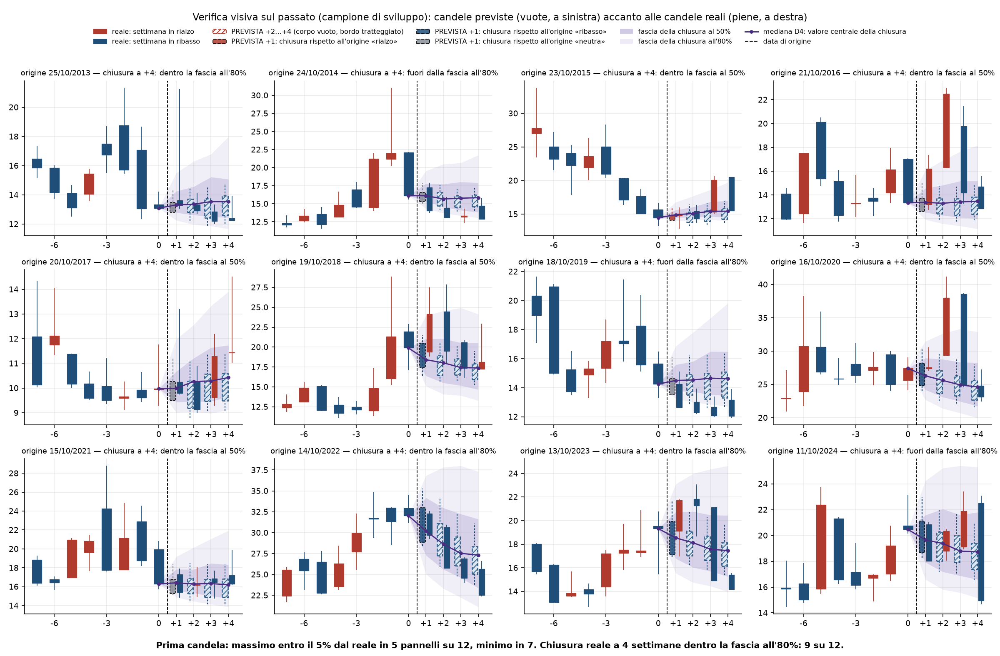

# Fase 4c — Massimo e minimo della prima candela

*Generato da `python -m src.run_phase4c`. Campione di sviluppo fino al 2024-11-08. L'holdout (VIX e dati esterni) non è stato letto: il comando gira sotto la guardia.
Tutti i numeri vengono da `reports/fase4c/`.*

**Conferme registrate:** criterio D1 del piano d'esame (perdita 0 / 1 / 0,5) confermato; K4 resta respinta e il corpo è stato rivalutato qui (Parte C); le altre voci «da sapere» della Fase 4b sono accettate.
**Decisioni applicate:** misura principale = quota di massimi e minimi previsti entro il 5% dal reale ed errore percentuale mediano (il 10% è secondario); ogni tabella anche senza le settimane di strappo;
il massimo è una previsione diretta; massimo e minimo comandano la candela; una sola previsione, alla chiusura settimanale; niente calendario degli eventi, niente modelli linguistici.

## Sintesi

1. **Massimo, previsione diretta.** Nessun insieme batte S0 secondo la regola. Su tutte le 933 origini il massimo è entro il 5% dal reale nel 43,1% dei casi (prima 43,0%); senza strappi 47,5% (prima 47,4%). La regola fissa fa 45,2%: **la previsione diretta del massimo non migliora quella che c'era**.
2. **Minimo.** Per F1 la regola adotta S1 (errore in log +1,7% [+0,3%; +3,1%] rispetto a S0, p = 0,019): minimo entro il 5% nel 52,3% dei casi (prima 50,6%); senza strappi 54,6% (prima 53,2%).
3. **Scelte della regola.** F1: massimo S0, minimo S1. FS: massimo S0, minimo S0. **F1 e FS finiscono con insiemi diversi** (F1: massimo S0, minimo S1; FS: massimo S0, minimo S0): per FS la regola confronta sei candidati sulle 634 origini comuni e Holm è più severo; S1 sul minimo lì ha p = 0,032 prima della correzione e 0,19 dopo.
4. **VVIX (S2): nessun guadagno distinguibile da zero.** massimo: entro il 5% 37,9% contro 40,1% di S0, errore in log +0,8% [-0,6%; +2,2%] (p Holm = 1,00); minimo: entro il 5% 53,5% contro 52,2% di S0, errore in log +1,9% [-0,2%; +4,2%] (p Holm = 0,39).
5. **Ampiezza dell'S&P 500 (S3): nessun guadagno (peggiora il massimo).** massimo: entro il 5% 37,1% contro 40,1% di S0, errore in log -0,9% [-1,9%; -0,0%] (p Holm = 0,97); minimo: entro il 5% 53,8% contro 52,2% di S0, errore in log +1,6% [-0,9%; +4,4%] (p Holm = 0,39). VIX3M/VIX (S4): nessun guadagno distinguibile da zero. Tutte insieme (S5): nessun guadagno distinguibile da zero.
6. **Previsione incrociata, versione reale (B3): nessun guadagno distinguibile da zero.** L'S&P 500 della settimana dopo non si prevede: direzione indovinata nel 53,8% dei casi contro il 59,0% di «sempre rialzo», R² del rendimento -1,8%; l'escursione invece sì (R² +41,1%), ma non basta.
7. **Tetto teorico (B2, non utilizzabile).** Conoscendo l'S&P 500 della settimana prevista: massimo: il tetto vale +10,3 punti sulla quota entro il 5%, la versione reale -5,4 punti (non sopravvive nulla); minimo: il tetto vale +10,1 punti sulla quota entro il 5%, la versione reale +0,2 punti (sopravvive il 2%); chiusura: il tetto vale +17,0 punti sulla quota entro il 5%, la versione reale -2,5 punti (non sopravvive nulla).
8. **Corpo (Parte C).** **Resta K2**: l'errore sulla chiusura di K5 non è significativamente più basso. Errore medio sulla chiusura della candela: K5 2,348 contro K2 2,358 punti (p = 0,7000). Con gli estremi che comandano, la chiusura della candela viene tagliata sul minimo previsto nel 43% dei casi.
9. **Prima candela, prima e dopo (F1, tutte le origini).** Entrambi gli estremi entro il 5%: 28,0% (prima 27,2%); errore sulla chiusura della candela 2,36 punti (prima 2,41); chiusura reale dentro l'escursione prevista 50,1% (prima 52,2%).
10. **Congelamento e piano.** F1 e FS sono ricongelate (`versioni/f1.json`, `versioni/fs.json`); nel criterio D del piano d'esame entrano le quote entro il 5% di massimo e minimo. **L'holdout non è stato aperto.**

## 1. In evidenza: quote entro il 5%, prima e dopo, con e senza strappi

«Prima» = prima candela del programma dopo la Fase 4b (massimo della candela K2, minimo M1q). «Dopo» = massimo e minimo diretti scelti in questa fase.
«Senza strappi» = senza le settimane in cui la chiusura reale ha superato del 20% la chiusura all'origine (87 su 933 origini):
**è un'etichetta che si conosce solo a posteriori**, serve a leggere i risultati e non è usabile per prevedere.

| versione   | origini                       | settimane     |   n | massimo entro il 5%: prima   | massimo: dopo   | minimo entro il 5%: prima   | minimo: dopo   | errore % mediano massimo: prima → dopo   | errore % mediano minimo: prima → dopo   |
|:-----------|:------------------------------|:--------------|----:|:-----------------------------|:----------------|:----------------------------|:---------------|:-----------------------------------------|:----------------------------------------|
| F1         | tutte le origini              | tutte         | 933 | 43,0%                        | 43,1%           | 50,6%                       | 52,3%          | 5,8% → 5,8%                              | 4,9% → 4,8%                             |
| F1         | tutte le origini              | senza strappi | 846 | 47,4%                        | 47,5%           | 53,2%                       | 54,6%          | 5,3% → 5,3%                              | 4,7% → 4,6%                             |
| F1         | origini con l'etichetta di FS | tutte         | 438 | 39,3%                        | 40,6%           | 50,5%                       | 55,5%          | 6,2% → 6,4%                              | 5,0% → 4,5%                             |
| F1         | origini con l'etichetta di FS | senza strappi | 394 | 43,7%                        | 45,2%           | 53,8%                       | 58,6%          | 5,6% → 5,5%                              | 4,7% → 4,2%                             |
| FS         | origini con l'etichetta di FS | tutte         | 438 | 39,3%                        | 40,6%           | 50,5%                       | 53,2%          | 6,2% → 6,4%                              | 5,0% → 4,6%                             |
| FS         | origini con l'etichetta di FS | senza strappi | 394 | 43,7%                        | 45,2%           | 53,8%                       | 56,1%          | 5,6% → 5,5%                              | 4,7% → 4,3%                             |

## 2. Parte A — Massimo e minimo diretti

Obiettivi: ln(massimo della settimana +1 / chiusura all'origine) e ln(minimo della settimana +1 / chiusura all'origine). Regressione sulla mediana sulle ultime 520 settimane (almeno 156).
Insiemi (elenco chiuso): S0 variabili di M1; S1 = S0 + candela del VIX; S2 = S1 + VVIX; S3 = S1 + ampiezza dell'S&P 500; S4 = S1 + VIX3M/VIX; S5 = S1 + VVIX, S&P 500 e VIX3M/VIX. Per il minimo, S0 è il modello M1q della Fase 4b.
Riferimenti: «regola fissa» (chiusura all'origine × rapporto mediano storico) e «programma attuale» (Fase 4b).

Campioni (ogni confronto è sulle stesse origini): tutte le origini (933, dal 2006-12-22); origini con VVIX (764, dal 2010-03-19);
origini con VIX3M e origini comuni a tutti gli insiemi (634, dal 2012-09-14). Tutte le tabelle, per ogni campione e ogni gruppo, sono in `reports/fase4c/a_misure.csv`.

### 2.1 Tutte le origini

| modello                                             | estremo   |   n | entro il 5%   | entro il 10%   | errore % mediano   | errore % medio   | errore mediano (punti)   | errore medio (punti)   | oltre il 5% per eccesso   | oltre il 5% per difetto   | entrambi entro il 5%   |
|:----------------------------------------------------|:----------|----:|:--------------|:---------------|:-------------------|:-----------------|:-------------------------|:-----------------------|:--------------------------|:--------------------------|:-----------------------|
| S0 variabili di M1                                  | massimo   | 933 | 43,1%         | 73,8%          | 5,8%               | 8,3%             | 1,14                     | 2,13                   | 21,1%                     | 35,8%                     | 27,0%                  |
| S0 variabili di M1                                  | minimo    | 933 | 51,2%         | 81,1%          | 4,8%               | 6,4%             | 0,76                     | 1,22                   | 26,2%                     | 22,6%                     | 27,0%                  |
| S1 = S0 + candela del VIX                           | massimo   | 933 | 42,7%         | 73,2%          | 5,9%               | 8,3%             | 1,17                     | 2,13                   | 22,2%                     | 35,2%                     | 28,0%                  |
| S1 = S0 + candela del VIX                           | minimo    | 933 | 52,3%         | 81,2%          | 4,8%               | 6,3%             | 0,73                     | 1,20                   | 25,7%                     | 22,0%                     | 28,0%                  |
| S3 = S1 + ampiezza dell'S&P 500                     | massimo   | 933 | 40,6%         | 73,1%          | 6,1%               | 8,4%             | 1,20                     | 2,14                   | 24,5%                     | 34,8%                     | 26,6%                  |
| S3 = S1 + ampiezza dell'S&P 500                     | minimo    | 933 | 52,1%         | 81,0%          | 4,7%               | 6,3%             | 0,74                     | 1,21                   | 26,4%                     | 21,5%                     | 26,6%                  |
| B3 previsione incrociata (S&P 500 previsto)         | massimo   | 933 | 38,4%         | 71,0%          | 6,4%               | 8,5%             | 1,26                     | 2,18                   | 31,6%                     | 30,0%                     | 23,8%                  |
| B3 previsione incrociata (S&P 500 previsto)         | minimo    | 933 | 52,0%         | 81,7%          | 4,8%               | 6,3%             | 0,74                     | 1,20                   | 25,6%                     | 22,4%                     | 23,8%                  |
| B2 TETTO TEORICO (S&P 500 futuro, non utilizzabile) | massimo   | 933 | 54,1%         | 81,9%          | 4,5%               | 6,5%             | 0,85                     | 1,76                   | 16,2%                     | 29,7%                     | 38,5%                  |
| B2 TETTO TEORICO (S&P 500 futuro, non utilizzabile) | minimo    | 933 | 62,3%         | 90,1%          | 3,8%               | 5,1%             | 0,59                     | 0,98                   | 20,9%                     | 16,8%                     | 38,5%                  |
| regola fissa                                        | massimo   | 933 | 45,2%         | 73,4%          | 5,8%               | 8,2%             | 1,11                     | 2,13                   | 15,9%                     | 38,9%                     | 26,6%                  |
| regola fissa                                        | minimo    | 933 | 48,2%         | 76,2%          | 5,2%               | 7,9%             | 0,85                     | 1,51                   | 33,4%                     | 18,3%                     | 26,6%                  |
| programma attuale (Fase 4b)                         | massimo   | 933 | 43,0%         | 73,5%          | 5,8%               | 8,2%             | 1,14                     | 2,12                   | 21,0%                     | 36,0%                     | 27,2%                  |
| programma attuale (Fase 4b)                         | minimo    | 933 | 50,6%         | 81,7%          | 4,9%               | 6,4%             | 0,75                     | 1,21                   | 24,2%                     | 25,2%                     | 27,2%                  |

Senza strappi:

| modello                                             | estremo   |   n | entro il 5%   | entro il 10%   | errore % mediano   | errore % medio   | errore mediano (punti)   | errore medio (punti)   | oltre il 5% per eccesso   | oltre il 5% per difetto   | entrambi entro il 5%   |
|:----------------------------------------------------|:----------|----:|:--------------|:---------------|:-------------------|:-----------------|:-------------------------|:-----------------------|:--------------------------|:--------------------------|:-----------------------|
| S0 variabili di M1                                  | massimo   | 846 | 47,5%         | 81,2%          | 5,3%               | 6,6%             | 1,06                     | 1,61                   | 23,3%                     | 29,2%                     | 29,8%                  |
| S0 variabili di M1                                  | minimo    | 846 | 53,5%         | 82,2%          | 4,6%               | 6,2%             | 0,73                     | 1,17                   | 28,6%                     | 17,8%                     | 29,8%                  |
| S1 = S0 + candela del VIX                           | massimo   | 846 | 47,0%         | 80,6%          | 5,5%               | 6,7%             | 1,05                     | 1,61                   | 24,5%                     | 28,5%                     | 30,9%                  |
| S1 = S0 + candela del VIX                           | minimo    | 846 | 54,6%         | 82,5%          | 4,6%               | 6,1%             | 0,70                     | 1,15                   | 28,0%                     | 17,4%                     | 30,9%                  |
| S3 = S1 + ampiezza dell'S&P 500                     | massimo   | 846 | 44,8%         | 80,4%          | 5,6%               | 6,8%             | 1,09                     | 1,62                   | 27,1%                     | 28,1%                     | 29,3%                  |
| S3 = S1 + ampiezza dell'S&P 500                     | minimo    | 846 | 54,0%         | 81,9%          | 4,5%               | 6,1%             | 0,72                     | 1,17                   | 28,7%                     | 17,3%                     | 29,3%                  |
| B3 previsione incrociata (S&P 500 previsto)         | massimo   | 846 | 42,3%         | 78,0%          | 5,8%               | 7,0%             | 1,13                     | 1,70                   | 34,9%                     | 22,8%                     | 26,2%                  |
| B3 previsione incrociata (S&P 500 previsto)         | minimo    | 846 | 54,0%         | 82,9%          | 4,6%               | 6,1%             | 0,71                     | 1,16                   | 27,9%                     | 18,1%                     | 26,2%                  |
| B2 TETTO TEORICO (S&P 500 futuro, non utilizzabile) | massimo   | 846 | 58,4%         | 86,8%          | 4,0%               | 5,7%             | 0,77                     | 1,49                   | 17,0%                     | 24,6%                     | 41,6%                  |
| B2 TETTO TEORICO (S&P 500 futuro, non utilizzabile) | minimo    | 846 | 62,1%         | 90,0%          | 3,8%               | 5,1%             | 0,59                     | 0,96                   | 22,0%                     | 16,0%                     | 41,6%                  |
| regola fissa                                        | massimo   | 846 | 49,9%         | 81,0%          | 5,1%               | 6,5%             | 1,00                     | 1,59                   | 17,5%                     | 32,6%                     | 29,3%                  |
| regola fissa                                        | minimo    | 846 | 49,9%         | 76,0%          | 5,0%               | 8,0%             | 0,82                     | 1,52                   | 35,9%                     | 14,2%                     | 29,3%                  |
| programma attuale (Fase 4b)                         | massimo   | 846 | 47,4%         | 81,0%          | 5,3%               | 6,6%             | 1,05                     | 1,59                   | 23,2%                     | 29,4%                     | 30,0%                  |
| programma attuale (Fase 4b)                         | minimo    | 846 | 53,2%         | 83,1%          | 4,7%               | 6,1%             | 0,72                     | 1,16                   | 26,5%                     | 20,3%                     | 30,0%                  |

### 2.2 Origini comuni a tutti gli insiemi

| modello                                             | estremo   |   n | entro il 5%   | entro il 10%   | errore % mediano   | errore % medio   | errore mediano (punti)   | errore medio (punti)   | oltre il 5% per eccesso   | oltre il 5% per difetto   | entrambi entro il 5%   |
|:----------------------------------------------------|:----------|----:|:--------------|:---------------|:-------------------|:-----------------|:-------------------------|:-----------------------|:--------------------------|:--------------------------|:-----------------------|
| S0 variabili di M1                                  | massimo   | 634 | 40,1%         | 72,9%          | 6,4%               | 8,7%             | 1,12                     | 2,06                   | 22,9%                     | 37,1%                     | 26,0%                  |
| S0 variabili di M1                                  | minimo    | 634 | 52,2%         | 81,7%          | 4,7%               | 6,3%             | 0,68                     | 1,06                   | 23,0%                     | 24,8%                     | 26,0%                  |
| S1 = S0 + candela del VIX                           | massimo   | 634 | 39,3%         | 71,5%          | 6,3%               | 8,7%             | 1,15                     | 2,06                   | 23,8%                     | 36,9%                     | 27,6%                  |
| S1 = S0 + candela del VIX                           | minimo    | 634 | 53,8%         | 82,5%          | 4,6%               | 6,2%             | 0,67                     | 1,03                   | 23,0%                     | 23,2%                     | 27,6%                  |
| S2 = S1 + VVIX                                      | massimo   | 634 | 37,9%         | 70,5%          | 6,4%               | 8,7%             | 1,17                     | 2,04                   | 29,0%                     | 33,1%                     | 26,2%                  |
| S2 = S1 + VVIX                                      | minimo    | 634 | 53,5%         | 82,8%          | 4,6%               | 6,2%             | 0,67                     | 1,04                   | 23,0%                     | 23,5%                     | 26,2%                  |
| S3 = S1 + ampiezza dell'S&P 500                     | massimo   | 634 | 37,1%         | 71,1%          | 6,5%               | 8,8%             | 1,17                     | 2,07                   | 26,3%                     | 36,6%                     | 25,7%                  |
| S3 = S1 + ampiezza dell'S&P 500                     | minimo    | 634 | 53,8%         | 82,5%          | 4,6%               | 6,2%             | 0,68                     | 1,05                   | 23,7%                     | 22,6%                     | 25,7%                  |
| S4 = S1 + VIX3M/VIX                                 | massimo   | 634 | 37,9%         | 72,1%          | 6,4%               | 8,6%             | 1,12                     | 2,02                   | 27,8%                     | 34,4%                     | 25,2%                  |
| S4 = S1 + VIX3M/VIX                                 | minimo    | 634 | 53,2%         | 82,3%          | 4,7%               | 6,1%             | 0,67                     | 1,03                   | 22,7%                     | 24,1%                     | 25,2%                  |
| S5 = S1 + VVIX, S&P 500 e VIX3M/VIX                 | massimo   | 634 | 37,1%         | 70,8%          | 6,5%               | 8,8%             | 1,10                     | 2,07                   | 30,4%                     | 32,5%                     | 27,0%                  |
| S5 = S1 + VVIX, S&P 500 e VIX3M/VIX                 | minimo    | 634 | 53,3%         | 82,2%          | 4,7%               | 6,2%             | 0,66                     | 1,05                   | 23,8%                     | 22,9%                     | 27,0%                  |
| B3 previsione incrociata (S&P 500 previsto)         | massimo   | 634 | 34,7%         | 67,7%          | 6,8%               | 9,0%             | 1,23                     | 2,11                   | 34,2%                     | 31,1%                     | 21,5%                  |
| B3 previsione incrociata (S&P 500 previsto)         | minimo    | 634 | 52,4%         | 82,6%          | 4,7%               | 6,2%             | 0,68                     | 1,04                   | 23,3%                     | 24,3%                     | 21,5%                  |
| B2 TETTO TEORICO (S&P 500 futuro, non utilizzabile) | massimo   | 634 | 50,3%         | 80,6%          | 5,0%               | 7,0%             | 0,85                     | 1,76                   | 17,7%                     | 32,0%                     | 35,6%                  |
| B2 TETTO TEORICO (S&P 500 futuro, non utilizzabile) | minimo    | 634 | 62,3%         | 90,5%          | 3,8%               | 5,0%             | 0,56                     | 0,83                   | 18,9%                     | 18,8%                     | 35,6%                  |
| regola fissa                                        | massimo   | 634 | 42,1%         | 71,8%          | 6,1%               | 8,7%             | 1,07                     | 2,06                   | 16,4%                     | 41,5%                     | 26,2%                  |
| regola fissa                                        | minimo    | 634 | 49,2%         | 77,9%          | 5,1%               | 7,8%             | 0,76                     | 1,28                   | 31,5%                     | 19,2%                     | 26,2%                  |
| programma attuale (Fase 4b)                         | massimo   | 634 | 39,7%         | 71,9%          | 6,3%               | 8,6%             | 1,11                     | 2,04                   | 22,4%                     | 37,9%                     | 25,9%                  |
| programma attuale (Fase 4b)                         | minimo    | 634 | 50,5%         | 82,2%          | 4,9%               | 6,3%             | 0,69                     | 1,06                   | 21,3%                     | 28,2%                     | 25,9%                  |

Senza strappi:

| modello                                             | estremo   |   n | entro il 5%   | entro il 10%   | errore % mediano   | errore % medio   | errore mediano (punti)   | errore medio (punti)   | oltre il 5% per eccesso   | oltre il 5% per difetto   | entrambi entro il 5%   |
|:----------------------------------------------------|:----------|----:|:--------------|:---------------|:-------------------|:-----------------|:-------------------------|:-----------------------|:--------------------------|:--------------------------|:-----------------------|
| S0 variabili di M1                                  | massimo   | 572 | 44,4%         | 80,4%          | 5,6%               | 6,9%             | 1,03                     | 1,54                   | 25,3%                     | 30,2%                     | 28,8%                  |
| S0 variabili di M1                                  | minimo    | 572 | 54,9%         | 82,7%          | 4,3%               | 6,1%             | 0,64                     | 1,01                   | 25,3%                     | 19,8%                     | 28,8%                  |
| S1 = S0 + candela del VIX                           | massimo   | 572 | 43,5%         | 79,0%          | 5,8%               | 7,0%             | 1,00                     | 1,54                   | 26,4%                     | 30,1%                     | 30,6%                  |
| S1 = S0 + candela del VIX                           | minimo    | 572 | 56,5%         | 83,7%          | 4,4%               | 5,9%             | 0,64                     | 0,98                   | 25,2%                     | 18,4%                     | 30,6%                  |
| S2 = S1 + VVIX                                      | massimo   | 572 | 42,0%         | 77,8%          | 6,0%               | 7,1%             | 1,04                     | 1,55                   | 32,2%                     | 25,9%                     | 29,0%                  |
| S2 = S1 + VVIX                                      | minimo    | 572 | 55,4%         | 84,3%          | 4,5%               | 5,9%             | 0,64                     | 0,98                   | 25,3%                     | 19,2%                     | 29,0%                  |
| S3 = S1 + ampiezza dell'S&P 500                     | massimo   | 572 | 41,1%         | 78,7%          | 6,0%               | 7,1%             | 1,06                     | 1,55                   | 29,2%                     | 29,7%                     | 28,5%                  |
| S3 = S1 + ampiezza dell'S&P 500                     | minimo    | 572 | 55,9%         | 83,4%          | 4,4%               | 6,0%             | 0,64                     | 1,00                   | 25,9%                     | 18,2%                     | 28,5%                  |
| S4 = S1 + VIX3M/VIX                                 | massimo   | 572 | 42,0%         | 79,2%          | 5,9%               | 7,0%             | 1,01                     | 1,52                   | 30,8%                     | 27,3%                     | 28,0%                  |
| S4 = S1 + VIX3M/VIX                                 | minimo    | 572 | 55,1%         | 84,1%          | 4,5%               | 5,9%             | 0,66                     | 0,98                   | 25,0%                     | 19,9%                     | 28,0%                  |
| S5 = S1 + VVIX, S&P 500 e VIX3M/VIX                 | massimo   | 572 | 40,9%         | 77,6%          | 6,0%               | 7,2%             | 1,00                     | 1,58                   | 33,7%                     | 25,3%                     | 29,7%                  |
| S5 = S1 + VVIX, S&P 500 e VIX3M/VIX                 | minimo    | 572 | 55,4%         | 83,7%          | 4,4%               | 5,9%             | 0,64                     | 1,00                   | 26,0%                     | 18,5%                     | 29,7%                  |
| B3 previsione incrociata (S&P 500 previsto)         | massimo   | 572 | 38,5%         | 74,7%          | 6,2%               | 7,4%             | 1,11                     | 1,64                   | 37,9%                     | 23,6%                     | 23,8%                  |
| B3 previsione incrociata (S&P 500 previsto)         | minimo    | 572 | 54,7%         | 83,9%          | 4,6%               | 6,0%             | 0,64                     | 0,99                   | 25,5%                     | 19,8%                     | 23,8%                  |
| B2 TETTO TEORICO (S&P 500 futuro, non utilizzabile) | massimo   | 572 | 54,9%         | 85,7%          | 4,5%               | 6,1%             | 0,77                     | 1,49                   | 18,5%                     | 26,6%                     | 39,2%                  |
| B2 TETTO TEORICO (S&P 500 futuro, non utilizzabile) | minimo    | 572 | 61,9%         | 90,2%          | 3,8%               | 5,0%             | 0,56                     | 0,83                   | 20,1%                     | 18,0%                     | 39,2%                  |
| regola fissa                                        | massimo   | 572 | 46,7%         | 79,5%          | 5,6%               | 6,8%             | 0,95                     | 1,52                   | 18,2%                     | 35,1%                     | 29,0%                  |
| regola fissa                                        | minimo    | 572 | 51,2%         | 78,0%          | 4,9%               | 7,8%             | 0,74                     | 1,29                   | 34,3%                     | 14,5%                     | 29,0%                  |
| programma attuale (Fase 4b)                         | massimo   | 572 | 44,1%         | 79,5%          | 5,6%               | 6,9%             | 1,02                     | 1,52                   | 24,8%                     | 31,1%                     | 28,7%                  |
| programma attuale (Fase 4b)                         | minimo    | 572 | 53,5%         | 83,6%          | 4,6%               | 6,0%             | 0,65                     | 1,00                   | 23,4%                     | 23,1%                     | 28,7%                  |

### 2.3 Quota entro il 5% per fascia di partenza, fascia 13-22 e terzili del VVIX (origini comuni)

I terzili del VVIX sono calcolati sulle origini del campione (a posteriori). Le altre misure sono in `a_misure.csv`.

| gruppo             | estremo   |   casi | S0    | S1    | S2    | S3    | S4    | S5    | B3    | B2    |
|:-------------------|:----------|-------:|:------|:------|:------|:------|:------|:------|:------|:------|
| fascia <15         | massimo   |    292 | 40,4% | 40,4% | 38,4% | 37,7% | 36,3% | 36,0% | 39,4% | 54,8% |
| fascia <15         | minimo    |    292 | 59,6% | 59,6% | 61,6% | 61,6% | 60,6% | 62,3% | 59,9% | 69,5% |
| fascia 15-20       | massimo   |    181 | 39,8% | 36,5% | 37,0% | 36,5% | 37,0% | 35,4% | 33,7% | 53,6% |
| fascia 15-20       | minimo    |    181 | 49,2% | 51,4% | 50,8% | 48,1% | 47,5% | 49,2% | 47,5% | 65,7% |
| fascia 20-25       | massimo   |     90 | 36,7% | 37,8% | 32,2% | 33,3% | 38,9% | 38,9% | 23,3% | 47,8% |
| fascia 20-25       | minimo    |     90 | 44,4% | 51,1% | 44,4% | 52,2% | 48,9% | 42,2% | 48,9% | 51,1% |
| fascia 25-30       | massimo   |     44 | 50,0% | 47,7% | 50,0% | 43,2% | 47,7% | 45,5% | 34,1% | 31,8% |
| fascia 25-30       | minimo    |     44 | 45,5% | 45,5% | 45,5% | 43,2% | 47,7% | 47,7% | 45,5% | 45,5% |
| fascia >=30        | massimo   |     27 | 33,3% | 37,0% | 37,0% | 37,0% | 40,7% | 40,7% | 29,6% | 18,5% |
| fascia >=30        | minimo    |     27 | 29,6% | 29,6% | 25,9% | 29,6% | 33,3% | 29,6% | 25,9% | 25,9% |
| fascia 13-22       | massimo   |    363 | 36,9% | 35,8% | 35,8% | 34,7% | 35,5% | 33,6% | 32,0% | 53,2% |
| fascia 13-22       | minimo    |    363 | 47,4% | 50,1% | 50,4% | 49,3% | 47,9% | 49,0% | 47,7% | 64,5% |
| VVIX terzile basso | massimo   |    212 | 42,9% | 43,4% | 40,6% | 41,5% | 40,6% | 41,5% | 38,7% | 59,9% |
| VVIX terzile basso | minimo    |    212 | 59,4% | 61,3% | 63,7% | 63,2% | 60,8% | 65,6% | 61,3% | 71,7% |
| VVIX terzile medio | massimo   |    211 | 41,2% | 39,3% | 39,3% | 35,5% | 36,5% | 34,6% | 35,5% | 51,2% |
| VVIX terzile medio | minimo    |    211 | 55,0% | 55,9% | 55,5% | 56,4% | 55,9% | 55,0% | 55,0% | 66,8% |
| VVIX terzile alto  | massimo   |    211 | 36,0% | 35,1% | 33,6% | 34,1% | 36,5% | 35,1% | 29,9% | 39,8% |
| VVIX terzile alto  | minimo    |    211 | 42,2% | 44,1% | 41,2% | 41,7% | 42,7% | 39,3% | 40,8% | 48,3% |

### 2.4 Regola

Per ciascun estremo: tra gli insiemi significativamente migliori di S0 (Diebold-Mariano sull'errore assoluto in log, p < 0,05 dopo Holm) e con quota entro il 5% non più bassa di S0, quello con l'errore più basso;
se nessuno, S0; a parità meno variabili. B3 partecipa come un insieme in più. Fissato prima di guardare i risultati: per F1 si confronta S1 con S0 su tutte le origini; per FS si confrontano S1-S5 e B3 con S0 sulle origini comuni.

F1 (S1 contro S0, tutte le origini):

| estremo   | insieme                   |   n |   variabili in più |   errore assoluto in log |   errore di S0 | guadagno sull'errore in log [IC 95%]   |   DM (positivo = meglio di S0) |      p |   p Holm | entro il 5%: insieme / S0   | ammesso dalla regola   |
|:----------|:--------------------------|----:|-------------------:|-------------------------:|---------------:|:---------------------------------------|-------------------------------:|-------:|---------:|:----------------------------|:-----------------------|
| massimo   | S1 = S0 + candela del VIX | 933 |                  3 |                   0.0893 |         0.0892 | -0,1% [-0,7%; +0,4%]                   |                        -0.2605 | 0.7945 |   0.7945 | 42,7% / 43,1%               | no                     |
| minimo    | S1 = S0 + candela del VIX | 933 |                  3 |                   0.0622 |         0.0632 | +1,7% [+0,3%; +3,1%]                   |                         2.3503 | 0.0190 |   0.0190 | 52,3% / 51,2%               | sì                     |

FS (S1-S5 e B3 contro S0, origini comuni):

| estremo   | insieme                                     |   n |   variabili in più |   errore assoluto in log |   errore di S0 | guadagno sull'errore in log [IC 95%]   |   DM (positivo = meglio di S0) |      p |   p Holm | entro il 5%: insieme / S0   | ammesso dalla regola   |
|:----------|:--------------------------------------------|----:|-------------------:|-------------------------:|---------------:|:---------------------------------------|-------------------------------:|-------:|---------:|:----------------------------|:-----------------------|
| massimo   | S1 = S0 + candela del VIX                   | 634 |                  3 |                   0.0945 |         0.0943 | -0,3% [-0,9%; +0,3%]                   |                        -0.6186 | 0.5364 |   1.0000 | 39,3% / 40,1%               | no                     |
| massimo   | S2 = S1 + VVIX                              | 634 |                  5 |                   0.0935 |         0.0943 | +0,8% [-0,6%; +2,2%]                   |                         0.8762 | 0.3812 |   1.0000 | 37,9% / 40,1%               | no                     |
| massimo   | S3 = S1 + ampiezza dell'S&P 500             | 634 |                  7 |                   0.0951 |         0.0943 | -0,9% [-1,9%; -0,0%]                   |                        -1.2978 | 0.1948 |   0.9742 | 37,1% / 40,1%               | no                     |
| massimo   | S4 = S1 + VIX3M/VIX                         | 634 |                  4 |                   0.0930 |         0.0943 | +1,4% [-0,1%; +2,8%]                   |                         1.4140 | 0.1579 |   0.9472 | 37,9% / 40,1%               | no                     |
| massimo   | S5 = S1 + VVIX, S&P 500 e VIX3M/VIX         | 634 |                 10 |                   0.0944 |         0.0943 | -0,2% [-2,2%; +1,9%]                   |                        -0.1253 | 0.9003 |   1.0000 | 37,1% / 40,1%               | no                     |
| massimo   | B3 previsione incrociata (S&P 500 previsto) | 634 |                 12 |                   0.0957 |         0.0943 | -1,5% [-4,7%; +1,1%]                   |                        -1.2295 | 0.2194 |   0.9742 | 34,7% / 40,1%               | no                     |
| minimo    | S1 = S0 + candela del VIX                   | 634 |                  3 |                   0.0613 |         0.0626 | +2,1% [+0,1%; +4,0%]                   |                         2.1446 | 0.0324 |   0.1942 | 53,8% / 52,2%               | no                     |
| minimo    | S2 = S1 + VVIX                              | 634 |                  5 |                   0.0614 |         0.0626 | +1,9% [-0,2%; +4,2%]                   |                         1.6589 | 0.0976 |   0.3905 | 53,5% / 52,2%               | no                     |
| minimo    | S3 = S1 + ampiezza dell'S&P 500             | 634 |                  7 |                   0.0616 |         0.0626 | +1,6% [-0,9%; +4,4%]                   |                         1.3005 | 0.1939 |   0.3905 | 53,8% / 52,2%               | no                     |
| minimo    | S4 = S1 + VIX3M/VIX                         | 634 |                  4 |                   0.0611 |         0.0626 | +2,4% [-0,1%; +5,2%]                   |                         2.0167 | 0.0441 |   0.2207 | 53,2% / 52,2%               | no                     |
| minimo    | S5 = S1 + VVIX, S&P 500 e VIX3M/VIX         | 634 |                 10 |                   0.0614 |         0.0626 | +1,9% [-1,4%; +5,4%]                   |                         1.0978 | 0.2727 |   0.3905 | 53,3% / 52,2%               | no                     |
| minimo    | B3 previsione incrociata (S&P 500 previsto) | 634 |                 12 |                   0.0616 |         0.0626 | +1,6% [-0,6%; +3,7%]                   |                         1.5830 | 0.1139 |   0.3905 | 52,4% / 52,2%               | no                     |

- **F1: massimo S0, minimo S1. FS: massimo S0, minimo S0.** Insiemi ammessi per FS: massimo nessuno; minimo nessuno.
- **F1 e FS finiscono con insiemi diversi** (F1: massimo S0, minimo S1; FS: massimo S0, minimo S0): per FS la regola confronta sei candidati sulle 634 origini comuni e Holm è più severo; S1 sul minimo lì ha p = 0,032 prima della correzione e 0,19 dopo.
- Ogni insieme contro S0 sul campione più lungo in cui esiste (solo descrizione): `reports/fase4c/a_confronti_sulle_proprie_origini.csv`.

## 3. Parte B — Previsione incrociata con l'S&P 500 (solo misura)

- **B1, legame.** Nella finestra di stima, regressione sulla mediana di massimo, minimo e chiusura del VIX della settimana +1 sulle variabili di S1 più rendimento ed escursione dell'S&P 500 della stessa settimana +1.
- **B2, TETTO TEORICO — non è una previsione utilizzabile.** Usa rendimento ed escursione dell'S&P 500 realmente avvenuti nella settimana prevista. Serve solo a misurare quanto varrebbe conoscerli. Non entra nel programma (lo verifica un test).
- **B3, versione reale.** Rendimento ed escursione dell'S&P 500 della settimana +1 sono previsti con dati fino all'origine (minimi quadrati; rendimento su rendimento a 1 e a 4 settimane e ln(VIX); escursione su escursione
  dell'ultima settimana, media a 4 e a 12 settimane e ln(VIX)) e inseriti nel legame B1.

Quanto è prevedibile l'S&P 500 della settimana dopo (R² rispetto alla media della finestra di stima):

| campione         |   n |   direzione del rendimento indovinata |   «sempre rialzo» |   quota di previsioni di rialzo |   R² fuori campione, rendimento |   R² fuori campione, escursione |
|:-----------------|----:|--------------------------------------:|------------------:|--------------------------------:|--------------------------------:|--------------------------------:|
| tutte le origini | 933 |                                 0.524 |             0.576 |                           0.719 |                          -0.020 |                           0.448 |
| origini comuni   | 634 |                                 0.538 |             0.590 |                           0.888 |                          -0.018 |                           0.411 |

Quota entro il 5% dal reale, origini comuni (634). «Migliore della Parte A»: per massimo e minimo l'insieme scelto per FS; per la chiusura l'insieme S1-S5 con l'errore più basso (solo misura).

| settimane     | bersaglio   |   n | migliore della Parte A   | entro il 5%: S0   | entro il 5%: migliore della Parte A   | entro il 5%: B3 reale   | entro il 5%: B2 TETTO TEORICO   | guadagno del tetto (punti %)   | guadagno reale (punti %)   | quota del guadagno che sopravvive   |
|:--------------|:------------|----:|:-------------------------|:------------------|:--------------------------------------|:------------------------|:--------------------------------|:-------------------------------|:---------------------------|:------------------------------------|
| tutte         | massimo     | 634 | S0                       | 40,1%             | 40,1%                                 | 34,7%                   | 50,3%                           | +10,3                          | -5,4                       | -52%                                |
| tutte         | minimo      | 634 | S0                       | 52,2%             | 52,2%                                 | 52,4%                   | 62,3%                           | +10,1                          | +0,2                       | 2%                                  |
| tutte         | chiusura    | 634 | S4                       | 32,6%             | 32,2%                                 | 30,1%                   | 49,7%                           | +17,0                          | -2,5                       | -15%                                |
| senza strappi | massimo     | 572 | S0                       | 44,4%             | 44,4%                                 | 38,5%                   | 54,9%                           | +10,5                          | -5,9                       | -57%                                |
| senza strappi | minimo      | 572 | S0                       | 54,9%             | 54,9%                                 | 54,7%                   | 61,9%                           | +7,0                           | -0,2                       | -2%                                 |
| senza strappi | chiusura    | 572 | S4                       | 36,2%             | 35,7%                                 | 33,4%                   | 53,8%                           | +17,7                          | -2,8                       | -16%                                |

**Quanta parte del guadagno del tetto teorico sopravvive nella versione reale:** massimo: il tetto vale +10,3 punti sulla quota entro il 5%, la versione reale -5,4 punti (non sopravvive nulla); minimo: il tetto vale +10,1 punti sulla quota entro il 5%, la versione reale +0,2 punti (sopravvive il 2%); chiusura: il tetto vale +17,0 punti sulla quota entro il 5%, la versione reale -2,5 punti (non sopravvive nulla).
Il legame tra VIX e S&P 500 dentro la stessa settimana è forte, ma il rendimento dell'S&P 500 non è prevedibile con una settimana di anticipo: senza quello, il legame non porta informazione.

## 4. Parte C — Corpo della prima candela

Con massimo e minimo scelti nella Parte A: **K2** (attuale) e **K5** (ibrida: se l'etichetta non è neutra, chiusura nella direzione dell'etichetta con l'ampiezza della K4; se è neutra, come K2). In entrambe il corpo è tagliato dentro
l'intervallo minimo-massimo previsto: se apertura o chiusura escono, si accorcia il corpo e gli estremi non si spostano.
Regola: K5 se l'errore sulla chiusura della candela è significativamente più basso (DM, p < 0,05) e la sovrapposizione non è significativamente più bassa; altrimenti K2. Applicata a F1 su tutte le origini, come nella Fase 4b.

| versione   | campione                      | corpo   |   n |   errore medio apertura |   errore medio chiusura | sovrapposizione [IC 95%]   |   chiusura reale nel corpo |   chiusura reale nell'escursione |   direzione del corpo |   corpo previsto / reale |   escursione prevista / reale |   apertura tagliata |   chiusura tagliata |
|:-----------|:------------------------------|:--------|----:|------------------------:|------------------------:|:---------------------------|---------------------------:|---------------------------------:|----------------------:|-------------------------:|------------------------------:|--------------------:|--------------------:|
| F1         | tutte le origini              | K2      | 933 |                   0.735 |                   2.358 | 0.517 [0.505; 0.530]       |                      0.310 |                            0.501 |                 0.636 |                    0.872 |                         0.765 |               0.001 |               0.434 |
| F1         | tutte le origini              | K5      | 933 |                   0.735 |                   2.348 | 0.517 [0.505; 0.530]       |                      0.303 |                            0.501 |                 0.628 |                    0.817 |                         0.765 |               0.001 |               0.426 |
| F1         | origini con l'etichetta di FS | K2      | 438 |                   0.639 |                   2.279 | 0.537 [0.522; 0.555]       |                      0.354 |                            0.557 |                 0.661 |                    0.905 |                         0.793 |               0.002 |               0.521 |
| F1         | origini con l'etichetta di FS | K5      | 438 |                   0.639 |                   2.262 | 0.537 [0.521; 0.555]       |                      0.340 |                            0.557 |                 0.647 |                    0.829 |                         0.793 |               0.002 |               0.511 |
| FS         | origini con l'etichetta di FS | K2      | 438 |                   0.639 |                   2.297 | 0.532 [0.514; 0.552]       |                      0.363 |                            0.571 |                 0.661 |                    0.909 |                         0.795 |               0.002 |               0.466 |
| FS         | origini con l'etichetta di FS | K5      | 438 |                   0.639 |                   2.254 | 0.532 [0.512; 0.552]       |                      0.349 |                            0.571 |                 0.661 |                    0.839 |                         0.795 |               0.002 |               0.482 |

Per etichetta (F1, tutte le origini):

| etichetta   | corpo   |   casi |   errore medio chiusura |   chiusura reale nel corpo |   direzione del corpo |   corpo previsto / reale |
|:------------|:--------|-------:|------------------------:|---------------------------:|----------------------:|-------------------------:|
| neutra      | K2      |    642 |                   1.847 |                      0.318 |                 0.605 |                    0.814 |
| neutra      | K5      |    642 |                   1.847 |                      0.318 |                 0.605 |                    0.814 |
| rialzo      | K2      |     33 |                   0.829 |                      0.182 |                 0.625 |                    0.787 |
| rialzo      | K5      |     33 |                   1.521 |                      0.212 |                 0.375 |                    1.332 |
| ribasso     | K2      |    258 |                   3.824 |                      0.306 |                 0.716 |                    0.936 |
| ribasso     | K5      |    258 |                   3.701 |                      0.279 |                 0.716 |                    0.806 |

- **Resta K2**: l'errore sulla chiusura di K5 non è significativamente più basso. Errore sulla chiusura: K5 2,348, K2 2,358 (DM = 0,39, p = 0,7000).
- La sovrapposizione è identica nelle due costruzioni (0,517): con gli estremi che comandano dipende solo da massimo e minimo, non dal corpo.
- **Il taglio conta.** Con K2 la chiusura della candela esce sotto il minimo previsto e viene riportata sul minimo nel 43% dei casi (F1); l'apertura viene tagliata nel 0,1%.
  In quei casi la candela non ha ombra inferiore. Minimo sopra il massimo: 0 casi.
- Colore secondo l'etichetta, grigio se neutra, come nella Fase 4b.

Prima candela: massimo entro il 5% dal reale in 5 pannelli su 12, minimo in 7. Chiusura reale a 4 settimane dentro la fascia all'80%: 9 su 12.

## 5. Parte D — Pagella, integrazione, congelamento

### 5.1 Prima candela: prima e dopo — F1, tutte le origini

| misura                                                  | tutte, prima   | tutte, dopo   | senza strappi, prima   | senza strappi, dopo   | fascia 13-22, prima   | fascia 13-22, dopo   |
|:--------------------------------------------------------|:---------------|:--------------|:-----------------------|:----------------------|:----------------------|:---------------------|
| origini                                                 | 933            | 933           | 846                    | 846                   | 494                   | 494                  |
| massimo entro il 5% dal reale                           | 43,0%          | 43,1%         | 47,4%                  | 47,5%                 | 41,5%                 | 40,9%                |
| massimo entro il 10%                                    | 73,5%          | 73,8%         | 81,0%                  | 81,2%                 | 73,9%                 | 73,5%                |
| massimo: errore percentuale mediano                     | 5,8%           | 5,8%          | 5,3%                   | 5,3%                  | 6,0%                  | 6,3%                 |
| massimo oltre il 5% per eccesso (previsto troppo alto)  | 21,0%          | 21,1%         | 23,2%                  | 23,3%                 | 21,7%                 | 22,7%                |
| massimo oltre il 5% per difetto (previsto troppo basso) | 36,0%          | 35,8%         | 29,4%                  | 29,2%                 | 36,8%                 | 36,4%                |
| minimo entro il 5% dal reale                            | 50,6%          | 52,3%         | 53,2%                  | 54,6%                 | 50,2%                 | 51,4%                |
| minimo entro il 10%                                     | 81,7%          | 81,2%         | 83,1%                  | 82,5%                 | 82,6%                 | 82,2%                |
| minimo: errore percentuale mediano                      | 4,9%           | 4,8%          | 4,7%                   | 4,6%                  | 5,0%                  | 4,9%                 |
| minimo oltre il 5% per eccesso                          | 24,2%          | 25,7%         | 26,5%                  | 28,0%                 | 25,1%                 | 25,9%                |
| minimo oltre il 5% per difetto                          | 25,2%          | 22,0%         | 20,3%                  | 17,4%                 | 24,7%                 | 22,7%                |
| massimo e minimo entrambi entro il 5%                   | 27,2%          | 28,0%         | 30,0%                  | 30,9%                 | 25,9%                 | 26,7%                |
| sovrapposizione con la candela reale                    | 0,521          | 0,517         | 0,552                  | 0,548                 | 0,514                 | 0,507                |
| chiusura reale dentro l'escursione prevista             | 52,2%          | 50,1%         | 57,6%                  | 55,2%                 | 47,6%                 | 45,1%                |
| chiusura reale nel corpo previsto                       | 33,4%          | 31,0%         | 36,9%                  | 34,2%                 | 31,0%                 | 28,5%                |
| corpo previsto / reale                                  | 0,910          | 0,872         | 1,079                  | 1,034                 | 0,822                 | 0,783                |
| escursione prevista / reale                             | 0,788          | 0,765         | 0,874                  | 0,848                 | 0,768                 | 0,756                |
| massimo: errore medio (punti)                           | 2,115          | 2,133         | 1,592                  | 1,608                 | 1,797                 | 1,809                |
| minimo: errore medio (punti)                            | 1,206          | 1,200         | 1,155                  | 1,154                 | 0,948                 | 0,953                |
| chiusura della candela: errore medio (punti)            | 2,408          | 2,358         | 1,849                  | 1,804                 | 2,036                 | 2,003                |

### 5.2 F1, origini in cui esiste l'etichetta di FS (438, dal 2016-06-17)

| misura                                                  | tutte, prima   | tutte, dopo   | senza strappi, prima   | senza strappi, dopo   | fascia 13-22, prima   | fascia 13-22, dopo   |
|:--------------------------------------------------------|:---------------|:--------------|:-----------------------|:----------------------|:----------------------|:---------------------|
| origini                                                 | 438            | 438           | 394                    | 394                   | 228                   | 228                  |
| massimo entro il 5% dal reale                           | 39,3%          | 40,6%         | 43,7%                  | 45,2%                 | 35,1%                 | 36,0%                |
| massimo entro il 10%                                    | 72,4%          | 73,5%         | 80,2%                  | 81,2%                 | 73,2%                 | 73,2%                |
| massimo: errore percentuale mediano                     | 6,2%           | 6,4%          | 5,6%                   | 5,5%                  | 6,5%                  | 6,9%                 |
| massimo oltre il 5% per eccesso (previsto troppo alto)  | 24,4%          | 24,4%         | 27,2%                  | 27,2%                 | 28,1%                 | 28,5%                |
| massimo oltre il 5% per difetto (previsto troppo basso) | 36,3%          | 34,9%         | 29,2%                  | 27,7%                 | 36,8%                 | 35,5%                |
| minimo entro il 5% dal reale                            | 50,5%          | 55,5%         | 53,8%                  | 58,6%                 | 48,2%                 | 51,8%                |
| minimo entro il 10%                                     | 81,7%          | 82,0%         | 83,8%                  | 84,0%                 | 81,1%                 | 80,7%                |
| minimo: errore percentuale mediano                      | 5,0%           | 4,5%          | 4,7%                   | 4,2%                  | 5,3%                  | 4,8%                 |
| minimo oltre il 5% per eccesso                          | 18,7%          | 20,1%         | 20,6%                  | 21,8%                 | 21,1%                 | 21,5%                |
| minimo oltre il 5% per difetto                          | 30,8%          | 24,4%         | 25,6%                  | 19,5%                 | 30,7%                 | 26,8%                |
| massimo e minimo entrambi entro il 5%                   | 26,5%          | 29,9%         | 29,4%                  | 33,2%                 | 23,7%                 | 27,2%                |
| sovrapposizione con la candela reale                    | 0,539          | 0,537         | 0,574                  | 0,570                 | 0,527                 | 0,517                |
| chiusura reale dentro l'escursione prevista             | 59,8%          | 55,7%         | 66,5%                  | 61,9%                 | 53,1%                 | 48,7%                |
| chiusura reale nel corpo previsto                       | 39,5%          | 35,4%         | 43,9%                  | 39,3%                 | 33,8%                 | 29,8%                |
| corpo previsto / reale                                  | 0,954          | 0,905         | 1,145                  | 1,087                 | 0,837                 | 0,794                |
| escursione prevista / reale                             | 0,836          | 0,793         | 0,940                  | 0,892                 | 0,792                 | 0,779                |
| massimo: errore medio (punti)                           | 2,186          | 2,213         | 1,592                  | 1,615                 | 2,122                 | 2,150                |
| minimo: errore medio (punti)                            | 1,129          | 1,096         | 1,052                  | 1,023                 | 0,986                 | 0,992                |
| chiusura della candela: errore medio (punti)            | 2,349          | 2,279         | 1,741                  | 1,678                 | 2,251                 | 2,205                |

### 5.3 FS, stesse origini

| misura                                                  | tutte, prima   | tutte, dopo   | senza strappi, prima   | senza strappi, dopo   | fascia 13-22, prima   | fascia 13-22, dopo   |
|:--------------------------------------------------------|:---------------|:--------------|:-----------------------|:----------------------|:----------------------|:---------------------|
| origini                                                 | 438            | 438           | 394                    | 394                   | 228                   | 228                  |
| massimo entro il 5% dal reale                           | 39,3%          | 40,6%         | 43,7%                  | 45,2%                 | 35,1%                 | 36,0%                |
| massimo entro il 10%                                    | 72,4%          | 73,5%         | 80,2%                  | 81,2%                 | 73,2%                 | 73,2%                |
| massimo: errore percentuale mediano                     | 6,2%           | 6,4%          | 5,6%                   | 5,5%                  | 6,5%                  | 6,9%                 |
| massimo oltre il 5% per eccesso (previsto troppo alto)  | 24,4%          | 24,4%         | 27,2%                  | 27,2%                 | 28,1%                 | 28,5%                |
| massimo oltre il 5% per difetto (previsto troppo basso) | 36,3%          | 34,9%         | 29,2%                  | 27,7%                 | 36,8%                 | 35,5%                |
| minimo entro il 5% dal reale                            | 50,5%          | 53,2%         | 53,8%                  | 56,1%                 | 48,2%                 | 48,2%                |
| minimo entro il 10%                                     | 81,7%          | 82,0%         | 83,8%                  | 83,8%                 | 81,1%                 | 81,1%                |
| minimo: errore percentuale mediano                      | 5,0%           | 4,6%          | 4,7%                   | 4,3%                  | 5,3%                  | 5,3%                 |
| minimo oltre il 5% per eccesso                          | 18,7%          | 20,5%         | 20,6%                  | 22,6%                 | 21,1%                 | 23,2%                |
| minimo oltre il 5% per difetto                          | 30,8%          | 26,3%         | 25,6%                  | 21,3%                 | 30,7%                 | 28,5%                |
| massimo e minimo entrambi entro il 5%                   | 26,5%          | 27,6%         | 29,4%                  | 30,7%                 | 23,7%                 | 22,4%                |
| sovrapposizione con la candela reale                    | 0,539          | 0,532         | 0,574                  | 0,564                 | 0,527                 | 0,514                |
| chiusura reale dentro l'escursione prevista             | 59,8%          | 57,1%         | 66,5%                  | 63,5%                 | 53,1%                 | 51,3%                |
| chiusura reale nel corpo previsto                       | 39,5%          | 36,3%         | 43,9%                  | 40,4%                 | 33,8%                 | 31,6%                |
| corpo previsto / reale                                  | 0,954          | 0,909         | 1,145                  | 1,090                 | 0,837                 | 0,802                |
| escursione prevista / reale                             | 0,836          | 0,795         | 0,940                  | 0,893                 | 0,792                 | 0,776                |
| massimo: errore medio (punti)                           | 2,186          | 2,213         | 1,592                  | 1,615                 | 2,122                 | 2,150                |
| minimo: errore medio (punti)                            | 1,129          | 1,125         | 1,052                  | 1,055                 | 0,986                 | 1,005                |
| chiusura della candela: errore medio (punti)            | 2,349          | 2,297         | 1,741                  | 1,693                 | 2,251                 | 2,235                |

### 5.4 Integrazione

- **F1** resta solo storico del VIX: massimo con S0, minimo con S1 (scelti tra S0 e S1). **FS**: massimo S0, minimo S0 (scelti tra tutti).
- **`--aggiorna`** scarica le serie giornaliere che servono a FS (ora: vix, vix3m) e le usa solo fino all'ultima seduta della settimana di origine. Se una serie dell'insieme degli estremi manca o è più vecchia dell'origine,
  il programma avvisa e per massimo e minimo ripiega sull'insieme di F1; se manca VIX3M, FS ripiega su F1 come prima. I valori usati vengono salvati accanto alla previsione.
- **Congelamento.** `python -m src.fase4c.congela` riscrive `versioni/f1.json` e `versioni/fs.json` (impronte dei sorgenti comprese quelle di `src/fase4c/`). Nome della costruzione nel registro: `K2+estremi/K2m-A1`.
- **Piano d'esame.** `reports/piano_esame_holdout.md` è aggiornato: nel criterio D della prima candela entrano la quota entro il 5% del massimo (D4) e del minimo (D5), e le tabelle sono previste con e senza strappi.
  I piani delle Fasi 4 e 4b sono in archivio (`reports/fase4/`, `reports/fase4b/`).

## 6. Quanto aggiungono VVIX, S&P 500 e previsione incrociata

Sulle origini comuni (634), rispetto a S0:

- **VVIX (S2): nessun guadagno distinguibile da zero.** massimo: entro il 5% 37,9% contro 40,1% di S0, errore in log +0,8% [-0,6%; +2,2%] (p Holm = 1,00); minimo: entro il 5% 53,5% contro 52,2% di S0, errore in log +1,9% [-0,2%; +4,2%] (p Holm = 0,39).
- **Ampiezza dell'S&P 500 (S3): nessun guadagno (peggiora il massimo).** massimo: entro il 5% 37,1% contro 40,1% di S0, errore in log -0,9% [-1,9%; -0,0%] (p Holm = 0,97); minimo: entro il 5% 53,8% contro 52,2% di S0, errore in log +1,6% [-0,9%; +4,4%] (p Holm = 0,39).
- **VIX3M/VIX (S4): nessun guadagno distinguibile da zero.** massimo: entro il 5% 37,9% contro 40,1% di S0, errore in log +1,4% [-0,1%; +2,8%] (p Holm = 0,95); minimo: entro il 5% 53,2% contro 52,2% di S0, errore in log +2,4% [-0,1%; +5,2%] (p Holm = 0,22).
- **Tutte insieme (S5): nessun guadagno distinguibile da zero.** massimo: entro il 5% 37,1% contro 40,1% di S0, errore in log -0,2% [-2,2%; +1,9%] (p Holm = 1,00); minimo: entro il 5% 53,3% contro 52,2% di S0, errore in log +1,9% [-1,4%; +5,4%] (p Holm = 0,39).
- **Previsione incrociata reale (B3): nessun guadagno distinguibile da zero.** massimo: entro il 5% 34,7% contro 40,1% di S0, errore in log -1,5% [-4,7%; +1,1%] (p Holm = 0,97); minimo: entro il 5% 52,4% contro 52,2% di S0, errore in log +1,6% [-0,6%; +3,7%] (p Holm = 0,39).
- **Candela del VIX (S1):** massimo: entro il 5% 39,3% contro 40,1% di S0, errore in log -0,3% [-0,9%; +0,3%] (p Holm = 1,00); minimo: entro il 5% 53,8% contro 52,2% di S0, errore in log +2,1% [+0,1%; +4,0%] (p Holm = 0,19). Su tutte le origini, per il minimo, passa la regola di F1.
- **Tetto teorico (B2):** massimo: il tetto vale +10,3 punti sulla quota entro il 5%, la versione reale -5,4 punti (non sopravvive nulla); minimo: il tetto vale +10,1 punti sulla quota entro il 5%, la versione reale +0,2 punti (sopravvive il 2%); chiusura: il tetto vale +17,0 punti sulla quota entro il 5%, la versione reale -2,5 punti (non sopravvive nulla). È l'unico confronto in cui i numeri si muovono davvero, e non è realizzabile.

## 7. Problemi e ambiguità

1. **La previsione diretta del massimo non migliora.** È stata adottata perché lo chiede la decisione («anche il massimo diventa una previsione diretta»), ma S0 fa 43,1% entro il 5% contro
   43,0% del programma di prima e 45,2% della regola fissa. Il massimo sbaglia soprattutto per difetto (35,8% dei casi): i picchi dentro la settimana non si vedono dall'origine.
2. **F1 e FS con insiemi diversi (da decidere).** **F1 e FS finiscono con insiemi diversi** (F1: massimo S0, minimo S1; FS: massimo S0, minimo S0): per FS la regola confronta sei candidati sulle 634 origini comuni e Holm è più severo; S1 sul minimo lì ha p = 0,032 prima della correzione e 0,19 dopo. È l'effetto della correzione per i confronti multipli su un campione più corto, non un segnale che S1 funzioni peggio con più dati. Un'alternativa ragionevole è far ereditare a FS l'insieme di F1; la regola è stata applicata come scritta.
3. **Su quali origini si applica la regola.** «Stesse origini» è stato letto così: F1 su tutte le origini (S0 e S1 esistono ovunque), FS sulle origini comuni a tutti gli insiemi. Holm è applicato dentro ogni famiglia e per ciascun estremo.
4. **Strappi.** Etichetta a posteriori (87 settimane su 933); toglierle alza tutte le quote, soprattutto quella del massimo. Non è una misura di ciò che il modello sa fare in anticipo.
5. **Il corpo viene tagliato spesso.** Con il minimo che comanda, la chiusura K2 finisce sul minimo previsto nel 43% dei casi: corpo K2 (media delle settimane, verso il basso) e minimo (mediana) non sono coerenti tra loro.
   Il corpo previsto scende al 87% del reale e la chiusura reale cade nell'escursione prevista nel 50,1% dei casi.
6. **Definizioni dove la consegna lasciava margine.** Media a 52 settimane del VVIX = media dei valori giornalieri negli ultimi 364 giorni (almeno 200); escursione settimanale dell'S&P 500 = ln(max/min) delle chiusure giornaliere dentro la settimana;
   regressioni dell'S&P 500 in B3 = minimi quadrati, stessa finestra di 520 settimane; terzili del VVIX calcolati sul campione.
7. **«Migliore della Parte A» per la chiusura.** La Parte A riguarda massimo e minimo; per la chiusura la tabella B mostra l'insieme S1-S5 con l'errore più basso sulle origini comuni (S4), solo come misura.
8. **Regola del corpo applicata a F1.** Come nella Fase 4b. Sulle origini con l'etichetta di FS: K5 2,254 contro K2 2,297 (p = 0,2474).
9. **`--aggiorna` e insiemi scelti.** Gli insiemi scelti non usano VVIX né S&P 500, quindi oggi il programma scarica solo ciò che serviva già (VIX e VIX3M per FS). Il ripiego sugli insiemi di F1 è programmato e provato da un test, ma con queste scelte non scatta.
10. **Fasi precedenti.** Il piano della Fase 4b è ora scritto in `reports/fase4b/piano_esame_holdout_fase4b.md` (contenuto identico); nessun'altra modifica al codice delle fasi precedenti.
11. **Registro.** Le previsioni f1 e fs già registrate per un'origine non vengono riscritte: conservano la prima candela di allora (colonna `costruzione`).
12. **Molti confronti sullo stesso campione.** Sette fasi sullo stesso campione di sviluppo: i piccoli guadagni vanno letti con cautela, e l'holdout dirà se reggono.
