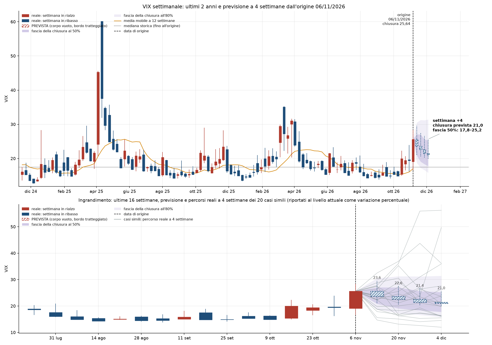
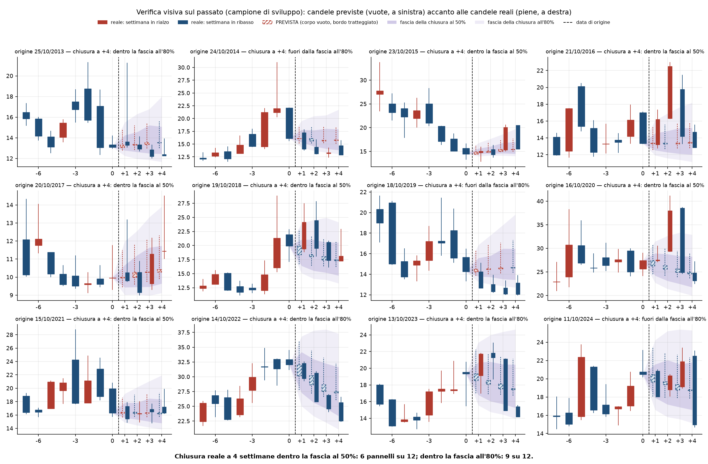

# Previsione del VIX settimanale — origine 06/11/2026

*Generato da `python -m src.forecast`. Storia usata: 1401 settimane complete dal 07/01/2000 al 06/11/2026
(file `VIX_settimanale_2000-2026.csv`; settimane incomplete escluse: 1). Tutto ciò che segue usa solo dati fino all'origine.
Progetto universitario: non è un consiglio di investimento.*

## In sintesi

- Il VIX ha chiuso a 25,64 il 06/11/2026: si colloca al percentile 83 di tutta la storia e al percentile 87 degli ultimi 5 anni (fascia 25-30).
- È 8,16 punti sopra la mediana storica (17,48) e 8,62 punti sopra la media a 12 settimane (17,02); nelle ultime 4 settimane è salito del 72,8%.
- Nei 61 precedenti con la stessa fascia e direzione (25-30, in rialzo) il VIX era più alto dopo 4 settimane nel 30% dei casi, con variazione mediana di −2,07 punti.
- Per la settimana +4 il modello indica una chiusura mediana di 21,0, con fascia all'80% tra 15,8 e 31,4; la probabilità di una chiusura sopra 20 è 63%, sopra 30 è 8%.

## 1. Lettura della situazione

**1. Livello.** Chiusura 25,64. Percentile rispetto a tutta la storia (1401 settimane dal 07/01/2000): 83°; rispetto agli ultimi 5 anni (260 settimane): 87°. Fascia: **25-30**.

**2. Riferimenti.**

| riferimento | valore | distanza dell'attuale (punti) | distanza (%) |
|---|---|---|---|
| media a 4 settimane | 21,12 | +4,52 | +21,4% |
| media a 12 settimane | 17,02 | +8,62 | +50,6% |
| mediana degli ultimi 5 anni | 17,60 | +8,04 | +45,7% |
| mediana di tutta la storia | 17,48 | +8,16 | +46,7% |

**3. Dinamica.** Variazione della chiusura: a 1 settimana +6,22 punti (+32,0%); a 4 settimane +10,80 punti (+72,8%); a 12 settimane +11,39 punti (+79,9%). Nelle ultime 12 settimane le chiusure sono state tra 14,43 e 25,64. Ampiezza tipica dei movimenti settimanali (mediana della variazione assoluta): 3,8% nelle ultime 12 settimane, contro 7,6% nell'intera storia (4° percentile dei periodi di 12 settimane).

**4. Contesto.** L'ultima chiusura a 30 o più risale a 32 settimane fa (27/03/2026); il picco di quell'episodio fu 31,05 il 27/03/2026.

**5. Precedenti per fascia × direzione.** Situazione attuale: fascia 25-30, direzione «in rialzo» (variazione log a 4 settimane +0,547; soglie ±0,10).

| dopo | casi | quota con VIX più alto | variazione mediana (punti) | 10° – 90° percentile (punti) |
|---|---|---|---|---|
| 1 settimana | 61 | 41% | −1,04 | −5,07 – +3,62 |
| 4 settimane | 61 | 30% | −2,07 | −9,30 – +6,15 |

**6. Casi simili** (20 casi). Selezione **solo illustrativa**: le situazioni passate più vicine secondo lo stato di M6 (livello, variazione a 4 e a 12 settimane, variabilità a 12 settimane), con almeno 8 settimane tra un caso e l'altro e con esito a 4 settimane già noto. **Non è il modello M6** e non entra nella previsione.

Dopo 4 settimane il VIX era più alto nel 30% dei casi; variazione mediana −18,8%.

| data | livello di allora | dopo 1 sett. | dopo 2 | dopo 3 | dopo 4 | chiusura dopo 4 sett. | minimo – massimo delle chiusure nelle 4 sett. |
|---|---|---|---|---|---|---|---|
| 03/08/2007 | 25,16 | +12,5% | +19,2% | −17,6% | −7,1% | 23,38 | 20,72 – 29,99 |
| 06/03/2026 | 29,49 | −7,8% | −9,2% | +5,3% | −19,1% | 23,87 | 23,87 – 31,05 |
| 02/08/2024 | 23,39 | −12,9% | −36,7% | −32,2% | −35,9% | 15,00 | 14,80 – 20,37 |
| 24/06/2016 | 25,76 | −42,7% | −48,8% | −50,8% | −53,3% | 12,02 | 12,02 – 14,77 |
| 12/10/2018 | 21,31 | −6,7% | +13,4% | −8,4% | −18,5% | 17,36 | 17,36 – 24,16 |
| 18/03/2011 | 24,44 | −26,7% | −28,8% | −26,9% | −37,3% | 15,32 | 15,32 – 17,91 |
| 21/06/2002 | 27,23 | −6,7% | −0,4% | +21,0% | +40,2% | 38,17 | 25,40 – 38,17 |
| 21/11/2025 | 23,43 | −30,2% | −34,2% | −32,8% | −36,4% | 14,91 | 14,91 – 16,35 |
| 18/05/2012 | 25,10 | −13,3% | +6,2% | −15,4% | −15,9% | 21,11 | 21,11 – 26,66 |
| 29/04/2022 | 33,40 | −9,6% | −13,6% | −11,9% | −23,0% | 25,72 | 25,72 – 30,19 |
| 28/12/2012 | 22,72 | −39,1% | −41,2% | −45,2% | −43,3% | 12,89 | 12,46 – 13,83 |
| 19/09/2008 | 32,07 | +8,3% | +40,8% | +118,1% | +119,3% | 70,33 | 34,74 – 70,33 |
| 13/10/2000 | 27,60 | −12,2% | −4,1% | −14,2% | +3,4% | 28,53 | 23,67 – 28,53 |
| 17/10/2014 | 21,99 | −26,7% | −36,2% | −40,3% | −39,5% | 13,31 | 13,12 – 16,11 |
| 18/01/2008 | 27,18 | +7,0% | −11,6% | +3,1% | −7,9% | 25,02 | 24,02 – 29,08 |
| 07/03/2025 | 23,37 | −6,8% | −17,5% | −7,4% | +93,9% | 45,31 | 19,28 – 45,31 |
| 26/11/2021 | 28,62 | +7,2% | −34,7% | −24,6% | −37,2% | 17,96 | 17,96 – 30,67 |
| 07/09/2001 | 30,99 | +2,7% | +37,7% | +3,0% | +7,7% | 33,39 | 31,84 – 42,66 |
| 14/04/2000 | 33,49 | −22,8% | −21,8% | −17,8% | −22,2% | 26,05 | 25,85 – 27,53 |
| 29/07/2011 | 25,25 | +26,7% | +44,0% | +70,5% | +41,0% | 35,59 | 32,00 – 43,05 |

## 2. Previsione per le prossime 4 settimane

Valori in punti VIX. Chiusura = mediana del modello D4; fasce = quantili di D4; probabilità = modello D1; massimo e minimo = regressione dedicata.
Accanto a ogni fascia, tra parentesi, la **copertura storica**: la frequenza con cui la chiusura reale è caduta dentro la fascia nel walk-forward di sviluppo
(927 previsioni a h = 4, obiettivi dal 09/02/2007 al 08/11/2024). Le fasce non sono ricalibrate: coprono meno del valore nominale.
Ultima colonna: errore assoluto medio storico (punti VIX) di chiusura, massimo e minimo, misurato nello stesso walk-forward.

|   settimana | data       | apertura   | massimo   | minimo   | chiusura   | fascia 50% (copertura storica)   | fascia 80% (copertura storica)   | fascia 90% (copertura storica)   | P(VIX > 20)   | P(VIX > 25)   | P(VIX > 30)   | errore medio storico: chiusura / massimo / minimo   |
|------------:|:-----------|:-----------|:----------|:---------|:-----------|:---------------------------------|:---------------------------------|:---------------------------------|:--------------|:--------------|:--------------|:----------------------------------------------------|
|          +1 | 13/11/2026 | 25,64      | 29,61     | 21,07    | 23,61      | 20,8 – 27,1 (44%)                | 18,7 – 30,5 (73%)                | 17,7 – 33,6 (84%)                | 93,2%         | 31,0%         | 6,1%          | 2,2 / 2,1 / 1,2                                     |
|          +2 | 20/11/2026 | 23,61      | 27,57     | 20,60    | 22,60      | 19,1 – 27,0 (43%)                | 17,2 – 31,3 (72%)                | 16,1 – 36,6 (84%)                | 81,9%         | 25,6%         | 7,5%          | 2,8 / 3,3 / 1,8                                     |
|          +3 | 27/11/2026 | 22,60      | 26,59     | 20,31    | 21,45      | 18,4 – 25,6 (45%)                | 16,6 – 31,2 (73%)                | 15,5 – 38,1 (84%)                | 70,1%         | 23,4%         | 7,9%          | 3,2 / 4,0 / 2,2                                     |
|          +4 | 04/12/2026 | 21,45      | 25,68     | 19,99    | 21,03      | 17,8 – 25,2 (44%)                | 15,8 – 31,4 (73%)                | 15,0 – 37,6 (84%)                | 63,1%         | 21,0%         | 8,2%          | 3,5 / 4,4 / 2,5                                     |

Nessuna candela ha richiesto la correzione dei vincoli su massimo e minimo.
Le date sono indicative (origine + 7 giorni per settimana): la chiusura settimanale è quella dell'ultima seduta della settimana.

## 3. Grafico

Il grafico in alto mostra gli ultimi 2 anni. I percorsi dei casi simili sono nel pannello in basso (ingrandimento sulle ultime 16 settimane): nel grafico
a 2 anni le quattro settimane di previsione occupano troppo poco spazio per ospitarli senza coprire candele e fasce.

### Come leggere il grafico

- **Candele piene** = settimane reali (apertura, massimo, minimo, chiusura del file). Rosso: chiusura sopra l'apertura; blu: chiusura sotto l'apertura.
- **Candele vuote con bordo tratteggiato** = le quattro settimane previste. Il corpo va dalla chiusura prevista della settimana precedente (per la prima: l'ultima chiusura reale) alla chiusura prevista; **le ombre indicano l'escursione attesa dentro la settimana** (massimo e minimo previsti), non un intervallo di confidenza.
- **Le fasce colorate sullo sfondo indicano l'incertezza sulla chiusura**: la più scura è la fascia al 50%, la più chiara quella all'80%. La chiusura reale è caduta dentro queste fasce con la frequenza riportata in tabella («copertura storica»), che è più bassa del valore nominale.
- **Ombre e fasce misurano cose diverse.** Un'ombra lunga dice che dentro la settimana il VIX può allontanarsi molto dalla chiusura; una fascia larga dice che la chiusura stessa è incerta.
- **Linea tratteggiata verticale** = data di origine: a destra tutto è previsione. **Linea arancione** = media mobile a 12 settimane; **linea punteggiata** = mediana storica.
- **Linee grigie sottili** (pannello di ingrandimento) = cosa è successo davvero nelle 4 settimane successive ai casi simili del passato, riportato al livello attuale come variazione percentuale. Servono a dare un'idea della varietà degli esiti; non sono una previsione.

## 4. Verifica visiva sul passato

Dodici origini scelte con regola fissa (12 origini, una ogni 52 settimane a ritroso a partire da 4 settimane prima dell'ultima data di sviluppo): tutte le origini e tutti gli esiti stanno nel campione di sviluppo. Chiusura reale a 4 settimane dentro la fascia al 50%: 6 pannelli su 12; dentro la fascia all'80%: 9 su 12.
Dodici casi sono pochi: servono a vedere come si comporta la previsione, non a misurarla. Le misure sono nel report `fase2b_report.md`.

## 5. Avvertenze

- Le fasce coprono meno del nominale: a 4 settimane la fascia al 50% ha contenuto la chiusura reale nel 44% dei casi, quella all'80% nel 73%, quella al 90% nel 84%.
- Fasce (modello D4) e probabilità (modello D1) vengono da due modelli diversi e possono non essere perfettamente coerenti tra loro.
- Il modello non anticipa i picchi: nelle fasi precedenti nessuna variabile costruita sul solo VIX li ha previsti. Le probabilità di superare 25 e 30 sono frequenze condizionate al livello attuale, non segnali.
- La previsione usa solo lo storico del VIX. Nessun dato esterno.
