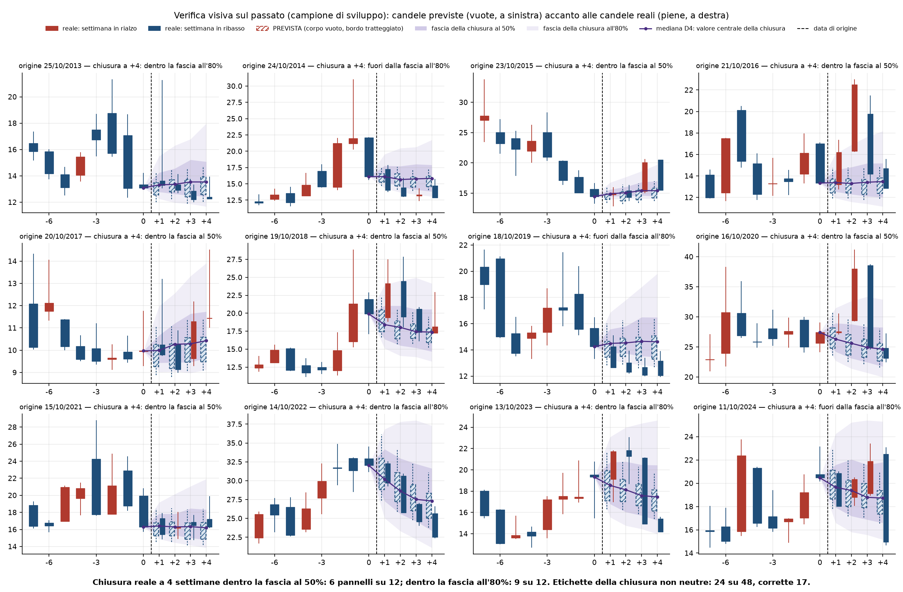

# Previsione del VIX settimanale — origine 06/11/2026

*Generato da `python -m src.forecast`. Versione principale: **F1 solo storico del VIX**. Storia usata: 1401 settimane complete dal 07/01/2000 al 06/11/2026
(file `VIX_settimanale_2000-2026.csv`; settimane incomplete escluse: 1). Tutto ciò che segue usa solo dati fino all'origine.
Progetto universitario: non è un consiglio di investimento.*

## In sintesi

- Il VIX ha chiuso a 25,64 il 06/11/2026: si colloca al percentile 83 di tutta la storia e al percentile 87 degli ultimi 5 anni (fascia 25-30).
- È 8,16 punti sopra la mediana storica (17,48) e 8,62 punti sopra la media a 12 settimane (17,02); nelle ultime 4 settimane è salito del 72,8%.
- Nei 61 precedenti con la stessa fascia e direzione (25-30, in rialzo) il VIX era più alto dopo 4 settimane nel 30% dei casi, con variazione mediana di −2,07 punti.
- Versione F1 solo storico del VIX: per la settimana +4 la chiusura centrale è 21,0, con fascia all'80% tra 15,8 e 31,4; la probabilità di una chiusura sopra 20 è 63%, sopra 30 è 8%.
- Rispetto alla chiusura dell'origine (25,64), la direzione della chiusura è in ribasso (probabilità 74%) per la settimana +1 e in ribasso (probabilità 81%) per la settimana +4.
- Candela prevista per la settimana +1: apertura 26,5, chiusura 21,8, escursione attesa tra 20,8 e 28,4 (ampiezze medie recenti; il corpo è disegnato nella direzione storicamente più frequente).

## 1. Lettura della situazione

**1. Livello.** Chiusura 25,64. Percentile rispetto a tutta la storia (1401 settimane dal 07/01/2000): 83°; rispetto agli ultimi 5 anni (260 settimane): 87°. Fascia: **25-30**.

**2. Riferimenti.**

| riferimento | valore | distanza dell'attuale (punti) | distanza (%) |
|---|---|---|---|
| media a 4 settimane | 21,12 | +4,52 | +21,4% |
| media a 12 settimane | 17,02 | +8,62 | +50,6% |
| mediana degli ultimi 5 anni | 17,60 | +8,04 | +45,7% |
| mediana di tutta la storia | 17,48 | +8,16 | +46,7% |

**3. Dinamica.** Variazione della chiusura: a 1 settimana +6,22 punti (+32,0%); a 4 settimane +10,80 punti (+72,8%); a 12 settimane +11,39 punti (+79,9%). Nelle ultime 12 settimane le chiusure sono state tra 14,43 e 25,64. Ampiezza tipica dei movimenti settimanali (mediana della variazione assoluta): 3,8% nelle ultime 12 settimane, contro 7,6% nell'intera storia (4° percentile dei periodi di 12 settimane).

**4. Contesto.** L'ultima chiusura a 30 o più risale a 32 settimane fa (27/03/2026); il picco di quell'episodio fu 31,05 il 27/03/2026.

**5. Precedenti per fascia × direzione.** Situazione attuale: fascia 25-30, direzione «in rialzo» (variazione log a 4 settimane +0,547; soglie ±0,10).

| dopo | casi | quota con VIX più alto | variazione mediana (punti) | 10° – 90° percentile (punti) |
|---|---|---|---|---|
| 1 settimana | 61 | 41% | −1,04 | −5,07 – +3,62 |
| 4 settimane | 61 | 30% | −2,07 | −9,30 – +6,15 |

**6. Casi simili** (20 casi). Selezione **solo illustrativa**: le situazioni passate più vicine secondo lo stato di M6 (livello, variazione a 4 e a 12 settimane, variabilità a 12 settimane), con almeno 8 settimane tra un caso e l'altro e con esito a 4 settimane già noto. **Non è il modello M6** e non entra nella previsione.

Dopo 4 settimane il VIX era più alto nel 30% dei casi; variazione mediana −18,8%.

| data | livello di allora | dopo 1 sett. | dopo 2 | dopo 3 | dopo 4 | chiusura dopo 4 sett. | minimo – massimo delle chiusure nelle 4 sett. |
|---|---|---|---|---|---|---|---|
| 03/08/2007 | 25,16 | +12,5% | +19,2% | −17,6% | −7,1% | 23,38 | 20,72 – 29,99 |
| 06/03/2026 | 29,49 | −7,8% | −9,2% | +5,3% | −19,1% | 23,87 | 23,87 – 31,05 |
| 02/08/2024 | 23,39 | −12,9% | −36,7% | −32,2% | −35,9% | 15,00 | 14,80 – 20,37 |
| 24/06/2016 | 25,76 | −42,7% | −48,8% | −50,8% | −53,3% | 12,02 | 12,02 – 14,77 |
| 12/10/2018 | 21,31 | −6,7% | +13,4% | −8,4% | −18,5% | 17,36 | 17,36 – 24,16 |
| 18/03/2011 | 24,44 | −26,7% | −28,8% | −26,9% | −37,3% | 15,32 | 15,32 – 17,91 |
| 21/06/2002 | 27,23 | −6,7% | −0,4% | +21,0% | +40,2% | 38,17 | 25,40 – 38,17 |
| 21/11/2025 | 23,43 | −30,2% | −34,2% | −32,8% | −36,4% | 14,91 | 14,91 – 16,35 |
| 18/05/2012 | 25,10 | −13,3% | +6,2% | −15,4% | −15,9% | 21,11 | 21,11 – 26,66 |
| 29/04/2022 | 33,40 | −9,6% | −13,6% | −11,9% | −23,0% | 25,72 | 25,72 – 30,19 |
| 28/12/2012 | 22,72 | −39,1% | −41,2% | −45,2% | −43,3% | 12,89 | 12,46 – 13,83 |
| 19/09/2008 | 32,07 | +8,3% | +40,8% | +118,1% | +119,3% | 70,33 | 34,74 – 70,33 |
| 13/10/2000 | 27,60 | −12,2% | −4,1% | −14,2% | +3,4% | 28,53 | 23,67 – 28,53 |
| 17/10/2014 | 21,99 | −26,7% | −36,2% | −40,3% | −39,5% | 13,31 | 13,12 – 16,11 |
| 18/01/2008 | 27,18 | +7,0% | −11,6% | +3,1% | −7,9% | 25,02 | 24,02 – 29,08 |
| 07/03/2025 | 23,37 | −6,8% | −17,5% | −7,4% | +93,9% | 45,31 | 19,28 – 45,31 |
| 26/11/2021 | 28,62 | +7,2% | −34,7% | −24,6% | −37,2% | 17,96 | 17,96 – 30,67 |
| 07/09/2001 | 30,99 | +2,7% | +37,7% | +3,0% | +7,7% | 33,39 | 31,84 – 42,66 |
| 14/04/2000 | 33,49 | −22,8% | −21,8% | −17,8% | −22,2% | 26,05 | 25,85 – 27,53 |
| 29/07/2011 | 25,25 | +26,7% | +44,0% | +70,5% | +41,0% | 35,59 | 32,00 – 43,05 |

## 2. Previsione per le prossime 4 settimane (F1 solo storico del VIX)

Valori in punti VIX. Due livelli, da leggere insieme.

**Candele previste** (A1 media su 260 settimane, regressione su 520): una settimana di dimensioni medie. La colonna «chiusura rispetto all'origine»
è l'etichetta scritta sopra le candele nel grafico: direzione della chiusura rispetto alla chiusura dell'origine, «neutra» tra 40% e 60%.

|   settimana | data       | apertura   | massimo   | minimo   | chiusura   | chiusura rispetto all'origine   | probabilità che chiuda sopra l'origine   | chiusura centrale   | errore medio storico della candela: apertura / massimo / minimo / chiusura   |
|------------:|:-----------|:-----------|:----------|:---------|:-----------|:--------------------------------|:-----------------------------------------|:--------------------|:-----------------------------------------------------------------------------|
|          +1 | 13/11/2026 | 26,46      | 28,41     | 20,82    | 21,80      | ribasso 74%                     | 26%                                      | 23,61               | 0,7 / 2,1 / 1,4 / 2,4                                                        |
|          +2 | 20/11/2026 | 24,36      | 26,16     | 19,47    | 20,38      | ribasso 79%                     | 21%                                      | 22,60               | 2,3 / 3,4 / 1,9 / 3,0                                                        |
|          +3 | 27/11/2026 | 23,32      | 25,05     | 19,89    | 20,83      | ribasso 79%                     | 21%                                      | 21,45               | 2,9 / 3,9 / 2,3 / 3,4                                                        |
|          +4 | 04/12/2026 | 22,13      | 23,77     | 18,88    | 19,77      | ribasso 81%                     | 19%                                      | 21,03               | 3,2 / 4,3 / 2,5 / 3,6                                                        |

**Chiusura centrale, fasce e probabilità** (chiusura centrale: mediana D4; probabilità: modello D1). Tra parentesi la copertura storica di ogni fascia,
cioè la frequenza con cui la chiusura reale vi è caduta nel walk-forward di sviluppo (927 previsioni a 4 settimane; tutte le origini di sviluppo dal 2006). Le fasce non sono ricalibrate.

|   settimana | chiusura centrale   | fascia 50% (copertura storica)   | fascia 80% (copertura storica)   | fascia 90% (copertura storica)   | P(VIX > 20)   | P(VIX > 25)   | P(VIX > 30)   | errore medio storico della chiusura centrale   |
|------------:|:--------------------|:---------------------------------|:---------------------------------|:---------------------------------|:--------------|:--------------|:--------------|:-----------------------------------------------|
|          +1 | 23,61               | 20,8 – 27,1 (44%)                | 18,7 – 30,5 (73%)                | 17,7 – 33,6 (84%)                | 93,2%         | 31,0%         | 6,1%          | 2,2                                            |
|          +2 | 22,60               | 19,1 – 27,0 (43%)                | 17,2 – 31,3 (72%)                | 16,1 – 36,6 (84%)                | 81,9%         | 25,6%         | 7,5%          | 2,8                                            |
|          +3 | 21,45               | 18,4 – 25,6 (45%)                | 16,6 – 31,2 (73%)                | 15,5 – 38,1 (84%)                | 70,1%         | 23,4%         | 7,9%          | 3,2                                            |
|          +4 | 21,03               | 17,8 – 25,2 (44%)                | 15,8 – 31,4 (73%)                | 15,0 – 37,6 (84%)                | 63,1%         | 21,0%         | 8,2%          | 3,5                                            |

- L'**etichetta della chiusura** nel walk-forward di sviluppo è stata «neutra» nel 69% dei casi a 1 settimana e nel 57% a 4; quando non era neutra
  è stata corretta nel 64% dei casi a 1 settimana (291 casi) e nel 71% a 4 (394 casi).
- Il **corpo** della candela è disegnato nella direzione storicamente più frequente (chiusura sotto l'apertura nel 65% delle settimane passate):
  è una frequenza, non una previsione.
- Gli errori storici sono errori assoluti medi in punti VIX misurati sul campione di sviluppo. Le date sono indicative (origine + 7 giorni per settimana).

## 3. Confronto tra le versioni

Le versioni sono costruite allo stesso modo e differiscono per le informazioni usate. In questa scheda la versione principale è **F1 solo storico del VIX**.

|   settimana | versione                           | chiusura centrale   | fascia 50%   | fascia 80%   | chiusura rispetto all'origine   | probabilità che chiuda sopra l'origine   | P(VIX > 20)   | P(VIX > 30)   |
|------------:|:-----------------------------------|:--------------------|:-------------|:-------------|:--------------------------------|:-----------------------------------------|:--------------|:--------------|
|          +1 | F1 solo storico del VIX            | 23,61               | 20,8 – 27,1  | 18,7 – 30,5  | ribasso 74%                     | 26%                                      | 93%           | 6%            |
|          +1 | F2 con struttura a termine (VIX3M) | 23,01               | 20,4 – 26,6  | 18,2 – 30,2  | ribasso 80%                     | 20%                                      | 90%           | 6%            |
|          +1 | F3 modello a regimi (N1)           | 22,98               | 20,9 – 26,4  | 19,4 – 30,2  | ribasso 70%                     | 30%                                      | 85%           | 10%           |
|          +2 | F1 solo storico del VIX            | 22,60               | 19,1 – 27,0  | 17,2 – 31,3  | ribasso 79%                     | 21%                                      | 82%           | 7%            |
|          +2 | F2 con struttura a termine (VIX3M) | 21,76               | 18,2 – 26,1  | 16,4 – 32,2  | ribasso 81%                     | 19%                                      | 71%           | 7%            |
|          +2 | F3 modello a regimi (N1)           | 22,06               | 19,6 – 25,5  | 17,7 – 30,1  | ribasso 76%                     | 24%                                      | 71%           | 10%           |
|          +3 | F1 solo storico del VIX            | 21,45               | 18,4 – 25,6  | 16,6 – 31,2  | ribasso 79%                     | 21%                                      | 70%           | 8%            |
|          +3 | F2 con struttura a termine (VIX3M) | 20,10               | 17,6 – 25,1  | 16,0 – 30,0  | ribasso 82%                     | 18%                                      | 60%           | 7%            |
|          +3 | F3 modello a regimi (N1)           | 21,55               | 18,8 – 25,1  | 16,6 – 29,9  | ribasso 77%                     | 23%                                      | 64%           | 10%           |
|          +4 | F1 solo storico del VIX            | 21,03               | 17,8 – 25,2  | 15,8 – 31,4  | ribasso 81%                     | 19%                                      | 63%           | 8%            |
|          +4 | F2 con struttura a termine (VIX3M) | 19,94               | 16,7 – 23,7  | 15,3 – 31,2  | ribasso 85%                     | 15%                                      | 51%           | 7%            |
|          +4 | F3 modello a regimi (N1)           | 21,19               | 18,2 – 25,0  | 15,9 – 29,8  | ribasso 78%                     | 22%                                      | 60%           | 10%           |

Dati usati da F2 per l'origine: VIX3M 24,60 e VIX 25,64 del 06/11/2026 (VIX3M / VIX − 1 = −0,041); file Cboe aggiornati fino al 13/11/2026, usati solo fino all'origine.

Stato del modello a regimi (F3) all'origine: probabilità del regime con livello medio più alto 98% (livelli medi dei due regimi: 16,2 e 19,4; ultima stima su 1378 settimane).

Le versioni sono state congelate nella Fase 4 (`versioni/*.json`) e saranno confrontate sull'holdout secondo `reports/piano_esame_holdout.md`.
Sul campione di sviluppo le differenze tra le versioni sono piccole (`reports/fase4_report.md`).

## 4. Grafico

In alto gli ultimi 2 anni; in basso l'ingrandimento sulle ultime 16 settimane, con i percorsi dei casi simili (nel grafico a 2 anni le quattro settimane
di previsione sono troppo strette per ospitarli).

### Come leggere il grafico

- **Candele piene** = settimane reali (apertura ufficiale della prima seduta, massimo, minimo, chiusura). Rosso: chiusura sopra l'apertura; blu: chiusura sotto l'apertura.
- **Candele vuote con bordo tratteggiato** = le quattro settimane previste. La candela mostra una settimana di **dimensioni medie**: apertura attesa, corpo e ombre di ampiezza media (medie delle ultime settimane, non di tutta la storia). Il corpo è disegnato nella direzione che nel passato è stata più frequente (frequenza storica, non una previsione).
- **Perché le candele previste sono blu.** L'apertura ufficiale del VIX è di norma più alta della chiusura precedente (mediana storica: +3,1%) e nel passato la settimana ha chiuso sotto la propria apertura nel 65% dei casi. **Il colore della candela non dice dove chiuderà il VIX rispetto a oggi.**
- **La scritta sopra ogni candela dice dove chiuderà il VIX rispetto alla chiusura dell'origine** (per la settimana +1 è la chiusura della settimana prima): «rialzo» o «ribasso» con la sua probabilità (modello D1), oppure **«neutra» quando la probabilità è tra 40% e 60%**. Nel walk-forward di sviluppo l'etichetta è stata «neutra» nel 69% dei casi a 1 settimana e nel 57% a 4; quando non era neutra è stata corretta nel 64% dei casi a 1 settimana e nel 71% a 4.
- **La linea arancione spessa è il livello recente (media delle chiusure delle ultime 12 settimane): è il riferimento principale.** Il tratteggio la prolunga fino alla settimana +4. La mediana storica (linea grigia punteggiata) resta in secondo piano.
- **La linea viola con i punti è la chiusura centrale (mediana D4).** Dove la candela si allontana dalla linea si vede la differenza tra «una settimana di dimensioni medie» e «il centro di tutte le chiusure possibili».
- **Le fasce colorate sullo sfondo indicano l'incertezza sulla chiusura**: la più scura è la fascia al 50%, la più chiara quella all'80%. La copertura misurata nel passato è in tabella.
- **Le ombre delle candele indicano l'escursione media dentro la settimana**, non un intervallo di confidenza: nel walk-forward di sviluppo la chiusura reale è caduta dentro l'escursione prevista nel 62% dei casi a 1 settimana e nel 47% a 4.
- **Linea tratteggiata verticale** = data di origine: a destra tutto è previsione.
- **Linee grigie sottili** (pannello di ingrandimento) = cosa è successo davvero nelle 4 settimane successive ai casi simili del passato, riportato al livello attuale. Non sono una previsione.

## 5. Verifica visiva sul passato

Dodici origini scelte con regola fissa (12 origini, una ogni 52 settimane a ritroso a partire da 4 settimane prima dell'ultima data di sviluppo), tutte nel campione di sviluppo, con la versione F1. Chiusura reale a 4 settimane dentro la fascia al 50%: 6 pannelli su 12; dentro la fascia all'80%: 9 su 12. Etichette della chiusura non neutre: 24 su 48, corrette 17.
Dodici casi sono pochi: servono a vedere come si comporta la previsione, non a misurarla. Le misure sono in `fase4_report.md`.

## 6. Avvertenze

- Le candele previste restano un po' più piccole di quelle reali: nel walk-forward, a 1 settimana, il rapporto tra corpo medio previsto e reale è 91% e quello tra escursione prevista e reale è 89%.
- La chiusura della candela **non** è la previsione centrale della chiusura: quella è la chiusura centrale (linea viola).
- Copertura misurata delle fasce a 4 settimane: quella al 50% ha contenuto la chiusura reale nel 44% dei casi, quella all'80% nel 73%, quella al 90% nel 84%.
- Candele, fasce e probabilità vengono da pezzi diversi del modello e possono non essere perfettamente coerenti tra loro.
- Il modello non anticipa i picchi.
- Ogni esecuzione senza `--origine` scrive le versioni calcolate in `reports/registro_previsioni.csv` (una riga per origine, versione e settimana); `python -m src.forecast --verifica` confronta il registro con le settimane completate.
