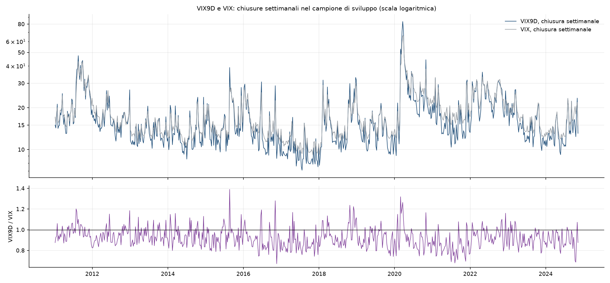
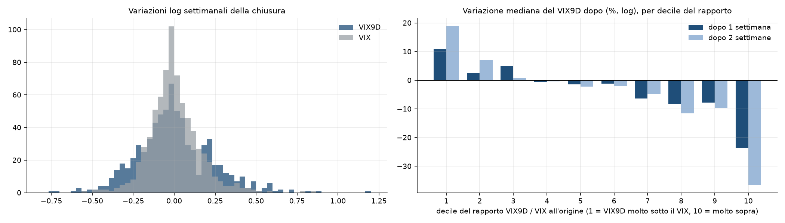
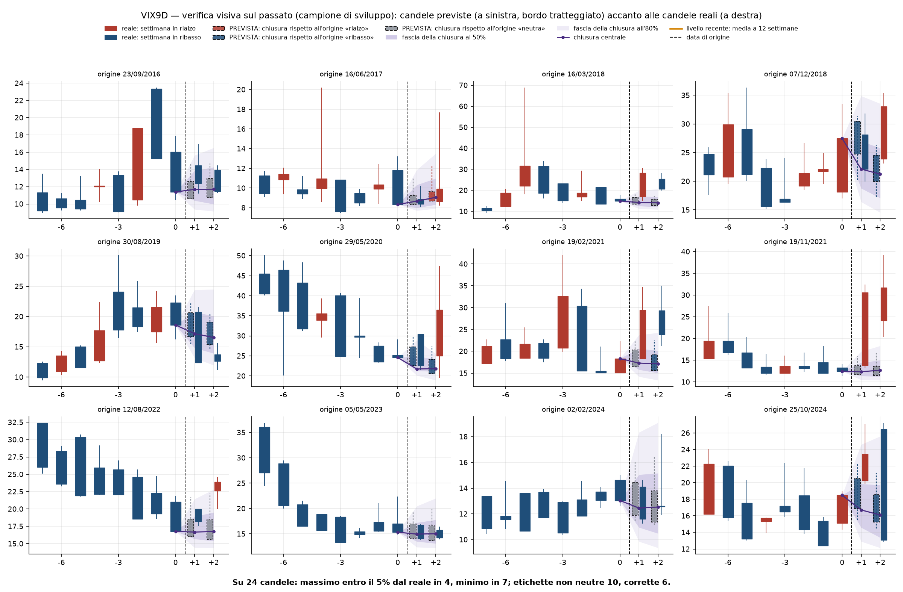

# Fase 9D-1 — VIX9D settimanale: fondamenta, modelli e programma

*Generato da `python -m src.vix9d.run_fase1`. Tutti i numeri vengono dai file in `reports/vix9d/`, prodotti dal codice sul solo campione di sviluppo
(2011-01-07 → 2024-11-08, 723 settimane). Le 104 settimane successive al confine sono salvate a parte e bloccate dalla guardia: nessuna misura le usa.
Il lavoro sul VIX resta fermo: le versioni F1 e FS sono congelate e il loro esame sull'holdout non è stato eseguito.*

## Sintesi in 10 righe

1. **Dati.** VIX9D giornaliero ufficiale Cboe, candele settimanali con le convenzioni del VIX: 723 settimane di sviluppo dal 2011-01-07. Fino al 2013-11-15 il file Cboe ha solo le chiusure: le candele vere sono 573 (dal 2013-11-22).
2. **Il VIX9D si muove molto più del VIX**: deviazione standard delle variazioni settimanali 0,241 contro 0,154; chiude oltre +20% sulla settimana prima nel 20,9% delle settimane (VIX: 10,0%) e torna verso la media più in fretta (mezza vita 3,1 settimane contro 5,7).
3. **Rapporto VIX9D / VIX**: mediana 0,917, sopra 1 nel 18% delle settimane. Dopo gli estremi il VIX9D rientra: nel decile più basso del rapporto la variazione mediana della settimana dopo è +11,0%, nel più alto -23,8%.
4. **Chiusura.** Il modello tipo HAR (R1) batte il random walk: R² fuori campione +9,8% a 1 settimana e +16,6% a 2 (425 e 423 previsioni). La candela del VIX9D (R3) non aggiunge nulla; il rapporto con il VIX (R2) sì: +3,5% e +7,4% su R1.
5. **Fasce.** Coperture vicine al nominale: 50% / 81% / 90% a 1 settimana e 49% / 79% / 89% a 2 (fasce al 50 / 80 / 90%), ma larghe: la fascia all'80% misura in media 9,6 punti a 1 settimana.
6. **Direzione.** La logistica di base indovina il verso nel 61% dei casi a 1 settimana e nel 64% a 2; l'etichetta è non neutra nel 42% e nel 58% dei casi, ed è allora corretta nel 69% e nel 70%.
7. **Massimo e minimo.** Entro il 5% dal reale: massimo 25% e minimo 30% per la candela +1; 17% e 25% per la +2. La regola fissa fa 26% e 27% sulla +1: i modelli la migliorano poco.
8. **Versioni.** G1 (solo VIX9D): R1 per chiusura e fasce, S0 per gli estremi, logistica di base. GS (con il VIX): R2 per la chiusura; direzione con il rapporto solo a 2 settimane; minimo della +2 con S2. Entrambe congelate in `versioni/vix9d/`.
9. **Quanto aggiunge il VIX**: 4 confronti su 8 superano la regola (chiusura, +1; chiusura, +2; direzione, +2; minimo, +2); negli altri (direzione, +1; massimo, +1; massimo, +2; minimo, +1) GS resta uguale a G1. In punti: l'errore medio della chiusura centrale passa da 3,06 a 3,01 (+1) e da 3,81 a 3,67 (+2).
10. **Rispetto al VIX** l'errore sulla chiusura in log è 1,59 volte più grande, quasi quanto il rapporto tra le variabilità dei due indici (1,56); massimo e minimo della +1 entro il 5% riescono nel 25% e nel 30% dei casi, contro 43% e 52% sul VIX. Programma: `python -m src.vix9d.forecast`. Piano d'esame scritto e non eseguito.

## 1. Audit dei dati

| voce | valore |
|---|---|
| fonte | Cboe Global Markets, VIX9D_History.csv (dati giornalieri ufficiali, OHLC) |
| sedute giornaliere nel campione di sviluppo | 3486 (2011-01-04 → 2024-11-08) |
| valori mancanti / non positivi / date duplicate | 0 / 0 / 0 |
| sedute con apertura, massimo, minimo e chiusura incoerenti | 0 |
| sedute con un solo valore (apertura = massimo = minimo = chiusura) | 722, l'ultima il 2013-11-15 |
| giorni feriali senza seduta (festività) | 128 |
| chiusura giornaliera minima / massima | 7,10 / 106,66 |
| variazioni giornaliere oltre il 30% in valore assoluto (log) | 149; oltre il 50%: 32 (elenco in `audit.json`) |
| settimane di sviluppo | 723 (2011-01-07 → 2024-11-08), settimane mancanti: 0 |
| settimane con meno di 5 sedute | 128 |
| settimane con sole chiusure / con candela vera | 150 / 573 (prima candela vera: 2013-11-22) |
| apertura della settimana / chiusura della settimana prima | mediana 1,110; 10° – 90° percentile 0,998 – 1,221; sopra 1 nel 85% delle 572 settimane |
| settimane senza VIX / con ultima seduta diversa da quella del VIX | 0 / 0 |
| settimane di holdout (bloccate) | 104 |

- **Convenzioni**: settimana da lunedì a venerdì; apertura = apertura ufficiale della prima seduta; massimo e minimo = estremi delle sedute; chiusura = chiusura dell'ultima seduta; settimana incompleta esclusa. Sono quelle del file del VIX.
- **Niente correzioni.** Nessun valore è stato modificato o rimosso. Le variazioni giornaliere molto grandi sono tante perché l'indice è fatto così (vedi sezione 2), non perché i dati siano sbagliati: non risultano valori incoerenti.
- **Le candele mancano fino a novembre 2013.** Le chiusure sono usate dal 2011; tutto ciò che richiede apertura, massimo o minimo usa solo le settimane con candela vera (colonna `candela`). Conseguenza: i modelli con la candela e le previsioni di massimo e minimo
  hanno la prima stima dopo 156 settimane con candela, cioè dal 2016-09-16.
- **File**: `data/vix9d/vix9d_weekly_dev.csv` è l'unico file del VIX9D letto dalle misure. Il file completo, il VIX settimanale ricostruito da Cboe e il file di holdout sono bloccati dalla guardia (`src/vix9d/dati.py`) e letti solo dal programma di previsione.
- Sulla parte di sviluppo il VIX settimanale ricostruito dai dati giornalieri Cboe coincide con quello del progetto (lo verifica un test).

## 2. Analisi compatta e confronto con il VIX

**Livelli e variazioni** (chiusure settimanali, stesse 723 settimane per i due indici):

| misura                                              | VIX9D              | VIX, stesse settimane   |
|:----------------------------------------------------|:-------------------|:------------------------|
| settimane                                           | 723                | 723                     |
| livello mediano                                     | 14,69              | 16,04                   |
| 5° – 95° percentile                                 | 9,2 – 30,7         | 11,2 – 30,7             |
| massimo                                             | 83,5               | 66,0                    |
| dev. std. delle variazioni log settimanali          | 0,241              | 0,154                   |
| variazione assoluta mediana                         | 13,7%              | 8,0%                    |
| settimane con rialzo oltre il 20%                   | 20,9% (151)        | 10,0% (72)              |
| oltre il 30%                                        | 12,3% (89)         | 4,6% (33)               |
| ribasso oltre il 20%                                | 14,1% (102)        | 5,0% (36)               |
| autocorrelazione del livello a 1 / 4 / 12 settimane | 0,80 / 0,57 / 0,35 | 0,89 / 0,70 / 0,47      |
| mezza vita di uno scostamento (settimane)           | 3,1                | 5,7                     |

- Il VIX9D sta in media un po' sotto il VIX (mediana 14,69 contro 16,04) ma ha code più lunghe: il suo massimo settimanale di chiusura è 83,5 contro 66,0.
- I due indici si muovono insieme (correlazione delle variazioni log settimanali 0,94), ma il VIX9D amplifica: la sua variazione tipica è 1,56 volte quella del VIX.
- Uno scostamento dalla media si dimezza in 3,1 settimane (VIX: 5,7). L'autocorrelazione delle variazioni a 1 settimana è -0,21 (VIX: -0,16): dopo un rialzo tende a seguire un ribasso, più che sul VIX.

**Candele** (solo settimane con candela vera):

| misura                                  | VIX9D   | VIX, stesse settimane   |
|:----------------------------------------|:--------|:------------------------|
| settimane con candela vera              | 573     | 573                     |
| corpo medio (log)                       | 0,203   | 0,116                   |
| escursione media (log)                  | 0,373   | 0,245                   |
| ombra superiore media (log)             | 0,113   | 0,081                   |
| ombra inferiore media (log)             | 0,057   | 0,047                   |
| settimane che chiudono sopra l'apertura | 27,1%   | 34,9%                   |
| massimo / chiusura precedente (mediana) | 1,250   | 1,124                   |
| minimo / chiusura precedente (mediana)  | 0,927   | 0,932                   |

- L'apertura ufficiale della settimana è di norma molto sopra la chiusura del venerdì precedente (mediana +11,0%), poi la settimana scende: solo il 27% delle settimane chiude sopra la propria apertura (VIX: 35%).
  Una spiegazione plausibile, non verificata qui, è il calendario: i 9 giorni dell'indice contengono due fine settimana il venerdì e uno solo il lunedì. Per la previsione conta il fatto, che è stabile; la candela prevista ne tiene conto (sezione 6).

**Per sottoperiodi:**

| sottoperiodo   |   settimane | livello mediano VIX9D   | livello mediano VIX   |   dev. std. variazioni VIX9D |   dev. std. variazioni VIX | rialzi oltre il 20%: VIX9D   | rialzi oltre il 20%: VIX   |   rapporto VIX9D / VIX mediano |
|:---------------|------------:|:------------------------|:----------------------|-----------------------------:|---------------------------:|:-----------------------------|:---------------------------|-------------------------------:|
| 2011-2014      |         208 | 14,86                   | 15,77                 |                        0,217 |                      0,140 | 22,7%                        | 10,1%                      |                          0,943 |
| 2015-2019      |         261 | 12,40                   | 13,78                 |                        0,258 |                      0,165 | 21,9%                        | 10,0%                      |                          0,905 |
| 2020-2024      |         254 | 17,32                   | 19,74                 |                        0,241 |                      0,153 | 18,2%                        | 9,5%                       |                          0,893 |

**Che cosa succede dopo gli estremi del rapporto VIX9D / VIX** (decili del rapporto alla chiusura settimanale; variazioni log del VIX9D):

|   decile del rapporto | rapporto VIX9D / VIX   |   casi | variazione mediana dopo 1 settimana   | VIX9D più alto dopo 1 settimana   | variazione mediana dopo 2 settimane   | VIX9D più alto dopo 2 settimane   |
|----------------------:|:-----------------------|-------:|:--------------------------------------|:----------------------------------|:--------------------------------------|:----------------------------------|
|                     1 | 0,67 – 0,80            |     73 | +11,0%                                | 70%                               | +18,9%                                | 84%                               |
|                     2 | 0,80 – 0,84            |     72 | +2,6%                                 | 62%                               | +7,0%                                 | 65%                               |
|                     3 | 0,84 – 0,87            |     72 | +5,0%                                 | 61%                               | +0,8%                                 | 53%                               |
|                     4 | 0,87 – 0,89            |     71 | -0,5%                                 | 45%                               | -0,5%                                 | 48%                               |
|                     5 | 0,89 – 0,92            |     73 | -1,4%                                 | 42%                               | -2,2%                                 | 49%                               |
|                     6 | 0,92 – 0,94            |     72 | -1,2%                                 | 49%                               | -2,0%                                 | 47%                               |
|                     7 | 0,94 – 0,96            |     72 | -6,4%                                 | 42%                               | -4,8%                                 | 40%                               |
|                     8 | 0,96 – 0,99            |     72 | -8,1%                                 | 25%                               | -11,5%                                | 25%                               |
|                     9 | 0,99 – 1,04            |     72 | -7,7%                                 | 36%                               | -9,6%                                 | 35%                               |
|                    10 | 1,04 – 1,39            |     73 | -23,8%                                | 19%                               | -36,5%                                | 19%                               |

- Il rapporto ha mediana 0,917 (5° – 95° percentile: 0,78 – 1,09) ed è sopra 1 nel 18% delle settimane.
- Quando il VIX9D è molto sotto il VIX (primo decile, 73 casi), la settimana dopo è più alto nel 70% dei casi e dopo due nel 84%. Quando è molto sopra (ultimo decile, 73 casi) è più alto solo nel 19% dei casi,
  con variazione mediana -23,8% a 1 settimana e -36,5% a 2. Questa tabella è descrittiva e usa tutto il campione: la misura fuori campione di quanto vale il rapporto è nelle sezioni 3-7.

## 3. Chiusura (Parte B)

Modelli della lista chiusa, stimati su log(VIX9D) con finestra espandibile e ristima a ogni origine; prima stima su almeno 156 settimane. **Origini comuni** = origini in cui esistono tutti i candidati: 425 a 1 settimana
(dal 2016-09-16) e 423 a 2. È il campione su cui si applicano le regole.

|   orizzonte | modello                           |   casi | RMSE log   | MAE log   | RMSE punti   | MAE punti   | entro 5%   | entro 10%   | entro 20%   | R² fuori campione contro R0   | R² fuori campione contro R1 [IC 95%]   | test                                        | p dopo Holm sui 6 confronti con R1   |
|------------:|:----------------------------------|-------:|:-----------|:----------|:-------------|:------------|:-----------|:------------|:------------|:------------------------------|:---------------------------------------|:--------------------------------------------|:-------------------------------------|
|          +1 | R0 random walk                    |    425 | 0,2400     | 0,1761    | 5,10         | 3,18        | 24,9%      | 40,2%       | 66,6%       | –                             | –                                      | –                                           | –                                    |
|          +1 | R1 tipo HAR (riferimento)         |    425 | 0,2280     | 0,1700    | 5,19         | 3,06        | 19,8%      | 35,8%       | 69,4%       | +9,8%                         | –                                      | Clark-West contro R0 (una coda): p < 0,0001 | –                                    |
|          +1 | R2 = R1 + ln(VIX9D/VIX)           |    425 | 0,2240     | 0,1690    | 5,00         | 3,03        | 18,6%      | 36,5%       | 66,4%       | +12,9%                        | +3,5% [+0,0%; +6,7%]                   | Clark-West (una coda): p = 0,0007           | 0,0030                               |
|          +1 | R3 = R1 + candela del VIX9D       |    425 | 0,2323     | 0,1739    | 5,25         | 3,11        | 17,9%      | 35,5%       | 68,5%       | +6,4%                         | -3,8% [-6,3%; -1,0%]                   | Clark-West (una coda): p = 0,8902           | 1,0000                               |
|          +1 | R4 = R1 + candela + ln(VIX9D/VIX) |    425 | 0,2267     | 0,1700    | 5,06         | 3,03        | 21,2%      | 36,5%       | 67,1%       | +10,8%                        | +1,1% [-2,6%; +4,4%]                   | Clark-West (una coda): p = 0,0061           | 0,0183                               |
|          +2 | R0 random walk                    |    423 | 0,3127     | 0,2300    | 6,83         | 4,24        | 18,9%      | 31,9%       | 53,4%       | –                             | –                                      | –                                           | –                                    |
|          +2 | R1 tipo HAR (riferimento)         |    423 | 0,2856     | 0,2129    | 6,66         | 3,84        | 13,5%      | 28,6%       | 57,4%       | +16,6%                        | –                                      | Clark-West contro R0 (una coda): p < 0,0001 | –                                    |
|          +2 | R2 = R1 + ln(VIX9D/VIX)           |    423 | 0,2748     | 0,2082    | 6,38         | 3,79        | 13,9%      | 28,8%       | 55,1%       | +22,8%                        | +7,4% [+2,9%; +11,3%]                  | Clark-West (una coda): p < 0,0001           | 0,0002                               |
|          +2 | R3 = R1 + candela del VIX9D       |    423 | 0,2934     | 0,2199    | 6,84         | 3,94        | 12,3%      | 27,4%       | 55,1%       | +12,0%                        | -5,6% [-9,7%; -1,0%]                   | Clark-West (una coda): p = 0,9325           | 1,0000                               |
|          +2 | R4 = R1 + candela + ln(VIX9D/VIX) |    423 | 0,2805     | 0,2113    | 6,54         | 3,82        | 13,7%      | 29,8%       | 54,6%       | +19,6%                        | +3,5% [-3,4%; +10,7%]                  | Clark-West (una coda): p = 0,0006           | 0,0030                               |

Per R0, R1 e R2, che non usano la candela, anche tutte le origini disponibili (567 a 1 settimana, dal 2013-12-27):

|   orizzonte | modello                   |   casi | RMSE log   | MAE log   | RMSE punti   | MAE punti   | entro 5%   | entro 10%   | entro 20%   | R² fuori campione contro R0   | R² fuori campione contro R1 [IC 95%]   | test                                        |
|------------:|:--------------------------|-------:|:-----------|:----------|:-------------|:------------|:-----------|:------------|:------------|:------------------------------|:---------------------------------------|:--------------------------------------------|
|          +1 | R0 random walk            |    567 | 0,2515     | 0,1831    | 5,07         | 3,19        | 24,3%      | 39,5%       | 64,4%       | –                             | –                                      | –                                           |
|          +1 | R1 tipo HAR (riferimento) |    567 | 0,2356     | 0,1759    | 5,02         | 3,04        | 18,9%      | 34,9%       | 67,4%       | +12,2%                        | –                                      | Clark-West contro R0 (una coda): p < 0,0001 |
|          +1 | R2 = R1 + ln(VIX9D/VIX)   |    567 | 0,2323     | 0,1751    | 4,87         | 3,02        | 16,8%      | 35,3%       | 64,7%       | +14,7%                        | +2,8% [-0,1%; +5,5%]                   | Clark-West (una coda): p = 0,0002           |
|          +2 | R0 random walk            |    565 | 0,3180     | 0,2354    | 6,61         | 4,20        | 18,2%      | 31,2%       | 52,6%       | –                             | –                                      | –                                           |
|          +2 | R1 tipo HAR (riferimento) |    565 | 0,2872     | 0,2168    | 6,29         | 3,76        | 12,9%      | 27,4%       | 56,3%       | +18,4%                        | –                                      | Clark-West contro R0 (una coda): p < 0,0001 |
|          +2 | R2 = R1 + ln(VIX9D/VIX)   |    565 | 0,2790     | 0,2129    | 6,07         | 3,72        | 13,8%      | 27,8%       | 54,7%       | +23,0%                        | +5,7% [+1,8%; +9,0%]                   | Clark-West (una coda): p < 0,0001           |

- **R1 batte R0** a entrambi gli orizzonti (Clark-West, p < 0,0001 e p < 0,0001). In punti però l'errore medio cala poco (3,18 → 3,06 a 1 settimana) e la quota entro il 5% è più bassa di quella del random walk
  (19,8% contro 24,9%): il modello guadagna sulle settimane lontane dalla media, non su quelle tranquille.
- **R3 (candela del VIX9D) non batte R1**: R² contro R1 -3,8% a 1 settimana e -5,6% a 2. Escursione e posizione della chiusura della settimana non aiutano a prevedere la chiusura successiva.
- **R2 (rapporto con il VIX) batte R1**: R² +3,5% [+0,0%; +6,7%] a 1 settimana e +7,4% [+2,9%; +11,3%] a 2; p dopo Holm nella famiglia della regola 0,0018 e 0,0001 (tabella della sezione 6).
  Anche R4 supera il test, ma con errore più alto di R2: la regola sceglie R2.
  Nella tabella qui sopra la correzione di Holm è fatta su tutti e 6 i confronti con R1 (più severa di quella per famiglia): R2 resta sotto il 5% a entrambi gli orizzonti.
- Entro il 10% dal valore reale cade circa il 36% delle previsioni a 1 settimana e il 29% a 2: è la misura di quanto resta imprevedibile.

## 4. Fasce, probabilità e direzione (Parte C)

**Fasce**: regressione quantilica ai quantili 5, 10, 25, 50, 75, 90, 95% sulle variabili del modello di chiusura. La chiusura centrale delle versioni è il quantile al 50%.

|   orizzonte | variabili del modello   |   casi | CRPS (7 quantili)   | CRPS contro R1     | copertura 50%   | larghezza 50% (punti)   | copertura 80%   | larghezza 80%   | copertura 90%   | larghezza 90%   |
|------------:|:------------------------|-------:|:--------------------|:-------------------|:----------------|:------------------------|:----------------|:----------------|:----------------|:----------------|
|          +1 | R1                      |    425 | 0,0981              | –                  | 50,1%           | 4,6                     | 80,7%           | 9,6             | 90,4%           | 13,0            |
|          +1 | R2                      |    425 | 0,0967              | +1,5% (p = 0,1678) | 52,0%           | 4,9                     | 79,1%           | 9,8             | 89,4%           | 13,2            |
|          +1 | R3                      |    425 | 0,1004              | -2,3% (p = 0,0093) | 50,8%           | 4,6                     | 81,2%           | 10,2            | 90,1%           | 14,1            |
|          +1 | R4                      |    425 | 0,0985              | -0,4% (p = 0,7843) | 50,8%           | 4,8                     | 81,9%           | 10,3            | 89,2%           | 13,9            |
|          +2 | R1                      |    423 | 0,1230              | –                  | 49,2%           | 5,2                     | 79,2%           | 11,0            | 88,9%           | 15,2            |
|          +2 | R2                      |    423 | 0,1170              | +4,9% (p = 0,0050) | 47,3%           | 5,2                     | 78,5%           | 11,5            | 90,5%           | 16,4            |
|          +2 | R3                      |    423 | 0,1281              | -4,1% (p = 0,0058) | 47,8%           | 5,1                     | 79,4%           | 11,7            | 89,4%           | 16,9            |
|          +2 | R4                      |    423 | 0,1205              | +2,1% (p = 0,3461) | 49,6%           | 5,4                     | 79,4%           | 12,3            | 89,1%           | 17,7            |

- Le coperture sono vicine al nominale per tutte le varianti. Il CRPS è calcolato sui 7 quantili (è un'approssimazione, la stessa usata per il VIX).
- Le fasce sono larghe perché l'indice lo è: quella al 90% misura in media 13,0 punti a 1 settimana, su un livello mediano di 14,7.

**Probabilità di chiudere sopra 20, 25, 30**: centro del modello di chiusura più la distribuzione degli errori passati (almeno 52 errori con esito già noto).

| versione   |   orizzonte |   soglia |   casi | frequenza dell'evento   | probabilità media prevista   | Brier   | Brier della frequenza storica   | Brier di «resta dov'è»   |
|:-----------|------------:|---------:|-------:|:------------------------|:-----------------------------|:--------|:--------------------------------|:-------------------------|
| G1         |          +1 |       20 |    425 | 26,1%                   | 24,8%                        | 0,0925  | 0,1930                          | 0,1412                   |
| G1         |          +1 |       25 |    425 | 12,7%                   | 12,1%                        | 0,0709  | 0,1109                          | 0,0988                   |
| G1         |          +1 |       30 |    425 | 6,6%                    | 6,2%                         | 0,0411  | 0,0615                          | 0,0565                   |
| G1         |          +2 |       20 |    423 | 26,2%                   | 23,7%                        | 0,1259  | 0,1936                          | 0,1915                   |
| G1         |          +2 |       25 |    423 | 12,8%                   | 11,8%                        | 0,0865  | 0,1114                          | 0,1371                   |
| G1         |          +2 |       30 |    423 | 6,6%                    | 6,4%                         | 0,0487  | 0,0618                          | 0,0851                   |
| GS         |          +1 |       20 |    425 | 26,1%                   | 24,6%                        | 0,0925  | 0,1930                          | 0,1412                   |
| GS         |          +1 |       25 |    425 | 12,7%                   | 12,2%                        | 0,0723  | 0,1109                          | 0,0988                   |
| GS         |          +1 |       30 |    425 | 6,6%                    | 6,4%                         | 0,0401  | 0,0615                          | 0,0565                   |
| GS         |          +2 |       20 |    423 | 26,2%                   | 24,1%                        | 0,1213  | 0,1936                          | 0,1915                   |
| GS         |          +2 |       25 |    423 | 12,8%                   | 12,2%                        | 0,0860  | 0,1114                          | 0,1371                   |
| GS         |          +2 |       30 |    423 | 6,6%                    | 6,7%                         | 0,0478  | 0,0618                          | 0,0851                   |

- Le probabilità hanno un Brier più basso sia della frequenza storica sia della regola «resta dov'è» a tutte le soglie e a entrambi gli orizzonti. La probabilità media prevista è vicina alla frequenza osservata dell'evento.

**Direzione** della chiusura rispetto all'origine: logistica con penalizzazione, variabili di R1 (base) e con ln(VIX9D/VIX). Etichetta «neutra» tra 40% e 60%.

|   orizzonte | modello                             |   casi | frequenza dei rialzi   | accuratezza   | Brier   | guadagno di Brier sulla frequenza   | guadagno di Brier sulla base [IC 95%]   | non neutre al 60%: quota, corrette (casi)   | non neutre al 65%: quota, corrette (casi)   | non neutre al 70%: quota, corrette (casi)   |
|------------:|:------------------------------------|-------:|:-----------------------|:--------------|:--------|:------------------------------------|:----------------------------------------|:--------------------------------------------|:--------------------------------------------|:--------------------------------------------|
|          +1 | frequenza storica                   |    425 | 45,4%                  | 54,6%         | 0,2484  | –                                   | –                                       | –                                           | –                                           | –                                           |
|          +1 | logistica di base (variabili di R1) |    425 | 45,4%                  | 61,2%         | 0,2309  | +7,1% (p = 0,0017)                  | –                                       | 42%, 69% (180)                              | 26%, 73% (111)                              | 15%, 78% (63)                               |
|          +1 | logistica con ln(VIX9D/VIX)         |    425 | 45,4%                  | 64,2%         | 0,2247  | +9,6% (p = 0,0005)                  | +2,7% [+0,5%; +5,0%]                    | 55%, 69% (233)                              | 35%, 73% (147)                              | 19%, 76% (80)                               |
|          +2 | frequenza storica                   |    423 | 46,3%                  | 53,7%         | 0,2494  | –                                   | –                                       | –                                           | –                                           | –                                           |
|          +2 | logistica di base (variabili di R1) |    423 | 46,3%                  | 64,1%         | 0,2230  | +10,6% (p = 0,0033)                 | –                                       | 58%, 70% (247)                              | 42%, 74% (176)                              | 25%, 78% (105)                              |
|          +2 | logistica con ln(VIX9D/VIX)         |    423 | 46,3%                  | 68,6%         | 0,2124  | +14,8% (p < 0,0001)                 | +4,8% [+2,0%; +7,6%]                    | 64%, 72% (271)                              | 48%, 75% (205)                              | 32%, 80% (134)                              |

Etichette separate per verso, alle tre soglie:

|   orizzonte | modello                             | soglia   | etichette «rialzo» (casi)   | «rialzo» corrette   |   etichette «ribasso» (casi) | «ribasso» corrette   |
|------------:|:------------------------------------|:---------|:----------------------------|:--------------------|-----------------------------:|:---------------------|
|          +1 | logistica di base (variabili di R1) | 60%      | 22                          | 68%                 |                          158 | 69%                  |
|          +1 | logistica di base (variabili di R1) | 65%      | 2 (meno di 20)              | 100%                |                          109 | 72%                  |
|          +1 | logistica di base (variabili di R1) | 70%      | 0 (meno di 20)              | –                   |                           63 | 78%                  |
|          +1 | logistica con ln(VIX9D/VIX)         | 60%      | 91                          | 65%                 |                          142 | 71%                  |
|          +1 | logistica con ln(VIX9D/VIX)         | 65%      | 53                          | 68%                 |                           94 | 76%                  |
|          +1 | logistica con ln(VIX9D/VIX)         | 70%      | 25                          | 76%                 |                           55 | 76%                  |
|          +2 | logistica di base (variabili di R1) | 60%      | 89                          | 71%                 |                          158 | 69%                  |
|          +2 | logistica di base (variabili di R1) | 65%      | 56                          | 73%                 |                          120 | 75%                  |
|          +2 | logistica di base (variabili di R1) | 70%      | 20                          | 75%                 |                           85 | 79%                  |
|          +2 | logistica con ln(VIX9D/VIX)         | 60%      | 129                         | 70%                 |                          142 | 75%                  |
|          +2 | logistica con ln(VIX9D/VIX)         | 65%      | 94                          | 77%                 |                          111 | 73%                  |
|          +2 | logistica con ln(VIX9D/VIX)         | 70%      | 57                          | 81%                 |                           77 | 79%                  |

- Il VIX9D sale rispetto alla settimana prima nel 45% dei casi. La logistica di base batte la frequenza storica (Brier, p = 0,0017 a 1 settimana e p = 0,0033 a 2).
- **Tra le etichette non neutre, 158 su 180 a 1 settimana sono «ribasso»** (158 su 247 a 2). Il modello si sbilancia quando l'indice è alto e ci si aspetta che rientri; quasi mai nel verso del rialzo.
- Alzando la soglia l'accuratezza sale (69% → 73% → 78% a 1 settimana) e i casi calano (180 → 111 → 63).
- Con il rapporto, a 2 settimane l'etichetta è non neutra nel 64% dei casi e corretta nel 72% (271 casi).

## 5. Massimo e minimo (Parte D)

Regressione mediana del logaritmo di massimo (o minimo) della settimana prevista rispetto alla chiusura dell'origine, solo sulle settimane con candela vera. Riferimento: regola fissa (mediana storica del rapporto tra estremo e chiusura dell'origine).

**Tutte le settimane:**

|   orizzonte | estremo   | insieme                    |   casi | entro 5%   | entro 10%   | errore % mediano   | errore mediano (punti)   | oltre il 5% per eccesso   | oltre il 5% per difetto   | massimo e minimo entrambi entro il 5%   |
|------------:|:----------|:---------------------------|-------:|:-----------|:------------|:-------------------|:-------------------------|:--------------------------|:--------------------------|:----------------------------------------|
|          +1 | massimo   | S0 (variabili di R1)       |    425 | 24,9%      | 52,5%       | 9,4%               | 1,73                     | 36,2%                     | 38,8%                     | 9,2%                                    |
|          +1 | massimo   | S1 (+ candela)             |    425 | 24,2%      | 53,9%       | 9,4%               | 1,74                     | 36,7%                     | 39,1%                     | 9,2%                                    |
|          +1 | massimo   | S2 (+ ln rapporto col VIX) |    425 | 23,1%      | 52,9%       | 9,6%               | 1,76                     | 38,8%                     | 38,1%                     | 8,5%                                    |
|          +1 | massimo   | regola fissa               |    425 | 25,9%      | 50,6%       | 10,0%              | 1,82                     | 37,2%                     | 36,9%                     | 9,6%                                    |
|          +1 | minimo    | S0 (variabili di R1)       |    425 | 30,4%      | 55,3%       | 8,8%               | 1,19                     | 30,4%                     | 39,3%                     | 9,2%                                    |
|          +1 | minimo    | S1 (+ candela)             |    425 | 29,9%      | 58,1%       | 8,4%               | 1,23                     | 31,3%                     | 38,8%                     | 9,2%                                    |
|          +1 | minimo    | S2 (+ ln rapporto col VIX) |    425 | 31,1%      | 59,3%       | 8,5%               | 1,16                     | 36,2%                     | 32,7%                     | 8,5%                                    |
|          +1 | minimo    | regola fissa               |    425 | 27,1%      | 55,5%       | 8,7%               | 1,33                     | 35,8%                     | 37,2%                     | 9,6%                                    |
|          +2 | massimo   | S0 (variabili di R1)       |    423 | 17,0%      | 31,7%       | 17,3%              | 3,02                     | 40,0%                     | 43,0%                     | 5,7%                                    |
|          +2 | massimo   | S1 (+ candela)             |    423 | 14,4%      | 30,0%       | 17,1%              | 3,09                     | 39,2%                     | 46,3%                     | 3,5%                                    |
|          +2 | massimo   | S2 (+ ln rapporto col VIX) |    423 | 14,7%      | 31,9%       | 16,1%              | 2,86                     | 44,0%                     | 41,4%                     | 5,4%                                    |
|          +2 | massimo   | regola fissa               |    423 | 14,7%      | 29,1%       | 18,3%              | 3,65                     | 44,2%                     | 41,1%                     | 5,4%                                    |
|          +2 | minimo    | S0 (variabili di R1)       |    423 | 24,8%      | 43,3%       | 12,1%              | 1,54                     | 31,2%                     | 44,0%                     | 5,7%                                    |
|          +2 | minimo    | S1 (+ candela)             |    423 | 22,5%      | 44,4%       | 12,0%              | 1,54                     | 32,6%                     | 44,9%                     | 3,5%                                    |
|          +2 | minimo    | S2 (+ ln rapporto col VIX) |    423 | 23,4%      | 47,3%       | 10,6%              | 1,42                     | 36,4%                     | 40,2%                     | 5,4%                                    |
|          +2 | minimo    | regola fissa               |    423 | 21,3%      | 38,8%       | 14,4%              | 1,80                     | 38,3%                     | 40,4%                     | 5,4%                                    |

**Senza le settimane di strappo** (chiusura reale oltre +20% sull'origine: 83 su 425 a 1 settimana, 103 su 423 a 2; è un'etichetta nota solo dopo):

|   orizzonte | estremo   | insieme                    |   casi | entro 5%   | entro 10%   | errore % mediano   | errore mediano (punti)   | oltre il 5% per eccesso   | oltre il 5% per difetto   | massimo e minimo entrambi entro il 5%   |
|------------:|:----------|:---------------------------|-------:|:-----------|:------------|:-------------------|:-------------------------|:--------------------------|:--------------------------|:----------------------------------------|
|          +1 | massimo   | S0 (variabili di R1)       |    342 | 28,9%      | 59,9%       | 8,3%               | 1,48                     | 44,7%                     | 26,3%                     | 10,2%                                   |
|          +1 | massimo   | S1 (+ candela)             |    342 | 28,1%      | 62,0%       | 7,9%               | 1,50                     | 45,3%                     | 26,6%                     | 10,2%                                   |
|          +1 | massimo   | S2 (+ ln rapporto col VIX) |    342 | 26,3%      | 60,5%       | 8,3%               | 1,51                     | 47,4%                     | 26,3%                     | 9,1%                                    |
|          +1 | massimo   | regola fissa               |    342 | 29,8%      | 57,3%       | 8,3%               | 1,58                     | 46,2%                     | 24,0%                     | 12,0%                                   |
|          +1 | minimo    | S0 (variabili di R1)       |    342 | 33,3%      | 59,4%       | 8,0%               | 1,10                     | 37,1%                     | 29,5%                     | 10,2%                                   |
|          +1 | minimo    | S1 (+ candela)             |    342 | 33,0%      | 63,2%       | 7,9%               | 1,11                     | 38,3%                     | 28,7%                     | 10,2%                                   |
|          +1 | minimo    | S2 (+ ln rapporto col VIX) |    342 | 32,5%      | 62,6%       | 8,1%               | 1,07                     | 43,9%                     | 23,7%                     | 9,1%                                    |
|          +1 | minimo    | regola fissa               |    342 | 31,3%      | 59,6%       | 8,2%               | 1,18                     | 43,6%                     | 25,1%                     | 12,0%                                   |
|          +2 | massimo   | S0 (variabili di R1)       |    320 | 19,4%      | 35,6%       | 15,1%              | 2,61                     | 52,2%                     | 28,4%                     | 6,9%                                    |
|          +2 | massimo   | S1 (+ candela)             |    320 | 15,9%      | 34,7%       | 15,1%              | 2,63                     | 51,2%                     | 32,8%                     | 4,4%                                    |
|          +2 | massimo   | S2 (+ ln rapporto col VIX) |    320 | 16,6%      | 35,3%       | 14,1%              | 2,55                     | 55,3%                     | 28,1%                     | 7,2%                                    |
|          +2 | massimo   | regola fissa               |    320 | 17,2%      | 34,1%       | 15,1%              | 2,96                     | 58,4%                     | 24,4%                     | 6,9%                                    |
|          +2 | minimo    | S0 (variabili di R1)       |    320 | 29,7%      | 51,6%       | 9,5%               | 1,26                     | 40,6%                     | 29,7%                     | 6,9%                                    |
|          +2 | minimo    | S1 (+ candela)             |    320 | 26,9%      | 52,2%       | 9,4%               | 1,27                     | 42,2%                     | 30,9%                     | 4,4%                                    |
|          +2 | minimo    | S2 (+ ln rapporto col VIX) |    320 | 27,5%      | 54,4%       | 9,0%               | 1,22                     | 46,2%                     | 26,2%                     | 7,2%                                    |
|          +2 | minimo    | regola fissa               |    320 | 25,3%      | 46,2%       | 11,3%              | 1,39                     | 48,8%                     | 25,9%                     | 6,9%                                    |

**Per fascia di livello** (quintile della chiusura all'origine sulla storia disponibile fino a quel momento; insieme S0):

|   orizzonte | fascia di livello all'origine   |   casi | massimo: entro 5%   | minimo: entro 5%   | massimo: errore % mediano   | minimo: errore % mediano   |
|------------:|:--------------------------------|-------:|:--------------------|:-------------------|:----------------------------|:---------------------------|
|          +1 | quintile 1                      |     90 | 25,6%               | 47,8%              | 8,4%                        | 5,3%                       |
|          +1 | quintile 2                      |     82 | 14,6%               | 34,1%              | 10,7%                       | 7,9%                       |
|          +1 | quintile 3                      |     56 | 28,6%               | 28,6%              | 9,5%                        | 8,4%                       |
|          +1 | quintile 4                      |     92 | 23,9%               | 20,7%              | 10,8%                       | 10,5%                      |
|          +1 | quintile 5                      |    105 | 31,4%               | 21,9%              | 8,3%                        | 10,9%                      |
|          +2 | quintile 1                      |     90 | 20,0%               | 33,3%              | 14,4%                       | 8,1%                       |
|          +2 | quintile 2                      |     82 | 14,6%               | 25,6%              | 17,5%                       | 10,3%                      |
|          +2 | quintile 3                      |     55 | 10,9%               | 29,1%              | 21,1%                       | 13,0%                      |
|          +2 | quintile 4                      |     92 | 15,2%               | 17,4%              | 19,1%                       | 13,9%                      |
|          +2 | quintile 5                      |    104 | 21,2%               | 21,2%              | 15,4%                       | 15,6%                      |

- Il massimo è il più difficile: entro il 5% nel 25% dei casi per la +1 e nel 17% per la +2. Gli errori oltre il 5% sono divisi quasi a metà tra eccesso e difetto: la previsione è centrata, è la dispersione che è grande.
- **Le settimane di strappo sono il 20% delle origini a 1 settimana** (nel campione intero il VIX9D chiude oltre +20% nel 21% delle settimane, il VIX nel 10%): toglierle migliora le quote di pochi punti (massimo della +1: 25% → 29%). L'errore non viene solo dai picchi.
- Nessun insieme batte S0 senza il VIX; con il VIX solo il minimo della +2 (S2). Rispetto alla regola fissa, S0 guadagna sul minimo (27% → 30% entro il 5% sulla +1) e non sul massimo (26% → 25%).

## 6. Candele e versioni (Parte E)

**Regole applicate** (fissate prima dei risultati: scelta per componente e per orizzonte; Holm dentro ogni famiglia; errore quadratico in log per la chiusura, assoluto in log per gli estremi, Brier per la direzione):

| famiglia di confronti   | componente / orizzonte   | riferimento   | candidato   | errore del riferimento   | errore del candidato   | test                        | p dopo Holm   | batte il riferimento   |
|:------------------------|:-------------------------|:--------------|:------------|:-------------------------|:-----------------------|:----------------------------|:--------------|:-----------------------|
| chiusura senza VIX      | +1                       | R1            | R3          | 0,2280                   | 0,2323                 | Clark-West: p = 0,8902      | 1,0000        | no                     |
| chiusura senza VIX      | +2                       | R1            | R3          | 0,2856                   | 0,2934                 | Clark-West: p = 0,9325      | 1,0000        | no                     |
| chiusura con VIX        | +1                       | R1            | R2          | 0,2280                   | 0,2240                 | Clark-West: p = 0,0007      | 0,0018        | sì                     |
| chiusura con VIX        | +1                       | R1            | R4          | 0,2280                   | 0,2267                 | Clark-West: p = 0,0061      | 0,0061        | sì                     |
| chiusura con VIX        | +2                       | R1            | R2          | 0,2856                   | 0,2748                 | Clark-West: p < 0,0001      | 0,0001        | sì                     |
| chiusura con VIX        | +2                       | R1            | R4          | 0,2856                   | 0,2805                 | Clark-West: p = 0,0006      | 0,0018        | sì                     |
| estremi senza VIX       | massimo, +1              | S0            | S1          | 0,1396                   | 0,1401                 | Diebold-Mariano: p = 0,6301 | 1,0000        | no                     |
| estremi senza VIX       | minimo, +1               | S0            | S1          | 0,1099                   | 0,1095                 | Diebold-Mariano: p = 0,6033 | 1,0000        | no                     |
| estremi senza VIX       | massimo, +2              | S0            | S1          | 0,2175                   | 0,2213                 | Diebold-Mariano: p = 0,0471 | 0,1883        | no                     |
| estremi senza VIX       | minimo, +2               | S0            | S1          | 0,1577                   | 0,1573                 | Diebold-Mariano: p = 0,8346 | 1,0000        | no                     |
| estremi con VIX         | massimo, +1              | S0            | S2          | 0,1396                   | 0,1389                 | Diebold-Mariano: p = 0,6660 | 0,6660        | no                     |
| estremi con VIX         | minimo, +1               | S0            | S2          | 0,1099                   | 0,1069                 | Diebold-Mariano: p = 0,0992 | 0,1984        | no                     |
| estremi con VIX         | massimo, +2              | S0            | S2          | 0,2175                   | 0,2102                 | Diebold-Mariano: p = 0,0638 | 0,1915        | no                     |
| estremi con VIX         | minimo, +2               | S0            | S2          | 0,1577                   | 0,1489                 | Diebold-Mariano: p = 0,0023 | 0,0093        | sì                     |
| direzione con VIX       | +1                       | BASE          | RAPP        | 0,2309                   | 0,2247                 | Diebold-Mariano: p = 0,1153 | 0,1153        | no                     |
| direzione con VIX       | +2                       | BASE          | RAPP        | 0,2230                   | 0,2124                 | Diebold-Mariano: p = 0,0043 | 0,0087        | sì                     |

**Composizione delle versioni:**

| versione                  | chiusura e fasce (+1 / +2)   | direzione (+1 / +2)   | massimo (+1 / +2)   | minimo (+1 / +2)   |
|:--------------------------|:-----------------------------|:----------------------|:--------------------|:-------------------|
| G1 solo storico del VIX9D | R1 / R1                      | BASE / BASE           | S0 / S0             | S0 / S0            |
| GS con il VIX             | R2 / R2                      | BASE / RAPP           | S0 / S0             | S0 / S2            |

- **G1** usa solo lo storico del VIX9D. Nessun candidato senza VIX batte il riferimento: G1 è fatta di R1, S0 e logistica di base.
- **GS** parte da G1 e sostituisce un componente solo dove il candidato con ln(VIX9D/VIX) batte quello di G1.
- **Candela**: apertura = chiusura precedente × rapporto mediano di apertura (ultima origine: 1,110); massimo e minimo previsti comandano; il corpo ha la direzione più frequente nella storia (chiusura sopra l'apertura nel 27% dei casi: quindi verso il basso)
  e l'ampiezza media delle ultime 260 settimane (0,195 in log), tagliato dentro l'intervallo minimo–massimo. Il colore segue l'etichetta di direzione della chiusura rispetto all'origine; grigio se neutra.
  Per la candela +2 la chiusura precedente è la chiusura centrale prevista per la +1.

**Pagella delle due candele, tutte le settimane:**

| misura                                                      | G1, candela +1            | G1, candela +2            | GS, candela +1            | GS, candela +2            |
|:------------------------------------------------------------|:--------------------------|:--------------------------|:--------------------------|:--------------------------|
| casi                                                        | 425                       | 423                       | 425                       | 423                       |
| errore medio chiusura centrale (punti)                      | 3,06                      | 3,81                      | 3,01                      | 3,67                      |
| chiusura entro 5% / 10%                                     | 21% / 41%                 | 16% / 34%                 | 19% / 41%                 | 18% / 35%                 |
| copertura 50 / 80 / 90%                                     | 50% / 81% / 90%           | 49% / 79% / 89%           | 52% / 79% / 89%           | 47% / 78% / 91%           |
| etichetta non neutra: quota, corrette (casi)                | 42%, 69% (180)            | 58%, 70% (247)            | 42%, 69% (180)            | 64%, 72% (271)            |
| massimo entro 5% / 10%                                      | 25% / 52%                 | 17% / 32%                 | 25% / 52%                 | 17% / 32%                 |
| minimo entro 5% / 10%                                       | 30% / 55%                 | 25% / 43%                 | 30% / 55%                 | 23% / 47%                 |
| errore % mediano massimo / minimo                           | 9,4% / 8,8%               | 17,3% / 12,1%             | 9,4% / 8,8%               | 17,3% / 10,6%             |
| entrambi entro 5%                                           | 9,2%                      | 5,7%                      | 9,2%                      | 5,9%                      |
| sovrapposizione                                             | 0,524                     | 0,405                     | 0,524                     | 0,404                     |
| chiusura reale dentro l'escursione prevista                 | 55%                       | 51%                       | 55%                       | 49%                       |
| corpo previsto / reale                                      | 0,81                      | 0,77                      | 0,81                      | 0,76                      |
| escursione prevista / reale                                 | 0,84                      | 0,86                      | 0,84                      | 0,81                      |
| errore medio apertura / massimo / minimo / chiusura (punti) | 1,40 / 3,33 / 1,81 / 3,07 | 3,42 / 5,16 / 2,57 / 3,96 | 1,40 / 3,33 / 1,81 / 3,07 | 3,35 / 5,16 / 2,45 / 3,80 |
| corpo tagliato dagli estremi                                | 55%                       | 57%                       | 55%                       | 56%                       |

**Senza le settimane di strappo:**

| misura                                                      | G1, candela +1            | G1, candela +2            | GS, candela +1            | GS, candela +2            |
|:------------------------------------------------------------|:--------------------------|:--------------------------|:--------------------------|:--------------------------|
| casi                                                        | 342                       | 320                       | 342                       | 320                       |
| errore medio chiusura centrale (punti)                      | 2,08                      | 2,34                      | 2,09                      | 2,39                      |
| chiusura entro 5% / 10%                                     | 25% / 50%                 | 21% / 44%                 | 24% / 50%                 | 23% / 43%                 |
| copertura 50 / 80 / 90%                                     | 61% / 88% / 94%           | 62% / 87% / 93%           | 60% / 85% / 93%           | 56% / 84% / 93%           |
| etichetta non neutra: quota, corrette (casi)                | 44%, 77% (149)            | 60%, 73% (191)            | 44%, 77% (149)            | 65%, 71% (209)            |
| massimo entro 5% / 10%                                      | 29% / 60%                 | 19% / 36%                 | 29% / 60%                 | 19% / 36%                 |
| minimo entro 5% / 10%                                       | 33% / 59%                 | 30% / 52%                 | 33% / 59%                 | 28% / 54%                 |
| errore % mediano massimo / minimo                           | 8,3% / 8,0%               | 15,1% / 9,5%              | 8,3% / 8,0%               | 15,1% / 9,0%              |
| entrambi entro 5%                                           | 10,2%                     | 6,9%                      | 10,2%                     | 6,9%                      |
| sovrapposizione                                             | 0,573                     | 0,460                     | 0,573                     | 0,454                     |
| chiusura reale dentro l'escursione prevista                 | 61%                       | 56%                       | 61%                       | 54%                       |
| corpo previsto / reale                                      | 0,89                      | 0,87                      | 0,89                      | 0,87                      |
| escursione prevista / reale                                 | 0,97                      | 1,05                      | 0,97                      | 1,01                      |
| errore medio apertura / massimo / minimo / chiusura (punti) | 1,43 / 2,31 / 1,66 / 2,01 | 2,92 / 3,62 / 1,87 / 2,21 | 1,43 / 2,31 / 1,66 / 2,01 | 2,90 / 3,62 / 1,85 / 2,17 |
| corpo tagliato dagli estremi                                | 52%                       | 52%                       | 52%                       | 52%                       |

- La chiusura reale cade dentro l'escursione prevista circa una volta su due (55% sulla +1); l'escursione prevista è più stretta di quella reale (0,84 volte), perché massimo e minimo sono mediane e non coprono le code.
- Il corpo viene tagliato dagli estremi nel 55% dei casi: la chiusura della candela non coincide con la chiusura centrale, che resta la previsione della chiusura (linea viola nel grafico).
- Senza strappi l'errore medio della chiusura centrale scende da 3,06 a 2,08 punti sulla +1 (425 → 342 casi).

## 7. Quanto aggiunge il VIX

| componente                                            | misura                                                 | guadagno                        | p dopo Holm                   | esito                                                |
|:------------------------------------------------------|:-------------------------------------------------------|:--------------------------------|:------------------------------|:-----------------------------------------------------|
| chiusura, +1 (R2 contro R1)                           | R² fuori campione contro R1 [IC 95%]                   | +3,5% [+0,0%; +6,7%]            | 0,0018                        | il VIX aggiunge                                      |
| chiusura, +2 (R2 contro R1)                           | R² fuori campione contro R1 [IC 95%]                   | +7,4% [+2,9%; +11,3%]           | 0,0001                        | il VIX aggiunge                                      |
| fasce, +1 (variabili di R2 contro R1)                 | riduzione del CRPS                                     | +1,5%                           | non nel criterio (p = 0,1678) | descrittivo: le fasce seguono il modello di chiusura |
| fasce, +2 (variabili di R2 contro R1)                 | riduzione del CRPS                                     | +4,9%                           | non nel criterio (p = 0,0050) | descrittivo: le fasce seguono il modello di chiusura |
| direzione, +1 (logistica con il rapporto contro base) | riduzione del Brier [IC 95%]                           | +2,7% [+0,5%; +5,0%]            | 0,1153                        | nessun guadagno dimostrato                           |
| direzione, +2 (logistica con il rapporto contro base) | riduzione del Brier [IC 95%]                           | +4,8% [+2,0%; +7,6%]            | 0,0087                        | il VIX aggiunge                                      |
| massimo, +1 (S2 contro S0)                            | quota entro il 5%: S0 → S2 (errore log medio: S0 → S2) | 24,9% → 23,1% (0,1396 → 0,1389) | 0,6660                        | nessun guadagno dimostrato                           |
| massimo, +2 (S2 contro S0)                            | quota entro il 5%: S0 → S2 (errore log medio: S0 → S2) | 17,0% → 14,7% (0,2175 → 0,2102) | 0,1915                        | nessun guadagno dimostrato                           |
| minimo, +1 (S2 contro S0)                             | quota entro il 5%: S0 → S2 (errore log medio: S0 → S2) | 30,4% → 31,1% (0,1099 → 0,1069) | 0,1984                        | nessun guadagno dimostrato                           |
| minimo, +2 (S2 contro S0)                             | quota entro il 5%: S0 → S2 (errore log medio: S0 → S2) | 24,8% → 23,4% (0,1577 → 0,1489) | 0,0093                        | il VIX aggiunge                                      |

- **Il VIX aggiunge** (regola superata) su: chiusura, +1; chiusura, +2; direzione, +2; minimo, +2. È l'effetto visto nella sezione 2: quando il VIX9D è lontano dal VIX tende a tornargli vicino, e il rapporto lo misura meglio della sola storia del VIX9D.
- **Non aggiunge nulla di dimostrato** su: direzione, +1; massimo, +1; massimo, +2; minimo, +1. In questi confronti GS usa lo stesso componente di G1, quindi la differenza tra le versioni è zero per costruzione.
- Sulle fasce (fuori dalla regola, perché seguono il modello di chiusura) la variazione del CRPS è +1,5% a 1 settimana (p = 0,1678) e +4,9% a 2 (p = 0,0050).
- **Il minimo della +2 va letto con cautela**: con S2 l'errore assoluto in log scende (0,1577 → 0,1489), ed è la perdita della regola, ma la quota entro il 5% passa da 24,8% a 23,4% e quella entro il 10% da 43,3% a 47,3%: migliora gli errori grandi, non i colpi precisi.
- In punti il guadagno è piccolo: errore medio della chiusura centrale 3,06 → 3,01 (+1) e 3,81 → 3,67 (+2). La quota di chiusure entro il 5% passa da 20,7% a 19,3% sulla +1 e da 15,8% a 18,0% sulla +2.

## 8. VIX e VIX9D a confronto

Numeri del VIX già pubblicati (`reports/fase4c/statistiche_programma.csv`, `prima_e_dopo.csv`, `a_misure.csv`; `reports/fase3/t1_metriche.csv`), versione F1; numeri del VIX9D da `reports/vix9d/e_versioni.csv`, versione G1. «n.p.» = non pubblicato per quel campione.

| misura                                                                                                   | VIX, versione F1: tutte le origini (n = 933)   | VIX, versione F1: origini più recenti (n = 438)   | VIX9D, versione G1 (n = 425)   |
|:---------------------------------------------------------------------------------------------------------|:-----------------------------------------------|:--------------------------------------------------|:-------------------------------|
| Errore assoluto medio della chiusura centrale, +1 (punti)                                                | 2,23                                           | n.p.                                              | 3,06                           |
| Errore assoluto medio della chiusura centrale, +2 (punti)                                                | 2,82                                           | n.p.                                              | 3,81                           |
| Radice dell'errore quadratico in log del modello di riferimento, +1 (M1 del VIX, n = 1037; R1 del VIX9D) | 0,143                                          | n.p.                                              | 0,228                          |
| Chiusura entro il 5% dal valore reale, +1                                                                | 32,0%                                          | n.p.                                              | 20,7%                          |
| Chiusura entro il 10% dal valore reale, +1                                                               | 58,4%                                          | n.p.                                              | 40,7%                          |
| Massimo entro il 5%, +1                                                                                  | 43,1%                                          | 40,6%                                             | 24,9%                          |
| Massimo entro il 10%, +1                                                                                 | 73,8%                                          | 73,5%                                             | 52,5%                          |
| Errore percentuale mediano del massimo, +1                                                               | 5,8%                                           | 6,4%                                              | 9,4%                           |
| Minimo entro il 5%, +1                                                                                   | 52,3%                                          | 55,5%                                             | 30,4%                          |
| Minimo entro il 10%, +1                                                                                  | 81,2%                                          | 82,0%                                             | 55,3%                          |
| Errore percentuale mediano del minimo, +1                                                                | 4,8%                                           | 4,5%                                              | 8,8%                           |
| Massimo e minimo entrambi entro il 5%, +1                                                                | 28,0%                                          | 29,9%                                             | 9,2%                           |
| Sovrapposizione tra candela prevista e reale, +1                                                         | 0,517                                          | 0,537                                             | 0,524                          |
| Etichetta di direzione non neutra, +1: quota dei casi                                                    | 31,2%                                          | n.p.                                              | 42,4%                          |
| Etichetta di direzione non neutra, +1: quota corretta (casi)                                             | 63,9% (291)                                    | n.p.                                              | 68,9% (180)                    |
| Etichetta di direzione non neutra, +2: quota dei casi                                                    | 30,9%                                          | n.p.                                              | 58,4%                          |
| Etichetta di direzione non neutra, +2: quota corretta (casi)                                             | 67,0% (288)                                    | n.p.                                              | 69,6% (247)                    |
| Copertura delle fasce al 50% / 80% / 90%, +1                                                             | 44% / 73% / 84%                                | n.p.                                              | 50% / 81% / 90%                |
| Copertura delle fasce al 50% / 80% / 90%, +2                                                             | 43% / 72% / 84%                                | n.p.                                              | 49% / 79% / 89%                |

- **I campioni non coincidono**: il VIX è misurato dal 2006 (2008 compreso), il VIX9D dal 2016. La colonna centrale riporta il VIX sulle sole origini più recenti dove il numero era già stato pubblicato: è il confronto più vicino allo stesso periodo.
- **La chiusura**: in log l'errore del VIX9D è 1,59 volte quello del VIX; il VIX9D è 1,56 volte più variabile. La difficoltà in più è quasi tutta nella natura dell'indice, non nel modello.
- **Massimo e minimo entro il 5%** (+1): 43% e 52% sul VIX, 25% e 30% sul VIX9D. Con la soglia al 10% il VIX9D arriva a 52% e 55%.
- **Direzione** (+1): l'etichetta è non neutra nel 42% dei casi sul VIX9D e nel 31% sul VIX; quando lo è, è corretta nel 69% e nel 64% dei casi. Il VIX9D rientra più in fretta dopo gli eccessi, e questo è ciò che l'etichetta coglie.
- **Fasce** (+1, 50 / 80 / 90%): 50% / 81% / 90% sul VIX9D, 44% / 73% / 84% sul VIX (F1).

## 9. Programma di previsione

`python -m src.vix9d.forecast [--versione g1|gs] [--aggiorna]` produce la scheda `reports/vix9d/previsione_corrente.md`: lettura della situazione (livello, percentile, distanza dal VIX, dinamica a 1, 4 e 12 settimane, precedenti in situazioni simili),
tabella delle settimane +1 e +2, grafico con le due candele previste, verifica visiva sul passato, avvertenze. Scrive il registro `reports/vix9d/registro_previsioni.csv`; `--verifica` confronta il registro con le settimane completate.
È l'unico comando del VIX9D che legge i dati successivi al confine, solo come storia da cui prevedere: non calcola errori su quel periodo. Se il VIX della settimana di origine manca, GS non è calcolabile e il programma ripiega su G1 avvisando.

**Verifica visiva sul passato** (12 origini equidistanti tra le origini comuni del periodo di valutazione (posizioni round(k x (n - 1) / 11)); versione G1):

Su 24 candele: massimo entro il 5% dal reale in 4, minimo in 7; etichette non neutre 10, corrette 6. Dodici origini servono a vedere come si comporta la previsione, non a misurarla.

## 10. Problemi e ambiguità

1. **Candele assenti prima di novembre 2013.** Scelta: chiusure dal 2011, candele solo dove sono vere. Alternativa scartata: partire dal 2013 per tutto, perdendo 150 settimane di chiusure.
2. **Storia corta.** 723 settimane contro le 1297 del VIX; il periodo di valutazione (425 origini) non contiene il 2008. Gli intervalli sono larghi e le regole hanno poca potenza.
3. **Apertura ufficiale molto sopra la chiusura precedente** (mediana +11,0%). Non è stata corretta né spiegata con un test: è trattata come un fatto dell'indice. Se l'apertura ufficiale non interessa a chi usa la previsione, la candela si può ridisegnare a partire dalla chiusura precedente: va deciso.
4. **Regola per «batte»: precisazioni mie.** La consegna non dice su quale orizzonte né come raggruppare i test. Ho fissato prima dei risultati: scelta per componente e per orizzonte; Holm dentro ogni famiglia di confronti (tabella della sezione 6). Con una sola famiglia per tutti i test passerebbero meno candidati.
5. **Versioni composte per orizzonte.** GS usa per il minimo della +2 un insieme diverso da quello del massimo: se massimo e minimo previsti si incrociassero vengono scambiati e il caso è segnalato nel programma.
6. **Chiusura centrale = quantile al 50%**, non la previsione dei minimi quadrati usata per i test della Parte B: sono due stime dello stesso centro e differiscono di poco. I test confrontano i minimi quadrati, le versioni pubblicano la mediana (come per il VIX).
7. **Strappi**: la soglia del +20% è quella del VIX; sul VIX9D riguarda il 20% delle origini a 1 settimana e il 24% a 2, quindi «senza strappi» toglie molto più campione che sul VIX.
8. **Fasce di livello**: quintili sulla storia disponibile all'origine; alcune celle hanno pochi casi e sono segnalate.
9. **Confronto con il VIX**: periodi diversi e, per alcune righe, numeri non pubblicati sullo stesso campione. Non ho ricalcolato nulla sul VIX, come richiesto.
10. **L'esame del VIX9D leggerà il VIX dell'holdout** come variabile di GS (non come bersaglio). Non è una valutazione dei modelli del VIX, ma va saputo prima di decidere l'ordine dei due esami: è scritto nel piano.
11. **Dati pubblicati nel repository**: `data/vix9d/` contiene le candele settimanali, comprese quelle dopo il confine (file di holdout e file completo), come per il VIX. Se preferisci non pubblicarle, si tolgono e si rigenerano con `python -m src.vix9d.prepara --scarica`.
12. **Registro**: riusa il formato del registro del VIX; le colonne `p_vix_sopra_*` contengono qui le probabilità che il VIX9D chiuda sopra le soglie.
13. **Nessun codice esistente è stato modificato.** Le fasi del VIX rieseguite danno gli stessi file (verificato su `run_phase4c`); i moduli del VIX9D riusano le funzioni del VIX importandole.

## 11. Proposte per il passo successivo

1. **Decidere l'apertura** (punto 3): candela dall'apertura ufficiale, come ora, oppure dalla chiusura precedente.
2. **Dati giornalieri del VIX9D dentro la settimana** (variazione dell'ultima seduta, variabilità delle sedute): è il blocco che per il VIX non ha dato nulla, ma qui l'indice è più rapido e la candela settimanale non è servita.
3. **Usare la previsione del VIX** (F1) come variabile per il VIX9D a 2 settimane, visto che il rapporto con il VIX è l'unica informazione che ha aggiunto qualcosa.
4. **Effetto non lineare del rapporto**: il rientro è forte soprattutto dopo gli estremi (decili 1 e 10); una variabile a soglie fissate prima potrebbe rendere di più della forma lineare.
5. **Soglia del 10% per massimo e minimo** come misura principale del VIX9D, lasciando il 5% come misura secondaria: al 5% il massimo della +1 riesce nel 25% dei casi, al 10% nel 52%.
6. **Esame sull'holdout**: il piano è in `reports/vix9d/piano_esame_holdout.md`; resta da decidere quando eseguirlo e in che ordine rispetto a quello del VIX.
