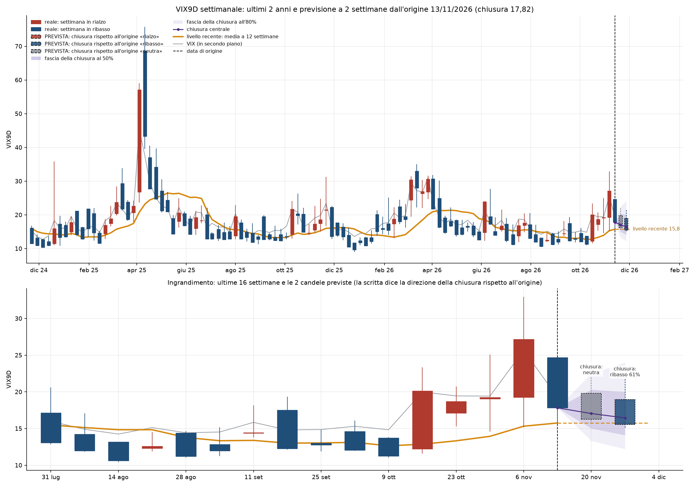
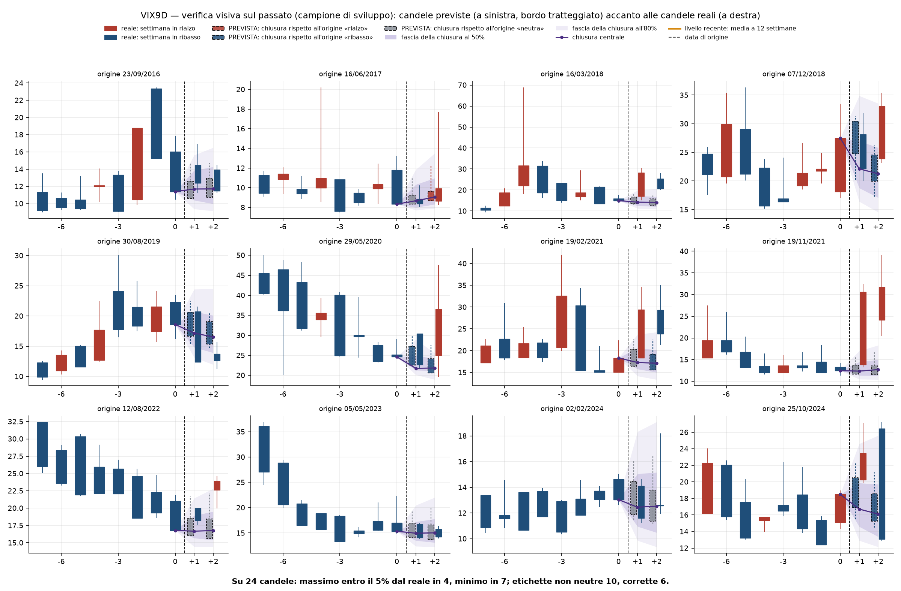

# Previsione del VIX9D settimanale — origine 13/11/2026

*Generato da `python -m src.vix9d.forecast`. Versione principale: **G1 solo storico del VIX9D**. Storia usata: 828 settimane complete dal 07/01/2011 al 13/11/2026
(678 con candela vera: prima di metà novembre 2013 il file Cboe ha solo le chiusure). Tutto ciò che segue usa solo dati fino all'origine;
la previsione si fa una sola volta, alla chiusura settimanale. Progetto universitario: non è un consiglio di investimento.*

## In sintesi

- Il VIX9D ha chiuso a 17,82 il 13/11/2026: percentile 69 della storia, 2,06 punti sopra il livello recente (15,76).
- Rispetto al VIX (19,30) è 1,48 punti sotto: rapporto 0,923, percentile 55 della sua storia.
- Settimana +1 (G1 solo storico del VIX9D): chiusura centrale 17,1, fascia all'80% tra 13,3 e 22,5; massimo previsto 22,1, minimo 15,7; direzione della chiusura rispetto all'origine: neutra.
- Settimana +2 (G1 solo storico del VIX9D): chiusura centrale 16,4, fascia all'80% tra 12,2 e 24,0; massimo previsto 21,8, minimo 15,1; direzione della chiusura rispetto all'origine: in ribasso (probabilità 61%).

## 1. Lettura della situazione

**Livello.** Chiusura 17,82: percentile 69 di tutta la storia (828 settimane dal 07/01/2011) e 62 degli ultimi 5 anni; quintile 4 su 5. Mediana storica 14,70; livello recente (media a 12 settimane) 15,76.

**Distanza dal VIX.** VIX 19,30: il VIX9D è 1,48 punti sotto (rapporto 0,923; mediana storica del rapporto 0,911; percentile del rapporto 55).

**Dinamica.** Variazione della chiusura: a 1 settimana −9,36 punti (−34,4%); a 4 settimane −2,30 punti (−11,4%); a 12 settimane +5,24 punti (+41,7%).

**Precedenti in situazioni simili** (stesso quintile di livello, 4, e stessa direzione a 4 settimane, «in calo»): 50 casi.

| dopo | quota con VIX9D più alto | variazione mediana (punti) | 10° – 90° percentile (punti) |
|---|---|---|---|
| 1 settimana | 42% | −0,83 | −3,99 – +5,95 |
| 2 settimane | 42% | −0,77 | −4,24 – +10,56 |

## 2. Previsione per le settimane +1 e +2 (G1 solo storico del VIX9D)

Valori in punti VIX9D. **Candele previste**: massimo e minimo sono previsti direttamente e comandano la candela; il corpo è quello di una settimana media, tagliato dentro l'intervallo;
il colore segue la direzione della chiusura rispetto all'origine («neutra» tra 40% e 60%).

|   settimana | data       | apertura   | massimo   | minimo   | chiusura   | chiusura rispetto all'origine   | probabilità che chiuda sopra l'origine   | chiusura centrale   | massimo / minimo entro il 5% nel passato   |
|------------:|:-----------|:-----------|:----------|:---------|:-----------|:--------------------------------|:-----------------------------------------|:--------------------|:-------------------------------------------|
|          +1 | 20/11/2026 | 19,80      | 22,06     | 15,66    | 16,25      | neutra                          | 40%                                      | 17,05               | 25% / 30%                                  |
|          +2 | 27/11/2026 | 18,94      | 21,77     | 15,11    | 15,55      | ribasso 61%                     | 39%                                      | 16,45               | 17% / 25%                                  |

**Chiusura centrale, fasce e probabilità.** Tra parentesi la copertura misurata nel walk-forward di sviluppo (425 previsioni a 1 settimana).

|   settimana | chiusura centrale   | fascia 50% (copertura misurata)   | fascia 80% (copertura misurata)   | fascia 90% (copertura misurata)   | P(VIX9D > 20)   | P(VIX9D > 25)   | P(VIX9D > 30)   | errore medio storico della chiusura centrale   |
|------------:|:--------------------|:----------------------------------|:----------------------------------|:----------------------------------|:----------------|:----------------|:----------------|:-----------------------------------------------|
|          +1 | 17,05               | 15,0 – 20,3 (50%)                 | 13,3 – 22,5 (81%)                 | 12,6 – 24,1 (90%)                 | 23,7%           | 7,7%            | 3,4%            | 3,1                                            |
|          +2 | 16,45               | 14,1 – 20,0 (49%)                 | 12,2 – 24,0 (79%)                 | 11,7 – 26,4 (89%)                 | 26,3%           | 10,3%           | 4,8%            | 3,8                                            |

- Etichetta della direzione nel walk-forward di sviluppo: non neutra nel 42% dei casi a 1 settimana (corretta nel 69%) e nel 58% a 2 (corretta nel 70%).
- Le date sono indicative (origine + 7 giorni per settimana).

## 3. Confronto tra le versioni

|   settimana | versione                  | chiusura centrale   | fascia 80%   | massimo   | minimo   | chiusura rispetto all'origine   | probabilità che chiuda sopra l'origine   |
|------------:|:--------------------------|:--------------------|:-------------|:----------|:---------|:--------------------------------|:-----------------------------------------|
|          +1 | G1 solo storico del VIX9D | 17,05               | 13,3 – 22,5  | 22,06     | 15,66    | neutra                          | 40%                                      |
|          +1 | GS con il VIX             | 17,23               | 13,5 – 23,2  | 22,06     | 15,66    | neutra                          | 40%                                      |
|          +2 | G1 solo storico del VIX9D | 16,45               | 12,2 – 24,0  | 21,77     | 15,11    | ribasso 61%                     | 39%                                      |
|          +2 | GS con il VIX             | 16,53               | 12,3 – 24,1  | 21,77     | 14,73    | neutra                          | 41%                                      |

Le versioni sono congelate (`versioni/vix9d/g1.json`, `versioni/vix9d/gs.json`); l'esame sull'holdout è descritto in `reports/vix9d/piano_esame_holdout.md` e non è stato eseguito.

## 4. Grafico

- **Candele piene dal bordo continuo** = settimane reali. **Candele dal bordo tratteggiato** = le due settimane previste: rosse se la chiusura è prevista sopra quella dell'origine, blu se sotto, grigie se «neutra».
- **Fasce sullo sfondo** = incertezza sulla chiusura (50% più scura, 80% più chiara). **Linea viola** = chiusura centrale. **Linea arancione** = livello recente (media a 12 settimane). **Linea grigia** = VIX, in secondo piano.
- L'apertura ufficiale del VIX9D è di norma molto più alta della chiusura precedente (mediana storica: +11,1%) e la settimana chiude sotto la propria apertura nel 73% dei casi: per questo il corpo è disegnato verso il basso. Il colore indica la direzione della chiusura rispetto all'origine, non il verso del corpo.

## 5. Verifica visiva sul passato

12 origini equidistanti tra le origini comuni del periodo di valutazione (posizioni round(k x (n - 1) / 11)), tutte nel campione di sviluppo, versione G1. Su 24 candele: massimo entro il 5% dal reale in 4, minimo in 7; etichette non neutre 10, corrette 6. Dodici origini sono poche: servono a vedere come si comporta la previsione, non a misurarla.

## 6. Avvertenze

- **Il VIX9D si muove molto più del VIX.** Nel walk-forward di sviluppo il massimo previsto della settimana +1 è stato entro il 5% da quello reale nel 25% dei casi e il minimo nel 30%; a 2 settimane 17% e 25%.
- L'errore medio della chiusura centrale è stato 3,1 punti a 1 settimana e 3,8 a 2. Il modello non anticipa i picchi.
- Il corpo viene tagliato dagli estremi nel 55% dei casi (misura di sviluppo, settimana +1): la chiusura della candela non è la previsione centrale, che è la linea viola.
- Ogni esecuzione senza `--origine` scrive le versioni calcolate in `reports/vix9d/registro_previsioni.csv`; `python -m src.vix9d.forecast --verifica` confronta il registro con le settimane completate.
